# UPTASK (SANTITASK): DOCUMENTACIÓN DEL PROYECTO

> Documento elaborado a partir del código recibido en `uptask.zip`. Lo descrito coincide con lo que el código hace.  
> Los campos marcados como **[Completar]** son datos que solo conoce el autor (nombres, institución, fechas reales, capturas).  
> Los diagramas están en Mermaid: se ven en GitHub, VS Code (extensión Markdown Preview Mermaid Support), Obsidian y Typora.

### Alcance de la revisión

| Revisado                                                                                         | No recibido (no se documenta su contenido)                                    |
| ------------------------------------------------------------------------------------------------ | ----------------------------------------------------------------------------- |
| `Router.php`, `public/index.php`, `includes/`, `controllers/`, `models/`, `classes/`             | `.env` (se deducen las variables por el código)                               |
| `views/`, `src/js/`, `src/scss/`                                                                 | `public/` salvo `index.php` (imágenes, `build/`)                              |
| `uptask.sql`, `docker-compose.yml`, `docker/`, `composer.json`, `package.json`, `vite.config.js` | `gulpfile.js/`, `vite-plugins/scss-auto-index.js`, `vendor/`, `node_modules/` |

---

# PORTADA

| Campo                     | Contenido                                            |
| ------------------------- | ---------------------------------------------------- |
| **Título**                | UpTask (SantiTask): gestor web de proyectos y tareas |
| **Autor / Equipo**        | [Completar]                                          |
| **Institución**           | [Completar]                                          |
| **Fecha**                 | 02/11/2026                                           |
| **Versión del documento** | 1.0                                                  |
| **Versión del sistema**   | 1.0.0 (según `package.json`)                         |

## Control de versiones

| Versión | Fecha      | Autor       | Cambios                                            |
| ------- | ---------- | ----------- | -------------------------------------------------- |
| 1.0     | 02/11/2026 | [Completar] | Primera documentación completa a partir del código |

---

# ÍNDICE

2. [Información general](https://claude.ai/chat/3f03764c-d8c1-4af9-890f-3d6a194edbd0#1-informaci%C3%B3n-general)
4. [Planteamiento](https://claude.ai/chat/3f03764c-d8c1-4af9-890f-3d6a194edbd0#2-planteamiento)
6. [Requisitos](https://claude.ai/chat/3f03764c-d8c1-4af9-890f-3d6a194edbd0#3-requisitos)
8. [Análisis y diseño](https://claude.ai/chat/3f03764c-d8c1-4af9-890f-3d6a194edbd0#4-an%C3%A1lisis-y-dise%C3%B1o)
10. [Gestión del proyecto](https://claude.ai/chat/3f03764c-d8c1-4af9-890f-3d6a194edbd0#5-gesti%C3%B3n-del-proyecto)
12. [Implementación](https://claude.ai/chat/3f03764c-d8c1-4af9-890f-3d6a194edbd0#6-implementaci%C3%B3n)
14. [Calidad](https://claude.ai/chat/3f03764c-d8c1-4af9-890f-3d6a194edbd0#7-calidad)
16. [Entrega y uso](https://claude.ai/chat/3f03764c-d8c1-4af9-890f-3d6a194edbd0#8-entrega-y-uso)
18. [Cierre](https://claude.ai/chat/3f03764c-d8c1-4af9-890f-3d6a194edbd0#9-cierre)
20. [Plan de corrección y endurecimiento](https://claude.ai/chat/3f03764c-d8c1-4af9-890f-3d6a194edbd0#10-plan-de-correcci%C3%B3n-y-endurecimiento)
22. [Matriz de trazabilidad](https://claude.ai/chat/3f03764c-d8c1-4af9-890f-3d6a194edbd0#11-matriz-de-trazabilidad)
24. [Lista de figuras](https://claude.ai/chat/3f03764c-d8c1-4af9-890f-3d6a194edbd0#12-lista-de-figuras)

---

# 1. Información general

## 1.1 Resumen

UpTask (rotulada «SantiTask» en la pantalla de acceso) es una aplicación web que permite a cada usuario crear una cuenta, confirmarla por correo y administrar sus propios proyectos con una lista de tareas. Dentro de un proyecto, el usuario añade tareas, edita su nombre, las marca como pendientes o completas, las elimina y las filtra por estado, todo sin recargar la página gracias a una API en JSON. Está hecha con PHP (patrón MVC con Active Record propio), MySQL, JavaScript puro y SCSS compilado con Vite, y se ejecuta con Docker. Cada proyecto tiene una URL única y solo su propietario puede verlo.

## 1.2 Introducción

- **Contexto:** organizar trabajos en proyectos con listas de tareas es una necesidad común en estudiantes y equipos pequeños.
- **Problema:** sin una herramienta propia, las tareas se dispersan en notas y chats, y no hay un estado claro de lo pendiente y lo completado.
- **Beneficiarios:** personas que quieren llevar sus proyectos de forma privada y simple.

## 1.3 Glosario

| Término             | Definición                                                                                                                                |
| ------------------- | ----------------------------------------------------------------------------------------------------------------------------------------- |
| MVC                 | Patrón que separa Modelos (datos), Vistas (HTML) y Controladores (lógica).                                                                |
| Active Record       | Patrón donde cada modelo representa una tabla y sabe guardarse (`guardar()`, `eliminar()`). Aquí lo implementa `models/ActiveRecord.php`. |
| Router              | Clase `MVC\Router` que asocia cada URL con un método de un controlador.                                                                   |
| Controlador frontal | `public/index.php`: único punto de entrada; Apache redirige todas las peticiones a él.                                                    |
| Token               | Texto temporal guardado en `usuarios.token` para confirmar la cuenta o restablecer la contraseña.                                         |
| URL del proyecto    | Identificador público del proyecto (`proyectos.url`), generado con `md5(uniqid())`.                                                       |
| Estado de tarea     | `0` = Pendiente, `1` = Completa.                                                                                                          |
| Vite                | Herramienta que compila SCSS y JavaScript y sirve los recursos en desarrollo.                                                             |
| API                 | Rutas `/api/...` que devuelven JSON y son usadas por `tareas.js`.                                                                         |

---

# 2. Planteamiento

## 2.1 Objetivos

**Objetivo general:** ofrecer una aplicación web donde cada usuario gestione de forma privada sus proyectos y las tareas de cada uno.

| N.º | Objetivo específico                              | Indicador de logro                                                 |
| --- | ------------------------------------------------ | ------------------------------------------------------------------ |
| OE1 | Registro de usuarios con confirmación por correo | Solo las cuentas con `confirmado = 1` pueden iniciar sesión        |
| OE2 | Proyectos privados por usuario                   | Un proyecto solo se abre si `propietarioId` coincide con la sesión |
| OE3 | Gestión de tareas sin recargar la página         | Crear, editar, cambiar estado y eliminar usando `fetch` y JSON     |
| OE4 | Recuperación de acceso                           | El usuario restablece su contraseña con un enlace con token        |
| OE5 | Entorno reproducible                             | La aplicación se levanta con `docker compose up`                   |

## 2.2 Alcance y límites

| Incluye                                                              | No incluye                                             |
| -------------------------------------------------------------------- | ------------------------------------------------------ |
| Registro, confirmación, login, logout y recuperación de contraseña   | Editar o eliminar proyectos                            |
| Perfil y cambio de contraseña                                        | Compartir proyectos o colaboradores                    |
| Proyectos y tareas (crear, editar nombre, estado, eliminar, filtrar) | Fechas límite, prioridades o etiquetas en tareas       |
| Diseño adaptable a móvil y modo oscuro                               | Notificaciones                                         |
| Despliegue con Docker                                                | Roles de administrador                                 |
|                                                                      | Pruebas automáticas (no hay en los archivos recibidos) |
|                                                                      | HTTPS configurado                                      |

## 2.3 Justificación

Una herramienta propia, sencilla y con datos privados por usuario permite llevar el control de tareas sin depender de servicios externos, y sirve como base para crecer con más funciones.

## 2.4 Usuarios y actores

| Actor                            | Descripción                               | Qué hace                                                                      |
| -------------------------------- | ----------------------------------------- | ----------------------------------------------------------------------------- |
| Visitante                        | Persona sin sesión                        | Crea cuenta, confirma su cuenta, inicia sesión, solicita recuperar contraseña |
| Usuario autenticado              | Persona con sesión (`$_SESSION['login']`) | Gestiona proyectos, tareas, perfil y contraseña                               |
| Servidor SMTP (actor secundario) | Servicio de correo externo                | Entrega los correos de confirmación y recuperación                            |

No existen roles distintos entre usuarios: todos tienen las mismas capacidades sobre sus propios datos.

---

# 3. Requisitos

## 3.1 Requisitos funcionales

| ID    | Requisito                                                               | Prioridad | Dónde se implementa                                       |
| ----- | ----------------------------------------------------------------------- | --------- | --------------------------------------------------------- |
| RF-01 | Registrar cuenta con nombre, email, contraseña (mín. 6) y repetición    | Alta      | `LoginController::crear`, `Usuario::validarNuevaCuenta`   |
| RF-02 | Confirmar la cuenta mediante enlace con token enviado por correo        | Alta      | `LoginController::confirmar`, `Email::enviarConfirmacion` |
| RF-03 | Iniciar sesión con email y contraseña (solo cuentas confirmadas)        | Alta      | `LoginController::login`                                  |
| RF-04 | Cerrar sesión                                                           | Alta      | `LoginController::logout`                                 |
| RF-05 | Recuperar contraseña: solicitar enlace y definir una nueva              | Media     | `LoginController::olvide`, `reestablecer`                 |
| RF-06 | Listar los proyectos del usuario                                        | Alta      | `DashboardController::index`                              |
| RF-07 | Crear proyecto con nombre obligatorio y URL única                       | Alta      | `DashboardController::crear_proyecto`                     |
| RF-08 | Abrir un proyecto (solo su propietario)                                 | Alta      | `DashboardController::proyecto`                           |
| RF-09 | Editar perfil (nombre y email, email único)                             | Media     | `DashboardController::perfil`                             |
| RF-10 | Cambiar contraseña verificando la actual                                | Media     | `DashboardController::cambiar_password`                   |
| RF-11 | Listar las tareas de un proyecto en JSON                                | Alta      | `TareaController::index`                                  |
| RF-12 | Crear tarea desde un modal                                              | Alta      | `TareaController::crear`, `tareas.js`                     |
| RF-13 | Editar el nombre de una tarea (doble clic en el nombre)                 | Media     | `TareaController::actualizar`                             |
| RF-14 | Cambiar el estado Pendiente/Completa (doble clic en el botón de estado) | Alta      | `TareaController::actualizar`                             |
| RF-15 | Eliminar tarea con confirmación (doble clic en Eliminar)                | Media     | `TareaController::eliminar`, SweetAlert2                  |
| RF-16 | Filtrar tareas por Todas, Completadas, Pendientes                       | Media     | `tareas.js::filtrarTareas`                                |
| RF-17 | Menú lateral desplegable en móvil                                       | Baja      | `src/js/app.js`                                           |

## 3.2 Requisitos no funcionales

| ID     | Categoría      | Requisito                               | Cómo se cumple en el código                                                          |
| ------ | -------------- | --------------------------------------- | ------------------------------------------------------------------------------------ |
| RNF-01 | Seguridad      | Contraseñas almacenadas con hash        | `Usuario::hashPassword` usa `password_hash` con `PASSWORD_BCRYPT`                    |
| RNF-02 | Seguridad      | Acceso restringido a la zona privada    | `isAuth()` y comparación `propietarioId` con `$_SESSION['id']` (con fallas, ver 7.3) |
| RNF-03 | Seguridad      | Escapar datos al escribir en la BD      | `ActiveRecord::sanitizarAtributos` usa `escape_string` (solo en escritura)           |
| RNF-04 | Integridad     | Borrado en cascada                      | Claves foráneas `ON DELETE CASCADE` en `proyectos` y `tareas`                        |
| RNF-05 | Portabilidad   | Entorno reproducible                    | `docker-compose.yml` con PHP/Apache y MySQL                                          |
| RNF-06 | Configuración  | Secretos fuera del código               | Variables en `.env` leídas con `vlucas/phpdotenv`                                    |
| RNF-07 | Compatibilidad | Móvil, tableta y escritorio             | Mixins con puntos de quiebre 480, 768 y 1024 px                                      |
| RNF-08 | Usabilidad     | Modo oscuro automático                  | `@media (prefers-color-scheme: dark)` en `_darkmode.scss`                            |
| RNF-09 | Usabilidad     | Retroalimentación al usuario            | Alertas en vistas y SweetAlert2 en tareas                                            |
| RNF-10 | Mantenibilidad | Código organizado por responsabilidades | MVC, autoload PSR-4 en `composer.json`                                               |
| RNF-11 | Rendimiento    | Evitar recargas al trabajar con tareas  | Una carga inicial y actualización en memoria del arreglo `tareas`                    |

## 3.3 Restricciones y supuestos

| Tipo        | Descripción                                                                                         |
| ----------- | --------------------------------------------------------------------------------------------------- |
| Restricción | Requiere PHP con `mysqli`, MySQL 8 y un servidor SMTP                                               |
| Restricción | Los recursos (CSS/JS) se sirven con Vite en desarrollo y compilados en `public/build` en producción |
| Restricción | SweetAlert2 y las fuentes se cargan desde CDN (necesita internet)                                   |
| Supuesto    | El servidor SMTP está configurado en `.env`                                                         |
| Supuesto    | La contraseña de MySQL de `docker-compose.yml` es solo para desarrollo                              |

---

# 4. Análisis y diseño

## 4.1 Casos de uso

**Figura 1. Diagrama de casos de uso.**

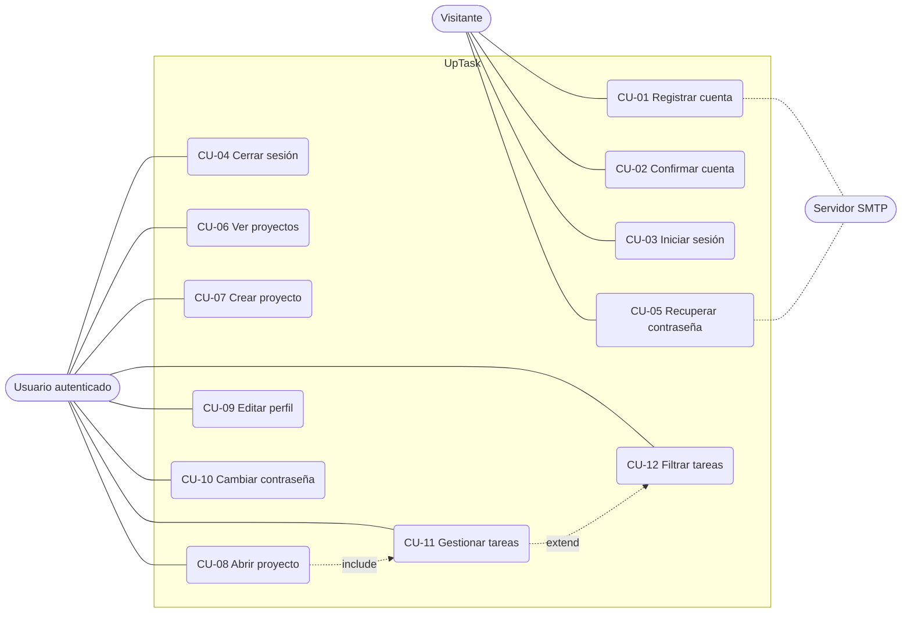

*Leyenda: óvalo = caso de uso; forma redondeada exterior = actor; línea punteada = relación con el servidor de correo o entre casos.*

### Ficha CU-01: Registrar cuenta

| Campo               | Contenido                                                                                                                                                                                                                                                                 |
| ------------------- | ------------------------------------------------------------------------------------------------------------------------------------------------------------------------------------------------------------------------------------------------------------------------- |
| **ID / Nombre**     | CU-01 Registrar cuenta                                                                                                                                                                                                                                                    |
| **Actor**           | Visitante (actor secundario: servidor SMTP)                                                                                                                                                                                                                               |
| **Requisito**       | RF-01                                                                                                                                                                                                                                                                     |
| **Precondiciones**  | El visitante está en `/crear`                                                                                                                                                                                                                                             |
| **Postcondiciones** | Se crea un usuario con `confirmado = 0`, contraseña con hash y un token; se envía el correo de confirmación; se redirige a `/mensaje`                                                                                                                                     |
| **Flujo principal** | 1. Completa nombre, email, contraseña y repetición. 2. El sistema valida los campos. 3. Comprueba que el email no exista. 4. Aplica el hash a la contraseña. 5. Genera el token. 6. Guarda el usuario. 7. Envía el correo. 8. Muestra «Hemos enviado las instrucciones…». |
| **Flujos alternos** | 2a. Campo vacío, contraseña menor de 6 o contraseñas distintas: alerta de error. 3a. Email ya registrado: «El usuario ya esta registrado».                                                                                                                                |

### Ficha CU-03: Iniciar sesión

| Campo               | Contenido                                                                                                                                                                                  |
| ------------------- | ------------------------------------------------------------------------------------------------------------------------------------------------------------------------------------------ |
| **ID / Nombre**     | CU-03 Iniciar sesión                                                                                                                                                                       |
| **Actor**           | Visitante                                                                                                                                                                                  |
| **Requisito**       | RF-03                                                                                                                                                                                      |
| **Precondiciones**  | La cuenta existe y está confirmada                                                                                                                                                         |
| **Postcondiciones** | Se crea la sesión con `id`, `nombre`, `email` y `login = true`; se redirige a `/dashboard`                                                                                                 |
| **Flujo principal** | 1. Escribe email y contraseña. 2. El sistema valida el formato. 3. Busca el usuario por email. 4. Verifica `confirmado`. 5. Compara con `password_verify`. 6. Inicia la sesión y redirige. |
| **Flujos alternos** | 2a. Email o contraseña vacíos, o email inválido. 4a. Usuario inexistente o sin confirmar: «El Usuario no existe o no esta confirmado». 5a. «Password incorrecto».                          |

### Ficha CU-05: Recuperar contraseña

| Campo               | Contenido                                                                                                                                                                                                                                                                    |
| ------------------- | ---------------------------------------------------------------------------------------------------------------------------------------------------------------------------------------------------------------------------------------------------------------------------- |
| **ID / Nombre**     | CU-05 Recuperar contraseña                                                                                                                                                                                                                                                   |
| **Actor**           | Visitante (actor secundario: servidor SMTP)                                                                                                                                                                                                                                  |
| **Requisito**       | RF-05                                                                                                                                                                                                                                                                        |
| **Precondiciones**  | La cuenta existe y está confirmada                                                                                                                                                                                                                                           |
| **Postcondiciones** | Se genera un token y se envía el enlace; al usar el enlace se guarda la nueva contraseña con hash y el token queda en `null`                                                                                                                                                 |
| **Flujo principal** | 1. En `/olvide` escribe su email. 2. El sistema genera un token y lo guarda. 3. Envía el correo con el enlace `/reestablecer?token=...`. 4. El usuario abre el enlace y escribe la nueva contraseña (mín. 6). 5. El sistema guarda el hash, borra el token y redirige a `/`. |
| **Flujos alternos** | 1a. Email inválido o cuenta inexistente o sin confirmar: alerta de error. 4a. Token no válido: «Token no valido» y no se muestra el formulario.                                                                                                                              |

### Ficha CU-11: Gestionar tareas (cambiar estado)

| Campo                                | Contenido                                                                                                                                                                                                                                                                     |
| ------------------------------------ | ----------------------------------------------------------------------------------------------------------------------------------------------------------------------------------------------------------------------------------------------------------------------------- |
| **ID / Nombre**                      | CU-11 Gestionar tareas                                                                                                                                                                                                                                                        |
| **Actor**                            | Usuario autenticado                                                                                                                                                                                                                                                           |
| **Requisitos**                       | RF-12, RF-13, RF-14, RF-15                                                                                                                                                                                                                                                    |
| **Precondiciones**                   | El usuario es propietario del proyecto abierto                                                                                                                                                                                                                                |
| **Postcondiciones**                  | La tarea se crea, se modifica o se elimina en la tabla `tareas`; la lista en pantalla se actualiza                                                                                                                                                                            |
| **Flujo principal (cambiar estado)** | 1. Hace doble clic en el botón de estado de una tarea. 2. `tareas.js` invierte el estado (`0`/`1`). 3. Envía `POST /api/tarea/actualizar`. 4. El servidor verifica que el proyecto sea del usuario. 5. Guarda el cambio. 6. El cliente actualiza la lista y muestra un aviso. |
| **Flujos alternos**                  | 4a. El proyecto no existe o no es del usuario: JSON con `tipo = error`. En crear, el nombre vacío se bloquea solo en el cliente. En eliminar, aparece una confirmación de SweetAlert2.                                                                                        |

## 4.2 Diagrama de flujo (proceso de negocio)

**Figura 2. Flujo general de uso del sistema.**

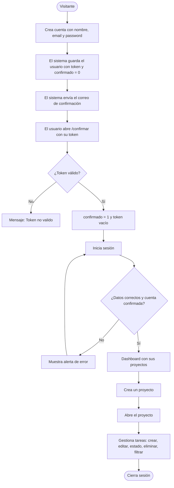

## 4.3 Diagramas de estados

**Figura 3. Estados de una cuenta de usuario.**

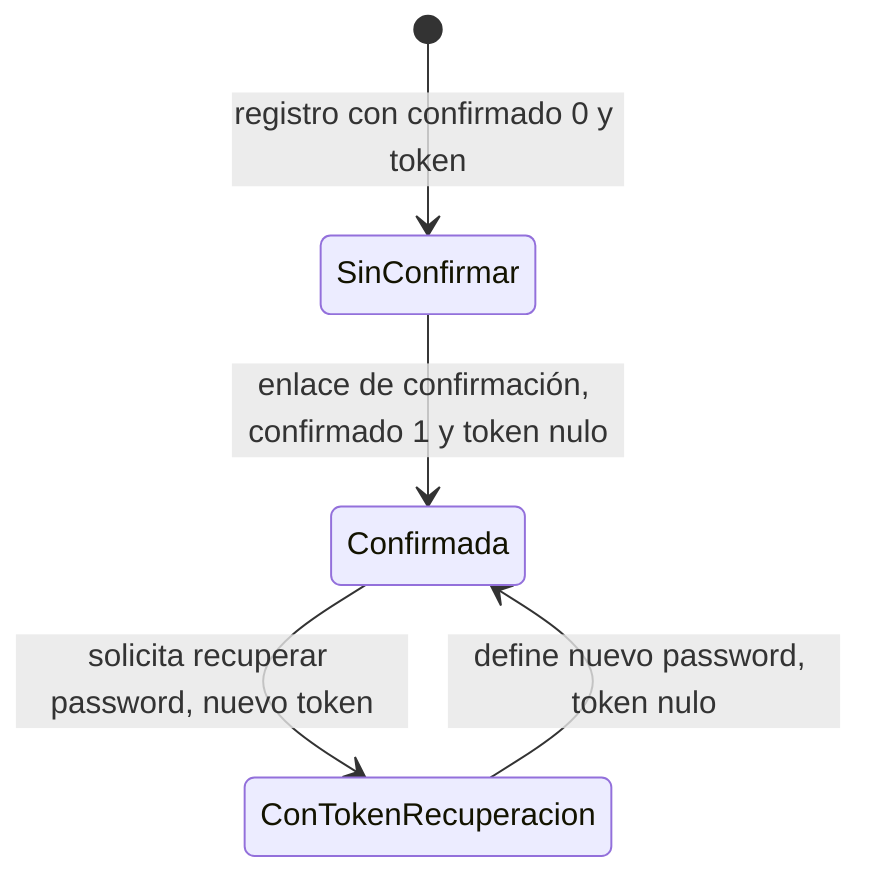

**Figura 4. Estados de una tarea.**

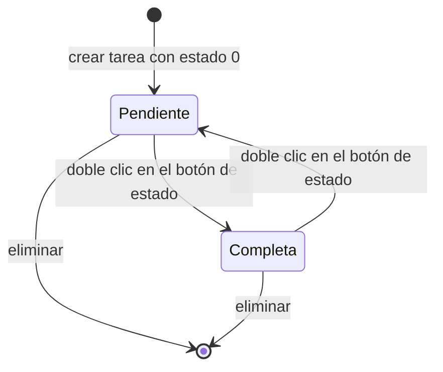

## 4.4 Modelo de datos

**Figura 5. Diagrama entidad-relación (tomado de `uptask.sql`).**

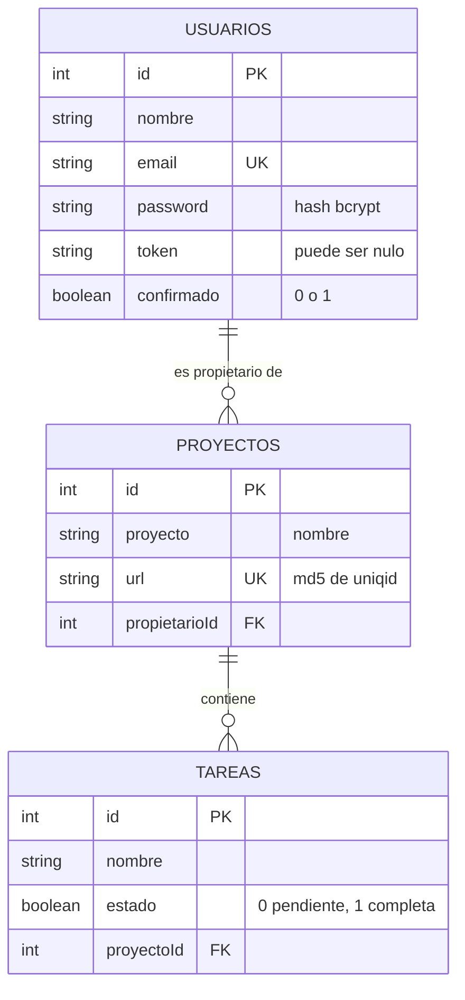

*Leyenda: PK = clave primaria, FK = clave foránea, UK = valor único. Las claves foráneas usan `ON DELETE CASCADE`: al borrar un usuario se borran sus proyectos y las tareas de estos.*

### Diccionario de datos

**Tabla `usuarios`**

| Campo      | Tipo SQL     | Nulo | Restricción         | Descripción                          |
| ---------- | ------------ | ---- | ------------------- | ------------------------------------ |
| id         | int unsigned | No   | PK, autoincremental | Identificador                        |
| nombre     | varchar(255) | No   | -                   | Nombre visible                       |
| email      | varchar(255) | No   | UNIQUE              | Usuario de acceso                    |
| password   | varchar(255) | No   | -                   | Hash bcrypt                          |
| token      | varchar(255) | Sí   | Por defecto NULL    | Token de confirmación o recuperación |
| confirmado | tinyint(1)   | No   | Por defecto 0       | 1 si la cuenta fue confirmada        |

**Tabla `proyectos`**

| Campo         | Tipo SQL     | Nulo | Restricción                           | Descripción                            |
| ------------- | ------------ | ---- | ------------------------------------- | -------------------------------------- |
| id            | int unsigned | No   | PK, autoincremental                   | Identificador interno                  |
| proyecto      | varchar(255) | No   | -                                     | Nombre del proyecto                    |
| url           | varchar(255) | No   | UNIQUE                                | Identificador usado en `/proyecto?id=` |
| propietarioId | int unsigned | No   | FK → `usuarios.id`, ON DELETE CASCADE | Dueño del proyecto                     |

**Tabla `tareas`**

| Campo      | Tipo SQL     | Nulo | Restricción                            | Descripción               |
| ---------- | ------------ | ---- | -------------------------------------- | ------------------------- |
| id         | int unsigned | No   | PK, autoincremental                    | Identificador             |
| nombre     | varchar(255) | No   | -                                      | Texto de la tarea         |
| estado     | tinyint(1)   | No   | Por defecto 0                          | 0 pendiente, 1 completa   |
| proyectoId | int unsigned | No   | FK → `proyectos.id`, ON DELETE CASCADE | Proyecto al que pertenece |

*Charset: `utf8mb4` con colación `utf8mb4_unicode_ci`, motor InnoDB. El volcado no contiene datos.*

## 4.5 Diagramas de secuencia

**Figura 6. Registro de cuenta y confirmación.**

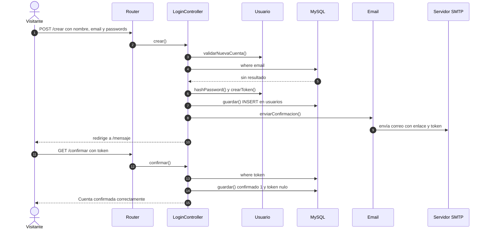

**Figura 7. Cambiar el estado de una tarea.**

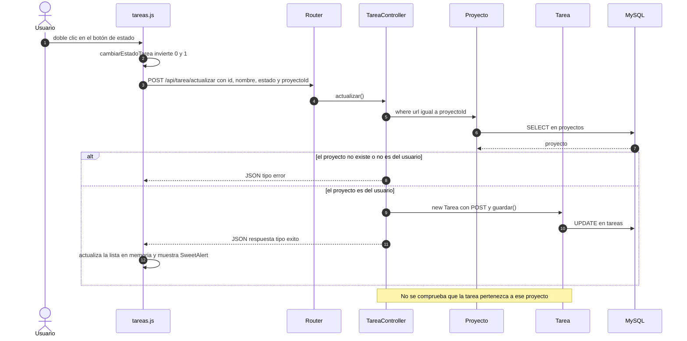

## 4.6 Diagrama de clases

**Figura 8. Clases del sistema (modelos, controladores, router y correo).**

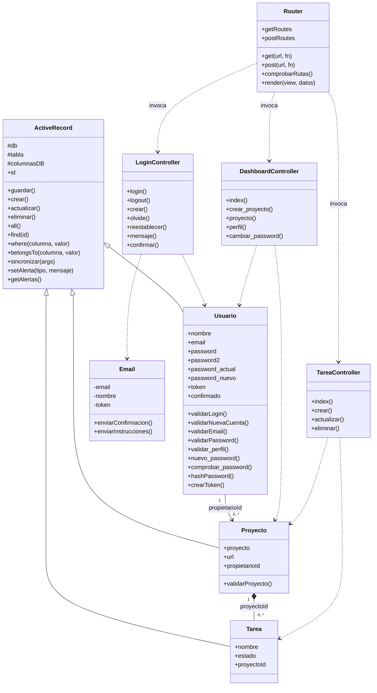

## 4.7 Arquitectura

**Figura 9. Arquitectura por capas.**

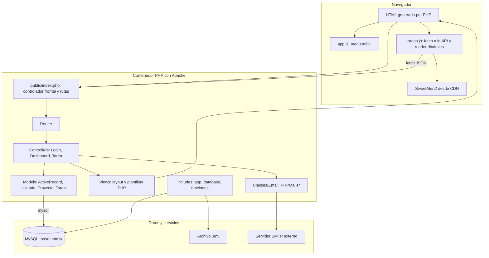

**Decisiones de arquitectura:**

| Decisión                                | Alternativa                        | Motivo                                              |
| --------------------------------------- | ---------------------------------- | --------------------------------------------------- |
| MVC propio con Router mínimo            | Framework (Laravel)                | Proyecto de aprendizaje, sin dependencias pesadas   |
| Active Record propio                    | ORM o PDO con consultas preparadas | Simplicidad; implica riesgos de seguridad (ver 7.3) |
| API JSON para tareas                    | Formularios con recarga            | Experiencia fluida sin recargar                     |
| Estado de tareas en memoria del cliente | Consultar tras cada acción         | Menos peticiones                                    |
| Vite + SCSS                             | CSS a mano o Gulp                  | Recarga en caliente y compilación de recursos       |
| Docker Compose                          | Instalación manual de PHP y MySQL  | Entorno reproducible                                |

### Rutas de la aplicación

| Método    | Ruta                    | Controlador y método                    | Acceso      | Descripción             |
| --------- | ----------------------- | --------------------------------------- | ----------- | ----------------------- |
| GET, POST | `/`                     | `LoginController::login`                | Público     | Iniciar sesión          |
| GET       | `/logout`               | `LoginController::logout`               | Sesión      | Cerrar sesión           |
| GET, POST | `/crear`                | `LoginController::crear`                | Público     | Registro                |
| GET, POST | `/olvide`               | `LoginController::olvide`               | Público     | Solicitar recuperación  |
| GET, POST | `/reestablecer`         | `LoginController::reestablecer`         | Con token   | Nueva contraseña        |
| GET       | `/mensaje`              | `LoginController::mensaje`              | Público     | Aviso de correo enviado |
| GET       | `/confirmar`            | `LoginController::confirmar`            | Con token   | Confirmar cuenta        |
| GET       | `/dashboard`            | `DashboardController::index`            | Sesión      | Lista de proyectos      |
| GET, POST | `/crear-proyecto`       | `DashboardController::crear_proyecto`   | Sesión      | Crear proyecto          |
| GET       | `/proyecto?id=`         | `DashboardController::proyecto`         | Propietario | Ver proyecto            |
| GET, POST | `/perfil`               | `DashboardController::perfil`           | Sesión      | Editar perfil           |
| GET, POST | `/cambiar-password`     | `DashboardController::cambiar_password` | Sesión      | Cambiar contraseña      |
| GET       | `/api/tareas?id=`       | `TareaController::index`                | Propietario | Listar tareas (JSON)    |
| POST      | `/api/tarea`            | `TareaController::crear`                | Propietario | Crear tarea             |
| POST      | `/api/tarea/actualizar` | `TareaController::actualizar`           | Propietario | Editar nombre o estado  |
| POST      | `/api/tarea/eliminar`   | `TareaController::eliminar`             | Propietario | Eliminar tarea          |

### Contrato de la API de tareas

| Endpoint                     | Parámetros                                   | Respuesta correcta                                   | Respuesta de error                             |
| ---------------------------- | -------------------------------------------- | ---------------------------------------------------- | ---------------------------------------------- |
| `GET /api/tareas`            | `id` (url del proyecto)                      | `{ "tareas": [ {id, nombre, estado, proyectoId} ] }` | Redirección sin `exit` (ver ERR-04)            |
| `POST /api/tarea`            | `nombre`, `proyectoId` (url)                 | `{ tipo: "exito", id, mensaje, proyectoId }`         | `{ tipo: "error", mensaje }`                   |
| `POST /api/tarea/actualizar` | `id`, `nombre`, `estado`, `proyectoId` (url) | `{ respuesta: { tipo, id, proyectoId, mensaje } }`   | `{ tipo: "error", mensaje }` (sin `respuesta`) |
| `POST /api/tarea/eliminar`   | `id`, `proyectoId` (url)                     | `{ resultado, mensaje, tipo, id, proyectoId }`       | `{ tipo: "error", mensaje }`                   |

## 4.8 Despliegue

**Figura 10. Diagrama de despliegue con Docker.**

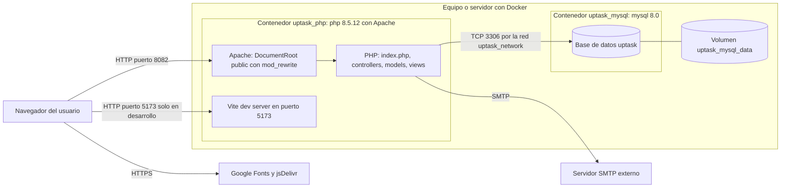

## 4.9 Diagrama de red

**Figura 11. Puertos y comunicaciones.**

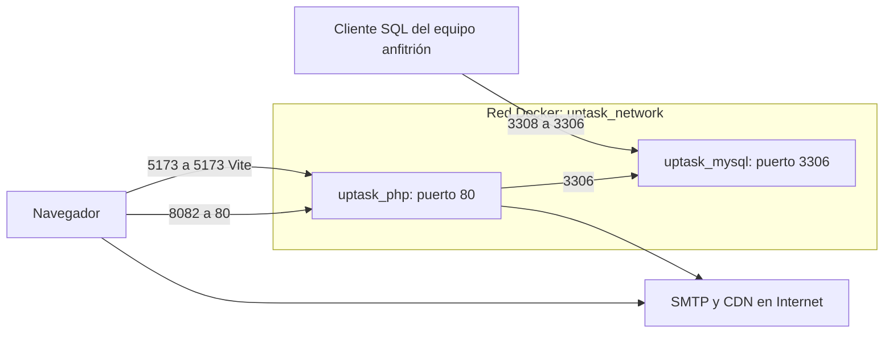

| Puerto del equipo | Contenedor            | Uso                                                   |
| ----------------- | --------------------- | ----------------------------------------------------- |
| 8082              | `uptask_php` (80)     | Aplicación web                                        |
| 5173              | `uptask_php` (5173)   | Servidor de desarrollo de Vite                        |
| 3308              | `uptask_mysql` (3306) | Acceso a la base de datos desde herramientas externas |

*No hay HTTPS configurado en esta composición.*

## 4.10 Diseño de interfaz

| Pantalla             | Ruta                   | Contenido                                                        |
| -------------------- | ---------------------- | ---------------------------------------------------------------- |
| Iniciar sesión       | `/`                    | Email, contraseña, enlaces a crear cuenta y olvidé               |
| Crear cuenta         | `/crear`               | Nombre, email, contraseña y repetición                           |
| Olvidé mi contraseña | `/olvide`              | Email                                                            |
| Reestablecer         | `/reestablecer?token=` | Nueva contraseña (solo si el token es válido)                    |
| Mensaje              | `/mensaje`             | Aviso de correo enviado                                          |
| Confirmar cuenta     | `/confirmar?token=`    | Resultado de la confirmación                                     |
| Proyectos            | `/dashboard`           | Barra lateral, lista de proyectos o aviso «No hay Proyectos aún» |
| Crear proyecto       | `/crear-proyecto`      | Nombre del proyecto                                              |
| Proyecto             | `/proyecto?id=`        | Botón «Nueva Tarea», filtros, lista de tareas                    |
| Modal de tarea       | (en `/proyecto`)       | Formulario para crear o editar el nombre                         |
| Perfil               | `/perfil`              | Nombre, email, enlace a cambiar contraseña                       |
| Cambiar contraseña   | `/cambiar-password`    | Contraseña actual y nueva                                        |

**Elementos comunes:** barra lateral con Proyectos, Crear Proyecto y Perfil; barra superior con el nombre del usuario y «Cerrar Sesión»; menú desplegable en móvil; modo oscuro automático.

> **[Completar]** Inserta capturas de cada pantalla: ``

---

# 5. Gestión del proyecto

## 5.1 Metodología

[Completar] (por ejemplo, Kanban o Scrum con sprints de 1 o 2 semanas).

## 5.2 Plan y cronograma

**Figura 13. Plan propuesto para corregir, probar y publicar.** Las fechas son una propuesta; ajústalas. El desarrollo ya realizado no incluye fechas porque no constan en los archivos.

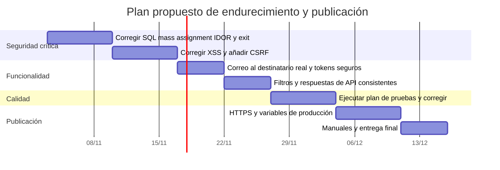

## 5.3 Roles y responsabilidades

| Integrante  | Rol                     | Responsabilidades         |
| ----------- | ----------------------- | ------------------------- |
| [Completar] | Desarrollo              | Backend, base de datos    |
| [Completar] | Frontend                | Vistas, SCSS, `tareas.js` |
| [Completar] | Calidad y documentación | Pruebas, manuales         |

## 5.4 Riesgos

| ID  | Riesgo                                                       | Probabilidad | Impacto | Mitigación                                                     |
| --- | ------------------------------------------------------------ | ------------ | ------- | -------------------------------------------------------------- |
| R1  | Uso malicioso por fallos de seguridad (ERR-01 a ERR-06)      | Alta         | Alto    | Aplicar el plan de la sección 10 antes de publicar             |
| R2  | Los correos no llegan al usuario (destinatario fijo, ERR-08) | Alta         | Alto    | Usar el email real del usuario y un proveedor SMTP             |
| R3  | Pérdida de datos si se borra el volumen de MySQL             | Media        | Alto    | Respaldos periódicos con `mysqldump`                           |
| R4  | Versiones de dependencias que cambien o no existan           | Media        | Medio   | Fijar versiones y verificar las etiquetas de imagen y paquetes |
| R5  | Un solo desarrollador conoce el sistema                      | Media        | Medio   | Mantener esta documentación actualizada                        |

## 5.5 Recursos y costos

| Recurso                               | Costo       |
| ------------------------------------- | ----------- |
| Desarrollo local con Docker           | 0 USD       |
| Servidor SMTP                         | [Completar] |
| Alojamiento y dominio (si se publica) | [Completar] |

---

# 6. Implementación

## 6.1 Tecnologías y herramientas

| Componente                | Tecnología                                                      | Versión (según los archivos)                |
| ------------------------- | --------------------------------------------------------------- | ------------------------------------------- |
| Lenguaje servidor         | PHP                                                             | 8.5.12 (imagen `php:8.5.12-apache`)         |
| Servidor web              | Apache con `mod_rewrite` y `mod_headers`                        | De la imagen                                |
| Base de datos             | MySQL                                                           | 8.0 (`mysql:8.0`; el volcado indica 8.0.46) |
| Acceso a datos            | `mysqli`                                                        | Extensión de PHP                            |
| Correo                    | `phpmailer/phpmailer`                                           | ^7.1                                        |
| Variables de entorno      | `vlucas/phpdotenv`                                              | ^5.6                                        |
| Empaquetado               | Vite                                                            | ^5.0.0                                      |
| Estilos                   | Sass (SCSS)                                                     | ^1.75.0                                     |
| Utilidades de compilación | `fast-glob`, `glob`, `vite-plugin-full-reload`, `gulp`, `sharp` | ^3.3.3, ^13.0.0, ^1.1.0, ^5.0.0, ^0.34.5    |
| Alertas en cliente        | SweetAlert2                                                     | 11 (CDN jsDelivr)                           |
| Fuentes                   | Inter y Open Sans                                               | Google Fonts                                |
| Contenedores              | Docker Compose                                                  | -                                           |

## 6.2 Estructura del código

```
uptask/
├── public/
│   └── index.php          # Controlador frontal: define todas las rutas
├── Router.php             # Clase MVC\Router (rutas y render de vistas)
├── controllers/
│   ├── LoginController.php
│   ├── DashboardController.php
│   └── TareaController.php
├── models/
│   ├── ActiveRecord.php   # Clase base con CRUD y consultas
│   ├── Usuario.php
│   ├── Proyecto.php
│   └── Tarea.php
├── classes/
│   └── Email.php          # Envío de correos con PHPMailer
├── includes/
│   ├── app.php            # Autoload, .env, funciones y conexión
│   ├── database.php       # Conexión mysqli con variables de entorno
│   └── funciones.php      # debuguear(), s(), isAuth(), vite_script()
├── views/
│   ├── layout.php         # Plantilla base
│   ├── auth/              # Pantallas de acceso
│   ├── dashboard/         # Pantallas de la zona privada
│   └── templates/         # Alertas, barra, sidebar, nombre del sitio
├── src/
│   ├── js/                # app.js y tareas.js
│   └── scss/              # base, componentes, auth, dashboard, dark
├── docker/                # Dockerfile y apache.conf
├── docker-compose.yml
├── uptask.sql             # Esquema de la base de datos
├── composer.json / package.json / vite.config.js
```

**Convenciones observadas:** espacios de nombres PSR-4 (`MVC`, `Controllers`, `Model`, `Classes`); métodos de controlador estáticos que reciben el `Router`; alertas en `Model\ActiveRecord` como arreglo estático `['error'|'exito'][]`; nombres de métodos en `camelCase` y `snake_case` mezclados (`crear_proyecto`, `validar_perfil`); textos de interfaz en español.

**Variables de entorno usadas por el código** (el archivo `.env` no fue recibido):

| Variable                                                   | Dónde se usa                  | Descripción                        |
| ---------------------------------------------------------- | ----------------------------- | ---------------------------------- |
| `DB_HOST`, `DB_USER`, `DB_PASS`, `DB_NAME`                 | `includes/database.php`       | Conexión MySQL                     |
| `MAIL_HOST`, `MAIL_PORT`, `MAIL_USERNAME`, `MAIL_PASSWORD` | `classes/Email.php`           | SMTP                               |
| `APP_URL`                                                  | `classes/Email.php`           | Base de los enlaces de los correos |
| `ENVIRONMENT`                                              | `layout.php`, `funciones.php` | `development` o `production`       |

## 6.3 Decisiones técnicas importantes

| N.º   | Decisión                                                      | Motivo                                                      |
| ----- | ------------------------------------------------------------- | ----------------------------------------------------------- |
| DT-01 | URL del proyecto con `md5(uniqid())` en lugar del id numérico | Evita exponer ids consecutivos                              |
| DT-02 | Confirmación de cuenta por token enviado por correo           | Verifica que el email pertenece al usuario                  |
| DT-03 | Las tareas se cargan con `fetch` y se pintan con JavaScript   | Evita recargar la página                                    |
| DT-04 | Cambio de estado, edición y borrado con doble clic            | Evita acciones accidentales con un solo clic                |
| DT-05 | `layout.php` y `vite_script()` cambian según `ENVIRONMENT`    | Usar Vite en desarrollo y archivos compilados en producción |
| DT-06 | Borrado en cascada en la base de datos                        | Mantener integridad al eliminar usuarios o proyectos        |

---

# 7. Calidad

## 7.1 Plan de pruebas

Las pruebas se diseñaron a partir del código. La columna «Resultado obtenido» queda vacía para llenarla al ejecutarlas. Las pruebas de seguridad describen el **comportamiento deseado**; si fallan, confirman el error indicado.

| ID    | Req.   | Caso                            | Pasos                                                                                                | Resultado esperado                                              | Resultado obtenido |
| ----- | ------ | ------------------------------- | ---------------------------------------------------------------------------------------------------- | --------------------------------------------------------------- | ------------------ |
| CP-01 | RF-01  | Registro válido                 | Completar `/crear` con datos correctos                                                               | Redirige a `/mensaje` y se crea el usuario con `confirmado = 0` |                    |
| CP-02 | RF-01  | Contraseñas distintas           | Escribir passwords diferentes                                                                        | Alerta «Los Passwords no son iguales»                           |                    |
| CP-03 | RF-01  | Email repetido                  | Registrar un email existente                                                                         | Alerta «El usuario ya esta registrado»                          |                    |
| CP-04 | RF-02  | Confirmar con token válido      | Abrir el enlace del correo                                                                           | Cuenta confirmada y token vacío                                 |                    |
| CP-05 | RF-02  | Confirmar con token falso       | Abrir `/confirmar?token=xxxx`                                                                        | Alerta «Token no valido»                                        |                    |
| CP-06 | RF-03  | Login con cuenta sin confirmar  | Iniciar sesión                                                                                       | Alerta de usuario no confirmado                                 |                    |
| CP-07 | RF-03  | Login correcto                  | Iniciar sesión con cuenta confirmada                                                                 | Redirige a `/dashboard`                                         |                    |
| CP-08 | RF-03  | Password incorrecto             | Escribir una clave errónea                                                                           | Alerta «Password incorrecto»                                    |                    |
| CP-09 | RF-05  | Recuperar contraseña            | Solicitar en `/olvide`, abrir enlace y guardar nueva clave                                           | Se puede iniciar sesión con la nueva clave                      |                    |
| CP-10 | RF-07  | Crear proyecto sin nombre       | Enviar el formulario vacío                                                                           | Alerta «El Nombre del Proyecto es Obligatorio»                  |                    |
| CP-11 | RF-07  | Crear proyecto válido           | Escribir un nombre                                                                                   | Redirige a `/proyecto?id=...`                                   |                    |
| CP-12 | RF-08  | Abrir proyecto ajeno            | Con el usuario B abrir la URL del proyecto de A                                                      | Redirige a `/dashboard` y no muestra datos de A                 |                    |
| CP-13 | RF-09  | Perfil con email de otra cuenta | Cambiar el email a uno existente                                                                     | Alerta «Email no válido…»                                       |                    |
| CP-14 | RF-10  | Cambiar contraseña              | Contraseña actual correcta y nueva de 6 o más                                                        | «Password Actualizado Correctamente»                            |                    |
| CP-15 | RF-12  | Crear tarea                     | Clic en Nueva Tarea y escribir un nombre                                                             | La tarea aparece como Pendiente                                 |                    |
| CP-16 | RF-14  | Cambiar estado                  | Doble clic en el botón de estado                                                                     | Cambia a Completa y se guarda al recargar                       |                    |
| CP-17 | RF-15  | Eliminar tarea                  | Doble clic en Eliminar y confirmar                                                                   | La tarea desaparece y no está al recargar                       |                    |
| CP-18 | RF-16  | Filtro tras cambiar estado      | Filtrar Pendientes, completar una y observar                                                         | La lista debe actualizarse (ver ERR-14)                         |                    |
| CP-19 | RNF-02 | Dashboard sin sesión            | Abrir `/dashboard` sin iniciar sesión                                                                | Redirige a `/` sin mostrar contenido                            |                    |
| CP-20 | RNF-02 | Editar tarea ajena              | Con el usuario B enviar `POST /api/tarea/actualizar` con su `proyectoId` y el `id` de una tarea de A | La petición debe rechazarse (ver ERR-03)                        |                    |
| CP-21 | RNF-03 | Inyección SQL                   | Abrir `/proyecto?id='`                                                                               | No debe producir error de SQL (ver ERR-01)                      |                    |
| CP-22 | RNF-03 | Nombre con HTML                 | Crear un proyecto llamado `<b>x</b>`                                                                 | Se muestra como texto, sin negrita (ver ERR-05)                 |                    |
| CP-23 | RNF-02 | Cambiar `id` en el perfil       | Enviar `POST /perfil` con `id` de otra cuenta                                                        | No debe modificar otra cuenta (ver ERR-02)                      |                    |
| CP-24 | RF-02  | Registro con `confirmado=1`     | Enviar `POST /crear` con el campo extra `confirmado=1`                                               | La cuenta debe quedar sin confirmar (ver ERR-02)                |                    |

## 7.2 Tipos de prueba

| Tipo           | Método                                                  | Estado      |
| -------------- | ------------------------------------------------------- | ----------- |
| Funcionales    | CP-01 a CP-18 a mano                                    | [Completar] |
| Seguridad      | CP-19 a CP-24 con el navegador y herramientas como curl | [Completar] |
| Usabilidad     | Probar con 2 o 3 usuarios                               | [Completar] |
| Compatibilidad | Chrome, Firefox, móvil                                  | [Completar] |
| Automáticas    | No se encontraron en los archivos recibidos             | Pendiente   |

## 7.3 Errores y limitaciones conocidos

Hallazgos obtenidos al leer el código. Se recomienda confirmarlos con las pruebas de la sección 7.1.

| ID     | Descripción                                                                                                                                                                                                                                                                                                      | Gravedad | Dónde                                                              |
| ------ | ---------------------------------------------------------------------------------------------------------------------------------------------------------------------------------------------------------------------------------------------------------------------------------------------------------------- | -------- | ------------------------------------------------------------------ |
| ERR-01 | **Inyección SQL:** `find`, `get`, `where` y `belongsTo` insertan el valor en la consulta sin escaparlo. Se llaman con datos del usuario, por ejemplo `Proyecto::where('url', $_GET['id'])` y `Proyecto::where('url', $_POST['proyectoId'])`                                                                      | Alta     | `ActiveRecord.php`, `DashboardController`, `TareaController`       |
| ERR-02 | **Asignación masiva:** `sincronizar($_POST)` copia cualquier campo enviado a propiedades como `id`, `password`, `token` o `confirmado`. En `perfil`, enviar otro `id` haría que `guardar()` actualice otra cuenta; en `crear`, enviar `confirmado=1` omitiría la confirmación por correo                         | Alta     | `Usuario`, `DashboardController::perfil`, `LoginController::crear` |
| ERR-03 | **Acceso a tareas ajenas:** `actualizar` y `eliminar` comprueban que el proyecto (por url) sea del usuario, pero no que la tarea con el `id` enviado pertenezca a ese proyecto. En `actualizar` incluso se reasigna la tarea al proyecto del atacante                                                            | Alta     | `TareaController.php`                                              |
| ERR-04 | **Falta `exit` tras `header('Location: ...')`:** el código sigue ejecutándose en `isAuth()`, `DashboardController::proyecto`, `TareaController::index` y otros. Puede mostrar contenido a quien debía ser redirigido (por ejemplo, el JSON de tareas de un proyecto ajeno si se conoce su url) o generar errores | Alta     | `funciones.php`, controladores                                     |
| ERR-05 | **XSS:** se imprimen sin escapar el nombre del proyecto (`$proyecto->proyecto`, `$titulo`), `$usuario->nombre` y `email` en los `value`, `$_SESSION['nombre']` y los mensajes de alerta. En `tareas.js`, el modal de edición inserta `tarea.nombre` con `innerHTML`. La función `s()` existe pero casi no se usa | Alta     | `views/`, `tareas.js`                                              |
| ERR-06 | **Sin protección CSRF** en formularios ni en las rutas POST de la API                                                                                                                                                                                                                                            | Media    | Global                                                             |
| ERR-07 | Tokens con `uniqid()` (predecible) y sin caducidad, usados para confirmar cuenta y recuperar contraseña                                                                                                                                                                                                          | Alta     | `Usuario::crearToken`                                              |
| ERR-08 | **Correo con destinatario fijo:** `addAddress('cuentas@uptask.com')`; el usuario real no recibe el mensaje (sirve solo con un buzón de pruebas)                                                                                                                                                                  | Alta     | `Email.php`                                                        |
| ERR-09 | Sesión: no se llama a `session_regenerate_id()` al iniciar sesión; `logout` vacía `$_SESSION` pero no usa `session_destroy()`; no hay ajustes de cookie                                                                                                                                                          | Media    | `LoginController`                                                  |
| ERR-10 | Con token inválido y un POST manual en `reestablecer` se produce un error fatal (`$usuario` vacío)                                                                                                                                                                                                               | Baja     | `LoginController::reestablecer`                                    |
| ERR-11 | El servidor no valida el nombre de la tarea (acepta vacío o muy largo); solo se valida en el cliente                                                                                                                                                                                                             | Media    | `TareaController::crear`                                           |
| ERR-12 | El `INSERT` de `ActiveRecord::crear` deja espacios dentro de las comillas (`VALUES (' ... ')`), que podrían guardarse al inicio del primer valor y al final del último. Verificar en la base de datos                                                                                                            | Baja     | `ActiveRecord.php`                                                 |
| ERR-13 | Los mensajes distintos de login y olvide permiten saber si un email está registrado                                                                                                                                                                                                                              | Baja     | `LoginController`                                                  |
| ERR-14 | Los filtros del cliente no se recalculan tras agregar, cambiar estado o eliminar: la lista filtrada puede quedar desactualizada                                                                                                                                                                                  | Media    | `tareas.js`                                                        |
| ERR-15 | La respuesta de error de `actualizar` no trae la clave `respuesta`, y el cliente lee `resultado.respuesta.tipo`, lo que lanza una excepción. Además, SweetAlert muestra el mismo texto como título y cuerpo                                                                                                      | Baja     | `TareaController`, `tareas.js`                                     |
| ERR-16 | `docker-compose.yml`: contraseña root `1234` en claro; se monta todo el proyecto (incluido `.env`) dentro del contenedor MySQL; `uptask.sql` queda en la subcarpeta `host/`, por lo que MySQL normalmente no lo importa solo (verificar)                                                                         | Media    | `docker-compose.yml`                                               |
| ERR-17 | No hay `.env.example` ni README; las variables solo se deducen del código                                                                                                                                                                                                                                        | Baja     | Raíz                                                               |
| ERR-18 | Marca inconsistente (UpTask, Uptask, SantiTask); el texto `Sopilote22` en `nombre-sitio.php` parece accidental y conviene revisarlo; `<html lang="en">` con contenido en español; `author` en `package.json` es «Tu nombre»                                                                                      | Baja     | `views/`, `package.json`                                           |
| ERR-19 | La CSP de Apache está pensada para desarrollo (`unsafe-inline`, `unsafe-eval`, `localhost:5173`)                                                                                                                                                                                                                 | Media    | `docker/apache.conf`                                               |
| ERR-20 | Las rutas inexistentes muestran texto plano, y se redirige a `/404`, que no existe                                                                                                                                                                                                                               | Baja     | `Router.php`, `TareaController`                                    |

## 7.4 Seguridad

| Aspecto       | Estado actual                                                          | Qué haría falta                                      |
| ------------- | ---------------------------------------------------------------------- | ---------------------------------------------------- |
| Contraseñas   | Hash bcrypt (correcto)                                                 | Mantener; subir el mínimo de 6 caracteres            |
| Autenticación | Solo cuentas confirmadas; sin límite de intentos                       | Limitar intentos y regenerar la sesión               |
| Autorización  | Se comprueba el propietario del proyecto, pero no de la tarea (ERR-03) | Verificar propiedad en cada recurso                  |
| Inyección SQL | Escape solo al escribir (ERR-01)                                       | Consultas preparadas o escape en todas               |
| XSS           | Casi sin escape de salida (ERR-05)                                     | Usar `s()` en todas las vistas y `textContent` en JS |
| CSRF          | Sin protección (ERR-06)                                                | Token CSRF por sesión                                |
| Tokens        | `uniqid()` sin caducidad (ERR-07)                                      | `random_bytes` con fecha de caducidad                |
| Sesión        | Sin regeneración ni destrucción (ERR-09)                               | `session_regenerate_id` y `session_destroy`          |
| Secretos      | En `.env`, pero `docker-compose.yml` tiene la clave root (ERR-16)      | Usar variables también en Compose                    |
| Transporte    | HTTP                                                                   | HTTPS en producción                                  |

---

# 8. Entrega y uso

## 8.1 Requisitos del entorno

| Elemento                 | Requisito                                                                 |
| ------------------------ | ------------------------------------------------------------------------- |
| Para ejecutar con Docker | Docker con Docker Compose v2 (`docker compose`)                           |
| Puertos libres           | 8082 (aplicación), 5173 (Vite, solo en desarrollo) y 3308 (MySQL, solo desde el propio equipo) |
| Navegador                | Chrome, Firefox, Edge o Safari actuales                                   |
| Internet                 | Descarga de imágenes y dependencias la primera vez; fuentes de Google en el navegador |
| Servidor de correo       | Cuenta SMTP **obligatoria**: sin correo de confirmación no se crea la cuenta de un tutor |

## 8.2 Guía de instalación y configuración

La guía paso a paso está en [`README.md`](README.md), sección 1 (así no se mantiene dos veces). Resumen:

1. `cp .env.example .env`; generar `DB_PASS` y `MYSQL_ROOT_PASSWORD` aleatorias; completar `MAIL_*` y `APP_URL`.
2. `docker compose up -d --build`. La primera vez MySQL importa `claudetask.sql` (carpeta `docker-entrypoint-initdb.d`) y crea el usuario de la aplicación con `docker/initdb/02-usuario.sh` (solo `SELECT`, `INSERT`, `UPDATE`, `DELETE` sobre `claudetask`). Esos scripts solo corren con el volumen vacío.
3. `docker exec -it claudetask_php npm run dev` (Vite, en desarrollo).
4. Abrir `http://localhost:8082`.

Para una base ya creada con `root`: `bash docker/crear-usuario-bd.sh`. Para producción: README, sección 7.

## 8.3 Manual de usuario

Hay dos roles. El manual completo está en [`README.md`](README.md): sección 2 (primer uso), 3 (tutor), 4 (tutelado) y 5 (contraseña olvidada y bloqueo). En una línea cada uno:

- **Tutor:** se registra con correo y confirma la cuenta; crea tutelados (la aplicación genera su alias), asigna tareas divididas en partes, y revisa lo que el alumno marca como hecho (aprobar, devolver con comentario o reabrir); puede editar, duplicar, ver el historial y eliminar tareas.
- **Tutelado:** entra con su alias y la contraseña que le dio su tutor; marca sus partes con «Ya lo hice» y ve las correcciones de su tutor. Si olvida la contraseña, su tutor la restablece.

## 8.4 Manual técnico y de mantenimiento

| Tarea                        | Cómo                                                                                                   |
| ---------------------------- | ------------------------------------------------------------------------------------------------------ |
| Agregar una ruta             | Registrar `$router->get/post(...)` en `public/index.php` y crear el método del controlador              |
| Agregar una vista            | Crear el archivo en `views/` y llamar `$router->render('carpeta/vista', [...])`                         |
| Agregar un modelo            | Crear la clase en `models/` que extienda `ActiveRecord` con `$tabla` y `$columnasDB`                    |
| Respaldo de la base          | `bash docker/respaldo.sh` (guarda `respaldos/claudetask-<fecha>.sql`, permisos 600)                     |
| Restaurar un respaldo        | `bash docker/restaurar.sh respaldos/claudetask-<fecha>.sql` (pide `si`; reemplaza los datos)             |
| Ver registros                | `docker logs claudetask_php` (PHP y Apache) y `docker logs claudetask_mysql`                             |
| Reconstruir recursos         | `docker exec claudetask_php npm run prod` (compila a `public/build/` y pone `ENVIRONMENT=production`)    |
| Cambiar de modo              | `ENVIRONMENT` en `.env` entre `development` y `production`; después, `docker restart claudetask_php`     |
| Tras editar `.env` o `docker/apache.conf` | Reiniciar `claudetask_php` (el contenedor puede ver una copia antigua)                         |
| Cambiar las claves de la base | Con una base ya creada, el `.env` no cambia el usuario de MySQL: usar `docker/crear-usuario-bd.sh` o `ALTER USER` |
| Optimizar imágenes           | `npm run imagen` (usa Gulp; la configuración no fue recibida)                                           |

---

# 9. Cierre

## 9.1 Resultados frente a los objetivos

El estado se basa en la lectura del código; falta ejecutar el plan de pruebas.

| Objetivo                      | Estado según el código                                                   |
| ----------------------------- | ------------------------------------------------------------------------ |
| OE1 Registro con confirmación | Implementado, con la falla ERR-02 (omitir la confirmación)               |
| OE2 Proyectos privados        | Implementado para proyectos; con fallas ERR-01 y ERR-04                  |
| OE3 Tareas sin recargar       | Implementado; con fallas ERR-03 y ERR-14                                 |
| OE4 Recuperación de acceso    | Implementado; el correo no llega al usuario real (ERR-08)                |
| OE5 Entorno reproducible      | Implementado con Docker; requiere `.env` y la importación manual del SQL |

## 9.2 Limitaciones

Ver sección 7.3. Además: no se pueden editar ni eliminar proyectos, no hay colaboración, y las acciones sobre tareas usan doble clic, lo que dificulta el uso en pantallas táctiles.

## 9.3 Mejoras futuras

- Editar y eliminar proyectos.
- Fechas límite, prioridades y etiquetas en tareas.
- Compartir proyectos con otros usuarios.
- Botones visibles (en lugar de doble clic) para móviles.
- Pruebas automáticas (PHPUnit) y migraciones de base de datos.
- Notificaciones por correo.

## 9.4 Conclusiones y lecciones aprendidas

[Completar] Ideas de partida: separar el MVC facilitó agregar funciones; una API JSON permite una interfaz fluida; validar permisos y escapar datos debe hacerse desde el inicio, no al final.

## 9.5 Bibliografía y fuentes

- Documentación de PHP: `mysqli`, `password_hash`, sesiones. [PHP: Prefacio - Manual](https://www.php.net/manual)
- OWASP Top 10 y hojas de referencia (CSRF, XSS, SQL Injection). [OWASP Foundation - The Open Source Foundation for Application Security](https://owasp.org)
- Documentación de Vite. [Vite | Next Generation Frontend Tooling](https://vitejs.dev)
- Documentación de PHPMailer. [GitHub - PHPMailer/PHPMailer: The classic email sending library for PHP · GitHub](https://github.com/PHPMailer/PHPMailer)
- Documentación de Docker Compose. [Docker Compose | Docker Docs](https://docs.docker.com/compose)
- Documentación de SweetAlert2. [SweetAlert2 - beautiful, accessible JavaScript popup boxes](https://sweetalert2.github.io)
- Documentación de Mermaid. [Mermaid | Diagramming and charting tool](https://mermaid.js.org)

## 9.6 Anexos

| Anexo | Contenido                                                                                           |
| ----- | --------------------------------------------------------------------------------------------------- |
| A     | Capturas de pantalla [Completar]                                                                    |
| B     | Código crítico: `ActiveRecord::where`, `TareaController::actualizar`, `DashboardController::perfil` |
| C     | Resultados de las pruebas [Completar]                                                               |

---

# 10. Plan de corrección y endurecimiento

Orden sugerido, de mayor a menor riesgo. Los fragmentos son ejemplos que se adaptan al código actual.

**1. Detener la ejecución tras cada redirección (ERR-04)**

```php
function isAuth(): void
{
    if (!isset($_SESSION['login'])) {
        header('Location: /');
        exit;
    }
}
```

Añadir `exit;` después de cada `header('Location: ...')` en los controladores.

**2. Escapar valores en las consultas de lectura (ERR-01)**

```php
public static function where($columna, $valor)
{
    $valor = self::$db->escape_string((string) $valor);
    $query = "SELECT * FROM " . static::$tabla . " WHERE {$columna} = '{$valor}'";
    $resultado = self::consultarSQL($query);
    return array_shift($resultado);
}
```

Hacer lo mismo en `find`, `get` y `belongsTo`. Lo ideal es migrar a consultas preparadas.

**3. Permitir solo los campos esperados (ERR-02)**

```php
// En perfil
$usuario->sincronizar([
    'nombre' => $_POST['nombre'] ?? null,
    'email'  => $_POST['email'] ?? null,
]);
```

Aplicar el mismo criterio en `crear`, `cambiar_password` y `reestablecer`.

**4. Verificar que la tarea pertenece al proyecto (ERR-03)**

```php
$tarea = Tarea::find((int) $_POST['id']);
if (!$tarea || (int) $tarea->proyectoId !== (int) $proyecto->id) {
    echo json_encode(['tipo' => 'error', 'mensaje' => 'Tarea no válida']);
    return;
}
```

Usar este bloque en `actualizar` y `eliminar` antes de modificar la tarea.

**5. Escapar la salida (ERR-05)**

```php
<?= s($proyecto->proyecto) ?>
<input value="<?= s($usuario->nombre) ?>">
```

En `tareas.js`, construir el input con `createElement` y asignar `value` por propiedad en lugar de usar `innerHTML` con datos del usuario.

**6. Tokens seguros con caducidad (ERR-07)**

```php
$this->token = bin2hex(random_bytes(16));
```

Añadir una columna `token_expira` y comprobarla al confirmar o restablecer.

**7. Correo al destinatario real (ERR-08)**

```php
$mail->addAddress($this->email, $this->nombre);
```

**8. CSRF y sesión (ERR-06, ERR-09)**

- Generar un token por sesión, incluirlo en los formularios y en las peticiones `fetch`, y validarlo en el servidor.
- Llamar a `session_regenerate_id(true)` al iniciar sesión y a `session_destroy()` al cerrarla.

**9. Docker y producción (ERR-16, ERR-19)**

- Mover la contraseña de MySQL a variables de entorno y retirar el montaje de todo el proyecto en el contenedor MySQL.
- Importar `uptask.sql` automáticamente copiándolo directo a `/docker-entrypoint-initdb.d/`.
- Ajustar la CSP y habilitar HTTPS para producción.

**10. Después de corregir:** ejecutar CP-01 a CP-24 y registrar los resultados.

---

# 11. Matriz de trazabilidad

| Requisito                  | Caso de uso | Diseño          | Código                                                    | Prueba                     |
| -------------------------- | ----------- | --------------- | --------------------------------------------------------- | -------------------------- |
| RF-01 Registrar cuenta     | CU-01       | Fig. 2, 3, 5, 6 | `LoginController::crear`, `Usuario::validarNuevaCuenta`   | CP-01, CP-02, CP-03, CP-24 |
| RF-02 Confirmar cuenta     | CU-02       | Fig. 3, 6       | `LoginController::confirmar`, `Email::enviarConfirmacion` | CP-04, CP-05               |
| RF-03 Iniciar sesión       | CU-03       | Fig. 2          | `LoginController::login`                                  | CP-06, CP-07, CP-08        |
| RF-04 Cerrar sesión        | CU-04       | Fig. 2          | `LoginController::logout`                                 | [Completar]                |
| RF-05 Recuperar contraseña | CU-05       | Fig. 3          | `LoginController::olvide`, `reestablecer`                 | CP-09                      |
| RF-06 Listar proyectos     | CU-06       | Fig. 2, 5       | `DashboardController::index`                              | CP-19                      |
| RF-07 Crear proyecto       | CU-07       | Fig. 5          | `DashboardController::crear_proyecto`                     | CP-10, CP-11               |
| RF-08 Abrir proyecto       | CU-08       | Fig. 5          | `DashboardController::proyecto`                           | CP-12                      |
| RF-09 Editar perfil        | CU-09       | Fig. 5          | `DashboardController::perfil`                             | CP-13, CP-23               |
| RF-10 Cambiar contraseña   | CU-10       | Fig. 5          | `DashboardController::cambiar_password`                   | CP-14                      |
| RF-11 Listar tareas        | CU-11       | Fig. 7, API     | `TareaController::index`                                  | CP-15                      |
| RF-12 Crear tarea          | CU-11       | Fig. 4, API     | `TareaController::crear`, `tareas.js::agregarTarea`       | CP-15                      |
| RF-13 Editar nombre        | CU-11       | Fig. 7, API     | `TareaController::actualizar`                             | CP-20                      |
| RF-14 Cambiar estado       | CU-11       | Fig. 4, 7       | `TareaController::actualizar`, `cambiarEstadoTarea`       | CP-16                      |
| RF-15 Eliminar tarea       | CU-11       | Fig. 4, API     | `TareaController::eliminar`                               | CP-17                      |
| RF-16 Filtrar tareas       | CU-12       | Fig. 9          | `tareas.js::filtrarTareas`                                | CP-18                      |
| RF-17 Menú móvil           | -           | Fig. 9          | `src/js/app.js`                                           | [Completar]                |

---

# 12. Lista de figuras

| Figura | Título                                    | Sección |
| ------ | ----------------------------------------- | ------- |
| 1      | Diagrama de casos de uso                  | 4.1     |
| 2      | Flujo general de uso del sistema          | 4.2     |
| 3      | Estados de una cuenta de usuario          | 4.3     |
| 4      | Estados de una tarea                      | 4.3     |
| 5      | Entidad-relación                          | 4.4     |
| 6      | Secuencia: registro y confirmación        | 4.5     |
| 7      | Secuencia: cambiar el estado de una tarea | 4.5     |
| 8      | Diagrama de clases                        | 4.6     |
| 9      | Arquitectura por capas                    | 4.7     |
| 10     | Despliegue con Docker                     | 4.8     |
| 11     | Puertos y comunicaciones                  | 4.9     |
| 12     | Pantallas (capturas)                      | 4.10    |
| 13     | Gantt propuesto                           | 5.2     |

---

# 13. Pruebas de ClaudeTask (Paso 8)

El plan hacía referencia a una lista «P-01 a P-16» que no existía en ningún documento. Esta es la lista propia, armada a partir de la matriz de roles y de las pruebas realizadas. Los CP-01 a CP-24 de la sección 7.1 pertenecen a UpTask (proyectos) y no se usan aquí.

Método: peticiones `curl` con sesión y token CSRF reales, y dos navegadores (uno por rol). Las pruebas de rechazo no destruyen datos y usan ids que existen, de modo que el 403 es por permiso y no por id inexistente. Fecha de ejecución: 2026-11-03. Usuarios: tutor Ana (id 1), tutor Beto (id 4, sin vínculo con los tutelados de Ana), tutelados Lucia47 (id 2) y Pedro52 (id 3).

| Id   | Área               | Prueba                                                                                                      | Esperado                                         | Resultado |
| ---- | ------------------ | ----------------------------------------------------------------------------------------------------------- | ------------------------------------------------ | --------- |
| P-01 | Vínculo            | Beto aprueba una parte de un tutelado de Ana                                                                 | 403; la parte no cambia                          | Pasa      |
| P-02 | Vínculo            | Beto devuelve una parte de un tutelado de Ana                                                                | 403; la parte no cambia                          | Pasa      |
| P-03 | Vínculo            | Beto añade una parte a una tarea ajena                                                                       | 403; sin partes nuevas                           | Pasa      |
| P-04 | Vínculo            | Beto duplica una tarea ajena                                                                                 | 403; sin tareas nuevas                           | Pasa      |
| P-05 | Vínculo            | Beto pide el historial de una tarea o parte ajena                                                            | 403                                              | Pasa      |
| P-06 | Vínculo            | Beto lista las tareas de Pedro                                                                               | Lista vacía                                      | Pasa      |
| P-07 | CSRF               | 10 endpoints POST con token ausente, vacío y falso (30 peticiones)                                           | 403 con mensaje de CSRF; datos intactos          | Pasa 30/30 |
| P-08 | Roles              | Tutelada: revisar, crear tarea, añadir parte, crear tutelado, vincular                                       | 403 en cada una                                  | Pasa      |
| P-09 | Roles              | Tutelada marca hecha una parte ajena                                                                         | 403                                              | Pasa      |
| P-10 | Roles              | `/api/tareas` como tutelada                                                                                  | No incluye tareas de otros                       | Pasa      |
| P-11 | Roles              | Tutelada abre páginas de tutor                                                                               | Redirige a `/`                                   | Pasa      |
| P-12 | Sesión             | Rutas privadas sin sesión                                                                                    | 302 a `/`                                        | Pasa      |
| P-13 | Sesión             | Logout y reutilización de la cookie anterior                                                                 | 302; la cookie anterior no entra                 | Pasa      |
| P-14 | Entradas           | Título de 300 caracteres; título, parte o fecha como arreglo; fecha inválida (`TareaController`)             | Error controlado, sin excepción                  | Falló; corregido y repetido: pasa |
| P-15 | Entradas           | Arreglos en login y registro (`strlen`, `trim`, `password_verify`)                                           | Sin `TypeError`                                  | Falló; corregido y repetido: pasa |
| P-16 | Salida             | Nombre con HTML en `crear.php`                                                                               | Se muestra escapado                              | Falló; corregido y repetido: pasa |
| P-17 | Textos peligrosos  | Título `<script>`, descripción con `">`, partes con `' OR 1=1 --`, HTML y emoji; comentario con `` | Se guarda literal; la consulta no se altera. Contadores 3→4, 6→10, 6→6, 7→9 | Pasa |
| P-18 | Textos peligrosos  | Tarjeta y partes en el panel de Ana y en `/mis-tareas` de Lucia47                                            | Texto literal, sin alert ni imágenes rotas       | Pasa      |
| P-19 | Textos peligrosos  | Modal Editar: valor de cada campo (consola del navegador)                                                    | Comillas y texto completos                       | Pasa      |
| P-20 | Textos peligrosos  | Modales Historial y Duplicar, y comentario devuelto                                                          | Texto literal; sin errores                       | Pasa      |
| P-21 | Interfaz           | Menú móvil a 375 px en modo claro y oscuro                                                                   | Sin fallos visibles                              | Pasa      |
| P-22 | Código             | `grep` de `new X($_POST)` y `sincronizar($_POST)` en controllers, models, includes, classes e index          | Ninguna llamada real                             | Pasa (solo 3 comentarios) |
| P-23 | Cuenta             | Registro de un tutor nuevo con correo (Ethereal): correo recibido, enlace con el token de la base, confirmación con el enlace, token de un solo uso, token inventado, ausente o como arreglo | Cuenta con `confirmado=1` y token NULL; reutilizar o inventar el token da «Token no valido»; sin token o con arreglo redirige a `/` | Pasa |
| P-24 | Cuenta             | Tokens nuevos de confirmar y recuperar                                                                       | 32 caracteres hexadecimales                      | Pasa      |
| P-25 | Cuenta             | Recuperar contraseña: correo «Reestablecer tu Password», correo como arreglo, password corto o como arreglo, password nuevo, token reutilizado, login con la contraseña vieja y la nueva | Sin errores de PHP; token intacto hasta un password válido; token NULL después; la vieja falla y la nueva entra a `/dashboard` | Pasa |

Tras P-17 la tarea de prueba se eliminó con `DELETE`; los contadores volvieron a tareas 3, partes 6, usuarios 6 e historial 7. P-23 a P-25 se hicieron con una cuenta desechable (`carla.p23@test.com`) y un buzón de pruebas Ethereal; la cuenta y sus intentos de login se borraron después y los contadores quedaron iguales.

## Pruebas del Paso 9

Misma fecha (2026-11-03) y mismo método que el Paso 8. Los commits son los del repositorio: 9a `c978a1f`, 9b `c1a2919`, 9c `2f334a3`, 9d `7bfa426`, 9e `f7414b2`. El Paso 9a (entorno de errores, correo al usuario, fallo de envío controlado) se probó antes y consta en el commit.

| Id   | Área                 | Prueba                                                                                                                                                      | Esperado                                                                                                                                  | Resultado |
| ---- | -------------------- | ----------------------------------------------------------------------------------------------------------------------------------------------------------- | ----------------------------------------------------------------------------------------------------------------------------------------- | --------- |
| P-26 | Tokens (9b)          | Registro; token de confirmación en `/reestablecer`; confirmar; pedir recuperación; token vigente; token caducado (GET y POST con contraseña nueva); token vigente con contraseña nueva; reutilizarlo; login con cada contraseña | Confirmación: `token_expira` NULL, rechazada en `/reestablecer` y válida en `/confirmar`. Recuperación: 3590 a 3600 s (medido 3594). Caducado: «El enlace ha caducado», sin formulario y sin cambio de contraseña. Tras usarlo: `token` y `token_expira` NULL, reutilizarlo da «Token no valido», entra la contraseña nueva y no la vieja | Pasa. La primera ejecución se cortó antes del paso 6 por un fallo del propio script de prueba (la función auxiliar devolvía 1), no del código; se repitió completa |
| P-27 | Base de datos (9c)   | Migrar la base existente a un usuario propio; consultar con él; intentar crear una tabla; entrar como root con la clave vieja y con la nueva; puerto; login en la aplicación | Datos intactos (tareas 3, partes 6, usuarios 6, historial 7); solo `SELECT, INSERT, UPDATE, DELETE` sobre `claudetask`; `CREATE` da error 1142; root con `1234` rechazado; puerto `127.0.0.1:3308`; Ana entra y con clave errónea no | Pasa |
| P-28 | Instalación (9c)     | MySQL desechable con los mismos montajes y variables que `docker-compose.yml` (volumen vacío)                                                               | Se ejecutan `01-claudetask.sql` y `02-usuario.sh`; 6 tablas con `token_expira`; el usuario lee y escribe pero `CREATE` da error 1142; sin errores en el registro | Pasa |
| P-29 | Cabeceras (9d)       | En desarrollo: cabeceras de `/`, cookie de sesión, scripts del panel del tutor, errores de PHP                                                              | Una sola CSP (la de desarrollo), `nosniff`, `Referrer-Policy`, cookie `HttpOnly; SameSite=Lax`, script en línea con nonce y módulos de Vite, sin avisos | Pasa |
| P-30 | Producción (9d)      | `npm run prod`; CSP de `/`; nonce de la cabecera frente al del HTML; 10 páginas (inicio, crear, olvide, mensaje, dashboard, crear-tarea, tutelados, perfil, cambiar-password, mis-tareas) | Sin archivos `.map`; CSP estricta sin `unsafe-inline`, `unsafe-eval` ni `localhost:5173`; nonces iguales; en las 10 páginas HTTP 200 y cero `style=`, `<style>`, manejadores `on...=`, scripts en línea sin nonce y avisos; `/build/` y `/build/assets/` responden 403; CSS `text/css` con `nosniff`; registro de PHP vacío | Pasa |
| P-31 | Producción, navegador (9d) | Con `ENVIRONMENT=production`, tutor y tutelado con la consola de DevTools abierta. Se pidió revisar: estilos y fuentes, crear, Editar, Historial, Duplicar y Eliminar tarea, marcar hecha y revisar una parte, modo oscuro y aviso de éxito | Sin mensajes `Refused to ...` ni de Content Security Policy en la consola; la interfaz igual que en desarrollo | Pasa, según lo indicado por el usuario. No se anotó el resultado por acción |
| P-32 | Respaldo (9e)        | `docker/respaldo.sh`; cancelar con `no`; restaurar con `si` en un MySQL desechable y comparar con la base real                                              | Archivo con permisos 600, 6 `CREATE TABLE`, `token_expira` presente y `respaldos/` fuera de `git status`; cancelar da `exit=1` sin tocar nada; restaurado = real en contadores y en el hash de contraseñas (`tareas=3 partes=6 usuarios=6 historial=7 vinculos=4`) | Pasa |
| P-33 | Archivos públicos (9e) | `/build/.vite/manifest.json`, un CSS de `/build/assets/` y `/`                                                                                            | 404, 200 y 200                                                                                                                            | Falló la primera vez (200): el contenedor veía una copia antigua de `docker/apache.conf` montada como archivo único. Tras reiniciar `claudetask_php` pasa |

## Decisiones de diseño aceptadas

- Vincular por correo revela si el correo existe.
- Logout solo vacía `$_SESSION`.
- Restablecer la contraseña de un tutelado no limpia su bloqueo en `intentos_login`.
- La tabla `intentos_login` crece con claves arbitrarias.

## Estado de los pendientes del Paso 9

Hechos:

- [x] `display_errors` según el entorno; los errores de MySQL van al registro (9a, `c978a1f`).
- [x] `classes/Email.php`: envía al correo del usuario, escapa el nombre y el enlace, y devuelve el resultado; `crear` borra la cuenta y avisa si el correo no sale, y `olvide` avisa (9a).
- [x] Caducidad de tokens (9b, `c1a2919`): solo caduca el de recuperar contraseña (1 hora, columna `token_expira`). El de confirmar cuenta no caduca y no sirve en `/reestablecer`. No se añadió «reenviar confirmación».
- [x] Usuario de base propio con solo `SELECT, INSERT, UPDATE, DELETE` sobre `claudetask`; contraseña de root y claves en `.env`; el arranque solo carga `claudetask.sql` y crea el usuario; MySQL solo en `127.0.0.1:3308` (9c, `2f334a3`). Para una base ya creada: `docker/crear-usuario-bd.sh`.
- [x] `.env` fuera del repositorio (`git ls-files` no lo lista).
- [x] `ENVIRONMENT=production` y `npm run prod` (9d, `7bfa426`): una sola regla de entorno (`esDesarrollo()`), CSP por entorno enviada desde PHP con nonce, cookie de sesión `HttpOnly` y `SameSite=Lax` (`Secure` si `APP_URL` es https), sin listado de directorios y sin sourcemaps.
- [x] Respaldo y restauración (9e, `f7414b2`): `docker/respaldo.sh` y `docker/restaurar.sh`; manifest de Vite no público.

Abiertos:

- [ ] Instalar desde cero siguiendo solo `README.md`, y que otra persona cree un tutelado, asigne una tarea y complete el ciclo (Versión 1.0). Los manuales ya están escritos.
- [x] Secciones 8.1 a 8.4 actualizadas; la instalación y los manuales de tutor y tutelado están en `README.md`.
- [ ] El envío SMTP es síncrono: registrar y recuperar contraseña tardan de 3 a 5 segundos (limitación conocida).
- [ ] Tras editar el `.env` o `docker/apache.conf` hay que reiniciar `claudetask_php`: el contenedor ve una copia antigua (comprobado de nuevo en 9e con `apache.conf`, que se monta como archivo único). Con `apache2ctl graceful` no basta.
- [ ] `/confirmar` acepta también un token de recuperación: lo gasta y deja `token_expira` sin limpiar. No abre ningún acceso.
- [ ] Antes de publicar, poner `ENVIRONMENT=production`, `APP_URL` con https y, si hay un proxy, revisar la CSP (`form-action` y `connect-src` están en `'self'`).

---

## Lista de verificación final

- [ ] Completar autor, institución, metodología y roles
- [ ] Insertar capturas de pantalla
- [ ] Ejecutar CP-01 a CP-24 y anotar resultados
- [ ] Confirmar o descartar cada error ERR-01 a ERR-20
- [ ] Aplicar el plan de la sección 10 antes de publicar
- [ ] Revisar el texto `Sopilote22` de `views/templates/nombre-sitio.php`
- [ ] Confirmar que lo documentado coincide con el sistema
