# CLAUDETASK: DOCUMENTACIÓN DEL PROYECTO

> Documento técnico de ClaudeTask. Lo descrito coincide con lo que el código del repositorio hace.  
> Los campos marcados como **[Completar]** son datos que solo conoce el autor (capturas, servidor SMTP y dominio de publicación).  
> Los diagramas están en Mermaid: se ven en GitHub, VS Code (extensión Markdown Preview Mermaid Support), Obsidian y Typora.

### Alcance del documento

| Documentado                                                                                                                              | No incluido (no se documenta su contenido)                                      |
| ---------------------------------------------------------------------------------------------------------------------------------------- | ------------------------------------------------------------------------------- |
| `Router.php`, `public/index.php`, `includes/`, `controllers/`, `models/`, `classes/`                                                     | `.env` (la plantilla es `.env.example`)                                         |
| `views/`, `src/js/`, `src/scss/`, `vite-plugins/`                                                                                        | `vendor/` y `node_modules/` (dependencias instaladas)                           |
| `claudetask.sql`, `docker-compose.yml`, `docker/`, `composer.json`, `package.json`, `vite.config.js`, `README.md`                        | `public/build/` (generado por Vite) y `respaldos/` (copias de la base)          |

---

# PORTADA

| Campo                     | Contenido                                            |
| ------------------------- | ---------------------------------------------------- |
| **Título**                | ClaudeTask: gestor web de tareas para tutores y tutelados |
| **Autor / Equipo**        | Julio Cesar Choque Mamani                            |
| **Institución**           | CaesarDev                                            |
| **Fecha**                 | 03/11/2026                                           |
| **Versión del documento** | 1.1                                                  |
| **Versión del sistema**   | 1.0.0 (según `package.json`)                         |

## Control de versiones

| Versión | Fecha      | Autor       | Cambios                                            |
| ------- | ---------- | ----------- | -------------------------------------------------- |
| 1.0     | 02/11/2026 | Julio Cesar Choque Mamani | Primera documentación completa a partir del código |
| 1.1     | 03/11/2026 | Julio Cesar Choque Mamani | Documentación alineada con ClaudeTask (Pasos 10a a 10c): requisitos, diseño, calidad, cierre, gestión y trazabilidad según el sistema y las pruebas P-01 a P-35 |

---

# ÍNDICE

- [1. Información general](#1-información-general)
- [2. Planteamiento](#2-planteamiento)
- [3. Requisitos](#3-requisitos)
- [4. Análisis y diseño](#4-análisis-y-diseño)
- [5. Gestión del proyecto](#5-gestión-del-proyecto)
- [6. Implementación](#6-implementación)
- [7. Calidad](#7-calidad)
- [8. Entrega y uso](#8-entrega-y-uso)
- [9. Cierre](#9-cierre)
- [10. Registro de correcciones aplicadas](#10-registro-de-correcciones-aplicadas)
- [11. Matriz de trazabilidad](#11-matriz-de-trazabilidad)
- [12. Lista de figuras](#12-lista-de-figuras)
- [13. Pruebas de ClaudeTask (Paso 8)](#13-pruebas-de-claudetask-paso-8)

---

# 1. Información general

## 1.1 Resumen

ClaudeTask es una aplicación web para que un **tutor** asigne tareas a sus **tutelados** (alumnos), las divida en partes y las revise. El tutor se registra con su correo y confirma la cuenta con un enlace; después crea a sus tutelados: el sistema genera el alias de acceso de cada uno (por ejemplo `Lucia47`) y el tutor fija su contraseña inicial. El tutor asigna una tarea con título, descripción, fecha límite y una o más partes. El tutelado marca cada parte como hecha; el tutor la aprueba, la devuelve con un comentario o la reabre, y la tarea queda completa cuando todas sus partes están aprobadas. Cada acción queda en un historial. Varios tutores pueden vincularse al mismo tutelado, y los permisos se deciden en el servidor por rol y por vínculo.

Está hecha con PHP 8 (patrón MVC con Active Record propio), MySQL 8, JavaScript sin frameworks y SCSS compilado con Vite. Los paneles cargan las tareas como JSON y se actualizan sin recargar la página. Se ejecuta con Docker Compose e incluye respaldo y restauración de la base. Nació como adaptación de UpTask, un gestor de proyectos y tareas, del que conserva la estructura MVC y la capa de acceso a datos.

## 1.2 Introducción

- **Contexto:** un tutor que acompaña a varios alumnos les asigna trabajos que casi nunca son un solo paso.
- **Problema:** sin una herramienta común, las tareas y sus correcciones se dispersan en notas y chats, y no queda claro qué parte entregó cada alumno ni qué falta por revisar.
- **Beneficiarios:** los tutores, que asignan y revisan, y los tutelados, que ven qué deben hacer y qué les devolvieron.

## 1.3 Glosario

| Término             | Definición                                                                                                                                                                                         |
| ------------------- | -------------------------------------------------------------------------------------------------------------------------------------------------------------------------------------------------- |
| MVC                 | Patrón que separa Modelos (datos), Vistas (HTML) y Controladores (lógica).                                                                                                                         |
| Active Record       | Patrón donde cada modelo representa una tabla y sabe guardarse (`guardar()`, `eliminar()`). Aquí lo implementa `models/ActiveRecord.php`.                                                          |
| Router              | Clase `MVC\Router` que asocia cada URL con un método de un controlador.                                                                                                                            |
| Controlador frontal | `public/index.php`: único punto de entrada; Apache redirige todas las peticiones a él.                                                                                                             |
| Tutor               | Cuenta con rol `tutor`: se registra con su correo, confirma la cuenta, crea tutelados, asigna tareas y revisa partes.                                                                              |
| Tutelado            | Cuenta con rol `tutelado`: la crea un tutor, entra con su alias (no tiene correo) y ve solo sus tareas.                                                                                            |
| Alias               | Identificador de acceso del tutelado (`usuarios.alias`): su primer nombre y un número, generado por el sistema.                                                                                    |
| Vínculo             | Relación entre un tutor y un tutelado (tabla `vinculos`). Da permiso sobre las tareas de ese tutelado. El tutor que creó al tutelado (`usuarios.creado_por`) es su responsable.                    |
| Tarea               | Trabajo asignado a un tutelado, con título, descripción y fecha límite opcional (tabla `tareas`).                                                                                                  |
| Parte               | Cada paso de una tarea (tabla `partes`). El tutelado marca cada parte como hecha y el tutor la revisa.                                                                                             |
| Estado de parte     | `pendiente`, `hecha` y `aprobada`. En pantalla, `hecha` se muestra como «Por revisar» al tutor y «Esperando al tutor» al tutelado.                                                                 |
| Historial           | Registro de quién marcó, aprobó, devolvió o reabrió una parte, y cuándo (tabla `historial`).                                                                                                       |
| Token               | Texto guardado en `usuarios.token`. El de confirmación no caduca; el de recuperación de contraseña caduca en 1 hora (`usuarios.token_expira`).                                                     |
| URL de la tarea     | Identificador de una tarea en la API (`tareas.url`), generado con `md5(uniqid())`, en lugar del id numérico.                                                                                       |
| Bloqueo de acceso   | Tras 5 intentos fallidos con el mismo correo o alias, el acceso se bloquea 30 segundos (tabla `intentos_login`).                                                                                   |
| CSRF                | Ataque que usa la sesión abierta de una persona para enviar peticiones sin que lo sepa. Se evita con un token por sesión que valida cada petición POST.                                            |
| CSP                 | Cabecera que limita qué scripts y estilos puede cargar el navegador. En producción, los scripts en línea llevan un valor aleatorio por petición (nonce).                                           |
| Vite                | Herramienta que compila SCSS y JavaScript y sirve los recursos en desarrollo.                                                                                                                      |
| API                 | Rutas `/api/...` que devuelven JSON; las usan `tutor.js`, `alumno.js` y `tutelados.js`.                                                                                                            |

---

# 2. Planteamiento

## 2.1 Objetivos

**Objetivo general:** ofrecer una aplicación web donde un tutor asigne tareas divididas en partes a sus tutelados y las revise, y donde cada tutelado vea y trabaje solo lo suyo.

| N.º | Objetivo específico                                  | Indicador de logro                                                                                                                  |
| --- | ---------------------------------------------------- | ----------------------------------------------------------------------------------------------------------------------------------- |
| OE1 | Registro de tutores con confirmación por correo      | Solo las cuentas con `confirmado = 1` pueden iniciar sesión; el tutelado nace confirmado, con alias generado por el sistema         |
| OE2 | Acceso por rol y por vínculo                         | Un tutor solo ve y modifica las tareas de tutelados con los que tiene vínculo; un tutelado solo ve las suyas                        |
| OE3 | Asignación y revisión de tareas por partes           | El tutelado marca partes como hechas; el tutor las aprueba, devuelve o reabre; la tarea está completa con todas las partes aprobadas |
| OE4 | Trazabilidad de lo ocurrido en cada tarea            | Cada marca, aprobación, devolución o reapertura queda en el historial con su autor y su fecha                                       |
| OE5 | Recuperación de acceso                               | El tutor restablece su contraseña con un enlace que caduca en 1 hora; un tutor restablece la de un tutelado                         |
| OE6 | Entorno reproducible y con respaldo                  | La aplicación se instala desde cero con `docker compose up` siguiendo el README, y la base se respalda y se restaura con scripts    |

## 2.2 Alcance y límites

| Incluye                                                                                              | No incluye                                                                             |
| ---------------------------------------------------------------------------------------------------- | -------------------------------------------------------------------------------------- |
| Registro de tutores, confirmación, login con correo o alias, logout y recuperación de contraseña     | Correo para los tutelados ni recuperación de su contraseña por sí mismos               |
| Alta de tutelados con alias generado, vínculos entre tutores y tutelados, y restablecer su contraseña | Reenviar el correo de confirmación                                                     |
| Tareas con partes (hasta 50) y fecha límite; editar, duplicar y eliminar                             | Notificaciones por correo de tareas o revisiones (el correo solo confirma y recupera)  |
| Revisión por partes (hecha, aprobar, devolver, reabrir) e historial                                  | Roles de administrador (solo hay tutor y tutelado)                                     |
| Filtros por tutelado y «solo por revisar»; marca de tareas vencidas                                  | Prioridades o etiquetas en las tareas                                                  |
| Perfil y cambio de contraseña                                                                        | Pruebas automáticas                                                                    |
| Diseño adaptable a móvil y modo oscuro                                                               | HTTPS configurado por la aplicación (se supone un proxy delante)                       |
| Despliegue con Docker, respaldo y restauración de la base                                            |                                                                                        |

## 2.3 Justificación

Una herramienta propia y sencilla permite que un tutor reparta el trabajo en partes verificables, y que cada alumno sepa qué debe hacer y qué le devolvieron, sin depender de servicios externos y con los datos separados por rol y por vínculo. Además sirve como base para crecer con más funciones.

## 2.4 Usuarios y actores

| Actor                            | Descripción                                          | Qué hace                                                                                                                        |
| -------------------------------- | ---------------------------------------------------- | ------------------------------------------------------------------------------------------------------------------------------- |
| Visitante                        | Persona sin sesión                                   | Inicia sesión (con correo o alias), crea una cuenta de tutor, confirma su cuenta y solicita recuperar la contraseña             |
| Tutor                            | Persona con sesión y rol `tutor`                     | Crea tutelados, vincula tutores, asigna, edita, duplica y elimina tareas, revisa partes, consulta el historial y gestiona su perfil |
| Tutelado                         | Persona con sesión y rol `tutelado`; la crea un tutor | Ve sus tareas, marca partes como hechas, consulta el historial y gestiona su nombre y su contraseña                            |
| Servidor SMTP (actor secundario) | Servicio de correo externo                           | Entrega los correos de confirmación y de recuperación                                                                           |

Hay dos roles, `tutor` y `tutelado` (`usuarios.rol`). El permiso sobre cada tarea depende del rol y del vínculo con el tutelado.

---

# 3. Requisitos

## 3.1 Requisitos funcionales

| ID    | Requisito                                                                                                          | Prioridad | Dónde se implementa                                                       |
| ----- | ------------------------------------------------------------------------------------------------------------------ | --------- | ------------------------------------------------------------------------- |
| RF-01 | Registrar una cuenta de tutor con nombre, correo, contraseña (6 a 72 caracteres) y repetición                      | Alta      | `LoginController::crear`, `Usuario::validarNuevaCuenta`                   |
| RF-02 | Confirmar la cuenta con un enlace enviado por correo; el enlace no caduca                                          | Alta      | `LoginController::confirmar`, `Email::enviarConfirmacion`                 |
| RF-03 | Iniciar sesión con correo (tutor) o alias (tutelado); bloquear 30 segundos tras 5 intentos fallidos                | Alta      | `LoginController::login`, `IntentoLogin`                                  |
| RF-04 | Cerrar sesión                                                                                                      | Alta      | `LoginController::logout`                                                 |
| RF-05 | Recuperar la contraseña de un tutor con un enlace que caduca en 1 hora                                             | Media     | `LoginController::olvide` y `reestablecer`, `Usuario::crearTokenRecuperacion` |
| RF-06 | Crear un tutelado: el sistema genera su alias (nombre y número) y el tutor fija su contraseña inicial             | Alta      | `TutorController::crear_tutelado`, `Usuario::generarAlias`                |
| RF-07 | Restablecer la contraseña de un tutelado                                                                           | Media     | `TutorController::reset_password`                                         |
| RF-08 | Vincular a otro tutor con un tutelado y desvincularlo; solo el responsable quita a otros                           | Media     | `TutorController::vincular` y `desvincular`, `Vinculo`                    |
| RF-09 | Asignar una tarea a un tutelado vinculado, con título, descripción, fecha límite y una o más partes (máximo 50)     | Alta      | `TareaController::crear`, `views/tutor/nueva-tarea.php`, `nueva-tarea.js` |
| RF-10 | Editar una tarea y sus partes (añadir, renombrar, reordenar y quitar)                                              | Media     | `TareaController::actualizar`, `ParteController::crear`                   |
| RF-11 | Duplicar una tarea a otros tutelados del tutor, con las partes en pendiente                                        | Baja      | `TareaController::duplicar`                                               |
| RF-12 | Eliminar una tarea con sus partes y su historial, con confirmación                                                 | Media     | `TareaController::eliminar`                                               |
| RF-13 | Listar las tareas y filtrarlas por tutelado y por «solo por revisar»; marcar las vencidas                          | Alta      | `TareaController::index`, `Tarea::vencida`, `tutor.js`                    |
| RF-14 | Marcar una parte como hecha (solo el tutelado dueño de la tarea)                                                   | Alta      | `ParteController::marcar_hecha`, `alumno.js`                              |
| RF-15 | Revisar una parte: aprobar, devolver con comentario o reabrir (solo un tutor vinculado)                            | Alta      | `ParteController::revisar`, `Parte::transicionar`                         |
| RF-16 | Consultar el historial de cada tarea: quién hizo qué y cuándo                                                      | Media     | `TareaController::historial`, `Historial::registrar`, `comun.js`          |
| RF-17 | Editar el perfil (nombre; el correo solo en tutores) y cambiar la contraseña verificando la actual                 | Media     | `PerfilController::perfil` y `cambiar_password`                           |
| RF-18 | Menú lateral desplegable en móvil                                                                                  | Baja      | `src/js/app.js`                                                           |

## 3.2 Requisitos no funcionales

| ID     | Categoría      | Requisito                                                        | Cómo se cumple en el código                                                                                                     |
| ------ | -------------- | ---------------------------------------------------------------- | ------------------------------------------------------------------------------------------------------------------------------- |
| RNF-01 | Seguridad      | Contraseñas almacenadas con hash                                 | `Usuario::hashPassword` usa `password_hash` con `PASSWORD_BCRYPT`                                                               |
| RNF-02 | Seguridad      | Acceso por rol y por vínculo                                     | `isAuth`, `isTutor`, `isTutelado` y `Vinculo::existe`; la API responde JSON 403 sin sesión o sin permiso                         |
| RNF-03 | Seguridad      | Entradas y consultas controladas                                 | Token CSRF en cada POST (`verificarCsrf`); campos leídos solo como texto; `escape_string` y columnas en lista blanca (`columnaSegura`) |
| RNF-04 | Seguridad      | Protección del navegador y de la sesión                          | CSP por entorno con nonce, `nosniff`, `Referrer-Policy`, cookie de sesión `HttpOnly` y `SameSite=Lax`; en producción los errores van al registro |
| RNF-05 | Seguridad      | Base de datos con el mínimo permiso                              | La aplicación usa `claudetask_app`, con solo `SELECT`, `INSERT`, `UPDATE` y `DELETE`; MySQL solo escucha en `127.0.0.1`          |
| RNF-06 | Integridad     | Borrado en cascada                                               | Claves foráneas `ON DELETE CASCADE`: al borrar una tarea caen sus partes y su historial; al borrar un usuario, sus vínculos      |
| RNF-07 | Portabilidad   | Entorno reproducible                                             | `docker-compose.yml` con PHP/Apache y MySQL; instalación desde cero comprobada (P-34)                                           |
| RNF-08 | Configuración  | Secretos fuera del código                                        | Variables en `.env` (fuera del repositorio) leídas con `vlucas/phpdotenv`; `.env.example` como plantilla                        |
| RNF-09 | Continuidad    | Respaldo y restauración de la base                               | `docker/respaldo.sh` y `docker/restaurar.sh`                                                                                    |
| RNF-10 | Compatibilidad | Móvil, tableta y escritorio                                      | SCSS con puntos de quiebre y menú móvil                                                                                         |
| RNF-11 | Usabilidad     | Modo claro y modo oscuro automáticos                             | `@media (prefers-color-scheme: dark)` y `color-scheme` en los estilos                                                           |
| RNF-12 | Usabilidad     | Retroalimentación al usuario                                     | Alertas en las vistas y avisos emergentes (`toast`) en el panel                                                                 |
| RNF-13 | Mantenibilidad | Código organizado por responsabilidades                          | MVC propio, autoload PSR-4 en `composer.json`                                                                                   |
| RNF-14 | Rendimiento    | Paneles sin recarga de página                                    | El panel carga las tareas una vez como JSON (`/api/tareas`) y se actualiza con el resultado de cada acción                       |

## 3.3 Restricciones y supuestos

| Tipo        | Descripción                                                                                                                |
| ----------- | -------------------------------------------------------------------------------------------------------------------------- |
| Restricción | Requiere Docker con Compose v2; la aplicación usa PHP con `mysqli` y MySQL 8                                               |
| Restricción | Un servidor SMTP es obligatorio: si el correo de confirmación no sale, la cuenta no se crea                                |
| Restricción | El envío SMTP es síncrono: registrar y recuperar contraseña tardan de 3 a 5 segundos                                       |
| Restricción | Los recursos (CSS y JS) se sirven con Vite en desarrollo y compilados en `public/build` en producción                      |
| Restricción | Las fuentes se cargan desde Google Fonts (necesita internet en el navegador)                                               |
| Restricción | Los tutelados no tienen correo: no pueden recuperar su contraseña por sí mismos, la restablece un tutor                    |
| Supuesto    | El servidor SMTP está configurado en `.env`                                                                                |
| Supuesto    | Las claves de `.env` son propias de cada instalación; las de `.env.example` son solo un marcador                           |
| Supuesto    | En producción hay un servidor o proxy con HTTPS delante del puerto 8082; la aplicación no termina TLS                      |

---

# 4. Análisis y diseño

## 4.1 Casos de uso

**Figura 1. Diagrama de casos de uso.**

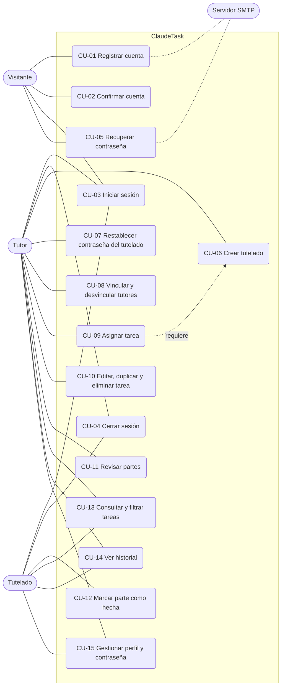

*Leyenda: óvalo = caso de uso o actor; línea punteada = relación con el servidor de correo o entre casos. El visitante que se registra o recupera su contraseña es siempre un tutor: los tutelados no se registran ni usan correo, los crea un tutor.*

### Ficha CU-01: Registrar cuenta

| Campo               | Contenido                                                                                                                                                                                                                               |
| ------------------- | --------------------------------------------------------------------------------------------------------------------------------------------------------------------------------------------------------------------------------------- |
| **ID / Nombre**     | CU-01 Registrar cuenta                                                                                                                                                                                                                  |
| **Actor**           | Visitante (actor secundario: servidor SMTP)                                                                                                                                                                                             |
| **Requisito**       | RF-01                                                                                                                                                                                                                                   |
| **Precondiciones**  | El visitante está en `/crear`                                                                                                                                                                                                           |
| **Postcondiciones** | Se crea un usuario con rol `tutor`, `confirmado = 0`, contraseña con hash y un token aleatorio; se envía el correo de confirmación y se redirige a `/mensaje`                                                                            |
| **Flujo principal** | 1. Escribe nombre, correo, contraseña y repetición. 2. El sistema valida los campos. 3. Comprueba que el correo no exista. 4. Aplica el hash a la contraseña. 5. Genera el token y guarda el usuario. 6. Envía el correo. 7. Muestra el aviso. |
| **Flujos alternos** | 2a. Campo vacío, nombre de más de 100 caracteres, contraseña fuera de 6 a 72 caracteres o contraseñas distintas: alerta de error. 3a. Correo ya registrado: «El usuario ya esta registrado». 6a. El correo no sale: se borra la cuenta y se avisa para reintentar. |

### Ficha CU-03: Iniciar sesión

| Campo               | Contenido                                                                                                                                                                                                                                                  |
| ------------------- | ---------------------------------------------------------------------------------------------------------------------------------------------------------------------------------------------------------------------------------------------------------- |
| **ID / Nombre**     | CU-03 Iniciar sesión                                                                                                                                                                                                                                       |
| **Actor**           | Tutor o tutelado (en el momento de entrar, un visitante)                                                                                                                                                                                                   |
| **Requisito**       | RF-03                                                                                                                                                                                                                                                      |
| **Precondiciones**  | La cuenta existe y está confirmada                                                                                                                                                                                                                         |
| **Postcondiciones** | Se regenera el identificador de sesión y se guardan `id`, `nombre`, `rol` y `login`; el tutor va a `/dashboard` y el tutelado a `/mis-tareas`                                                                                                              |
| **Flujo principal** | 1. Escribe correo (tutor) o alias (tutelado) y contraseña. 2. El sistema consulta el contador de intentos de ese identificador. 3. Si el texto lleva `@` busca por correo y exige rol tutor; si no, busca por alias y exige rol tutelado. 4. Compara con `password_verify`. 5. Borra el contador, inicia la sesión y redirige. |
| **Flujos alternos** | 1a. Identificador o contraseña vacíos: alerta. 2a. Bloqueado: «Demasiados intentos. Espera N segundos». 4a. Cuenta inexistente, sin confirmar, de otro rol o contraseña incorrecta: el mismo mensaje «Usuario o contraseña incorrectos», y se suma un intento; al quinto se bloquea 30 segundos. |

### Ficha CU-05: Recuperar contraseña

| Campo               | Contenido                                                                                                                                                                                                                                                              |
| ------------------- | ---------------------------------------------------------------------------------------------------------------------------------------------------------------------------------------------------------------------------------------------------------------------- |
| **ID / Nombre**     | CU-05 Recuperar contraseña                                                                                                                                                                                                                                             |
| **Actor**           | Visitante que es un tutor (actor secundario: servidor SMTP)                                                                                                                                                                                                            |
| **Requisito**       | RF-05                                                                                                                                                                                                                                                                  |
| **Precondiciones**  | La cuenta es de tutor y está confirmada                                                                                                                                                                                                                                |
| **Postcondiciones** | Se guarda un token con caducidad (`token_expira`, 1 hora) y se envía el enlace; al usarlo se guarda la nueva contraseña con hash y `token` y `token_expira` quedan en `NULL`                                                                                           |
| **Flujo principal** | 1. En `/olvide` escribe su correo. 2. El sistema genera el token y lo guarda. 3. Envía el enlace `/reestablecer?token=...`. 4. El tutor lo abre y escribe la nueva contraseña (6 a 72). 5. El sistema guarda el hash y limpia el token.                                  |
| **Flujos alternos** | 1a. Correo inválido, inexistente, sin confirmar o de un tutelado: alerta de error. 3a. El correo no sale: alerta para reintentar. 4a. Token que no es de recuperación (por ejemplo, el de confirmar): «Token no valido». 4b. Token caducado: «El enlace ha caducado. Pide uno nuevo.» |

### Ficha CU-06: Crear tutelado

| Campo               | Contenido                                                                                                                                                                                                                  |
| ------------------- | -------------------------------------------------------------------------------------------------------------------------------------------------------------------------------------------------------------------------- |
| **ID / Nombre**     | CU-06 Crear tutelado                                                                                                                                                                                                       |
| **Actor**           | Tutor                                                                                                                                                                                                                      |
| **Requisito**       | RF-06                                                                                                                                                                                                                      |
| **Precondiciones**  | Sesión de tutor; el tutor está en `/tutelados`                                                                                                                                                                             |
| **Postcondiciones** | Se crea un usuario con rol `tutelado`, ya confirmado, con alias único y `creado_por` igual al tutor; se crea el vínculo entre ambos; el tutor ve el alias y la contraseña **una sola vez**                                  |
| **Flujo principal** | 1. Escribe nombre, curso (opcional) y contraseña (mínimo 6). 2. El sistema valida. 3. Genera el alias (primer nombre sin acentos más un número no predecible). 4. Guarda el usuario con hash y crea el vínculo. 5. Muestra los datos. |
| **Flujos alternos** | 2a. Nombre vacío o de más de 100 caracteres, curso de más de 60 o contraseña corta: JSON de error. 3a. No hay alias libre o el nombre no tiene letras: JSON de error.                                                     |

### Ficha CU-09: Asignar tarea

| Campo               | Contenido                                                                                                                                                                                                                                                                  |
| ------------------- | -------------------------------------------------------------------------------------------------------------------------------------------------------------------------------------------------------------------------------------------------------------------------- |
| **ID / Nombre**     | CU-09 Asignar tarea                                                                                                                                                                                                                                                        |
| **Actor**           | Tutor                                                                                                                                                                                                                                                                      |
| **Requisito**       | RF-09                                                                                                                                                                                                                                                                      |
| **Precondiciones**  | El tutor tiene al menos un tutelado vinculado                                                                                                                                                                                                                              |
| **Postcondiciones** | Se crea una tarea con `url` aleatoria y sus partes en estado `pendiente`, en el orden escrito                                                                                                                                                                              |
| **Flujo principal** | 1. En `/crear-tarea` elige el tutelado, escribe título, descripción y fecha límite, y añade las partes. 2. `nueva-tarea.js` envía `POST /api/tarea`. 3. El servidor comprueba el vínculo y valida los campos. 4. Guarda la tarea y cada parte. 5. Responde `exito`.        |
| **Flujos alternos** | 3a. Tutelado no vinculado: 403. 3b. Título vacío o de más de 255 caracteres, descripción de más de 5000, fecha inválida, ninguna parte, más de 50 partes o una parte de más de 255 caracteres: 400 con el mensaje.                                                          |

### Ficha CU-11: Revisar partes

| Campo               | Contenido                                                                                                                                                                                                                                                            |
| ------------------- | -------------------------------------------------------------------------------------------------------------------------------------------------------------------------------------------------------------------------------------------------------------------- |
| **ID / Nombre**     | CU-11 Revisar partes                                                                                                                                                                                                                                                 |
| **Actor**           | Tutor vinculado al tutelado                                                                                                                                                                                                                                          |
| **Requisito**       | RF-15                                                                                                                                                                                                                                                                |
| **Precondiciones**  | La parte está *Por revisar* (para aprobar o devolver) o *Aprobada* (para reabrir)                                                                                                                                                                                    |
| **Postcondiciones** | La parte cambia de estado, guarda el comentario (hasta 500 caracteres) y quién la revisó, y se añade una fila al historial                                                                                                                                           |
| **Flujo principal** | 1. En el panel pulsa **Aprobar**, **Devolver** o **Reabrir**, con comentario opcional. 2. `tutor.js` envía `POST /api/parte/revisar`. 3. El servidor comprueba el vínculo. 4. `Parte::transicionar` aplica la regla. 5. Guarda, registra el historial y devuelve el progreso. |
| **Flujos alternos** | 3a. Tutor no vinculado: 403. 4a. Transición no permitida (por ejemplo, aprobar algo que no está por revisar) o acción desconocida: 400 con el mensaje.                                                                                                               |

### Ficha CU-12: Marcar parte como hecha

| Campo               | Contenido                                                                                                                                                                                                                       |
| ------------------- | ------------------------------------------------------------------------------------------------------------------------------------------------------------------------------------------------------------------------------- |
| **ID / Nombre**     | CU-12 Marcar parte como hecha                                                                                                                                                                                                   |
| **Actor**           | Tutelado dueño de la tarea                                                                                                                                                                                                      |
| **Requisito**       | RF-14                                                                                                                                                                                                                           |
| **Precondiciones**  | La parte está en estado `pendiente` (nueva o devuelta)                                                                                                                                                                          |
| **Postcondiciones** | La parte pasa a `hecha` («Esperando al tutor»), se borra el comentario anterior y se añade una fila al historial                                                                                                                |
| **Flujo principal** | 1. En `/mis-tareas` pulsa **Ya lo hice** en una parte. 2. `alumno.js` envía `POST /api/parte/hecha`. 3. El servidor comprueba que la tarea es suya y que la parte sigue pendiente. 4. Guarda y registra el historial. 5. Responde `exito`. |
| **Flujos alternos** | 3a. La tarea es de otro alumno: 403. 3b. La parte ya no está pendiente: 400. Un tutor que intente esta acción recibe 403.                                                                                                       |

## 4.2 Diagrama de flujo (proceso de negocio)

**Figura 2. Flujo general de uso del sistema.**


## 4.3 Diagramas de estados

**Figura 3. Estados de una cuenta de tutor.** Un tutelado nace ya confirmado y sin token: no pasa por este diagrama.

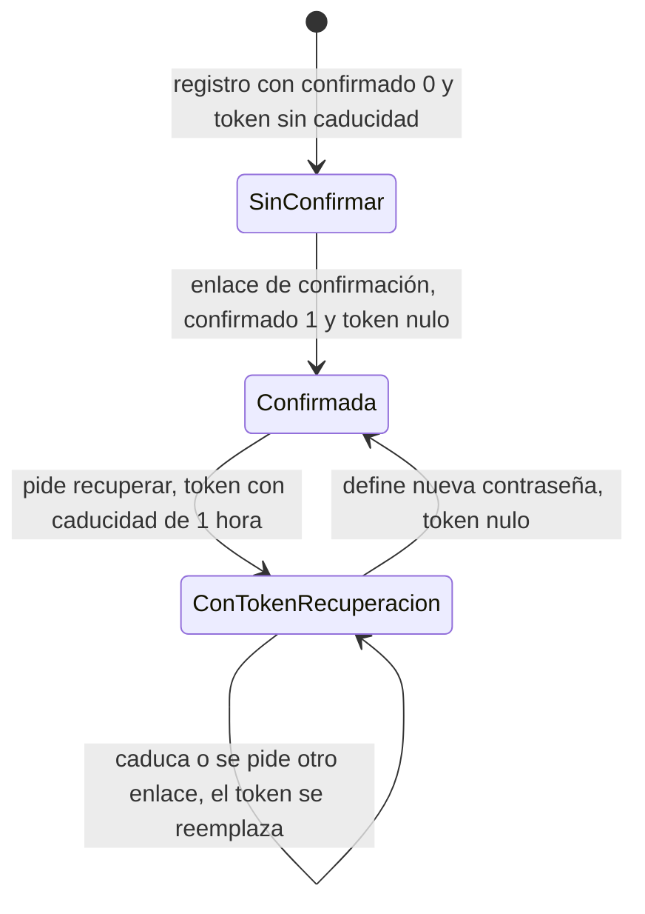

**Figura 4. Estados de una parte de tarea.**

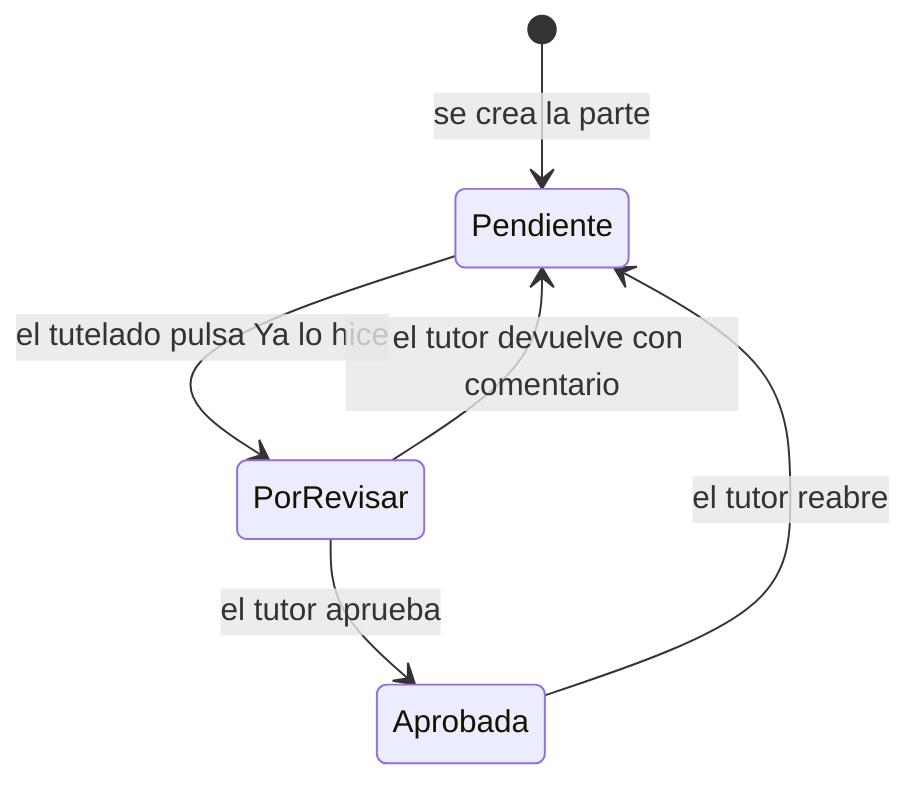

Los estados de la base de datos son `pendiente`, `hecha` y `aprobada`; en pantalla `hecha` se muestra como *Por revisar* (al tutor) o *Esperando al tutor* (al alumno). La tarea no tiene estado propio: se calcula con sus partes.

| Estado de la tarea | Cómo se calcula (`Tarea::progreso` y `Tarea::vencida`)                                                  |
| ------------------ | -------------------------------------------------------------------------------------------------------- |
| En curso           | Tiene al menos una parte que no está aprobada                                                            |
| Completa           | Tiene partes y todas están en estado `aprobada`                                                          |
| Vencida            | Tiene fecha límite anterior a hoy y no está completa (se muestra además del estado anterior)             |

## 4.4 Modelo de datos

**Figura 5. Diagrama entidad-relación (tomado de `claudetask.sql`).**

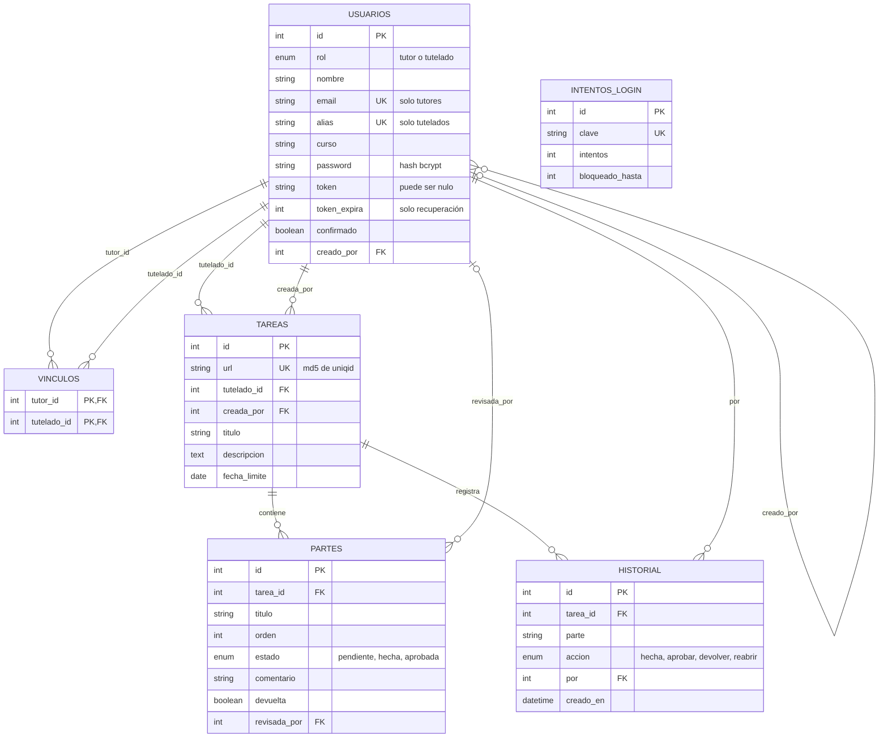

*Leyenda: PK = clave primaria, FK = clave foránea, UK = valor único. `INTENTOS_LOGIN` no se relaciona con otras tablas: su `clave` es el correo o el alias escrito en el acceso. `VINCULOS` une tutores con tutelados (relación de muchos a muchos). Borrados: al borrar una tarea caen sus partes y su historial; al borrar un usuario caen sus vínculos, sus tareas y su historial; `creado_por` y `revisada_por` pasan a `NULL`.*

### Diccionario de datos

**Tabla `usuarios`**

| Campo        | Tipo SQL                  | Nulo | Restricción                                  | Descripción                                                             |
| ------------ | ------------------------- | ---- | -------------------------------------------- | ----------------------------------------------------------------------- |
| id           | int unsigned              | No   | PK, autoincremental                          | Identificador                                                           |
| rol          | enum('tutor','tutelado')  | No   | -                                            | Tipo de cuenta                                                          |
| nombre       | varchar(255)              | No   | -                                            | Nombre visible (la aplicación admite hasta 100 caracteres)              |
| email        | varchar(255)              | Sí   | UNIQUE                                       | Acceso del tutor; `NULL` en tutelados                                   |
| alias        | varchar(60)               | Sí   | UNIQUE                                       | Acceso del tutelado (nombre y número); `NULL` en tutores                |
| curso        | varchar(60)               | Sí   | -                                            | Curso del tutelado (opcional)                                           |
| password     | varchar(255)              | No   | -                                            | Hash bcrypt                                                             |
| token        | varchar(255)              | Sí   | -                                            | Token de confirmación o de recuperación                                 |
| token_expira | int unsigned              | Sí   | -                                            | Hora Unix en que caduca el token de recuperación; `NULL` en el de confirmación |
| confirmado   | tinyint(1)                | No   | Por defecto 0                                | 1 si la cuenta está confirmada (los tutelados se crean con 1)           |
| creado_por   | int unsigned              | Sí   | FK → `usuarios.id`, ON DELETE SET NULL       | Tutor responsable del tutelado                                          |

**Tabla `vinculos`**

| Campo       | Tipo SQL     | Nulo | Restricción                                  | Descripción      |
| ----------- | ------------ | ---- | -------------------------------------------- | ---------------- |
| tutor_id    | int unsigned | No   | PK compuesta, FK → `usuarios.id`, CASCADE    | Tutor vinculado  |
| tutelado_id | int unsigned | No   | PK compuesta, FK → `usuarios.id`, CASCADE    | Tutelado         |

**Tabla `tareas`**

| Campo        | Tipo SQL     | Nulo | Restricción                              | Descripción                              |
| ------------ | ------------ | ---- | ---------------------------------------- | ---------------------------------------- |
| id           | int unsigned | No   | PK, autoincremental                      | Identificador interno                    |
| url          | varchar(255) | No   | UNIQUE                                   | Identificador que usa la API             |
| tutelado_id  | int unsigned | No   | FK → `usuarios.id`, ON DELETE CASCADE    | Alumno al que se asigna                  |
| creada_por   | int unsigned | No   | FK → `usuarios.id`, ON DELETE CASCADE    | Tutor que la creó                        |
| titulo       | varchar(255) | No   | -                                        | Título                                   |
| descripcion  | text         | Sí   | -                                        | Descripción (hasta 5000 en la aplicación)|
| fecha_limite | date         | Sí   | -                                        | Fecha límite opcional                    |

**Tabla `partes`**

| Campo        | Tipo SQL                              | Nulo | Restricción                                | Descripción                                         |
| ------------ | ------------------------------------- | ---- | ------------------------------------------ | --------------------------------------------------- |
| id           | int unsigned                          | No   | PK, autoincremental                        | Identificador                                       |
| tarea_id     | int unsigned                          | No   | FK → `tareas.id`, ON DELETE CASCADE        | Tarea a la que pertenece                            |
| titulo       | varchar(255)                          | No   | -                                          | Texto de la parte                                   |
| orden        | int                                   | No   | Por defecto 0                              | Posición dentro de la tarea                         |
| estado       | enum('pendiente','hecha','aprobada')  | No   | Por defecto `pendiente`                    | Estado de la parte                                  |
| comentario   | varchar(500)                          | No   | Por defecto vacío                          | Comentario del tutor al devolver o aprobar          |
| devuelta     | tinyint(1)                            | No   | Por defecto 0                              | 1 si la última revisión fue una devolución          |
| revisada_por | int unsigned                          | Sí   | FK → `usuarios.id`, ON DELETE SET NULL     | Último tutor que revisó                             |

**Tabla `historial`**

| Campo     | Tipo SQL                                        | Nulo | Restricción                              | Descripción                       |
| --------- | ----------------------------------------------- | ---- | ---------------------------------------- | --------------------------------- |
| id        | int unsigned                                    | No   | PK, autoincremental                      | Identificador                     |
| tarea_id  | int unsigned                                    | No   | FK → `tareas.id`, ON DELETE CASCADE      | Tarea                             |
| parte     | varchar(255)                                    | No   | -                                        | Título de la parte en ese momento |
| accion    | enum('hecha','aprobar','devolver','reabrir')    | No   | -                                        | Qué ocurrió                       |
| por       | int unsigned                                    | No   | FK → `usuarios.id`, ON DELETE CASCADE    | Quién lo hizo                     |
| creado_en | datetime                                        | No   | Por defecto `CURRENT_TIMESTAMP`          | Cuándo                            |

**Tabla `intentos_login`**

| Campo           | Tipo SQL     | Nulo | Restricción         | Descripción                                          |
| --------------- | ------------ | ---- | ------------------- | ---------------------------------------------------- |
| id              | int unsigned | No   | PK, autoincremental | Identificador                                        |
| clave           | varchar(255) | No   | UNIQUE              | Correo o alias escrito, en minúsculas                |
| intentos        | int          | No   | Por defecto 0       | Fallos seguidos (se reinicia al bloquear)            |
| bloqueado_hasta | int unsigned | No   | Por defecto 0       | Hora Unix hasta la que está bloqueado (0 = no)       |

*Charset: `utf8mb4` con colación `utf8mb4_unicode_ci`, motor InnoDB. `claudetask.sql` solo contiene el esquema, sin datos.*

## 4.5 Diagramas de secuencia

**Figura 6. Registro de cuenta y confirmación.**

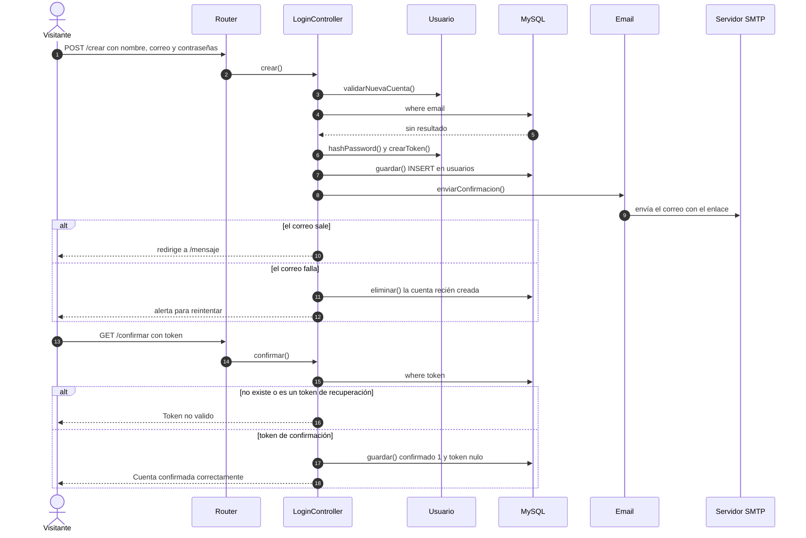

**Figura 7. Inicio de sesión con bloqueo por intentos.**

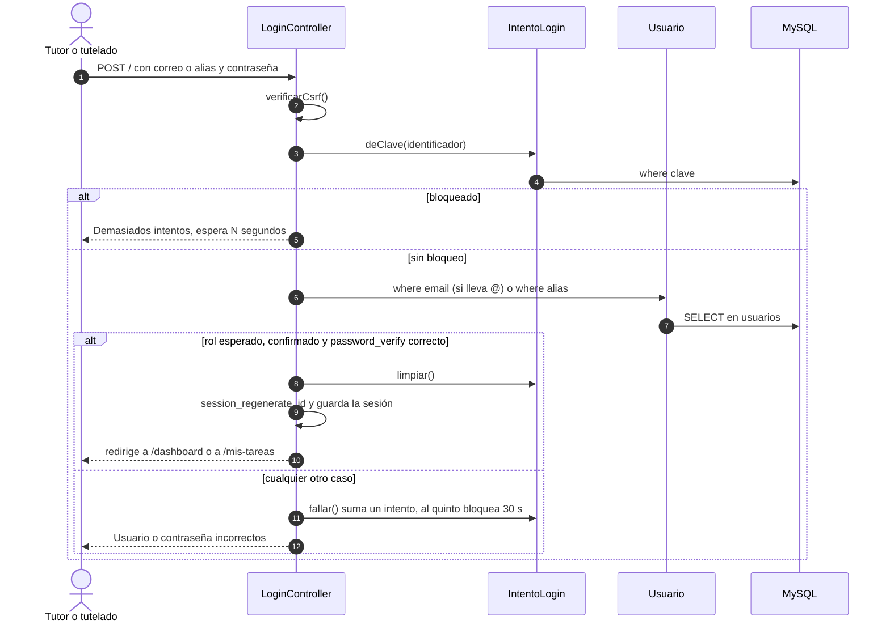

**Figura 8. El tutelado marca una parte como hecha.**

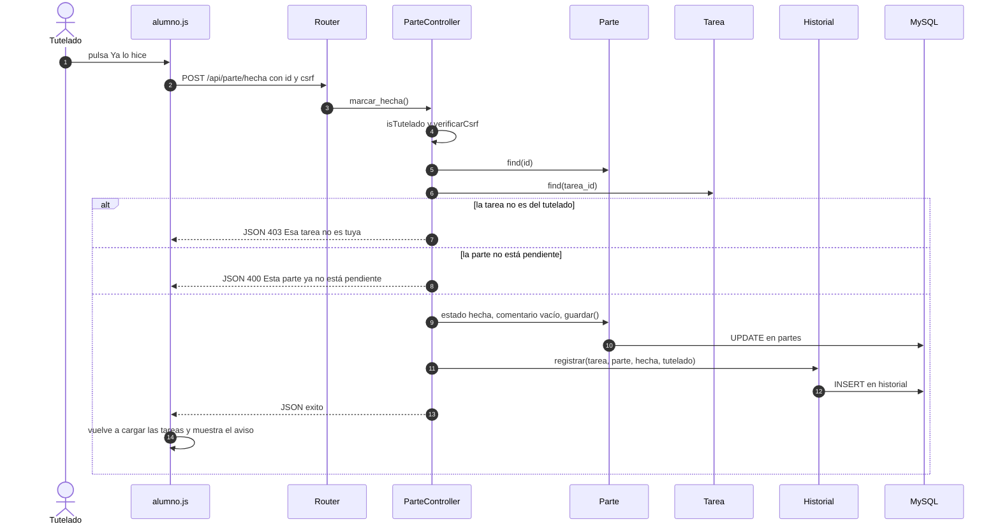

**Figura 9. El tutor revisa una parte.**

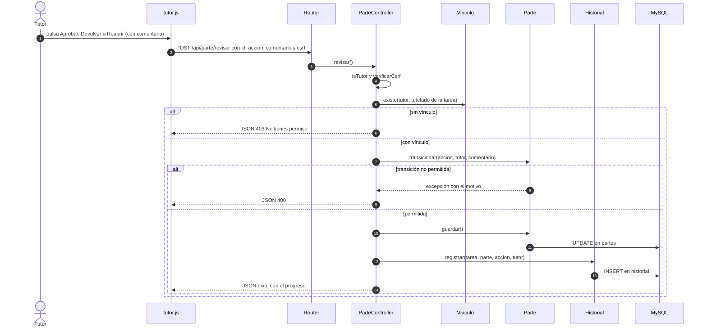

## 4.6 Diagrama de clases

**Figura 10. Clases del sistema (modelos, controladores, router y correo).**


## 4.7 Arquitectura

**Figura 11. Arquitectura por capas.**

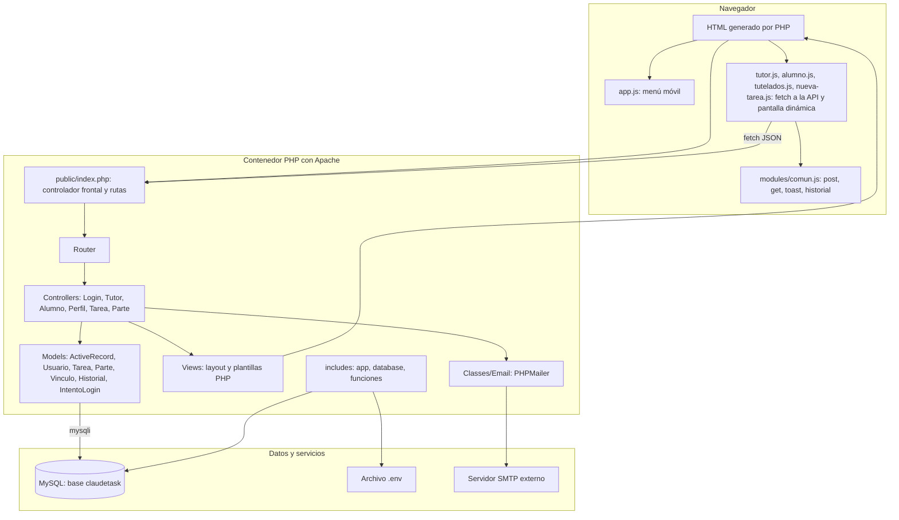

**Decisiones de arquitectura:**

| Decisión                                              | Alternativa                          | Motivo                                                                  |
| ----------------------------------------------------- | ------------------------------------ | ----------------------------------------------------------------------- |
| MVC propio con Router mínimo                          | Framework (Laravel)                  | Proyecto de aprendizaje, sin dependencias pesadas                       |
| Active Record propio con `escape_string` y columnas en lista blanca | ORM o PDO con consultas preparadas | Simplicidad; la defensa depende de escapar y validar cada entrada       |
| Dos roles con vínculo muchos a muchos                 | Un solo propietario por tarea        | Varios tutores pueden atender al mismo tutelado                         |
| La tarea se divide en partes con revisión del tutor   | Estado único por tarea               | El tutor valida el avance paso a paso                                   |
| Estado de la tarea calculado desde sus partes         | Columna de estado en `tareas`        | Un solo origen de verdad: el estado de las partes                       |
| API JSON para tareas y partes, con CSRF en cada POST  | Formularios con recarga              | Paneles fluidos sin recargar                                            |
| Vite + SCSS                                           | CSS a mano o Gulp                    | Recarga en caliente y compilación de recursos                           |
| Docker Compose con usuario de base de solo datos      | Instalación manual, usuario root     | Entorno reproducible y mínimo permiso                                   |

### Rutas de la aplicación

| Método    | Ruta                    | Controlador y método                    | Acceso                    | Descripción                          |
| --------- | ----------------------- | --------------------------------------- | ------------------------- | ------------------------------------ |
| GET, POST | `/`                     | `LoginController::login`                | Público                   | Iniciar sesión                       |
| GET       | `/logout`               | `LoginController::logout`               | Público                   | Cerrar sesión                        |
| GET, POST | `/crear`                | `LoginController::crear`                | Público                   | Registro de tutores                  |
| GET, POST | `/olvide`               | `LoginController::olvide`               | Público                   | Solicitar recuperación               |
| GET, POST | `/reestablecer`         | `LoginController::reestablecer`         | Con token de recuperación | Nueva contraseña                     |
| GET       | `/mensaje`              | `LoginController::mensaje`              | Público                   | Aviso de correo enviado              |
| GET       | `/confirmar`            | `LoginController::confirmar`            | Con token de confirmación | Confirmar cuenta                     |
| GET       | `/dashboard`            | `TutorController::index`                | Tutor                     | Panel de tareas del tutor            |
| GET       | `/crear-tarea`          | `TutorController::crear_tarea`          | Tutor                     | Formulario de nueva tarea            |
| GET       | `/tutelados`            | `TutorController::tutelados`            | Tutor                     | Gestión de tutelados y vínculos      |
| GET       | `/mis-tareas`           | `AlumnoController::index`               | Tutelado                  | Panel de tareas del alumno           |
| GET, POST | `/perfil`               | `PerfilController::perfil`              | Sesión                    | Editar perfil                        |
| GET, POST | `/cambiar-password`     | `PerfilController::cambiar_password`    | Sesión                    | Cambiar contraseña                   |
| GET       | `/api/tareas`           | `TareaController::index`                | Sesión (según rol)        | Listar tareas (JSON)                 |
| POST      | `/api/tarea`            | `TareaController::crear`                | Tutor vinculado           | Crear tarea con partes               |
| POST      | `/api/tarea/actualizar` | `TareaController::actualizar`           | Tutor vinculado           | Editar tarea y partes                |
| POST      | `/api/tarea/eliminar`   | `TareaController::eliminar`             | Tutor vinculado           | Eliminar tarea                       |
| POST      | `/api/tarea/duplicar`   | `TareaController::duplicar`             | Tutor vinculado           | Duplicar a otros tutelados           |
| GET       | `/api/historial`        | `TareaController::historial`            | Dueño o tutor vinculado   | Historial de una tarea               |
| POST      | `/api/parte`            | `ParteController::crear`                | Tutor vinculado           | Añadir una parte a una tarea         |
| POST      | `/api/parte/hecha`      | `ParteController::marcar_hecha`         | Tutelado dueño            | Marcar una parte como hecha          |
| POST      | `/api/parte/revisar`    | `ParteController::revisar`              | Tutor vinculado           | Aprobar, devolver o reabrir          |
| POST      | `/api/tutelado`         | `TutorController::crear_tutelado`       | Tutor                     | Crear tutelado                       |
| POST      | `/api/tutelado/password`| `TutorController::reset_password`       | Tutor vinculado           | Restablecer su contraseña            |
| POST      | `/api/vinculo`          | `TutorController::vincular`             | Tutor vinculado           | Vincular a otro tutor                |
| POST      | `/api/vinculo/eliminar` | `TutorController::desvincular`          | Tutor vinculado           | Quitar un vínculo                    |

*Una ruta que no existe responde 404 con la vista `404`. Las páginas protegidas redirigen a `/` sin sesión o con el rol equivocado; la API responde JSON con código 403.*

### Contrato de la API

Todos los POST llevan el campo `csrf` (o la cabecera `X-CSRF-Token`); sin él responden 403. Las respuestas son JSON; en un error llevan `{ "tipo": "error", "mensaje": "..." }` con el código 400, 403 o 404.

| Endpoint                         | Parámetros                                                         | Respuesta correcta                                                                   |
| -------------------------------- | ------------------------------------------------------------------ | ------------------------------------------------------------------------------------ |
| `GET /api/tareas`                | `tutelado` (opcional), `porRevisar` (opcional)                     | `{ "tareas": [ { url, titulo, descripcion, fecha_limite, tutelado_id, vencida, progreso: {ok, total, completa}, partes: [ {id, titulo, estado, comentario, devuelta} ] } ] }` |
| `POST /api/tarea`                | `tutelado_id`, `titulo`, `descripcion`, `fecha_limite`, `partes[]` | `{ tipo: "exito", url, mensaje }`                                                    |
| `POST /api/tarea/actualizar`     | `url`, `titulo`, `descripcion`, `fecha_limite`, `partes` (JSON `[{id, titulo}]`) | `{ tipo: "exito", mensaje }`                                           |
| `POST /api/tarea/eliminar`       | `url`                                                              | `{ tipo: "exito", mensaje }`                                                         |
| `POST /api/tarea/duplicar`       | `url`, `destinos[]` (ids de tutelados)                             | `{ tipo: "exito", copiadas }`                                                        |
| `GET /api/historial`             | `url`                                                              | `{ "historial": [ { parte, accion, por, cuando } ] }`                                |
| `POST /api/parte`                | `url`, `titulo`                                                    | `{ tipo: "exito", id }`                                                              |
| `POST /api/parte/hecha`          | `id`                                                               | `{ tipo: "exito", mensaje }`                                                         |
| `POST /api/parte/revisar`        | `id`, `accion` (`aprobar`, `devolver`, `reabrir`), `comentario`    | `{ tipo: "exito", progreso: {ok, total, completa} }`                                 |
| `POST /api/tutelado`             | `nombre`, `curso`, `password`                                      | `{ tipo: "exito", nombre, alias, password }` (la contraseña solo se devuelve aquí)   |
| `POST /api/tutelado/password`    | `id`, `password`                                                   | `{ tipo: "exito", mensaje }`                                                         |
| `POST /api/vinculo`              | `tutelado_id`, `correo`                                            | `{ tipo: "exito", mensaje }`                                                         |
| `POST /api/vinculo/eliminar`     | `tutelado_id`, `tutor_id`                                          | `{ tipo: "exito", mensaje }`                                                         |

## 4.8 Despliegue

**Figura 12. Diagrama de despliegue con Docker.**

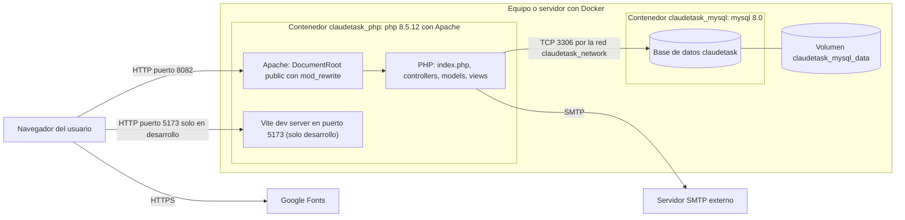

*En el primer arranque, con el volumen vacío, MySQL ejecuta `01-claudetask.sql` (esquema) y `02-usuario.sh` (crea `claudetask_app` con permisos solo de datos). Las claves salen de `.env`.*

## 4.9 Diagrama de red

**Figura 13. Puertos y comunicaciones.**

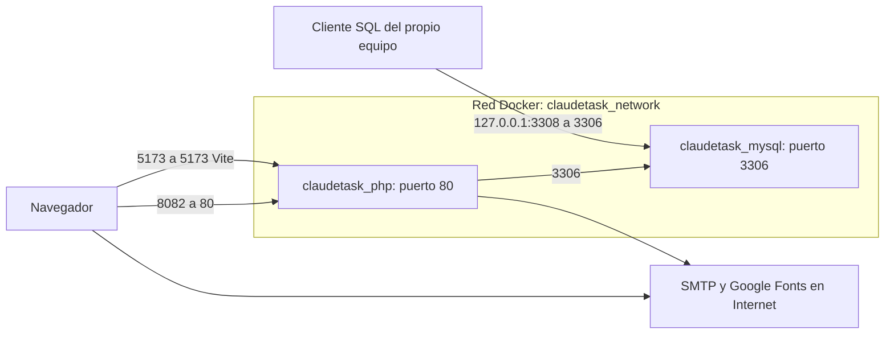

| Puerto del equipo | Contenedor                | Uso                                                                  |
| ----------------- | ------------------------- | -------------------------------------------------------------------- |
| 8082              | `claudetask_php` (80)     | Aplicación web                                                       |
| 5173              | `claudetask_php` (5173)   | Servidor de desarrollo de Vite (se quita en producción)              |
| 127.0.0.1:3308    | `claudetask_mysql` (3306) | Base de datos, accesible solo desde el propio equipo                 |

*No hay HTTPS en esta composición: en producción va un servidor o proxy con HTTPS delante del puerto 8082.*

## 4.10 Diseño de interfaz

| Pantalla                | Ruta                   | Contenido                                                                                             |
| ----------------------- | ---------------------- | ----------------------------------------------------------------------------------------------------- |
| Iniciar sesión          | `/`                    | Correo o alias, contraseña, enlaces a crear cuenta y olvidé                                           |
| Crear cuenta            | `/crear`               | Nombre, correo, contraseña y repetición                                                               |
| Olvidé mi contraseña    | `/olvide`              | Correo                                                                                                |
| Reestablecer            | `/reestablecer?token=` | Nueva contraseña (solo si el token es válido y no caducó)                                             |
| Mensaje                 | `/mensaje`             | Aviso de correo enviado                                                                               |
| Confirmar cuenta        | `/confirmar?token=`    | Resultado de la confirmación                                                                          |
| Tareas (tutor)          | `/dashboard`           | Filtro por tutelado, casilla «Solo por revisar», tarjetas con partes, avance y acciones               |
| Nueva tarea             | `/crear-tarea`         | Tutelado, título, descripción, fecha límite y partes (**+ Añadir parte**)                             |
| Tutelados               | `/tutelados`           | Alta de tutelado, datos de acceso (una sola vez), lista con tutores, vincular, quitar y restablecer   |
| Mis tareas (tutelado)   | `/mis-tareas`          | Tarjetas con sus partes: **Ya lo hice**, *Esperando al tutor*, comentario del tutor, historial        |
| Perfil                  | `/perfil`              | Nombre y correo (tutor) o alias (tutelado, solo lectura); enlace a cambiar contraseña                 |
| Cambiar contraseña      | `/cambiar-password`    | Contraseña actual y nueva                                                                             |
| Ventanas del panel      | (en `/dashboard`)      | Editar tarea, Duplicar tarea, Historial; el historial también está en `/mis-tareas`                   |

**Elementos comunes:** barra lateral con las opciones del rol (el tutor ve Tareas, Nueva tarea, Tutelados y Perfil; el tutelado, Mis tareas y Perfil); barra superior con el nombre, el rol y **Cerrar Sesión**; menú desplegable en móvil; modo claro y oscuro automáticos.

> **[Completar]** Inserta capturas de cada pantalla: ``

---

# 5. Gestión del proyecto

## 5.1 Metodología

No se aplicó una metodología formal. El proceso real fue un desarrollo incremental de una sola persona: cada paso (del Paso 1 al Paso 10) cambió una parte del sistema, se probó y se cerró con un commit, y las pruebas quedaron registradas en la sección 13. De las metodologías conocidas, la más parecida es un Kanban personal, sin sprints ni estimaciones.

## 5.2 Plan y cronograma

Git registra los 28 commits del proyecto hasta `56c8534` con la misma fecha, 2026-11-03, así que no se puede reconstruir un cronograma con duraciones y no se inventa uno. La tabla muestra el orden real de los pasos con sus commits.

| Paso | Contenido                                                                          | Commits                                                                               |
| ---- | ---------------------------------------------------------------------------------- | ------------------------------------------------------------------------------------- |
| 1    | Base renombrada a ClaudeTask                                                       | `19d6614`                                                                             |
| 2    | Consultas seguras, NULL real, 404, sesión única, CSRF                              | `c1b2931`                                                                             |
| 3    | Roles, login por correo o alias, bloqueo de intentos                               | `044f268`                                                                             |
| 4    | Tareas y partes, API, vínculos, panel del tutor                                    | `d9850e0`                                                                             |
| 5    | Flujo de estados, historial y vista del alumno                                     | `b2bd296`                                                                             |
| 6    | Tutelados, vínculos y endurecimiento de entradas                                   | `d01b229`, `98a7151` (parche)                                                         |
| 7    | Interfaz en modo claro y modo oscuro                                               | `f03a7b1`, `7e375cf`                                                                  |
| -    | Endurecimiento de `TareaController` y de la cuenta                                 | `c3401ed`, `1da09e5`                                                                  |
| 8    | Lista de pruebas P-01 a P-25                                                       | `a3f03d4`, `97a16f7`                                                                  |
| 9    | Errores y correo, tokens, usuario de base, CSP, respaldo, README, P-26 a P-35      | `c978a1f`, `c1a2919`, `2f334a3`, `7bfa426`, `f7414b2`, `6aa6283`, `5b581aa`, `941e8d1`, `563e2ff`, `6a96305` |
| 10   | Documentación alineada con el sistema real (10a, 10b, 10c)                         | `6f9a8b9`, `1fe904c`, `73e90ac`, `5b54f42`, `56c8534`                                |

**Pendiente para la Versión 1.0:** que otra persona haga el ciclo solo con el `README.md` (7.2), insertar las capturas (4.10) y publicar el sistema (5.4, R6 y R7).

## 5.3 Roles y responsabilidades

Un rol es la tarea de la que alguien responde en el proyecto. Como el autor es una sola persona, ella cubre todos.

| Integrante                                | Rol                                       | Responsabilidades                                                              |
| ----------------------------------------- | ----------------------------------------- | ------------------------------------------------------------------------------ |
| Julio Cesar Choque Mamani (CaesarDev)     | Desarrollo, frontend, calidad y documentación | Backend y base de datos; vistas, SCSS y JavaScript del cliente; pruebas y manuales |

## 5.4 Riesgos

Probabilidad e impacto son una estimación del autor al 2026-11-03, no una medición.

| ID  | Riesgo                                                                                                    | Probabilidad | Impacto | Mitigación                                                                                                          |
| --- | --------------------------------------------------------------------------------------------------------- | ------------ | ------- | ------------------------------------------------------------------------------------------------------------------- |
| R1  | Uso malicioso por fallos de seguridad que no se hayan encontrado (los conocidos están resueltos, sección 10) | Baja         | Alto    | Las 35 pruebas pasan; quedan LIM-01 y LIM-02 (7.3); registrar las pruebas de 7.1 que faltan                         |
| R2  | Los correos de confirmación y recuperación tardan o no salen (SMTP síncrono, LIM-07)                      | Media        | Alto    | Un SMTP real antes de publicar; probar el envío en el servidor; en el plan gratuito de DOM Cloud ver R7            |
| R3  | Pérdida de datos si se borra el volumen de MySQL o la cuenta del servidor                                 | Media        | Alto    | `docker/respaldo.sh` y `docker/restaurar.sh` (P-32) en Docker; en el servidor de publicación definir otro método   |
| R4  | Versiones de dependencias que cambien o no existan                                                        | Media        | Medio   | `composer.lock` y `package-lock.json` fijan los paquetes; el `Dockerfile` fija `php:8.5.12-apache` y la base es `mysql:8.0` |
| R5  | Un solo desarrollador conoce el sistema                                                                   | Media        | Medio   | Mantener esta documentación actualizada y la prueba de usabilidad con otra persona (7.2)                            |
| R6  | El servidor de publicación (DOM Cloud) no usa Docker, Apache ni MySQL 8, y el sistema depende de ellos      | Alta         | Alto    | Ver abajo                                                                                                           |
| R7  | Límites del plan gratuito de DOM Cloud                                                                    | Media        | Medio   | Ver abajo                                                                                                           |

**R6.** Según la documentación de DOM Cloud (consultada el 2026-11-03), sus servidores no usan Docker, funcionan con NGINX y Passenger e instalan MariaDB, no MySQL. En ClaudeTask, la reescritura de todas las rutas a `index.php`, el 404 para rutas que empiezan por punto, `nosniff`, `Referrer-Policy` y el bloqueo del listado de directorios están en `docker/apache.conf`, y `public/` no tiene `.htaccess` (solo `index.php`). Esas reglas hay que llevarlas a la configuración de NGINX del servidor. Lo que no se verificó: que haya PHP 8.5 en DOM Cloud y que `claudetask.sql` cargue sin cambios en MariaDB. Mitigación: repetir P-27, P-29, P-30 y P-33 en el servidor real antes de dar por publicado el sistema, y los scripts `docker/respaldo.sh`, `docker/restaurar.sh` y `docker/crear-usuario-bd.sh` no sirven allí tal cual (LIM-10).

**R7.** Según la misma documentación, el plan gratuito: pide un código de invitación (o una cuenta de GitHub con más de 6 meses y un seguidor, o una mejora de pago de 4,5 USD una sola vez); da 1,5 GB de almacenamiento y 2 GB de transferencia mensual; muestra un aviso en el dominio gratuito `*.dom.my.id`; borra los datos si la cuenta caduca y no se entra en 14 días más (se renueva al iniciar sesión al menos cada 60 días); y mantiene siempre activo un cortafuegos que bloquea las conexiones salientes salvo a una lista de sitios. Esa lista no se revisó, así que no se sabe si el SMTP elegido cabe en ella; el puerto 25 está bloqueado para todos, y el aviso de DOM Cloud recomienda un relay por el puerto 587 o una API REST. Mitigación: dominio propio, entrar al menos cada 60 días, respaldos fuera del servidor y, si el cortafuegos bloquea el SMTP, pasar a un plan de pago.

## 5.5 Recursos y costos

| Recurso                                   | Costo                                                                                                  |
| ----------------------------------------- | ------------------------------------------------------------------------------------------------------ |
| Desarrollo local con Docker               | 0 USD                                                                                                  |
| Pruebas de correo (Ethereal)              | 0 USD                                                                                                  |
| Alojamiento: DOM Cloud, plan gratuito     | 0 USD, con los límites de R7; la mejora de pago única indicada en su documentación es de 4,5 USD       |
| Servidor SMTP para publicar               | [Completar]                                                                                            |
| Dominio propio (opcional)                 | [Completar]                                                                                            |

---

# 6. Implementación

## 6.1 Tecnologías y herramientas

| Componente                    | Tecnología                                                  | Versión (según los archivos)                                                            |
| ----------------------------- | ----------------------------------------------------------- | --------------------------------------------------------------------------------------- |
| Lenguaje servidor             | PHP                                                         | 8.5.12 (imagen `php:8.5.12-apache`)                                                     |
| Servidor web                  | Apache con `mod_rewrite` y `mod_headers`                    | De la imagen                                                                            |
| Base de datos                 | MySQL, InnoDB, `utf8mb4_unicode_ci`                         | 8.0 (`mysql:8.0`)                                                                       |
| Acceso a datos                | `mysqli`                                                    | Extensión de PHP (el Dockerfile instala también `pdo` y `pdo_mysql`, que el código no usa) |
| Dependencias de PHP           | Composer                                                    | Imagen `composer:latest`                                                                |
| Correo                        | `phpmailer/phpmailer`                                       | ^7.1                                                                                    |
| Variables de entorno          | `vlucas/phpdotenv`                                          | ^5.6                                                                                    |
| Empaquetado                   | Vite, con `vite-plugin-full-reload` y un plugin propio (`vite-plugins/scss-auto-index.js`) | ^5.0.0; ^1.1.0                                                  |
| Estilos                       | Sass (SCSS)                                                 | ^1.75.0                                                                                 |
| Utilidad de compilación       | `fast-glob`                                                 | ^3.3.3                                                                                  |
| Declaradas y sin uso          | `glob`, `gulp` y `sharp`                                    | ^13.0.0, ^5.0.0, ^0.34.5 (el script `npm run imagen` pide un `gulpfile.js` que no existe) |
| Node y npm                    | Paquetes `nodejs` y `npm` del sistema de la imagen          | Los que traiga la imagen                                                                |
| Fuentes                       | Bricolage Grotesque y Figtree                               | Google Fonts                                                                            |
| Contenedores                  | Docker Compose, servicios `php` y `mysql`                   | Compose v2                                                                              |

## 6.2 Estructura del código

```
claudetask/
├── public/
│   └── index.php            # Controlador frontal: define todas las rutas
├── Router.php               # Clase MVC\Router (rutas y render de vistas)
├── controllers/
│   ├── LoginController.php  # Acceso, registro, confirmación y recuperación
│   ├── TutorController.php  # Panel del tutor, tutelados y vínculos
│   ├── TareaController.php  # API de tareas e historial
│   ├── ParteController.php  # API de partes: añadir, marcar hecha y revisar
│   ├── AlumnoController.php # «Mis tareas» del tutelado
│   └── PerfilController.php # Perfil y cambio de contraseña
├── models/
│   ├── ActiveRecord.php     # Clase base con CRUD y consultas
│   ├── Usuario.php          # Tutores y tutelados, tokens, alias
│   ├── Tarea.php
│   ├── Parte.php            # Estados y transiciones de una parte
│   ├── Vinculo.php          # Relación tutor-tutelado
│   ├── Historial.php
│   └── IntentoLogin.php     # Bloqueo por intentos fallidos
├── classes/
│   └── Email.php            # Envío de correos con PHPMailer
├── includes/
│   ├── app.php              # Autoload, .env, errores, sesión, cabeceras y conexión
│   ├── database.php         # Conexión mysqli con variables de entorno
│   └── funciones.php        # s(), isAuth(), isTutor(), isTutelado(), CSRF, CSP y Vite
├── views/
│   ├── layout.php           # Plantilla base
│   ├── 404.php
│   ├── auth/                # Pantallas de acceso
│   ├── tutor/               # Tareas, nueva tarea y tutelados
│   ├── alumno/              # Mis tareas
│   ├── perfil/              # Perfil y cambio de contraseña
│   └── templates/           # Alertas, barra, sidebar, cabecera y pie del panel
├── src/
│   ├── js/                  # app.js, tutor.js, alumno.js, tutelados.js, nueva-tarea.js y modules/comun.js
│   └── scss/                # base, componentes, auth, dashboard, dark
├── vite-plugins/
│   └── scss-auto-index.js   # Mantiene los _index.scss de src/scss
├── docker/                  # Dockerfile, apache.conf, initdb/, respaldo.sh, restaurar.sh, crear-usuario-bd.sh
├── docker-compose.yml
├── claudetask.sql           # Esquema de la base de datos
├── .env.example             # Plantilla de variables de entorno
├── README.md                # Instalación y manuales
└── composer.json / package.json / vite.config.js
```

`src/scss/dashboard/_proyectos.scss` es un resto de UpTask: define `.no-proyectos` y `.listado-proyectos` (esta también aparece en el modo oscuro), pero ninguna vista ni script usa esas clases.

**Convenciones observadas:** espacios de nombres PSR-4 (`MVC`, `Controllers`, `Model`, `Classes`); métodos de controlador estáticos que reciben el `Router`; alertas en `Model\ActiveRecord` como arreglo estático `['error'|'exito'][]`; nombres de métodos en `camelCase` y `snake_case` mezclados (`crear_tutelado`, `marcar_hecha`, `generarAlias`); textos de interfaz en español.

**Variables de entorno usadas por el código** (la plantilla es `.env.example`):

| Variable                                                   | Dónde se usa                                                          | Descripción                                                                                       |
| ---------------------------------------------------------- | --------------------------------------------------------------------- | ------------------------------------------------------------------------------------------------- |
| `DB_HOST`, `DB_USER`, `DB_PASS`, `DB_NAME`                 | `includes/database.php`; `docker-compose.yml` e `initdb/02-usuario.sh` | Conexión MySQL. `DB_USER` es `claudetask_app`, con permisos solo de datos                         |
| `MYSQL_ROOT_PASSWORD`                                      | `docker-compose.yml` y los scripts de `docker/`                       | Contraseña de root de MySQL, para administración y respaldos; la aplicación no la usa            |
| `MAIL_HOST`, `MAIL_PORT`, `MAIL_USERNAME`, `MAIL_PASSWORD` | `classes/Email.php`                                                   | SMTP                                                                                              |
| `MAIL_FROM`                                                | `classes/Email.php`                                                   | Remitente de los correos (opcional; por omisión `cuentas@claudetask.com`)                        |
| `APP_URL`                                                  | `classes/Email.php`, `includes/app.php`                               | Base de los enlaces de los correos; si empieza por `https://`, la cookie de sesión lleva `Secure` |
| `ENVIRONMENT`                                              | `includes/app.php`, `includes/funciones.php` (`esDesarrollo()`)       | `development` o `production`; cualquier otro valor se trata como producción                      |

## 6.3 Decisiones técnicas importantes

| N.º   | Decisión                                                                                                              | Motivo                                                                                                          |
| ----- | --------------------------------------------------------------------------------------------------------------------- | --------------------------------------------------------------------------------------------------------------- |
| DT-01 | La API identifica cada tarea por `url` (`md5(uniqid())`) en lugar del id numérico                                     | Evita exponer ids consecutivos. El permiso no depende de ocultar la URL: el servidor comprueba el vínculo en cada petición |
| DT-02 | Dos clases de token en `usuarios.token`: confirmación (sin caducidad) y recuperación (caduca en 1 hora); cada ruta rechaza el del otro | Verifica el correo del tutor y limita la vida del enlace de recuperación. No existe «reenviar confirmación» (LIM-05) |
| DT-03 | Los paneles cargan las tareas una vez como JSON desde `/api/tareas` y se actualizan con la respuesta de cada acción   | Evita recargar la página (RNF-14)                                                                               |
| DT-04 | Los permisos se deciden en el servidor por rol y por vínculo; la API responde JSON 403 sin sesión o sin permiso       | El cliente no decide nada; los endpoints API no llaman a `isAuth()` antes de `isTutor(true)` o `isTutelado(true)` para que, sin sesión, den JSON y no una redirección |
| DT-05 | El tutelado no tiene correo: el sistema genera su alias y el tutor fija su contraseña inicial y la restablece         | Los tutelados no usan correo (ver 3.3)                                                                          |
| DT-06 | Una parte pasa por tres estados (`pendiente`, `hecha`, `aprobada`) y solo el tutor la aprueba                          | La tarea está completa cuando el tutor aprobó todas sus partes                                                  |
| DT-07 | Cada marca, aprobación, devolución o reapertura se guarda en `historial`                                              | Saber quién hizo qué y cuándo                                                                                   |
| DT-08 | Bloqueo de 30 segundos tras 5 intentos fallidos, llevado por correo o alias en `intentos_login`                       | Dificulta adivinar contraseñas                                                                                  |
| DT-09 | Token CSRF en cada POST y una sola regla de entorno, `esDesarrollo()`, que decide la CSP, el uso de Vite y los errores | En desarrollo Vite necesita una CSP más abierta; en producción la CSP es estricta, con nonce, y se usan los archivos compilados |
| DT-10 | La aplicación usa un usuario de base propio (`claudetask_app`) con solo `SELECT`, `INSERT`, `UPDATE` y `DELETE`        | La aplicación no puede crear ni borrar tablas                                                                   |
| DT-11 | Borrado en cascada en la base de datos                                                                                | Mantener la integridad: al borrar una tarea caen sus partes y su historial (RNF-06)                            |

---

# 7. Calidad

## 7.1 Plan de pruebas

Las pruebas de ClaudeTask son las **P-01 a P-35** de la sección 13, con su método, su fecha (2026-11-03) y su resultado. Los CP-01 a CP-24 que tenía esta sección eran de UpTask (proyectos, `tareas.js`, `/proyecto?id=`): no se ejecutaron y se retiraron. La relación de cada requisito con sus pruebas está en la sección 11.

**Resultado:** las 35 pasan. P-14, P-15 y P-16 fallaron, se corrigieron y se repitieron; P-35 mostró el fallo con el guion antes del cambio. P-33 pasó tras reiniciar el contenedor. En P-26 y P-34 falló el procedimiento de prueba, no el código. P-31 consta «según lo indicado por el usuario», sin resultado por acción.

**Cobertura por área**

| Área                      | Pruebas                       | Qué comprueban                                                                                                     |
| ------------------------- | ----------------------------- | ------------------------------------------------------------------------------------------------------------------ |
| Vínculo                   | P-01 a P-06                   | Un tutor sin vínculo no aprueba, devuelve, añade partes, duplica ni ve el historial o las tareas de un tutelado ajeno |
| CSRF                      | P-07                          | 10 endpoints POST con token ausente, vacío y falso (30 peticiones): 403 y datos intactos                           |
| Roles                     | P-08 a P-11                   | Un tutelado no revisa, no crea, no vincula ni abre páginas de tutor; `/api/tareas` no incluye tareas de otros      |
| Sesión                    | P-12, P-13                    | Rutas privadas sin sesión redirigen a `/`; tras el logout la cookie anterior no entra                              |
| Entradas                  | P-14, P-15                    | Títulos largos, arreglos en lugar de texto y fechas inválidas dan error controlado                                 |
| Salida y textos peligrosos | P-16 a P-20                  | HTML, `<script>`, comillas e inyección SQL se guardan y se muestran como texto literal                             |
| Interfaz                  | P-21                          | Menú móvil a 375 px en modo claro y oscuro                                                                         |
| Código                    | P-22                          | Ninguna llamada real a `new X($_POST)` ni a `sincronizar($_POST)`                                                  |
| Cuenta y tokens           | P-23 a P-26, P-35             | Registro, confirmación, recuperación, caducidad y uso único de los tokens                                          |
| Base de datos e instalación | P-27, P-28, P-34            | Usuario de base con solo `SELECT`, `INSERT`, `UPDATE` y `DELETE`; instalación desde cero y ciclo completo          |
| Cabeceras y producción    | P-29 a P-31, P-33             | CSP por entorno con nonce, cookie de sesión, sin `.map`, `/build/` sin listado, manifest de Vite no público        |
| Respaldo                  | P-32                          | Respaldo y restauración conservan los datos y el hash de las contraseñas                                           |

**Equivalencias con los CP retirados**

| CP de UpTask              | Prueba actual                                                   |
| ------------------------- | --------------------------------------------------------------- |
| CP-01, CP-04, CP-05       | P-23 (registro, confirmación, token inventado)                  |
| CP-07, CP-08              | P-27 (login correcto y con clave errónea)                       |
| CP-09                     | P-25 y P-26 (recuperar contraseña)                              |
| CP-12, CP-20              | P-01 a P-06 (permiso por vínculo, en lugar de por proyecto)     |
| CP-19                     | P-12 (rutas privadas sin sesión)                                |
| CP-21, CP-22              | P-17 (texto peligroso y SQL en títulos y partes)                |
| CP-23, CP-24              | P-22 (revisión del código; no se repitió como petición)         |
| Resto                     | Sin equivalente: eran de proyectos, perfil o filtros de UpTask  |

**Requisitos sin prueba numerada**

Estas funciones se dieron por probadas en su paso, pero ninguna prueba P las registra. Son las candidatas a P-36 en adelante.

| Requisito | Qué falta registrar                                                                                               |
| --------- | ----------------------------------------------------------------------------------------------------------------- |
| RF-03     | Bloqueo tras 5 intentos fallidos y desbloqueo a los 30 s; login de una cuenta sin confirmar                       |
| RF-06     | Crear un tutelado solo consta dentro del recorrido de P-34 y como rechazo en P-08                                  |
| RF-07     | Restablecer la contraseña de un tutelado                                                                          |
| RF-08     | Desvincular, y que solo el responsable quite a otros tutores                                                      |
| RF-11     | Duplicar una tarea con éxito (P-04 cubre el rechazo y P-20 el modal)                                              |
| RF-13     | Filtros por tutelado y «solo por revisar»; marca de tarea vencida                                                 |
| RF-17     | Editar el perfil y cambiar la contraseña                                                                          |
| RNF-13    | No hay prueba: se comprueba leyendo el código                                                                     |

## 7.2 Tipos de prueba

| Tipo           | Método                                                                                                                         | Estado                                                    |
| -------------- | ------------------------------------------------------------------------------------------------------------------------------ | --------------------------------------------------------- |
| Funcionales    | Pruebas por área con `curl` y dos navegadores (uno por rol) y el recorrido completo de P-34                                    | Hecho, con las lagunas de 7.1                             |
| Seguridad      | P-01 a P-20, P-22, P-27 a P-30, P-32, P-33 y P-35: `curl` con sesión y token CSRF reales, y revisión del código                | Hecho                                                     |
| Usabilidad     | El recorrido de P-34 lo hizo el autor; falta que otra persona lo haga solo con `README.md`                                     | Pendiente (Versión 1.0)                                   |
| Compatibilidad | Pruebas manuales en Brave (motor Chromium) y Mozilla Firefox (Gecko); menú móvil a 375 px en modo claro y oscuro (P-21); consola de DevTools sin avisos de CSP en producción (P-31) | Parcial: sin Safari (WebKit) y sin registro de qué prueba se hizo en cada navegador |
| Automáticas    | No existen; todas las pruebas son manuales o con `curl`                                                                        | No hay                                                    |

## 7.3 Errores y limitaciones conocidos

Los ERR-01 a ERR-20 se redactaron al leer el código de UpTask, la base de ClaudeTask. Su estado se revisó el 2026-11-03 contra el código actual y las pruebas P-01 a P-35. La columna «Cierre» da el commit que lo corrigió y la prueba que lo respalda; donde no hay prueba, dice cómo se verificó.

**Resumen:** 15 resueltos, 3 parciales (ERR-09, ERR-13 y ERR-18) y 2 obsoletos por la reescritura del cliente (ERR-14 y ERR-15).

| ID     | Hallazgo en UpTask                                                                          | Gravedad | Estado   | Cierre                                                                                                                                                                                                                                                                  |
| ------ | ------------------------------------------------------------------------------------------- | -------- | -------- | ----------------------------------------------------------------------------------------------------------------------------------------------------------------------------------------------------------------------------------------------------------------------- |
| ERR-01 | Inyección SQL: `find`, `get`, `where` y `belongsTo` insertaban datos del usuario sin escapar | Alta     | Resuelto | `c1b2931`. `find` convierte a entero; `where` y `belongsTo` escapan el valor y aceptan solo columnas con letras, números y guion bajo. P-17 (`' OR 1=1 --` en partes: la consulta no se altera). Residuo: `get($limite)` no escapa, pero ningún código lo llama |
| ERR-02 | Asignación masiva: `sincronizar($_POST)` permitía fijar `id`, `confirmado` y otros campos     | Alta     | Resuelto | `d9850e0`, `1da09e5` (crear) y `98a7151` (reestablecer); el commit de cada baja se atribuye por su mensaje. Comprobación: P-22 (ninguna llamada real a `new X($_POST)` ni a `sincronizar($_POST)`)                                                                      |
| ERR-03 | Acceso a tareas ajenas: no se comprobaba que la tarea perteneciera al usuario               | Alta     | Resuelto | `d9850e0` (Paso 4): el permiso se decide por el vínculo tutor-tutelado (`Vinculo::existe`). P-01 a P-06 y P-09                                                                                                                                                          |
| ERR-04 | Sin `exit` tras `header('Location: ...')`                                                    | Alta     | Resuelto | `c1b2931`. Revisión del código (2026-11-03): las 8 redirecciones de controllers, includes, classes y `public/index.php` van seguidas de `exit`. P-12                                                                                                                      |
| ERR-05 | XSS: salida sin escapar en vistas y en `innerHTML`                                           | Alta     | Resuelto | `d9850e0` (`esc()` en el cliente nuevo, `textContent` donde basta) y `1da09e5` (`crear.php`). P-16 a P-20; P-30 (CSP estricta en producción)                                                                                                                             |
| ERR-06 | Sin protección CSRF                                                                          | Media    | Resuelto | `c1b2931`. P-07: 30 de 30 peticiones rechazadas con 403                                                                                                                                                                                                                 |
| ERR-07 | Tokens con `uniqid()` y sin caducidad                                                        | Alta     | Resuelto | `1da09e5` (32 caracteres hexadecimales aleatorios) y `c1a2919` (la recuperación caduca en 1 hora; la confirmación no). P-24, P-26, P-35                                                                                                                                  |
| ERR-08 | Correo con destinatario fijo `cuentas@uptask.com`                                            | Alta     | Resuelto | `c978a1f`: se envía al correo del usuario y el fallo de envío se controla. P-23, P-25                                                                                                                                                                                   |
| ERR-09 | Sesión sin regenerar el id, sin destruirla y sin ajustes de cookie                           | Media    | Parcial  | `c1b2931` (`session_regenerate_id(true)` al iniciar sesión) y `7bfa426` (cookie `HttpOnly` y `SameSite=Lax`). `logout` solo vacía `$_SESSION`: aceptado (LIM-02). P-13, P-29                                                                                            |
| ERR-10 | Error fatal en `reestablecer` con token inválido y POST manual                               | Baja     | Resuelto | `98a7151`: sin usuario válido no se procesa el POST. P-25, P-26                                                                                                                                                                                                         |
| ERR-11 | El servidor no validaba el nombre de la tarea                                                | Media    | Resuelto | `c3401ed` (entradas solo texto, límites de largo, fecha válida). P-14                                                                                                                                                                                                    |
| ERR-12 | `INSERT` con espacios dentro de las comillas                                                 | Baja     | Resuelto | `c1b2931` (`literal()` y NULL real). Verificado leyendo el código, no en la base                                                                                                                                                                                         |
| ERR-13 | Mensajes distintos que revelan si un correo está registrado                                  | Baja     | Parcial  | `044f268`: el login da un solo mensaje («Usuario o contraseña incorrectos»). `olvide`, `crear` y `vincular` siguen revelándolo: aceptado (LIM-01)                                                                                                                        |
| ERR-14 | Filtros del cliente desactualizados tras cambiar datos                                       | Media    | Obsoleto | El cliente se reescribió en el Paso 4: `tareas.js` ya no existe y los filtros del panel (`tutor.js`) se piden al servidor con `/api/tareas`                                                                                                                              |
| ERR-15 | `actualizar` respondía un error sin la clave `respuesta`                                     | Baja     | Obsoleto | Mismo caso: cliente y API se reescribieron en el Paso 4; los endpoints responden con `tipo` y `mensaje`                                                                                                                                                                  |
| ERR-16 | `docker-compose.yml`: root `1234`, montaje de todo el proyecto, SQL en una subcarpeta        | Media    | Resuelto | `2f334a3`: usuario `claudetask_app`, claves en `.env` y solo dos archivos de arranque montados. P-27, P-28, P-34                                                                                                                                                         |
| ERR-17 | Sin `.env.example` ni README                                                                 | Baja     | Resuelto | `.env.example` desde `19d6614`; `README.md` en `5b581aa`. P-34 (instalación solo con el README)                                                                                                                                                                          |
| ERR-18 | Marca inconsistente (UpTask, Uptask, SantiTask)                                              | Baja     | Parcial  | `941e8d1` quitó el texto accidental; `<html lang="es">` y el autor de `package.json` ya están corregidos. El código dice ClaudeTask; quedan menciones a UpTask en `README.md` (como origen) y en esta documentación, que se ajusta en el Paso 10c                          |
| ERR-19 | CSP de desarrollo (`unsafe-inline`, `unsafe-eval`, `localhost:5173`)                         | Media    | Resuelto | `7bfa426`: CSP por entorno con nonce; la de producción es estricta. P-29, P-30, P-31                                                                                                                                                                                     |
| ERR-20 | Rutas inexistentes en texto plano y redirección a una `/404` que no existía                  | Baja     | Resuelto | `c1b2931`: el `Router` responde HTTP 404 con la vista `404.php`. Verificado leyendo el código, sin petición de prueba                                                                                                                                                    |

**Limitaciones aceptadas y abiertas**

| ID     | Limitación                                                                                                                                    | Estado   |
| ------ | --------------------------------------------------------------------------------------------------------------------------------------------- | -------- |
| LIM-01 | Vincular (por correo), `olvide` y `crear` revelan si un correo está registrado                                                                | Aceptada |
| LIM-02 | `logout` solo vacía `$_SESSION`; no destruye la sesión                                                                                        | Aceptada |
| LIM-03 | Restablecer la contraseña de un tutelado no limpia su bloqueo en `intentos_login`                                                             | Aceptada |
| LIM-04 | La tabla `intentos_login` crece con claves arbitrarias                                                                                        | Aceptada |
| LIM-05 | No hay «reenviar confirmación»: una cuenta sin confirmar queda bloqueada                                                                      | Aceptada |
| LIM-06 | La contraseña de un tutelado solo exige un mínimo de 6 caracteres                                                                             | Aceptada |
| LIM-07 | El envío SMTP es síncrono: registrar y recuperar contraseña tardan de 3 a 5 segundos                                                          | Abierta  |
| LIM-08 | Antes de publicar: `ENVIRONMENT=production`, `APP_URL` con https y, si hay un proxy, revisar la CSP (`form-action` y `connect-src` están en `'self'`) | Abierta  |
| LIM-09 | Tras editar `.env` o `docker/apache.conf` hay que reiniciar `claudetask_php`; con `apache2ctl graceful` no basta                              | Conocida |
| LIM-10 | El destino previsto, DOM Cloud, no usa Docker ni Apache y trae MariaDB: las reglas de `docker/apache.conf` y los scripts de `docker/` no se aplican allí (5.4, R6) | Abierta  |

## 7.4 Seguridad

Estado al 2026-11-03. Las pruebas son las de la sección 13.

| Aspecto           | Estado actual                                                                                                                                                       | Pruebas                 | Pendiente                                              |
| ----------------- | ------------------------------------------------------------------------------------------------------------------------------------------------------------------- | ----------------------- | ------------------------------------------------------ |
| Contraseñas       | Hash bcrypt (`password_hash`); de 6 a 72 caracteres al registrarse; el tutelado solo exige 6 (LIM-06)                                                               | P-25, P-26, P-32        | Subir el mínimo, si se desea                           |
| Autenticación     | Solo cuentas confirmadas; bloqueo de 30 s tras 5 intentos; mensaje único de error; `session_regenerate_id(true)` al entrar                                          | P-15, P-27              | Registrar la prueba del bloqueo (7.1)                  |
| Autorización      | Por rol y por vínculo (`Vinculo::existe`); la API responde JSON 403 sin sesión o sin permiso                                                                        | P-01 a P-11             | Ninguno                                                |
| Inyección SQL     | Valores escapados, columnas en lista blanca, `find` con entero; el usuario de base no puede crear ni borrar tablas                                                   | P-17, P-27, P-28        | Consultas preparadas, como mejora futura               |
| XSS               | Salida escapada (`s()` y `esc()`), `textContent` donde basta y CSP estricta con nonce en producción                                                                  | P-16 a P-20, P-30       | Ninguno                                                |
| CSRF              | Token por sesión en cada POST (campo `csrf` o cabecera `X-CSRF-Token`)                                                                                              | P-07                    | Ninguno                                                |
| Tokens            | 32 caracteres hexadecimales aleatorios; el de recuperación caduca en 1 hora; el de confirmación no caduca y cada ruta rechaza el del otro                            | P-24, P-26, P-35        | «Reenviar confirmación» (LIM-05)                       |
| Sesión            | Cookie `HttpOnly` y `SameSite=Lax` (`Secure` si `APP_URL` es https); `logout` solo vacía `$_SESSION` (LIM-02)                                                       | P-13, P-29              | Ninguno                                                |
| Secretos          | `.env` fuera del repositorio; claves propias de cada instalación; MySQL solo en `127.0.0.1`                                                                         | P-27, P-28, P-34        | Ninguno                                                |
| Cabeceras         | CSP por entorno, `nosniff` y `Referrer-Policy`; sin sourcemaps; `/build/` sin listado; manifest de Vite no público                                                  | P-29, P-30, P-33        | Revisar la CSP si hay un proxy (LIM-08)                |
| Errores           | En producción los errores van al registro y no a la pantalla; el registro de PHP quedó vacío en las 10 páginas probadas                                             | P-30                    | Ninguno                                                |
| Respaldo          | `docker/respaldo.sh` y `docker/restaurar.sh`                                                                                                                        | P-32                    | Ninguno                                                |
| Transporte        | HTTP en desarrollo; en producción se supone HTTPS en un proxy delante del puerto 8082                                                                               | Sin prueba              | HTTPS y proxy en producción (LIM-08)                   |

---

# 8. Entrega y uso

## 8.1 Requisitos del entorno

| Elemento                 | Requisito                                                                 |
| ------------------------ | ------------------------------------------------------------------------- |
| Para ejecutar con Docker | Docker con Docker Compose v2 (`docker compose`)                           |
| Puertos libres           | 8082 (aplicación), 5173 (Vite, solo en desarrollo) y 3308 (MySQL, solo desde el propio equipo) |
| Navegador                | Probado en Brave y Mozilla Firefox (7.2); otros navegadores actuales no se probaron, Safari tampoco |
| Internet                 | Descarga de imágenes y dependencias la primera vez; fuentes de Google en el navegador |
| Servidor de correo       | Cuenta SMTP **obligatoria**: sin correo de confirmación no se crea la cuenta de un tutor |

## 8.2 Guía de instalación y configuración

La guía paso a paso está en [`README.md`](README.md), sección 1 (así no se mantiene dos veces). Resumen:

1. `cp .env.example .env`; generar `DB_PASS` y `MYSQL_ROOT_PASSWORD` aleatorias; completar `MAIL_*` y `APP_URL`.
2. `docker compose up -d --build`. La primera vez MySQL importa `claudetask.sql` (carpeta `docker-entrypoint-initdb.d`) y crea el usuario de la aplicación con `docker/initdb/02-usuario.sh` (solo `SELECT`, `INSERT`, `UPDATE`, `DELETE` sobre `claudetask`). Esos scripts solo corren con el volumen vacío.
3. `docker exec -it claudetask_php npm run dev` (Vite, en desarrollo).
4. Abrir `http://localhost:8082`.

Para una base ya creada con `root`: `bash docker/crear-usuario-bd.sh`. Para producción: README, sección 7.

## 8.3 Manual de usuario

Hay dos roles. El manual completo está en [`README.md`](README.md): sección 2 (primer uso), 3 (tutor), 4 (tutelado) y 5 (contraseña olvidada y bloqueo). En una línea cada uno:

- **Tutor:** se registra con correo y confirma la cuenta; crea tutelados (la aplicación genera su alias), asigna tareas divididas en partes, y revisa lo que el alumno marca como hecho (aprobar, devolver con comentario o reabrir); puede editar, duplicar, ver el historial y eliminar tareas.
- **Tutelado:** entra con su alias y la contraseña que le dio su tutor; marca sus partes con «Ya lo hice» y ve las correcciones de su tutor. Si olvida la contraseña, su tutor la restablece.

## 8.4 Manual técnico y de mantenimiento

| Tarea                        | Cómo                                                                                                   |
| ---------------------------- | ------------------------------------------------------------------------------------------------------ |
| Agregar una ruta             | Registrar `$router->get/post(...)` en `public/index.php` y crear el método del controlador              |
| Agregar una vista            | Crear el archivo en `views/` y llamar `$router->render('carpeta/vista', [...])`                         |
| Agregar un modelo            | Crear la clase en `models/` que extienda `ActiveRecord` con `$tabla` y `$columnasDB`                    |
| Respaldo de la base          | `bash docker/respaldo.sh` (guarda `respaldos/claudetask-<fecha>.sql`, permisos 600)                     |
| Restaurar un respaldo        | `bash docker/restaurar.sh respaldos/claudetask-<fecha>.sql` (pide `si`; reemplaza los datos)             |
| Ver registros                | `docker logs claudetask_php` (PHP y Apache) y `docker logs claudetask_mysql`                             |
| Reconstruir recursos         | `docker exec claudetask_php npm run prod` (compila a `public/build/` y pone `ENVIRONMENT=production`)    |
| Cambiar de modo              | `ENVIRONMENT` en `.env` entre `development` y `production`; después, `docker restart claudetask_php`     |
| Tras editar `.env` o `docker/apache.conf` | Reiniciar `claudetask_php` (el contenedor puede ver una copia antigua)                         |
| Cambiar las claves de la base | Con una base ya creada, el `.env` no cambia el usuario de MySQL: usar `docker/crear-usuario-bd.sh` o `ALTER USER` |
| Optimizar imágenes           | `npm run imagen` no funciona: `package.json` lo define con Gulp, pero no existe `gulpfile.js`            |

---

# 9. Cierre

## 9.1 Resultados frente a los objetivos

Evaluación al 2026-11-03 de los objetivos de la sección 2.1, contra las pruebas P-01 a P-35 (sección 13). «Verificado en el código» significa que se leyó el código y no hay una prueba numerada que lo registre.

| Objetivo                                        | Estado                    | Evidencia                                                                                                                                                                                                                               |
| ----------------------------------------------- | ------------------------- | --------------------------------------------------------------------------------------------------------------------------------------------------------------------------------------------------------------------------------------- |
| OE1 Registro de tutores con confirmación        | Cumplido                  | Registro, correo, confirmación y token de un solo uso: P-23, P-24, P-26, P-35 y el recorrido de P-34. Que solo las cuentas con `confirmado = 1` entren se verificó en el código (`LoginController::login`); no hay prueba numerada (RF-03). El tutelado nace con `confirmado = 1` y alias generado (`TutorController::crear_tutelado`, `Usuario::generarAlias`): verificado en el código y recorrido en P-34 |
| OE2 Acceso por rol y por vínculo                | Cumplido                  | P-01 a P-06 (un tutor sin vínculo no ve ni modifica), P-08 a P-11 (un tutelado no usa funciones de tutor y solo ve lo suyo), P-12 y P-13 (sesión) y P-07 (CSRF)                                                                          |
| OE3 Asignación y revisión de tareas por partes  | Cumplido en lo probado    | P-34 recorre asignar con partes, marcar, aprobar y devolver; P-01, P-02, P-08 y P-09 comprueban los rechazos. Reabrir con éxito y el cierre de la tarea con todas las partes aprobadas no tienen prueba numerada                         |
| OE4 Trazabilidad en el historial                | Cumplido en lo probado    | La tabla `historial` guarda tarea, parte, acción, autor (`por`) y fecha (`creado_en`), verificado en `claudetask.sql` y `models/Historial.php`. P-17 registra que el historial crece (7 a 9) y P-05 y P-20 cubren el permiso y el modal  |
| OE5 Recuperación de acceso                      | Parcial                   | El tutor restablece su contraseña con un enlace de 1 hora: P-25, P-26. Que un tutor restablezca la de un tutelado (RF-07) no tiene prueba numerada                                                                                      |
| OE6 Entorno reproducible y con respaldo         | Cumplido                  | Instalación desde cero con solo el README: P-34 (y P-28 para el arranque de la base). Respaldo y restauración: P-32. Falta que otra persona repita el ciclo sola con el README (Versión 1.0)                                              |

**Resumen:** 4 cumplidos, 2 cumplidos en lo probado y 1 parcial según la evidencia; ninguno incumplido. Las lagunas son de prueba, no de funcionamiento conocido, y están listadas en 7.1 como candidatas a P-36 en adelante.

## 9.2 Limitaciones

- Las limitaciones de seguridad y operación están en 7.3 (LIM-01 a LIM-09).
- Lo que el alcance excluye (sección 2.2): correo y recuperación propia para los tutelados, reenviar la confirmación, notificaciones por correo de tareas o revisiones, rol de administrador, prioridades y etiquetas, pruebas automáticas y HTTPS configurado por la aplicación.
- Pruebas: todas son manuales o con `curl`; no se probó en Safari (WebKit); falta la prueba de usabilidad con otra persona (7.2).

## 9.3 Mejoras futuras

Son propuestas que salen de lo que el alcance excluye (2.2) y de las limitaciones abiertas (7.3); no hay compromiso de fechas.

- «Reenviar confirmación» (LIM-05).
- Envío de correo asíncrono, para quitar los 3 a 5 segundos de LIM-07.
- Notificaciones por correo de tareas y revisiones.
- Prioridades y etiquetas en las tareas.
- Consultas preparadas en lugar de escape de valores (7.4).
- Pruebas automáticas (PHPUnit) y migraciones de base de datos.
- Registrar las pruebas P-36 en adelante de 7.1 (bloqueo de intentos, restablecer clave de tutelado, desvincular, duplicar con éxito, filtros y vencidas, perfil).

## 9.4 Conclusiones y lecciones aprendidas

[Completar] Ideas de partida: separar el MVC facilitó agregar funciones; una API JSON permite una interfaz fluida; validar permisos y escapar datos debe hacerse desde el inicio, no al final.

## 9.5 Bibliografía y fuentes

- Documentación de PHP: `mysqli`, `password_hash`, sesiones. [PHP: Prefacio - Manual](https://www.php.net/manual)
- OWASP Top 10 y hojas de referencia (CSRF, XSS, SQL Injection). [OWASP Foundation - The Open Source Foundation for Application Security](https://owasp.org)
- Documentación de Vite. [Vite | Next Generation Frontend Tooling](https://vitejs.dev)
- Documentación de phpdotenv. [GitHub - vlucas/phpdotenv](https://github.com/vlucas/phpdotenv)
- Documentación de PHPMailer. [GitHub - PHPMailer/PHPMailer: The classic email sending library for PHP · GitHub](https://github.com/PHPMailer/PHPMailer)
- Documentación de DOM Cloud: [Our Free Plan](https://domcloud.co/docs/intro/free-plan), [Security Services](https://domcloud.co/docs/features/security) y [Self Hosting](https://domcloud.co/docs/intro/self-hosting) (consultadas el 2026-11-03).
- Documentación de Docker Compose. [Docker Compose | Docker Docs](https://docs.docker.com/compose)
- Documentación de Mermaid. [Mermaid | Diagramming and charting tool](https://mermaid.js.org)

## 9.6 Anexos

| Anexo | Contenido                                                                                           |
| ----- | --------------------------------------------------------------------------------------------------- |
| A     | Capturas de pantalla [Completar]                                                                    |
| B     | Código crítico: `ActiveRecord::where`, `TareaController::actualizar`, `PerfilController::perfil`    |
| C     | Resultados de las pruebas: sección 13 (P-01 a P-35)                                                 |

---

# 10. Registro de correcciones aplicadas

Esta sección reemplaza el «Plan de corrección y endurecimiento» que se redactó para UpTask. Aquel plan tenía diez pasos con fragmentos de código de proyectos, `tareas.js` y `uptask.sql`; todos se aplicaron al reescribir el sistema como ClaudeTask, así que los fragmentos ya no describen el código. Aquí queda cada paso con los commits y las pruebas que lo respaldan. Los commits y las pruebas se toman de la sección 7.3 (revisada el 2026-11-03); el detalle de cada hallazgo está allí.

| Paso del plan                                   | Hallazgo      | Commits                                       | Pruebas             | Estado   |
| ----------------------------------------------- | ------------- | --------------------------------------------- | ------------------- | -------- |
| 1. Detener la ejecución tras cada redirección   | ERR-04        | `c1b2931`                                     | P-12                | Resuelto |
| 2. Escapar valores en las consultas de lectura  | ERR-01        | `c1b2931`                                     | P-17                | Resuelto |
| 3. Permitir solo los campos esperados           | ERR-02        | `d9850e0`, `1da09e5`, `98a7151`               | P-22                | Resuelto |
| 4. Verificar que la tarea pertenece al usuario  | ERR-03        | `d9850e0` (el permiso es por vínculo)         | P-01 a P-06, P-09   | Resuelto |
| 5. Escapar la salida                            | ERR-05        | `d9850e0`, `1da09e5`                          | P-16 a P-20, P-30   | Resuelto |
| 6. Tokens seguros con caducidad                 | ERR-07        | `1da09e5`, `c1a2919`                          | P-24, P-26, P-35    | Resuelto |
| 7. Correo al destinatario real                  | ERR-08        | `c978a1f`                                     | P-23, P-25          | Resuelto |
| 8. CSRF y sesión                                | ERR-06, ERR-09 | `c1b2931`, `7bfa426`                         | P-07, P-13, P-29    | ERR-06 resuelto; ERR-09 parcial (LIM-02) |
| 9. Docker y producción                          | ERR-16, ERR-19 | `2f334a3`, `7bfa426`                         | P-27 a P-31, P-34   | Resuelto |
| 10. Ejecutar las pruebas tras corregir          | -             | -                                             | P-01 a P-35         | Hecho: las 35 pasan (7.1) |

**Lo que no es un paso del plan y también se cerró:** ERR-10 (`98a7151`), ERR-11 (`c3401ed`), ERR-12 (`c1b2931`), ERR-17 (`5b581aa`) y ERR-20 (`c1b2931`). ERR-14 y ERR-15 quedaron obsoletos al reescribir el cliente en el Paso 4; se atribuyen a `d9850e0` por su mensaje, sin haber comprobado el hash exacto.

**Lo que queda abierto**

| Qué                                                                                                    | Referencia                          |
| ------------------------------------------------------------------------------------------------------ | ----------------------------------- |
| `logout` solo vacía `$_SESSION`                                                                        | ERR-09 parcial, LIM-02 (aceptada)   |
| Vincular, `olvide` y `crear` revelan si un correo existe                                               | ERR-13 parcial, LIM-01 (aceptada)   |
| Menciones a UpTask como origen en el README y en esta documentación                                    | ERR-18 parcial (se ajusta en 10c)   |
| `ActiveRecord::get($limite)` no escapa; ningún código lo llama                                         | Residuo de ERR-01                   |
| Consultas preparadas en lugar de escape de valores                                                     | Mejora futura (7.4)                 |
| Antes de publicar: `ENVIRONMENT=production`, `APP_URL` con https y revisar la CSP si hay un proxy      | LIM-08 (abierta)                    |
| Publicar en DOM Cloud: reglas de NGINX, MariaDB, respaldos y SMTP                                      | LIM-10 (abierta), 5.4 R6 y R7       |

---

# 11. Matriz de trazabilidad

## 11.1 Requisitos funcionales

La columna «Prueba» remite a la sección 13. «Sin P» significa que ninguna prueba numerada registra ese requisito (ver 7.1).

| Requisito                            | Caso de uso | Diseño                | Código                                                                         | Prueba                                   |
| ------------------------------------ | ----------- | --------------------- | ------------------------------------------------------------------------------ | ---------------------------------------- |
| RF-01 Registrar cuenta               | CU-01       | Fig. 1, 2, 3, 6       | `LoginController::crear`, `Usuario::validarNuevaCuenta`                        | P-15, P-16, P-22, P-23, P-34             |
| RF-02 Confirmar cuenta               | CU-02       | Fig. 3, 6             | `LoginController::confirmar`, `Email::enviarConfirmacion`                      | P-23, P-24, P-26, P-35                   |
| RF-03 Iniciar sesión                 | CU-03       | Fig. 7                | `LoginController::login`, `IntentoLogin`                                       | P-15, P-27; bloqueo: sin P               |
| RF-04 Cerrar sesión                  | CU-04       | Fig. 2                | `LoginController::logout`                                                      | P-13                                     |
| RF-05 Recuperar contraseña           | CU-05       | Fig. 3                | `LoginController::olvide` y `reestablecer`, `Usuario::crearTokenRecuperacion`  | P-24, P-25, P-26                         |
| RF-06 Crear tutelado                 | CU-06       | Fig. 2, 5             | `TutorController::crear_tutelado`, `Usuario::generarAlias`                     | P-08 (rechazo), P-34                     |
| RF-07 Restablecer clave del tutelado | CU-07       | Fig. 1                | `TutorController::reset_password`                                              | Sin P                                    |
| RF-08 Vincular y desvincular         | CU-08       | Fig. 1, 5             | `TutorController::vincular` y `desvincular`, `Vinculo`                         | P-08 (rechazo), P-01 a P-06 (efecto del vínculo); desvincular: sin P |
| RF-09 Asignar tarea con partes       | CU-09       | Fig. 2, 4, 5          | `TareaController::crear`, `views/tutor/nueva-tarea.php`, `nueva-tarea.js`      | P-14, P-17, P-34                         |
| RF-10 Editar tarea y partes          | CU-10       | Fig. 4                | `TareaController::actualizar`, `ParteController::crear`                        | P-03, P-14, P-19                         |
| RF-11 Duplicar tarea                 | CU-10       | Fig. 5                | `TareaController::duplicar`                                                    | P-04, P-20 (modal); éxito: sin P         |
| RF-12 Eliminar tarea                 | CU-10       | Fig. 5                | `TareaController::eliminar`                                                    | P-17 (baja con sus partes y su historial) |
| RF-13 Listar y filtrar tareas        | CU-13       | Fig. 11               | `TareaController::index`, `Tarea::vencida`, `tutor.js`                         | P-06, P-10, P-18; filtros y vencidas: sin P |
| RF-14 Marcar parte como hecha        | CU-12       | Fig. 4, 8             | `ParteController::marcar_hecha`, `alumno.js`                                   | P-09, P-34                               |
| RF-15 Revisar parte                  | CU-11       | Fig. 4, 9             | `ParteController::revisar`, `Parte::transicionar`                              | P-01, P-02, P-08, P-34                   |
| RF-16 Historial de la tarea          | CU-14       | Fig. 5, 8, 9          | `TareaController::historial`, `Historial::registrar`, `comun.js`               | P-05, P-20                               |
| RF-17 Perfil y contraseña            | CU-15       | Fig. 1                | `PerfilController::perfil` y `cambiar_password`                                | Sin P                                    |
| RF-18 Menú lateral móvil             | -           | -                     | `src/js/app.js`                                                                | P-21                                     |

## 11.2 Requisitos no funcionales

| Requisito                        | Diseño          | Código                                                                  | Prueba                          |
| -------------------------------- | --------------- | ----------------------------------------------------------------------- | ------------------------------- |
| RNF-01 Contraseñas con hash      | Fig. 5          | `Usuario::hashPassword`                                                 | P-25, P-26, P-32                |
| RNF-02 Acceso por rol y vínculo  | Fig. 11         | `isAuth`, `isTutor`, `isTutelado`, `Vinculo::existe`                    | P-01 a P-06, P-08 a P-13        |
| RNF-03 Entradas y consultas      | Fig. 11         | `verificarCsrf`, `escape_string`, `columnaSegura`                       | P-07, P-14 a P-20, P-22         |
| RNF-04 Navegador y sesión        | Fig. 11, 13     | `enviarCabecerasSeguridad`, `cspNonce`, `includes/app.php`              | P-13, P-29, P-30, P-31          |
| RNF-05 Base con el mínimo permiso | Fig. 12, 13    | Usuario `claudetask_app`, `docker/`                                     | P-27, P-28, P-34                |
| RNF-06 Borrado en cascada        | Fig. 5          | Claves foráneas de `claudetask.sql`                                     | P-17                            |
| RNF-07 Entorno reproducible      | Fig. 12         | `docker-compose.yml`                                                    | P-28, P-34                      |
| RNF-08 Secretos fuera del código | Fig. 12         | `.env`, `.env.example`, `vlucas/phpdotenv`                              | P-34                            |
| RNF-09 Respaldo y restauración   | Fig. 12         | `docker/respaldo.sh`, `docker/restaurar.sh`                             | P-32                            |
| RNF-10 Móvil, tableta y escritorio | -             | SCSS con puntos de quiebre, `src/js/app.js`                             | P-21                            |
| RNF-11 Modo claro y oscuro       | -               | `prefers-color-scheme` y `color-scheme` en `src/scss`                   | P-21, P-31                      |
| RNF-12 Retroalimentación         | -               | Alertas de las vistas, `toast` en `comun.js`                            | P-31                            |
| RNF-13 Código por responsabilidades | Fig. 10, 11  | MVC propio, autoload PSR-4 en `composer.json`                           | Sin P (se lee en el código)     |
| RNF-14 Paneles sin recarga       | Fig. 8, 9       | `/api/tareas`, `tutor.js`, `alumno.js`                                  | P-10, P-18                      |

---

# 12. Lista de figuras

| Figura | Título                                                  | Sección |
| ------ | ------------------------------------------------------- | ------- |
| 1      | Diagrama de casos de uso                                | 4.1     |
| 2      | Flujo general de uso del sistema                        | 4.2     |
| 3      | Estados de una cuenta de tutor                          | 4.3     |
| 4      | Estados de una parte de tarea                           | 4.3     |
| 5      | Diagrama entidad-relación                               | 4.4     |
| 6      | Secuencia: registro de cuenta y confirmación            | 4.5     |
| 7      | Secuencia: inicio de sesión con bloqueo por intentos    | 4.5     |
| 8      | Secuencia: el tutelado marca una parte como hecha       | 4.5     |
| 9      | Secuencia: el tutor revisa una parte                    | 4.5     |
| 10     | Diagrama de clases                                      | 4.6     |
| 11     | Arquitectura por capas                                  | 4.7     |
| 12     | Diagrama de despliegue con Docker                       | 4.8     |
| 13     | Puertos y comunicaciones                                | 4.9     |
| 14     | Pantallas (capturas)                                    | 4.10    |

---

# 13. Pruebas de ClaudeTask (Paso 8)

El plan hacía referencia a una lista «P-01 a P-16» que no existía en ningún documento. Esta es la lista propia, armada a partir de la matriz de roles y de las pruebas realizadas. Los CP-01 a CP-24 que tenía la sección 7.1 pertenecían a UpTask (proyectos) y se retiraron; la sección 11 relaciona cada requisito con estas pruebas.

Método: peticiones `curl` con sesión y token CSRF reales, y dos navegadores (uno por rol). Las pruebas de rechazo no destruyen datos y usan ids que existen, de modo que el 403 es por permiso y no por id inexistente. Fecha de ejecución: 2026-11-03. Usuarios: tutor Ana (id 1), tutor Beto (id 4, sin vínculo con los tutelados de Ana), tutelados Lucia47 (id 2) y Pedro52 (id 3).

| Id   | Área               | Prueba                                                                                                      | Esperado                                         | Resultado |
| ---- | ------------------ | ----------------------------------------------------------------------------------------------------------- | ------------------------------------------------ | --------- |
| P-01 | Vínculo            | Beto aprueba una parte de un tutelado de Ana                                                                 | 403; la parte no cambia                          | Pasa      |
| P-02 | Vínculo            | Beto devuelve una parte de un tutelado de Ana                                                                | 403; la parte no cambia                          | Pasa      |
| P-03 | Vínculo            | Beto añade una parte a una tarea ajena                                                                       | 403; sin partes nuevas                           | Pasa      |
| P-04 | Vínculo            | Beto duplica una tarea ajena                                                                                 | 403; sin tareas nuevas                           | Pasa      |
| P-05 | Vínculo            | Beto pide el historial de una tarea o parte ajena                                                            | 403                                              | Pasa      |
| P-06 | Vínculo            | Beto lista las tareas de Pedro                                                                               | Lista vacía                                      | Pasa      |
| P-07 | CSRF               | 10 endpoints POST con token ausente, vacío y falso (30 peticiones)                                           | 403 con mensaje de CSRF; datos intactos          | Pasa 30/30 |
| P-08 | Roles              | Tutelada: revisar, crear tarea, añadir parte, crear tutelado, vincular                                       | 403 en cada una                                  | Pasa      |
| P-09 | Roles              | Tutelada marca hecha una parte ajena                                                                         | 403                                              | Pasa      |
| P-10 | Roles              | `/api/tareas` como tutelada                                                                                  | No incluye tareas de otros                       | Pasa      |
| P-11 | Roles              | Tutelada abre páginas de tutor                                                                               | Redirige a `/`                                   | Pasa      |
| P-12 | Sesión             | Rutas privadas sin sesión                                                                                    | 302 a `/`                                        | Pasa      |
| P-13 | Sesión             | Logout y reutilización de la cookie anterior                                                                 | 302; la cookie anterior no entra                 | Pasa      |
| P-14 | Entradas           | Título de 300 caracteres; título, parte o fecha como arreglo; fecha inválida (`TareaController`)             | Error controlado, sin excepción                  | Falló; corregido y repetido: pasa |
| P-15 | Entradas           | Arreglos en login y registro (`strlen`, `trim`, `password_verify`)                                           | Sin `TypeError`                                  | Falló; corregido y repetido: pasa |
| P-16 | Salida             | Nombre con HTML en `crear.php`                                                                               | Se muestra escapado                              | Falló; corregido y repetido: pasa |
| P-17 | Textos peligrosos  | Título `<script>`, descripción con `">`, partes con `' OR 1=1 --`, HTML y emoji; comentario con `` | Se guarda literal; la consulta no se altera. Contadores 3→4, 6→10, 6→6, 7→9 | Pasa |
| P-18 | Textos peligrosos  | Tarjeta y partes en el panel de Ana y en `/mis-tareas` de Lucia47                                            | Texto literal, sin alert ni imágenes rotas       | Pasa      |
| P-19 | Textos peligrosos  | Modal Editar: valor de cada campo (consola del navegador)                                                    | Comillas y texto completos                       | Pasa      |
| P-20 | Textos peligrosos  | Modales Historial y Duplicar, y comentario devuelto                                                          | Texto literal; sin errores                       | Pasa      |
| P-21 | Interfaz           | Menú móvil a 375 px en modo claro y oscuro                                                                   | Sin fallos visibles                              | Pasa      |
| P-22 | Código             | `grep` de `new X($_POST)` y `sincronizar($_POST)` en controllers, models, includes, classes e index          | Ninguna llamada real                             | Pasa (solo 3 comentarios) |
| P-23 | Cuenta             | Registro de un tutor nuevo con correo (Ethereal): correo recibido, enlace con el token de la base, confirmación con el enlace, token de un solo uso, token inventado, ausente o como arreglo | Cuenta con `confirmado=1` y token NULL; reutilizar o inventar el token da «Token no valido»; sin token o con arreglo redirige a `/` | Pasa |
| P-24 | Cuenta             | Tokens nuevos de confirmar y recuperar                                                                       | 32 caracteres hexadecimales                      | Pasa      |
| P-25 | Cuenta             | Recuperar contraseña: correo «Reestablecer tu Password», correo como arreglo, password corto o como arreglo, password nuevo, token reutilizado, login con la contraseña vieja y la nueva | Sin errores de PHP; token intacto hasta un password válido; token NULL después; la vieja falla y la nueva entra a `/dashboard` | Pasa |

Tras P-17 la tarea de prueba se eliminó con `DELETE`; los contadores volvieron a tareas 3, partes 6, usuarios 6 e historial 7. P-23 a P-25 se hicieron con una cuenta desechable (`carla.p23@test.com`) y un buzón de pruebas Ethereal; la cuenta y sus intentos de login se borraron después y los contadores quedaron iguales.

## Pruebas del Paso 9

Misma fecha (2026-11-03) y mismo método que el Paso 8. Los commits son los del repositorio: 9a `c978a1f`, 9b `c1a2919`, 9c `2f334a3`, 9d `7bfa426`, 9e `f7414b2`; después, `6aa6283` (resultados), `5b581aa` (README) y `941e8d1` (P-34). El Paso 9a (entorno de errores, correo al usuario, fallo de envío controlado) se probó antes y consta en el commit.

| Id   | Área                 | Prueba                                                                                                                                                      | Esperado                                                                                                                                  | Resultado |
| ---- | -------------------- | ----------------------------------------------------------------------------------------------------------------------------------------------------------- | ----------------------------------------------------------------------------------------------------------------------------------------- | --------- |
| P-26 | Tokens (9b)          | Registro; token de confirmación en `/reestablecer`; confirmar; pedir recuperación; token vigente; token caducado (GET y POST con contraseña nueva); token vigente con contraseña nueva; reutilizarlo; login con cada contraseña | Confirmación: `token_expira` NULL, rechazada en `/reestablecer` y válida en `/confirmar`. Recuperación: 3590 a 3600 s (medido 3594). Caducado: «El enlace ha caducado», sin formulario y sin cambio de contraseña. Tras usarlo: `token` y `token_expira` NULL, reutilizarlo da «Token no valido», entra la contraseña nueva y no la vieja | Pasa. La primera ejecución se cortó antes del paso 6 por un fallo del propio script de prueba (la función auxiliar devolvía 1), no del código; se repitió completa |
| P-27 | Base de datos (9c)   | Migrar la base existente a un usuario propio; consultar con él; intentar crear una tabla; entrar como root con la clave vieja y con la nueva; puerto; login en la aplicación | Datos intactos (tareas 3, partes 6, usuarios 6, historial 7); solo `SELECT, INSERT, UPDATE, DELETE` sobre `claudetask`; `CREATE` da error 1142; root con `1234` rechazado; puerto `127.0.0.1:3308`; Ana entra y con clave errónea no | Pasa |
| P-28 | Instalación (9c)     | MySQL desechable con los mismos montajes y variables que `docker-compose.yml` (volumen vacío)                                                               | Se ejecutan `01-claudetask.sql` y `02-usuario.sh`; 6 tablas con `token_expira`; el usuario lee y escribe pero `CREATE` da error 1142; sin errores en el registro | Pasa |
| P-29 | Cabeceras (9d)       | En desarrollo: cabeceras de `/`, cookie de sesión, scripts del panel del tutor, errores de PHP                                                              | Una sola CSP (la de desarrollo), `nosniff`, `Referrer-Policy`, cookie `HttpOnly; SameSite=Lax`, script en línea con nonce y módulos de Vite, sin avisos | Pasa |
| P-30 | Producción (9d)      | `npm run prod`; CSP de `/`; nonce de la cabecera frente al del HTML; 10 páginas (inicio, crear, olvide, mensaje, dashboard, crear-tarea, tutelados, perfil, cambiar-password, mis-tareas) | Sin archivos `.map`; CSP estricta sin `unsafe-inline`, `unsafe-eval` ni `localhost:5173`; nonces iguales; en las 10 páginas HTTP 200 y cero `style=`, `<style>`, manejadores `on...=`, scripts en línea sin nonce y avisos; `/build/` y `/build/assets/` responden 403; CSS `text/css` con `nosniff`; registro de PHP vacío | Pasa |
| P-31 | Producción, navegador (9d) | Con `ENVIRONMENT=production`, tutor y tutelado con la consola de DevTools abierta. Se pidió revisar: estilos y fuentes, crear, Editar, Historial, Duplicar y Eliminar tarea, marcar hecha y revisar una parte, modo oscuro y aviso de éxito | Sin mensajes `Refused to ...` ni de Content Security Policy en la consola; la interfaz igual que en desarrollo | Pasa, según lo indicado por el usuario. No se anotó el resultado por acción |
| P-32 | Respaldo (9e)        | `docker/respaldo.sh`; cancelar con `no`; restaurar con `si` en un MySQL desechable y comparar con la base real                                              | Archivo con permisos 600, 6 `CREATE TABLE`, `token_expira` presente y `respaldos/` fuera de `git status`; cancelar da `exit=1` sin tocar nada; restaurado = real en contadores y en el hash de contraseñas (`tareas=3 partes=6 usuarios=6 historial=7 vinculos=4`) | Pasa |
| P-33 | Archivos públicos (9e) | `/build/.vite/manifest.json`, un CSS de `/build/assets/` y `/`                                                                                            | 404, 200 y 200                                                                                                                            | Falló la primera vez (200): el contenedor veía una copia antigua de `docker/apache.conf` montada como archivo único. Tras reiniciar `claudetask_php` pasa |
| P-34 | Instalación desde cero (9f) | Copia limpia del commit `941e8d1` con `git archive HEAD` en otra carpeta (sin `.env`, `vendor` ni `node_modules`), con su propio volumen de MySQL; solo los pasos 1 a 4 de `README.md`; después el «Primer uso» y los manuales: registrar tutor, confirmar por correo, iniciar sesión, crear tutelado, asignar tarea con partes, entrar como alumno, marcar, aprobar y devolver | `docker compose up -d --build` termina sin errores (listo a los 40 s); `/` da 200 y `/build/.vite/manifest.json` da 404; el usuario `claudetask_app` solo tiene `SELECT, INSERT, UPDATE, DELETE` sobre `claudetask`; 0 usuarios al inicio; el flujo completo funciona como lo describe el README | Pasa. El primer intento falló por el procedimiento de la prueba, no por el código: los contenedores de la instalación habitual, aunque detenidos, conservan los nombres fijos `claudetask_php` y `claudetask_mysql`; hubo que renombrarlos antes y devolverles el nombre después. El recorrido en el navegador lo hizo el usuario y no se anotó resultado por paso; el README no necesitó cambios |
| P-35 | Tokens en `/confirmar` (9f) | Con un usuario confirmado de la base: poner un token de recuperación (con `token_expira` a 1 hora) y visitar `/confirmar?token=...`; después un token de confirmación (`token_expira` NULL, `confirmado=0`) y visitar lo mismo; restaurar el usuario | El token de recuperación da «Token no valido» y no se gasta; el de confirmación confirma la cuenta, deja `token` NULL y `confirmado=1` | Pasa. Antes del cambio, el mismo guion mostró el fallo: el token de recuperación confirmaba y se gastaba. Usuario restaurado (`NULL NULL 1`) |

## Decisiones de diseño aceptadas

- Vincular por correo revela si el correo existe.
- Logout solo vacía `$_SESSION`.
- Restablecer la contraseña de un tutelado no limpia su bloqueo en `intentos_login`.
- La tabla `intentos_login` crece con claves arbitrarias.

## Estado de los pendientes del Paso 9

Hechos:

- [x] `display_errors` según el entorno; los errores de MySQL van al registro (9a, `c978a1f`).
- [x] `classes/Email.php`: envía al correo del usuario, escapa el nombre y el enlace, y devuelve el resultado; `crear` borra la cuenta y avisa si el correo no sale, y `olvide` avisa (9a).
- [x] Caducidad de tokens (9b, `c1a2919`): solo caduca el de recuperar contraseña (1 hora, columna `token_expira`). El de confirmar cuenta no caduca y no sirve en `/reestablecer`. No se añadió «reenviar confirmación».
- [x] Usuario de base propio con solo `SELECT, INSERT, UPDATE, DELETE` sobre `claudetask`; contraseña de root y claves en `.env`; el arranque solo carga `claudetask.sql` y crea el usuario; MySQL solo en `127.0.0.1:3308` (9c, `2f334a3`). Para una base ya creada: `docker/crear-usuario-bd.sh`.
- [x] `.env` fuera del repositorio (`git ls-files` no lo lista).
- [x] `ENVIRONMENT=production` y `npm run prod` (9d, `7bfa426`): una sola regla de entorno (`esDesarrollo()`), CSP por entorno enviada desde PHP con nonce, cookie de sesión `HttpOnly` y `SameSite=Lax` (`Secure` si `APP_URL` es https), sin listado de directorios y sin sourcemaps.
- [x] Respaldo y restauración (9e, `f7414b2`): `docker/respaldo.sh` y `docker/restaurar.sh`; manifest de Vite no público.

Abiertos:

- [x] Instalar desde cero siguiendo solo `README.md` y recorrer el ciclo completo (P-34, 2026-11-03, commit `941e8d1`).
- [ ] Que otra persona, distinta de quien desarrolló, cree un tutelado, asigne una tarea y complete el ciclo siguiendo solo los manuales (Versión 1.0).
- [x] Secciones 8.1 a 8.4 actualizadas; la instalación y los manuales de tutor y tutelado están en `README.md`.
- [ ] El envío SMTP es síncrono: registrar y recuperar contraseña tardan de 3 a 5 segundos (limitación conocida).
- [ ] Tras editar el `.env` o `docker/apache.conf` hay que reiniciar `claudetask_php`: el contenedor ve una copia antigua (comprobado de nuevo en 9e con `apache.conf`, que se monta como archivo único). Con `apache2ctl graceful` no basta.
- [x] `/confirmar` ya no acepta un token de recuperación (el que lleva `token_expira`): da «Token no valido» y no lo gasta (P-35).
- [ ] Antes de publicar, poner `ENVIRONMENT=production`, `APP_URL` con https y, si hay un proxy, revisar la CSP (`form-action` y `connect-src` están en `'self'`).

---

## Lista de verificación final

- [x] Completar autor, institución, metodología y roles (la metodología y los roles son descripciones del proceso real, confirmar con el autor)
- [ ] Insertar capturas de pantalla
- [x] Los CP-01 a CP-24 (UpTask) se retiraron; los resultados están en P-01 a P-35 (secciones 7.1, 11 y 13)
- [x] Cada error ERR-01 a ERR-20 confirmado, resuelto o descartado (sección 7.3, 2026-11-03)
- [x] El plan de corrección de UpTask está aplicado y registrado en la sección 10; quedan las limitaciones de 7.3
- [x] Revisar el texto `Sopilote22` de `views/templates/nombre-sitio.php` (quitado en `941e8d1`)
- [x] Confirmar que lo documentado coincide con el sistema (2026-11-03, leyendo el código: rutas, accesos, parámetros de la API, tablas, puertos y sección 8; no se volvió a ejecutar el sistema)
