# CLAUDETASK: DOCUMENTACIÓN DEL PROYECTO

> Documento técnico de ClaudeTask. Lo descrito coincide con lo que el código del repositorio hace.  
> Los campos marcados como **[Completar]** son datos que solo conoce el autor (capturas y dominio de publicación).  
> Los diagramas están en Mermaid: se ven en GitHub, VS Code (extensión Markdown Preview Mermaid Support), Obsidian y Typora.

### Alcance del documento

| Documentado                                                                                                                              | No incluido (no se documenta su contenido)                                      |
| ---------------------------------------------------------------------------------------------------------------------------------------- | ------------------------------------------------------------------------------- |
| `Router.php`, `public/index.php`, `includes/`, `controllers/`, `models/`, `classes/`                                                     | `.env` (la plantilla es `.env.example`)                                         |
| `views/`, `src/js/`, `src/scss/`, `vite-plugins/`                                                                                        | `vendor/` y `node_modules/` (dependencias instaladas)                           |
| `claudetask.sql`, `docker-compose.yml`, `docker/`, `composer.json`, `package.json`, `vite.config.js`, `README.md`                        | `public/build/` (generado por Vite) y `respaldos/` (copias de la base)          |

---

# PORTADA

| Campo                     | Contenido                                            |
| ------------------------- | ---------------------------------------------------- |
| **Título**                | ClaudeTask: gestor web de tareas para tutores y tutelados |
| **Autor / Equipo**        | Julio Cesar Choque Mamani                            |
| **Institución**           | CaesarDev                                            |
| **Fecha**                 | 05/11/2026                                            |
| **Versión del documento** | 1.2                                                  |
| **Versión del sistema**   | 1.0.0 (según `package.json`)                         |

## Control de versiones

| Versión | Fecha      | Autor       | Cambios                                            |
| ------- | ---------- | ----------- | -------------------------------------------------- |
| 1.0     | 02/11/2026 | Julio Cesar Choque Mamani | Primera documentación completa a partir del código |
| 1.1     | 03/11/2026 | Julio Cesar Choque Mamani | Documentación alineada con ClaudeTask (Pasos 10a a 10c): requisitos, diseño, calidad, cierre, gestión y trazabilidad según el sistema y las pruebas P-01 a P-35 |
| 1.2     | 05/11/2026 | Julio Cesar Choque Mamani | Pasos 11a a 11s: pruebas P-36 a P-59 (publicación en DOM Cloud y su actualización), limitaciones LIM-11 a LIM-22, decisiones del autor del 2026-11-05 y estado del despliegue |

---

# ÍNDICE

- [1. Información general](#1-información-general)
- [2. Planteamiento](#2-planteamiento)
- [3. Requisitos](#3-requisitos)
- [4. Análisis y diseño](#4-análisis-y-diseño)
- [5. Gestión del proyecto](#5-gestión-del-proyecto)
- [6. Implementación](#6-implementación)
- [7. Calidad](#7-calidad)
- [8. Entrega y uso](#8-entrega-y-uso)
- [9. Cierre](#9-cierre)
- [10. Registro de correcciones aplicadas](#10-registro-de-correcciones-aplicadas)
- [11. Matriz de trazabilidad](#11-matriz-de-trazabilidad)
- [12. Lista de figuras](#12-lista-de-figuras)
- [13. Pruebas de ClaudeTask (Paso 8)](#13-pruebas-de-claudetask-paso-8)

---

# 1. Información general

## 1.1 Resumen

ClaudeTask es una aplicación web para que un **tutor** asigne tareas a sus **tutelados** (alumnos), las divida en partes y las revise. El tutor se registra con su correo y confirma la cuenta con un enlace; después crea a sus tutelados: el sistema genera el alias de acceso de cada uno (por ejemplo `Lucia47`) y el tutor fija su contraseña inicial. El tutor asigna una tarea con título, descripción, fecha límite y una o más partes. El tutelado marca cada parte como hecha; el tutor la aprueba, la devuelve con un comentario o la reabre, y la tarea queda completa cuando todas sus partes están aprobadas. Cada acción queda en un historial. Varios tutores pueden vincularse al mismo tutelado, y los permisos se deciden en el servidor por rol y por vínculo.

Está hecha con PHP 8 (patrón MVC con Active Record propio), MySQL 8, JavaScript sin frameworks y SCSS compilado con Vite. Los paneles cargan las tareas como JSON y se actualizan sin recargar la página. Se ejecuta con Docker Compose e incluye respaldo y restauración de la base. Nació como adaptación de UpTask, un gestor de proyectos y tareas, del que conserva la estructura MVC y la capa de acceso a datos.

## 1.2 Introducción

- **Contexto:** un tutor que acompaña a varios alumnos les asigna trabajos que casi nunca son un solo paso.
- **Problema:** sin una herramienta común, las tareas y sus correcciones se dispersan en notas y chats, y no queda claro qué parte entregó cada alumno ni qué falta por revisar.
- **Beneficiarios:** los tutores, que asignan y revisan, y los tutelados, que ven qué deben hacer y qué les devolvieron.

## 1.3 Glosario

| Término             | Definición                                                                                                                                                                                         |
| ------------------- | -------------------------------------------------------------------------------------------------------------------------------------------------------------------------------------------------- |
| MVC                 | Patrón que separa Modelos (datos), Vistas (HTML) y Controladores (lógica).                                                                                                                         |
| Active Record       | Patrón donde cada modelo representa una tabla y sabe guardarse (`guardar()`, `eliminar()`). Aquí lo implementa `models/ActiveRecord.php`.                                                          |
| Router              | Clase `MVC\Router` que asocia cada URL con un método de un controlador.                                                                                                                            |
| Controlador frontal | `public/index.php`: único punto de entrada; Apache redirige todas las peticiones a él.                                                                                                             |
| Tutor               | Cuenta con rol `tutor`: se registra con su correo, confirma la cuenta, crea tutelados, asigna tareas y revisa partes.                                                                              |
| Tutelado            | Cuenta con rol `tutelado`: la crea un tutor, entra con su alias (no tiene correo) y ve solo sus tareas.                                                                                            |
| Alias               | Identificador de acceso del tutelado (`usuarios.alias`): su primer nombre y un número, generado por el sistema.                                                                                    |
| Vínculo             | Relación entre un tutor y un tutelado (tabla `vinculos`). Da permiso sobre las tareas de ese tutelado. El tutor que creó al tutelado (`usuarios.creado_por`) es su responsable.                    |
| Tarea               | Trabajo asignado a un tutelado, con título, descripción y fecha límite opcional (tabla `tareas`).                                                                                                  |
| Parte               | Cada paso de una tarea (tabla `partes`). El tutelado marca cada parte como hecha y el tutor la revisa.                                                                                             |
| Estado de parte     | `pendiente`, `hecha` y `aprobada`. En pantalla, `hecha` se muestra como «Por revisar» al tutor y «Esperando al tutor» al tutelado.                                                                 |
| Historial           | Registro de quién marcó, aprobó, devolvió o reabrió una parte, y cuándo (tabla `historial`).                                                                                                       |
| Token               | Texto guardado en `usuarios.token`. El de confirmación no caduca; el de recuperación de contraseña caduca en 1 hora (`usuarios.token_expira`).                                                     |
| URL de la tarea     | Identificador de una tarea en la API (`tareas.url`), generado con `md5(uniqid())`, en lugar del id numérico.                                                                                       |
| Bloqueo de acceso   | Tras 5 intentos fallidos con el mismo correo o alias, el acceso se bloquea 30 segundos (tabla `intentos_login`).                                                                                   |
| CSRF                | Ataque que usa la sesión abierta de una persona para enviar peticiones sin que lo sepa. Se evita con un token por sesión que valida cada petición POST.. En DOM Cloud (P-48): 403 sin token y con token falso |, P-48 
| CSP                 | Cabecera que limita qué scripts y estilos puede cargar el navegador. En producción, los scripts en línea llevan un valor aleatorio por petición (nonce).                                           |
| Vite                | Herramienta que compila SCSS y JavaScript y sirve los recursos en desarrollo.                                                                                                                      |
| API                 | Rutas `/api/...` que devuelven JSON; las usan `tutor.js`, `alumno.js` y `tutelados.js`.                                                                                                            |

---

# 2. Planteamiento

## 2.1 Objetivos

**Objetivo general:** ofrecer una aplicación web donde un tutor asigne tareas divididas en partes a sus tutelados y las revise, y donde cada tutelado vea y trabaje solo lo suyo.

| N.º | Objetivo específico                                  | Indicador de logro                                                                                                                  |
| --- | ---------------------------------------------------- | ----------------------------------------------------------------------------------------------------------------------------------- |
| OE1 | Registro de tutores con confirmación por correo      | Solo las cuentas con `confirmado = 1` pueden iniciar sesión; el tutelado nace confirmado, con alias generado por el sistema         |
| OE2 | Acceso por rol y por vínculo                         | Un tutor solo ve y modifica las tareas de tutelados con los que tiene vínculo; un tutelado solo ve las suyas                        |
| OE3 | Asignación y revisión de tareas por partes           | El tutelado marca partes como hechas; el tutor las aprueba, devuelve o reabre; la tarea está completa con todas las partes aprobadas |
| OE4 | Trazabilidad de lo ocurrido en cada tarea            | Cada marca, aprobación, devolución o reapertura queda en el historial con su autor y su fecha                                       |
| OE5 | Recuperación de acceso                               | El tutor restablece su contraseña con un enlace que caduca en 1 hora; un tutor restablece la de un tutelado                         |
| OE6 | Entorno reproducible y con respaldo                  | La aplicación se instala desde cero con `docker compose up` siguiendo el README, y la base se respalda y se restaura con scripts    |

## 2.2 Alcance y límites

| Incluye                                                                                              | No incluye                                                                             |
| ---------------------------------------------------------------------------------------------------- | -------------------------------------------------------------------------------------- |
| Registro de tutores, confirmación, login con correo o alias, logout y recuperación de contraseña     | Correo para los tutelados ni recuperación de su contraseña por sí mismos               |
| Alta de tutelados con alias generado, vínculos entre tutores y tutelados, y restablecer su contraseña | Reenviar el correo de confirmación                                                     |
| Tareas con partes (hasta 50) y fecha límite; editar, duplicar y eliminar                             | Notificaciones por correo de tareas o revisiones (el correo solo confirma y recupera)  |
| Revisión por partes (hecha, aprobar, devolver, reabrir) e historial                                  | Roles de administrador (solo hay tutor y tutelado)                                     |
| Filtros por tutelado y «solo por revisar»; marca de tareas vencidas                                  | Prioridades o etiquetas en las tareas                                                  |
| Perfil y cambio de contraseña                                                                        | Pruebas automáticas                                                                    |
| Diseño adaptable a móvil y modo oscuro                                                               | HTTPS configurado por la aplicación (se supone un proxy delante)                       |
| Despliegue con Docker, respaldo y restauración de la base                                            |                                                                                        |

## 2.3 Justificación

Una herramienta propia y sencilla permite que un tutor reparta el trabajo en partes verificables, y que cada alumno sepa qué debe hacer y qué le devolvieron, sin depender de servicios externos y con los datos separados por rol y por vínculo. Además sirve como base para crecer con más funciones.

## 2.4 Usuarios y actores

| Actor                            | Descripción                                          | Qué hace                                                                                                                        |
| -------------------------------- | ---------------------------------------------------- | ------------------------------------------------------------------------------------------------------------------------------- |
| Visitante                        | Persona sin sesión                                   | Inicia sesión (con correo o alias), crea una cuenta de tutor, confirma su cuenta y solicita recuperar la contraseña             |
| Tutor                            | Persona con sesión y rol `tutor`                     | Crea tutelados, vincula tutores, asigna, edita, duplica y elimina tareas, revisa partes, consulta el historial y gestiona su perfil |
| Tutelado                         | Persona con sesión y rol `tutelado`; la crea un tutor | Ve sus tareas, marca partes como hechas, consulta el historial y gestiona su nombre y su contraseña                            |
| Servidor SMTP (actor secundario) | Servicio de correo externo                           | Entrega los correos de confirmación y de recuperación                                                                           |

Hay dos roles, `tutor` y `tutelado` (`usuarios.rol`). El permiso sobre cada tarea depende del rol y del vínculo con el tutelado.

---

# 3. Requisitos

## 3.1 Requisitos funcionales

| ID    | Requisito                                                                                                          | Prioridad | Dónde se implementa                                                       |
| ----- | ------------------------------------------------------------------------------------------------------------------ | --------- | ------------------------------------------------------------------------- |
| RF-01 | Registrar una cuenta de tutor con nombre, correo, contraseña (6 a 72 caracteres) y repetición                      | Alta      | `LoginController::crear`, `Usuario::validarNuevaCuenta`                   |
| RF-02 | Confirmar la cuenta con un enlace enviado por correo; el enlace no caduca                                          | Alta      | `LoginController::confirmar`, `Email::enviarConfirmacion`                 |
| RF-03 | Iniciar sesión con correo (tutor) o alias (tutelado); bloquear 30 segundos tras 5 intentos fallidos                | Alta      | `LoginController::login`, `IntentoLogin`                                  |
| RF-04 | Cerrar sesión                                                                                                      | Alta      | `LoginController::logout`                                                 |
| RF-05 | Recuperar la contraseña de un tutor con un enlace que caduca en 1 hora                                             | Media     | `LoginController::olvide` y `reestablecer`, `Usuario::crearTokenRecuperacion` |
| RF-06 | Crear un tutelado: el sistema genera su alias (nombre y número) y el tutor fija su contraseña inicial             | Alta      | `TutorController::crear_tutelado`, `Usuario::generarAlias`                |
| RF-07 | Restablecer la contraseña de un tutelado                                                                           | Media     | `TutorController::reset_password`                                         |
| RF-08 | Vincular a otro tutor con un tutelado y desvincularlo; solo el responsable quita a otros                           | Media     | `TutorController::vincular` y `desvincular`, `Vinculo`                    |
| RF-09 | Asignar una tarea a un tutelado vinculado, con título, descripción, fecha límite y una o más partes (máximo 50)     | Alta      | `TareaController::crear`, `views/tutor/nueva-tarea.php`, `nueva-tarea.js` |
| RF-10 | Editar una tarea y sus partes (añadir, renombrar, reordenar y quitar)                                              | Media     | `TareaController::actualizar`                   |
| RF-11 | Duplicar una tarea a otros tutelados del tutor, con las partes en pendiente                                        | Baja      | `TareaController::duplicar`                                               |
| RF-12 | Eliminar una tarea con sus partes y su historial, con confirmación                                                 | Media     | `TareaController::eliminar`                                               |
| RF-13 | Listar las tareas y filtrarlas por tutelado y por «solo por revisar»; marcar las vencidas                          | Alta      | `TareaController::index`, `Tarea::vencida`, `tutor.js`                    |
| RF-14 | Marcar una parte como hecha (solo el tutelado dueño de la tarea)                                                   | Alta      | `ParteController::marcar_hecha`, `alumno.js`                              |
| RF-15 | Revisar una parte: aprobar, devolver con comentario o reabrir (solo un tutor vinculado)                            | Alta      | `ParteController::revisar`, `Parte::transicionar`                         |
| RF-16 | Consultar el historial de cada tarea: quién hizo qué y cuándo                                                      | Media     | `TareaController::historial`, `Historial::registrar`, `comun.js`          |
| RF-17 | Editar el perfil (nombre; el correo solo en tutores) y cambiar la contraseña verificando la actual                 | Media     | `PerfilController::perfil` y `cambiar_password`                           |
| RF-18 | Menú lateral desplegable en móvil                                                                                  | Baja      | `src/js/app.js`                                                           |

## 3.2 Requisitos no funcionales

| ID     | Categoría      | Requisito                                                        | Cómo se cumple en el código                                                                                                     |
| ------ | -------------- | ---------------------------------------------------------------- | ------------------------------------------------------------------------------------------------------------------------------- |
| RNF-01 | Seguridad      | Contraseñas almacenadas con hash                                 | `Usuario::hashPassword` usa `password_hash` con `PASSWORD_BCRYPT`                                                               |
| RNF-02 | Seguridad      | Acceso por rol y por vínculo                                     | `isAuth`, `isTutor`, `isTutelado` y `Vinculo::existe`; la API responde JSON 403 sin sesión o sin permiso                         |
| RNF-03 | Seguridad      | Entradas y consultas controladas                                 | Token CSRF en cada POST (`verificarCsrf`); campos leídos solo como texto; `escape_string` y columnas en lista blanca (`columnaSegura`) |
| RNF-04 | Seguridad      | Protección del navegador y de la sesión                          | CSP por entorno con nonce, `nosniff`, `Referrer-Policy`, cookie de sesión `HttpOnly` y `SameSite=Lax`; en producción los errores van al registro. En DOM Cloud salen desde PHP, salvo en los estáticos de `/build/` (LIM-16, resuelta en parte) |
| RNF-05 | Seguridad      | Base de datos con el mínimo permiso                              | La aplicación usa `claudetask_app`, con solo `SELECT`, `INSERT`, `UPDATE` y `DELETE`; MySQL solo escucha en `127.0.0.1`          |
| RNF-06 | Integridad     | Borrado en cascada                                               | Claves foráneas `ON DELETE CASCADE`: al borrar una tarea caen sus partes y su historial; al borrar un usuario, sus vínculos      |
| RNF-07 | Portabilidad   | Entorno reproducible                                             | `docker-compose.yml` con PHP/Apache y MySQL; instalación desde cero comprobada (P-34)                                           |
| RNF-08 | Configuración  | Secretos fuera del código                                        | Variables en `.env` (fuera del repositorio) leídas con `vlucas/phpdotenv`; `.env.example` como plantilla                        |
| RNF-09 | Continuidad    | Respaldo y restauración de la base                               | `docker/respaldo.sh` y `docker/restaurar.sh`                                                                                    |
| RNF-10 | Compatibilidad | Móvil, tableta y escritorio                                      | SCSS con puntos de quiebre y menú móvil                                                                                         |
| RNF-11 | Usabilidad     | Modo claro y modo oscuro automáticos                             | `@media (prefers-color-scheme: dark)` y `color-scheme` en los estilos                                                           |
| RNF-12 | Usabilidad     | Retroalimentación al usuario                                     | Alertas en las vistas y avisos emergentes (`toast`) en el panel                                                                 |
| RNF-13 | Mantenibilidad | Código organizado por responsabilidades                          | MVC propio, autoload PSR-4 en `composer.json`                                                                                   |
| RNF-14 | Rendimiento    | Paneles sin recarga de página                                    | El panel carga las tareas una vez como JSON (`/api/tareas`) y se actualiza con el resultado de cada acción                       |

## 3.3 Restricciones y supuestos

| Tipo        | Descripción                                                                                                                |
| ----------- | -------------------------------------------------------------------------------------------------------------------------- |
| Restricción | Requiere Docker con Compose v2; la aplicación usa PHP con `mysqli` y MySQL 8                                               |
| Restricción | Un servidor SMTP es obligatorio: si el correo de confirmación no sale, la cuenta no se crea                                |
| Restricción | El envío SMTP es síncrono: registrar y recuperar contraseña tardan de 3 a 5 segundos                                       |
| Restricción | Los recursos (CSS y JS) se sirven con Vite en desarrollo y compilados en `public/build` en producción                      |
| Restricción | Las fuentes se cargan desde Google Fonts (necesita internet en el navegador)                                               |
| Restricción | Los tutelados no tienen correo: no pueden recuperar su contraseña por sí mismos, la restablece un tutor                    |
| Supuesto    | El servidor SMTP está configurado en `.env`                                                                                |
| Supuesto    | Las claves de `.env` son propias de cada instalación; las de `.env.example` son solo un marcador                           |
| Supuesto    | En producción hay un servidor o proxy con HTTPS delante del puerto 8082; la aplicación no termina TLS                      |

---

# 4. Análisis y diseño

## 4.1 Casos de uso

**Figura 1. Diagrama de casos de uso.**


*Leyenda: óvalo = caso de uso o actor; línea punteada = relación con el servidor de correo o entre casos. El visitante que se registra o recupera su contraseña es siempre un tutor: los tutelados no se registran ni usan correo, los crea un tutor.*

### Ficha CU-01: Registrar cuenta

| Campo               | Contenido                                                                                                                                                                                                                               |
| ------------------- | --------------------------------------------------------------------------------------------------------------------------------------------------------------------------------------------------------------------------------------- |
| **ID / Nombre**     | CU-01 Registrar cuenta                                                                                                                                                                                                                  |
| **Actor**           | Visitante (actor secundario: servidor SMTP)                                                                                                                                                                                             |
| **Requisito**       | RF-01                                                                                                                                                                                                                                   |
| **Precondiciones**  | El visitante está en `/crear`                                                                                                                                                                                                           |
| **Postcondiciones** | Se crea un usuario con rol `tutor`, `confirmado = 0`, contraseña con hash y un token aleatorio; se envía el correo de confirmación y se redirige a `/mensaje`                                                                            |
| **Flujo principal** | 1. Escribe nombre, correo, contraseña y repetición. 2. El sistema valida los campos. 3. Comprueba que el correo no exista. 4. Aplica el hash a la contraseña. 5. Genera el token y guarda el usuario. 6. Envía el correo. 7. Muestra el aviso. |
| **Flujos alternos** | 2a. Campo vacío, nombre de más de 100 caracteres, contraseña fuera de 6 a 72 caracteres o contraseñas distintas: alerta de error. 3a. Correo ya registrado: «El usuario ya esta registrado». 6a. El correo no sale: se borra la cuenta y se avisa para reintentar. |

### Ficha CU-03: Iniciar sesión

| Campo               | Contenido                                                                                                                                                                                                                                                  |
| ------------------- | ---------------------------------------------------------------------------------------------------------------------------------------------------------------------------------------------------------------------------------------------------------- |
| **ID / Nombre**     | CU-03 Iniciar sesión                                                                                                                                                                                                                                       |
| **Actor**           | Tutor o tutelado (en el momento de entrar, un visitante)                                                                                                                                                                                                   |
| **Requisito**       | RF-03                                                                                                                                                                                                                                                      |
| **Precondiciones**  | La cuenta existe y está confirmada                                                                                                                                                                                                                         |
| **Postcondiciones** | Se regenera el identificador de sesión y se guardan `id`, `nombre`, `rol` y `login`; el tutor va a `/dashboard` y el tutelado a `/mis-tareas`                                                                                                              |
| **Flujo principal** | 1. Escribe correo (tutor) o alias (tutelado) y contraseña. 2. El sistema consulta el contador de intentos de ese identificador. 3. Si el texto lleva `@` busca por correo y exige rol tutor; si no, busca por alias y exige rol tutelado. 4. Compara con `password_verify`. 5. Borra el contador, inicia la sesión y redirige. |
| **Flujos alternos** | 1a. Identificador o contraseña vacíos: alerta. 2a. Bloqueado: «Demasiados intentos. Espera N segundos». 4a. Cuenta inexistente, sin confirmar, de otro rol o contraseña incorrecta: el mismo mensaje «Usuario o contraseña incorrectos», y se suma un intento; al quinto se bloquea 30 segundos. |

### Ficha CU-05: Recuperar contraseña

| Campo               | Contenido                                                                                                                                                                                                                                                              |
| ------------------- | ---------------------------------------------------------------------------------------------------------------------------------------------------------------------------------------------------------------------------------------------------------------------- |
| **ID / Nombre**     | CU-05 Recuperar contraseña                                                                                                                                                                                                                                             |
| **Actor**           | Visitante que es un tutor (actor secundario: servidor SMTP)                                                                                                                                                                                                            |
| **Requisito**       | RF-05                                                                                                                                                                                                                                                                  |
| **Precondiciones**  | La cuenta es de tutor y está confirmada                                                                                                                                                                                                                                |
| **Postcondiciones** | Se guarda un token con caducidad (`token_expira`, 1 hora) y se envía el enlace; al usarlo se guarda la nueva contraseña con hash y `token` y `token_expira` quedan en `NULL`                                                                                           |
| **Flujo principal** | 1. En `/olvide` escribe su correo. 2. El sistema genera el token y lo guarda. 3. Envía el enlace `/reestablecer?token=...`. 4. El tutor lo abre y escribe la nueva contraseña (6 a 72). 5. El sistema guarda el hash y limpia el token.                                  |
| **Flujos alternos** | 1a. Correo inválido, inexistente, sin confirmar o de un tutelado: alerta de error. 3a. El correo no sale: alerta para reintentar. 4a. Token que no es de recuperación (por ejemplo, el de confirmar): «Token no valido». 4b. Token caducado: «El enlace ha caducado. Pide uno nuevo.» |

### Ficha CU-06: Crear tutelado

| Campo               | Contenido                                                                                                                                                                                                                  |
| ------------------- | -------------------------------------------------------------------------------------------------------------------------------------------------------------------------------------------------------------------------- |
| **ID / Nombre**     | CU-06 Crear tutelado                                                                                                                                                                                                       |
| **Actor**           | Tutor                                                                                                                                                                                                                      |
| **Requisito**       | RF-06                                                                                                                                                                                                                      |
| **Precondiciones**  | Sesión de tutor; el tutor está en `/tutelados`                                                                                                                                                                             |
| **Postcondiciones** | Se crea un usuario con rol `tutelado`, ya confirmado, con alias único y `creado_por` igual al tutor; se crea el vínculo entre ambos; el tutor ve el alias y la contraseña **una sola vez**                                  |
| **Flujo principal** | 1. Escribe nombre, curso (opcional) y contraseña (mínimo 6). 2. El sistema valida. 3. Genera el alias (primer nombre sin acentos más un número no predecible). 4. Guarda el usuario con hash y crea el vínculo. 5. Muestra los datos. |
| **Flujos alternos** | 2a. Nombre vacío o de más de 100 caracteres, curso de más de 60 o contraseña corta: JSON de error. 3a. No hay alias libre o el nombre no tiene letras: JSON de error.                                                     |

### Ficha CU-09: Asignar tarea

| Campo               | Contenido                                                                                                                                                                                                                                                                  |
| ------------------- | -------------------------------------------------------------------------------------------------------------------------------------------------------------------------------------------------------------------------------------------------------------------------- |
| **ID / Nombre**     | CU-09 Asignar tarea                                                                                                                                                                                                                                                        |
| **Actor**           | Tutor                                                                                                                                                                                                                                                                      |
| **Requisito**       | RF-09                                                                                                                                                                                                                                                                      |
| **Precondiciones**  | El tutor tiene al menos un tutelado vinculado                                                                                                                                                                                                                              |
| **Postcondiciones** | Se crea una tarea con `url` aleatoria y sus partes en estado `pendiente`, en el orden escrito                                                                                                                                                                              |
| **Flujo principal** | 1. En `/crear-tarea` elige el tutelado, escribe título, descripción y fecha límite, y añade las partes. 2. `nueva-tarea.js` envía `POST /api/tarea`. 3. El servidor comprueba el vínculo y valida los campos. 4. Guarda la tarea y cada parte. 5. Responde `exito`.        |
| **Flujos alternos** | 3a. Tutelado no vinculado: 403. 3b. Título vacío o de más de 255 caracteres, descripción de más de 5000, fecha inválida, ninguna parte, más de 50 partes o una parte de más de 255 caracteres: 400 con el mensaje.                                                          |

### Ficha CU-11: Revisar partes

| Campo               | Contenido                                                                                                                                                                                                                                                            |
| ------------------- | -------------------------------------------------------------------------------------------------------------------------------------------------------------------------------------------------------------------------------------------------------------------- |
| **ID / Nombre**     | CU-11 Revisar partes                                                                                                                                                                                                                                                 |
| **Actor**           | Tutor vinculado al tutelado                                                                                                                                                                                                                                          |
| **Requisito**       | RF-15                                                                                                                                                                                                                                                                |
| **Precondiciones**  | La parte está *Por revisar* (para aprobar o devolver) o *Aprobada* (para reabrir)                                                                                                                                                                                    |
| **Postcondiciones** | La parte cambia de estado, guarda el comentario (hasta 500 caracteres) y quién la revisó, y se añade una fila al historial                                                                                                                                           |
| **Flujo principal** | 1. En el panel pulsa **Aprobar**, **Devolver** o **Reabrir**, con comentario opcional. 2. `tutor.js` envía `POST /api/parte/revisar`. 3. El servidor comprueba el vínculo. 4. `Parte::transicionar` aplica la regla. 5. Guarda, registra el historial y devuelve el progreso. |
| **Flujos alternos** | 3a. Tutor no vinculado: 403. 4a. Transición no permitida (por ejemplo, aprobar algo que no está por revisar) o acción desconocida: 400 con el mensaje.                                                                                                               |

### Ficha CU-12: Marcar parte como hecha

| Campo               | Contenido                                                                                                                                                                                                                       |
| ------------------- | ------------------------------------------------------------------------------------------------------------------------------------------------------------------------------------------------------------------------------- |
| **ID / Nombre**     | CU-12 Marcar parte como hecha                                                                                                                                                                                                   |
| **Actor**           | Tutelado dueño de la tarea                                                                                                                                                                                                      |
| **Requisito**       | RF-14                                                                                                                                                                                                                           |
| **Precondiciones**  | La parte está en estado `pendiente` (nueva o devuelta)                                                                                                                                                                          |
| **Postcondiciones** | La parte pasa a `hecha` («Esperando al tutor»), se borra el comentario anterior y se añade una fila al historial                                                                                                                |
| **Flujo principal** | 1. En `/mis-tareas` pulsa **Ya lo hice** en una parte. 2. `alumno.js` envía `POST /api/parte/hecha`. 3. El servidor comprueba que la tarea es suya y que la parte sigue pendiente. 4. Guarda y registra el historial. 5. Responde `exito`. |
| **Flujos alternos** | 3a. La tarea es de otro alumno: 403. 3b. La parte ya no está pendiente: 400. Un tutor que intente esta acción recibe 403.                                                                                                       |

## 4.2 Diagrama de flujo (proceso de negocio)

**Figura 2. Flujo general de uso del sistema.**

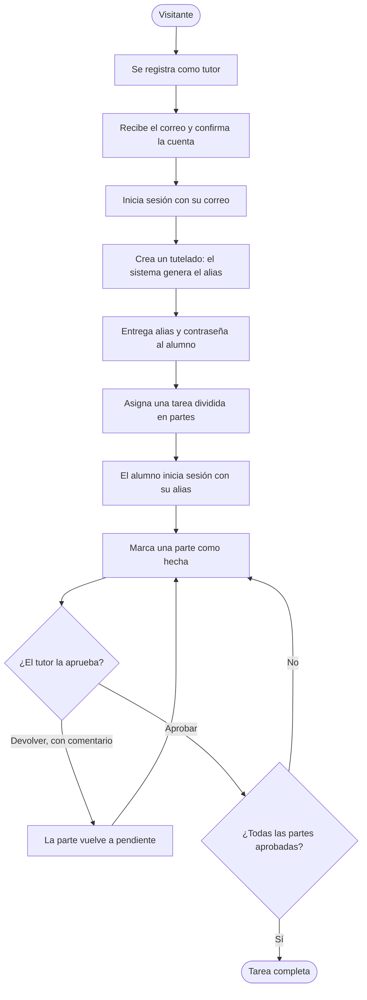

## 4.3 Diagramas de estados

**Figura 3. Estados de una cuenta de tutor.** Un tutelado nace ya confirmado y sin token: no pasa por este diagrama.

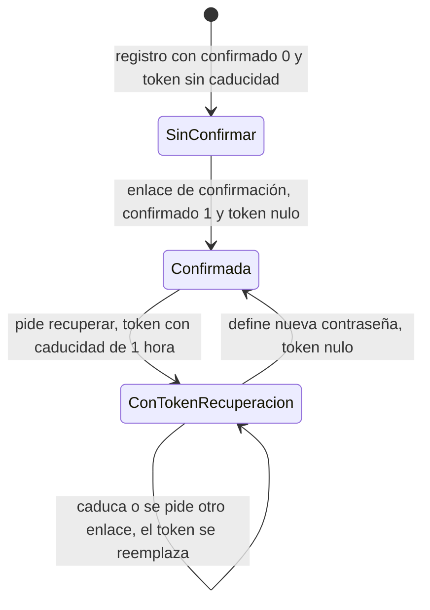

**Figura 4. Estados de una parte de tarea.**

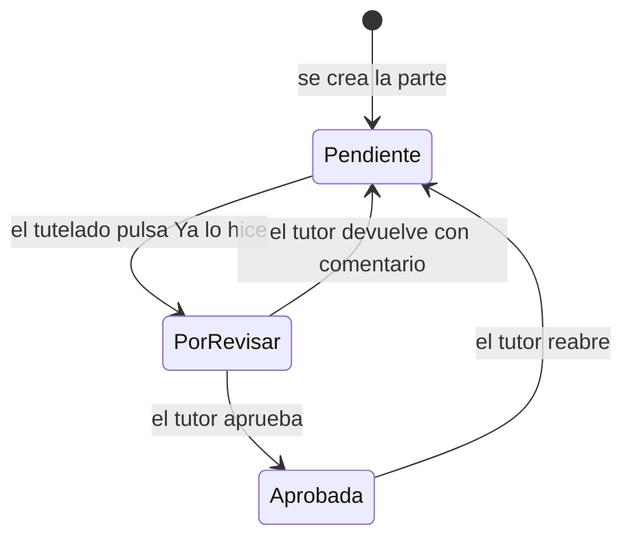

Los estados de la base de datos son `pendiente`, `hecha` y `aprobada`; en pantalla `hecha` se muestra como *Por revisar* (al tutor) o *Esperando al tutor* (al alumno). La tarea no tiene estado propio: se calcula con sus partes.

| Estado de la tarea | Cómo se calcula (`Tarea::progreso` y `Tarea::vencida`)                                                  |
| ------------------ | -------------------------------------------------------------------------------------------------------- |
| En curso           | Tiene al menos una parte que no está aprobada                                                            |
| Completa           | Tiene partes y todas están en estado `aprobada`                                                          |
| Vencida            | Tiene fecha límite anterior a hoy y no está completa (se muestra además del estado anterior)             |

## 4.4 Modelo de datos

**Figura 5. Diagrama entidad-relación (tomado de `claudetask.sql`).**

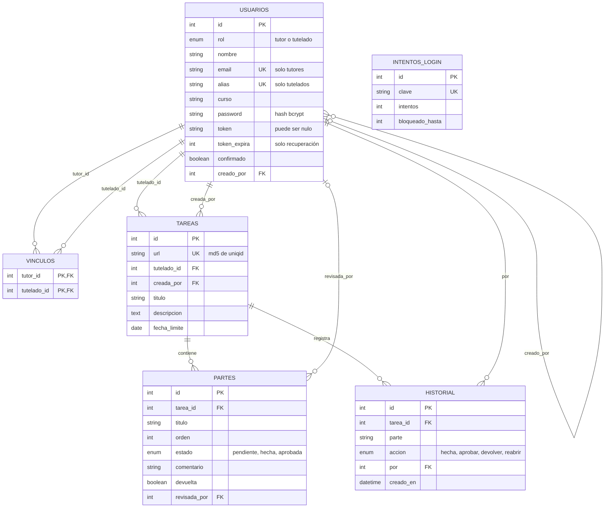

*Leyenda: PK = clave primaria, FK = clave foránea, UK = valor único. `INTENTOS_LOGIN` no se relaciona con otras tablas: su `clave` es el correo o el alias escrito en el acceso. `VINCULOS` une tutores con tutelados (relación de muchos a muchos). Borrados: al borrar una tarea caen sus partes y su historial; al borrar un usuario caen sus vínculos, sus tareas y su historial; `creado_por` y `revisada_por` pasan a `NULL`.*

### Diccionario de datos

**Tabla `usuarios`**

| Campo        | Tipo SQL                  | Nulo | Restricción                                  | Descripción                                                             |
| ------------ | ------------------------- | ---- | -------------------------------------------- | ----------------------------------------------------------------------- |
| id           | int unsigned              | No   | PK, autoincremental                          | Identificador                                                           |
| rol          | enum('tutor','tutelado')  | No   | -                                            | Tipo de cuenta                                                          |
| nombre       | varchar(255)              | No   | -                                            | Nombre visible (la aplicación admite hasta 100 caracteres)              |
| email        | varchar(255)              | Sí   | UNIQUE                                       | Acceso del tutor; `NULL` en tutelados                                   |
| alias        | varchar(60)               | Sí   | UNIQUE                                       | Acceso del tutelado (nombre y número); `NULL` en tutores                |
| curso        | varchar(60)               | Sí   | -                                            | Curso del tutelado (opcional)                                           |
| password     | varchar(255)              | No   | -                                            | Hash bcrypt                                                             |
| token        | varchar(255)              | Sí   | -                                            | Token de confirmación o de recuperación                                 |
| token_expira | int unsigned              | Sí   | -                                            | Hora Unix en que caduca el token de recuperación; `NULL` en el de confirmación |
| confirmado   | tinyint(1)                | No   | Por defecto 0                                | 1 si la cuenta está confirmada (los tutelados se crean con 1)           |
| creado_por   | int unsigned              | Sí   | FK → `usuarios.id`, ON DELETE SET NULL       | Tutor responsable del tutelado                                          |

**Tabla `vinculos`**

| Campo       | Tipo SQL     | Nulo | Restricción                                  | Descripción      |
| ----------- | ------------ | ---- | -------------------------------------------- | ---------------- |
| tutor_id    | int unsigned | No   | PK compuesta, FK → `usuarios.id`, CASCADE    | Tutor vinculado  |
| tutelado_id | int unsigned | No   | PK compuesta, FK → `usuarios.id`, CASCADE    | Tutelado         |

**Tabla `tareas`**

| Campo        | Tipo SQL     | Nulo | Restricción                              | Descripción                              |
| ------------ | ------------ | ---- | ---------------------------------------- | ---------------------------------------- |
| id           | int unsigned | No   | PK, autoincremental                      | Identificador interno                    |
| url          | varchar(255) | No   | UNIQUE                                   | Identificador que usa la API             |
| tutelado_id  | int unsigned | No   | FK → `usuarios.id`, ON DELETE CASCADE    | Alumno al que se asigna                  |
| creada_por   | int unsigned | No   | FK → `usuarios.id`, ON DELETE CASCADE    | Tutor que la creó                        |
| titulo       | varchar(255) | No   | -                                        | Título                                   |
| descripcion  | text         | Sí   | -                                        | Descripción (hasta 5000 en la aplicación)|
| fecha_limite | date         | Sí   | -                                        | Fecha límite opcional                    |

**Tabla `partes`**

| Campo        | Tipo SQL                              | Nulo | Restricción                                | Descripción                                         |
| ------------ | ------------------------------------- | ---- | ------------------------------------------ | --------------------------------------------------- |
| id           | int unsigned                          | No   | PK, autoincremental                        | Identificador                                       |
| tarea_id     | int unsigned                          | No   | FK → `tareas.id`, ON DELETE CASCADE        | Tarea a la que pertenece                            |
| titulo       | varchar(255)                          | No   | -                                          | Texto de la parte                                   |
| orden        | int                                   | No   | Por defecto 0                              | Posición dentro de la tarea                         |
| estado       | enum('pendiente','hecha','aprobada')  | No   | Por defecto `pendiente`                    | Estado de la parte                                  |
| comentario   | varchar(500)                          | No   | Por defecto vacío                          | Comentario del tutor al devolver o aprobar          |
| devuelta     | tinyint(1)                            | No   | Por defecto 0                              | 1 si la última revisión fue una devolución          |
| revisada_por | int unsigned                          | Sí   | FK → `usuarios.id`, ON DELETE SET NULL     | Último tutor que revisó                             |

**Tabla `historial`**

| Campo     | Tipo SQL                                        | Nulo | Restricción                              | Descripción                       |
| --------- | ----------------------------------------------- | ---- | ---------------------------------------- | --------------------------------- |
| id        | int unsigned                                    | No   | PK, autoincremental                      | Identificador                     |
| tarea_id  | int unsigned                                    | No   | FK → `tareas.id`, ON DELETE CASCADE      | Tarea                             |
| parte     | varchar(255)                                    | No   | -                                        | Título de la parte en ese momento |
| accion    | enum('hecha','aprobar','devolver','reabrir')    | No   | -                                        | Qué ocurrió                       |
| por       | int unsigned                                    | No   | FK → `usuarios.id`, ON DELETE CASCADE    | Quién lo hizo                     |
| creado_en | datetime                                        | No   | Por defecto `CURRENT_TIMESTAMP`          | Cuándo                            |

**Tabla `intentos_login`**

| Campo           | Tipo SQL     | Nulo | Restricción         | Descripción                                          |
| --------------- | ------------ | ---- | ------------------- | ---------------------------------------------------- |
| id              | int unsigned | No   | PK, autoincremental | Identificador                                        |
| clave           | varchar(255) | No   | UNIQUE              | Correo o alias escrito, en minúsculas                |
| intentos        | int          | No   | Por defecto 0       | Fallos seguidos (se reinicia al bloquear)            |
| bloqueado_hasta | int unsigned | No   | Por defecto 0       | Hora Unix hasta la que está bloqueado (0 = no)       |

*Charset: `utf8mb4` con colación `utf8mb4_unicode_ci`, motor InnoDB. `claudetask.sql` solo contiene el esquema, sin datos.*

## 4.5 Diagramas de secuencia

**Figura 6. Registro de cuenta y confirmación.**

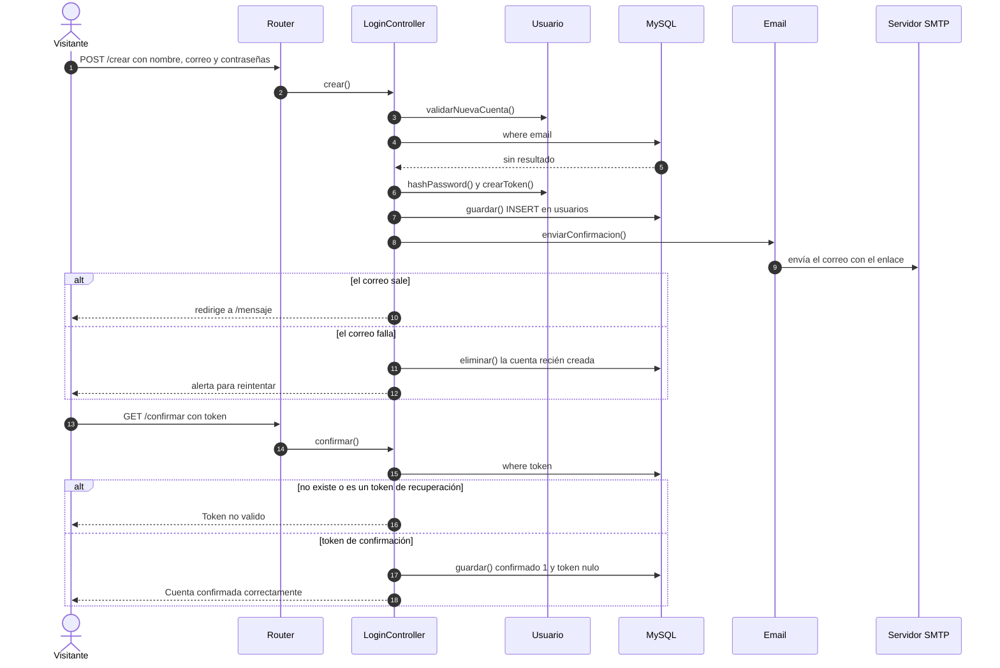

**Figura 7. Inicio de sesión con bloqueo por intentos.**

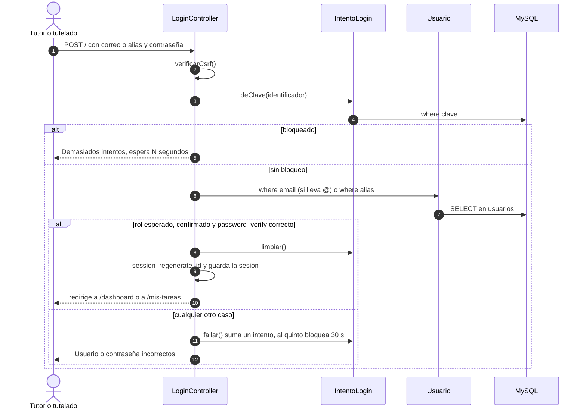

**Figura 8. El tutelado marca una parte como hecha.**

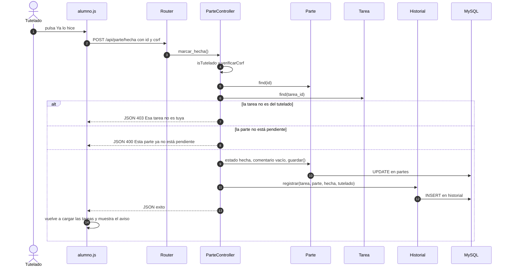

**Figura 9. El tutor revisa una parte.**

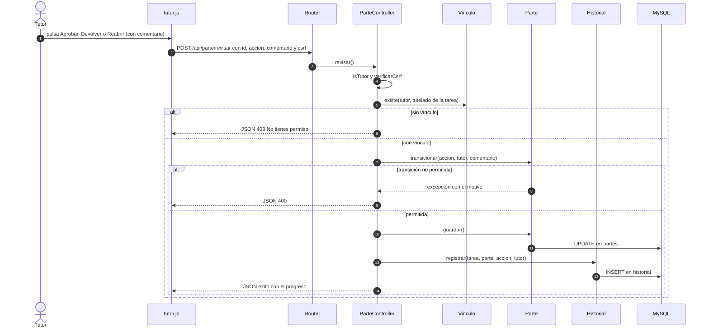

## 4.6 Diagrama de clases

**Figura 10. Clases del sistema (modelos, controladores, router y correo).**

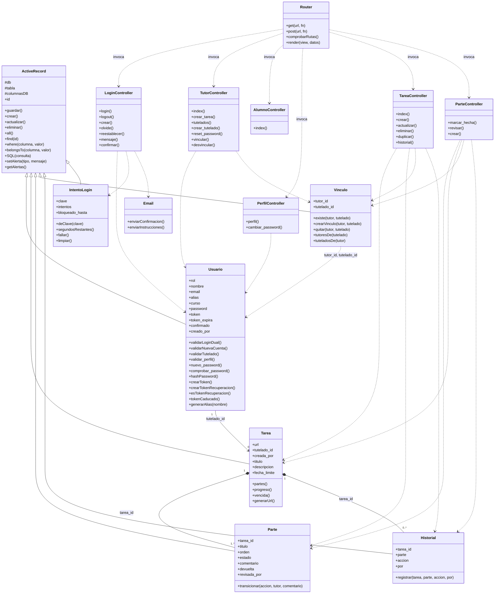

## 4.7 Arquitectura

**Figura 11. Arquitectura por capas.**

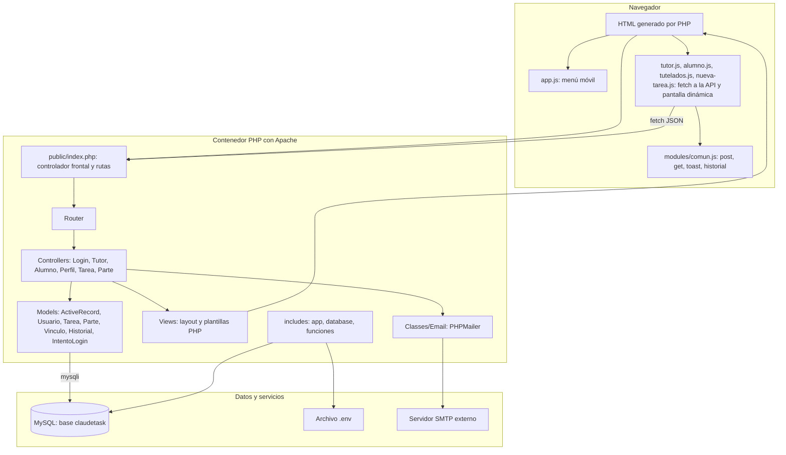

**Decisiones de arquitectura:**

| Decisión                                              | Alternativa                          | Motivo                                                                  |
| ----------------------------------------------------- | ------------------------------------ | ----------------------------------------------------------------------- |
| MVC propio con Router mínimo                          | Framework (Laravel)                  | Proyecto de aprendizaje, sin dependencias pesadas                       |
| Active Record propio con `escape_string` y columnas en lista blanca | ORM o PDO con consultas preparadas | Simplicidad; la defensa depende de escapar y validar cada entrada       |
| Dos roles con vínculo muchos a muchos                 | Un solo propietario por tarea        | Varios tutores pueden atender al mismo tutelado                         |
| La tarea se divide en partes con revisión del tutor   | Estado único por tarea               | El tutor valida el avance paso a paso                                   |
| Estado de la tarea calculado desde sus partes         | Columna de estado en `tareas`        | Un solo origen de verdad: el estado de las partes                       |
| API JSON para tareas y partes, con CSRF en cada POST  | Formularios con recarga              | Paneles fluidos sin recargar                                            |
| Vite + SCSS                                           | CSS a mano o Gulp                    | Recarga en caliente y compilación de recursos                           |
| Docker Compose con usuario de base de solo datos      | Instalación manual, usuario root     | Entorno reproducible y mínimo permiso                                   |

### Rutas de la aplicación

| Método    | Ruta                    | Controlador y método                    | Acceso                    | Descripción                          |
| --------- | ----------------------- | --------------------------------------- | ------------------------- | ------------------------------------ |
| GET, POST | `/`                     | `LoginController::login`                | Público                   | Iniciar sesión                       |
| GET       | `/logout`               | `LoginController::logout`               | Público                   | Cerrar sesión                        |
| GET, POST | `/crear`                | `LoginController::crear`                | Público                   | Registro de tutores                  |
| GET, POST | `/olvide`               | `LoginController::olvide`               | Público                   | Solicitar recuperación               |
| GET, POST | `/reestablecer`         | `LoginController::reestablecer`         | Con token de recuperación | Nueva contraseña                     |
| GET       | `/mensaje`              | `LoginController::mensaje`              | Público                   | Aviso de correo enviado              |
| GET       | `/confirmar`            | `LoginController::confirmar`            | Con token de confirmación | Confirmar cuenta                     |
| GET       | `/dashboard`            | `TutorController::index`                | Tutor                     | Panel de tareas del tutor            |
| GET       | `/crear-tarea`          | `TutorController::crear_tarea`          | Tutor                     | Formulario de nueva tarea            |
| GET       | `/tutelados`            | `TutorController::tutelados`            | Tutor                     | Gestión de tutelados y vínculos      |
| GET       | `/mis-tareas`           | `AlumnoController::index`               | Tutelado                  | Panel de tareas del alumno           |
| GET, POST | `/perfil`               | `PerfilController::perfil`              | Sesión                    | Editar perfil                        |
| GET, POST | `/cambiar-password`     | `PerfilController::cambiar_password`    | Sesión                    | Cambiar contraseña                   |
| GET       | `/api/tareas`           | `TareaController::index`                | Sesión (según rol)        | Listar tareas (JSON)                 |
| POST      | `/api/tarea`            | `TareaController::crear`                | Tutor vinculado           | Crear tarea con partes               |
| POST      | `/api/tarea/actualizar` | `TareaController::actualizar`           | Tutor vinculado           | Editar tarea y partes                |
| POST      | `/api/tarea/eliminar`   | `TareaController::eliminar`             | Tutor vinculado           | Eliminar tarea                       |
| POST      | `/api/tarea/duplicar`   | `TareaController::duplicar`             | Tutor vinculado           | Duplicar a otros tutelados           |
| GET       | `/api/historial`        | `TareaController::historial`            | Dueño o tutor vinculado   | Historial de una tarea               |
| POST      | `/api/parte/hecha`      | `ParteController::marcar_hecha`         | Tutelado dueño            | Marcar una parte como hecha          |
| POST      | `/api/parte/revisar`    | `ParteController::revisar`              | Tutor vinculado           | Aprobar, devolver o reabrir          |
| POST      | `/api/tutelado`         | `TutorController::crear_tutelado`       | Tutor                     | Crear tutelado                       |
| POST      | `/api/tutelado/password`| `TutorController::reset_password`       | Tutor vinculado           | Restablecer su contraseña            |
| POST      | `/api/vinculo`          | `TutorController::vincular`             | Tutor vinculado           | Vincular a otro tutor                |
| POST      | `/api/vinculo/eliminar` | `TutorController::desvincular`          | Tutor vinculado           | Quitar un vínculo                    |

*Una ruta que no existe responde 404 con la vista `404`. Las páginas protegidas redirigen a `/` sin sesión o con el rol equivocado; la API responde JSON con código 403.*

### Contrato de la API

Todos los POST llevan el campo `csrf` (o la cabecera `X-CSRF-Token`); sin él responden 403. Las respuestas son JSON; en un error llevan `{ "tipo": "error", "mensaje": "..." }` con el código 400, 403 o 404.

| Endpoint                         | Parámetros                                                         | Respuesta correcta                                                                   |
| -------------------------------- | ------------------------------------------------------------------ | ------------------------------------------------------------------------------------ |
| `GET /api/tareas`                | `tutelado` (opcional), `porRevisar` (opcional)                     | `{ "tareas": [ { url, titulo, descripcion, fecha_limite, tutelado_id, vencida, progreso: {ok, total, completa}, partes: [ {id, titulo, estado, comentario, devuelta} ] } ] }` |
| `POST /api/tarea`                | `tutelado_id`, `titulo`, `descripcion`, `fecha_limite`, `partes[]` | `{ tipo: "exito", url, mensaje }`                                                    |
| `POST /api/tarea/actualizar`     | `url`, `titulo`, `descripcion`, `fecha_limite`, `partes` (JSON `[{id, titulo}]`) | `{ tipo: "exito", mensaje }`                                           |
| `POST /api/tarea/eliminar`       | `url`                                                              | `{ tipo: "exito", mensaje }`                                                         |
| `POST /api/tarea/duplicar`       | `url`, `destinos[]` (ids de tutelados)                             | `{ tipo: "exito", copiadas }`                                                        |
| `GET /api/historial`             | `url`                                                              | `{ "historial": [ { parte, accion, por, cuando } ] }`                                |
| `POST /api/parte/hecha`          | `id`                                                               | `{ tipo: "exito", mensaje }`                                                         |
| `POST /api/parte/revisar`        | `id`, `accion` (`aprobar`, `devolver`, `reabrir`), `comentario`    | `{ tipo: "exito", progreso: {ok, total, completa} }`                                 |
| `POST /api/tutelado`             | `nombre`, `curso`, `password`                                      | `{ tipo: "exito", nombre, alias, password }` (la contraseña solo se devuelve aquí)   |
| `POST /api/tutelado/password`    | `id`, `password`                                                   | `{ tipo: "exito", mensaje }`                                                         |
| `POST /api/vinculo`              | `tutelado_id`, `correo`                                            | `{ tipo: "exito", mensaje }`                                                         |
| `POST /api/vinculo/eliminar`     | `tutelado_id`, `tutor_id`                                          | `{ tipo: "exito", mensaje }`                                                         |

## 4.8 Despliegue

**Figura 12. Diagrama de despliegue con Docker.**

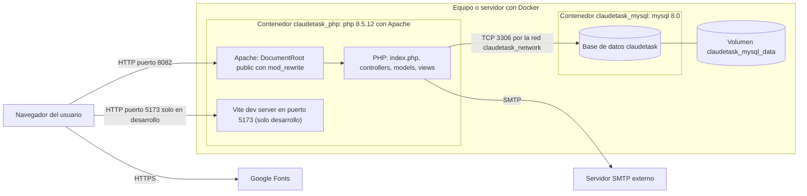

*En el primer arranque, con el volumen vacío, MySQL ejecuta `01-claudetask.sql` (esquema) y `02-usuario.sh` (crea `claudetask_app` con permisos solo de datos). Las claves salen de `.env`.*

**Despliegue en DOM Cloud (sin Docker).** La figura 12 es el entorno de desarrollo. En DOM Cloud no hay contenedores; la tabla compara los dos entornos con lo que se verificó en el despliegue (5.4, R6; receta en 8.2).

| Elemento              | Docker (desarrollo)                          | DOM Cloud (verificado en el despliegue)                                                   |
| --------------------- | -------------------------------------------- | ----------------------------------------------------------------------------------------- |
| PHP y servidor web    | PHP 8.5.12 con Apache                        | PHP 8.4.27 con php-fpm bajo NGINX                                                         |
| Base de datos         | MySQL 8.0, base `claudetask`                 | MariaDB, base `santi_task_db`; sin `CREATE DATABASE` ni `USE` en la carga                 |
| Usuario de la base    | `claudetask_app`, solo datos                 | El usuario de la cuenta, con permisos sobre su base (LIM-14)                              |
| Reglas de rutas       | `docker/apache.conf`                         | Bloque `nginx` de la receta: reescritura a `index.php`, 404 para rutas con punto y para archivos con extensión inexistentes |
| Recursos de Vite      | Servidor de desarrollo en el puerto 5173     | `npm ci` y `npm run build` en cada despliegue (la versión de Node del servidor no está aclarada, 8.1)                       |
| Variables de entorno  | `.env` creado a mano                         | `.env` generado por la receta (`DB_*`, `MAIL_*`, `APP_URL`, `ENVIRONMENT=production`)     |
| HTTPS                 | Proxy externo, no incluido                   | `ssl` y `ssl always` de DOM Cloud                                                         |
| Respaldos             | `docker/respaldo.sh` y `restaurar.sh`        | Sin resolver (R3, LIM-10)                                                                 |

## 4.9 Diagrama de red

**Figura 13. Puertos y comunicaciones.**

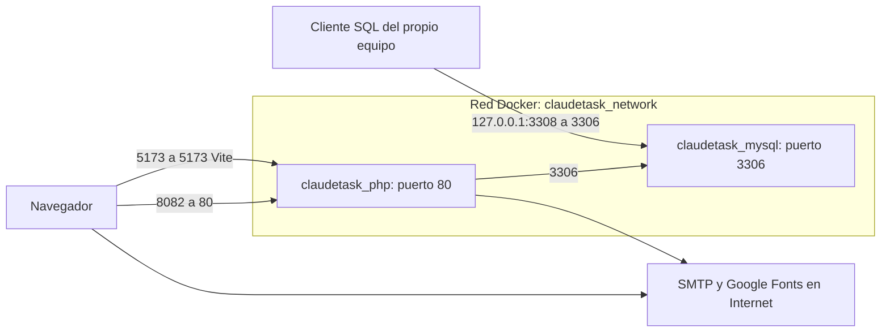

| Puerto del equipo | Contenedor                | Uso                                                                  |
| ----------------- | ------------------------- | -------------------------------------------------------------------- |
| 8082              | `claudetask_php` (80)     | Aplicación web                                                       |
| 5173              | `claudetask_php` (5173)   | Servidor de desarrollo de Vite (se quita en producción)              |
| 127.0.0.1:3308    | `claudetask_mysql` (3306) | Base de datos, accesible solo desde el propio equipo                 |

*No hay HTTPS en esta composición: en producción va un servidor o proxy con HTTPS delante del puerto 8082.*

## 4.10 Diseño de interfaz

| Pantalla                | Ruta                   | Contenido                                                                                             |
| ----------------------- | ---------------------- | ----------------------------------------------------------------------------------------------------- |
| Iniciar sesión          | `/`                    | Correo o alias, contraseña, enlaces a crear cuenta y olvidé                                           |
| Crear cuenta            | `/crear`               | Nombre, correo, contraseña y repetición                                                               |
| Olvidé mi contraseña    | `/olvide`              | Correo                                                                                                |
| Reestablecer            | `/reestablecer?token=` | Nueva contraseña (solo si el token es válido y no caducó)                                             |
| Mensaje                 | `/mensaje`             | Aviso de correo enviado                                                                               |
| Confirmar cuenta        | `/confirmar?token=`    | Resultado de la confirmación                                                                          |
| Tareas (tutor)          | `/dashboard`           | Filtro por tutelado, casilla «Solo por revisar», tarjetas con partes, avance y acciones               |
| Nueva tarea             | `/crear-tarea`         | Tutelado, título, descripción, fecha límite y partes (**+ Añadir parte**)                             |
| Tutelados               | `/tutelados`           | Alta de tutelado, datos de acceso (una sola vez), lista con tutores, vincular, quitar y restablecer   |
| Mis tareas (tutelado)   | `/mis-tareas`          | Tarjetas con sus partes: **Ya lo hice**, *Esperando al tutor*, comentario del tutor, historial        |
| Perfil                  | `/perfil`              | Nombre y correo (tutor) o alias (tutelado, solo lectura); enlace a cambiar contraseña                 |
| Cambiar contraseña      | `/cambiar-password`    | Contraseña actual y nueva                                                                             |
| Ventanas del panel      | (en `/dashboard`)      | Editar tarea, Duplicar tarea, Historial; el historial también está en `/mis-tareas`                   |

**Elementos comunes:** barra lateral con las opciones del rol (el tutor ve Tareas, Nueva tarea, Tutelados y Perfil; el tutelado, Mis tareas y Perfil); barra superior con el nombre, el rol y **Cerrar Sesión**; menú desplegable en móvil; modo claro y oscuro automáticos.

> **[Completar]** Inserta capturas de cada pantalla: ``

---

# 5. Gestión del proyecto

## 5.1 Metodología

No se aplicó una metodología formal. El proceso real fue un desarrollo incremental de una sola persona: cada paso (del Paso 1 al Paso 10) cambió una parte del sistema, se probó y se cerró con un commit, y las pruebas quedaron registradas en la sección 13. De las metodologías conocidas, la más parecida es un Kanban personal, sin sprints ni estimaciones.

## 5.2 Plan y cronograma

Git registra los 30 commits del proyecto hasta `272405a` con la misma fecha, 2026-11-03, así que no se puede reconstruir un cronograma con duraciones y no se inventa uno. La tabla muestra el orden real de los pasos con sus commits.

| Paso | Contenido                                                                          | Commits                                                                               |
| ---- | ---------------------------------------------------------------------------------- | ------------------------------------------------------------------------------------- |
| 1    | Base renombrada a ClaudeTask                                                       | `19d6614`                                                                             |
| 2    | Consultas seguras, NULL real, 404, sesión única, CSRF                              | `c1b2931`                                                                             |
| 3    | Roles, login por correo o alias, bloqueo de intentos                               | `044f268`                                                                             |
| 4    | Tareas y partes, API, vínculos, panel del tutor                                    | `d9850e0`                                                                             |
| 5    | Flujo de estados, historial y vista del alumno                                     | `b2bd296`                                                                             |
| 6    | Tutelados, vínculos y endurecimiento de entradas                                   | `d01b229`, `98a7151` (parche)                                                         |
| 7    | Interfaz en modo claro y modo oscuro                                               | `f03a7b1`, `7e375cf`                                                                  |
| -    | Endurecimiento de `TareaController` y de la cuenta                                 | `c3401ed`, `1da09e5`                                                                  |
| 8    | Lista de pruebas P-01 a P-25                                                       | `a3f03d4`, `97a16f7`                                                                  |
| 9    | Errores y correo, tokens, usuario de base, CSP, respaldo, README, P-26 a P-35      | `c978a1f`, `c1a2919`, `2f334a3`, `7bfa426`, `f7414b2`, `6aa6283`, `5b581aa`, `941e8d1`, `563e2ff`, `6a96305` |
| 10   | Documentación alineada con el sistema real (10a a 10d)                         | `6f9a8b9`, `1fe904c`, `73e90ac`, `5b54f42`, `56c8534`, `eb67270`, `272405a`                                |
| 11 | P-36 a P-43 (11a), publicación en DOM Cloud (11b), P-44 con LIM-16 y LIM-17 (11c), P-45, ciclo de revisión (11d), P-46 en el servidor (11e), P-47, recorrido en el servidor (11f) LIM-18, cuentas de prueba en el servidor (11g) y P-48, rechazos en el servidor (11h) y LIM-19, zona horaria del servidor (11i) y limpieza de código con P-49 (11j) y P-50 con LIM-20, cierre de B1 y B4 (11k) y P-51, reabrir y rechazos con una tarea ajena en el servidor (11l), P-52 y P-53, registro de errores de PHP y recorrido en el navegador en un sitio de pruebas (11m) y LIM-19 resuelta en parte con P-54, hora del historial en la zona del navegador (11n) y P-55 a P-57, charset de la conexión, alias sin `iconv` y correo de confirmación contra Ethereal, con la decisión de usar solo Ethereal (11o), `nosniff` y `Referrer-Policy` desde PHP con LIM-16 resuelta en parte (11p), sin `X-Powered-By` (11q), ruta `/api/parte` sin uso quitada (11r) y registro del despliegue en el publicado con P-58, P-59 y las decisiones del 2026-11-05 (11s) | `244d0f5` (11a), `d428585` (11b), `d8852dd` (11c), `4782b14` (11d), `207dc2c` (11e), `19e805f` (11f), `a3909fe` (11g), `dcbcdf0` (11h), `3aa234f` (11i), `ec8357d` (11j), `1a295e8` (11k), `232d168` (11l), `d741ac2` (11n, solo `comun.js`), `1d2ad7a` (11m y registro de 11n), `12f3881` (11o), `2410736` (11p), `61dab42` (11q), `c16d246` (11r), `8d37318` (11s) |

**Pendiente para la Versión 1.0:** que otra persona haga el ciclo solo con el `README.md` (7.2), insertar las capturas (4.10), confirmar la metodología (5.1) y los roles (5.3), y que el autor haga la limpieza de la base del publicado antes de la presentación o de abrir el sitio al público (LIM-18, aceptada con esa condición; debe dejar al menos un tutor con clave fuerte, porque sin SMTP no se registran tutores nuevos, LIM-15). La publicación en DOM Cloud está hecha y se actualizó el 2026-11-05 por `git pull` (8.2); P-44, P-46, P-47, P-48, P-51, P-58 y P-59 son del servidor publicado. Siguen abiertas, sin compromiso de fecha: la cadena del certificado (LIM-17), los estáticos de `/build/` sin `nosniff` ni `Referrer-Policy` (LIM-16, resuelta en parte), los respaldos manuales con restauración no probada en el servidor (LIM-10) y el correo del publicado (LIM-15, aceptada: solo Ethereal).

## 5.3 Roles y responsabilidades

Un rol es la tarea de la que alguien responde en el proyecto. Como el autor es una sola persona, ella cubre todos.

| Integrante                                | Rol                                       | Responsabilidades                                                              |
| ----------------------------------------- | ----------------------------------------- | ------------------------------------------------------------------------------ |
| Julio Cesar Choque Mamani (CaesarDev)     | Desarrollo, frontend, calidad y documentación | Backend y base de datos; vistas, SCSS y JavaScript del cliente; pruebas y manuales |

## 5.4 Riesgos

Probabilidad e impacto son una estimación del autor al 2026-11-03, no una medición.

| ID  | Riesgo                                                                                                    | Probabilidad | Impacto | Mitigación                                                                                                          |
| --- | --------------------------------------------------------------------------------------------------------- | ------------ | ------- | ------------------------------------------------------------------------------------------------------------------- |
| R1  | Uso malicioso por fallos de seguridad que no se hayan encontrado (los conocidos están resueltos, sección 10) | Baja         | Alto    | 58 pruebas pasan y P-44 pasa en parte; quedan LIM-01, LIM-02, LIM-11 a LIM-13 y LIM-16, esta resuelta en parte (7.3)                         |
| R2  | Los correos de confirmación y recuperación tardan o no salen (SMTP síncrono, LIM-07)                      | Media        | Alto    | Se probó el envío contra Ethereal (P-57); sin SMTP real en el sitio publicado, aceptado (LIM-15); en DOM Cloud ver R7 |
| R3  | Pérdida de datos si se borra el volumen de MySQL o la cuenta del servidor                                 | Media        | Alto    | `docker/respaldo.sh` y `docker/restaurar.sh` (P-32) en Docker; en el servidor de publicación los respaldos son manuales, con phpMyAdmin (Exportar); la restauración no se probó allí (LIM-10)   |
| R4  | Versiones de dependencias que cambien o no existan                                                        | Media        | Medio   | `composer.lock` y `package-lock.json` fijan los paquetes; el `Dockerfile` fija `php:8.5.12-apache` y la base es `mysql:8.0` |
| R5  | Un solo desarrollador conoce el sistema                                                                   | Media        | Medio   | Mantener esta documentación actualizada y la prueba de usabilidad con otra persona (7.2)                            |
| R6  | El servidor de publicación (DOM Cloud) no usa Docker, Apache ni MySQL 8, y el sistema depende de ellos      | Media        | Medio   | Ver abajo                                                                                                           |
| R7  | Límites del plan Lite de DOM Cloud (transferencia, almacenamiento, cortafuegos de salida)                                                                    | Media        | Medio   | Ver abajo                                                                                                           |

**R6.** DOM Cloud no usa Docker: según su documentación (consultada el 2026-11-03) sirve con NGINX y php-fpm y trae MariaDB, no MySQL 8. ClaudeTask se desplegó allí (el registro del despliegue del runner lleva fecha 2026-11-03; la receta está en 8.2). El 2026-11-05 se montó además un segundo sitio de pruebas desechable (8.2) donde se hicieron P-52 a P-57; el autor lo eliminó después (confirmado por él el 2026-11-05) y esas pruebas no se pueden repetir allí. R6 pasó de Alta/Alto a Media/Medio el 2026-11-05 (criterio de Claude por delegación del autor, no una medición): el sistema ya funciona y está probado en el publicado, pero tres diferencias del entorno aparecieron tarde (conexión `latin1`, `iconv` con `LC_CTYPE=C` y hora en UTC), así que no baja a Baja.

*Verificado en el registro del despliegue y en phpMyAdmin:*

- PHP 8.4.27. `php -l` no dio fallos en `controllers`, `models`, `classes`, `includes`, `Router.php` y `public`. El `Dockerfile` usa 8.5.12; `composer.lock` pide `^8.0`.
- `composer install --no-dev` y `vite build` (5.4.21; en ese momento se anotó el Node 18 por defecto; el SSH del publicado mostró v24.22.1 el 2026-11-05 y no se sabe qué Node usa la receta) terminan sin errores.
- `claudetask.sql` no carga tal cual: empieza con `CREATE DATABASE claudetask` y `USE claudetask`, y en el servidor la base es `santi_task_db`. Se quitan esas líneas con `sed` y se fija `utf8mb4_unicode_ci` con `ALTER DATABASE`, porque las tablas solo declaran `ENGINE=InnoDB` y heredan el charset de la base. Resultado: 6 tablas `InnoDB` y `utf8mb4_unicode_ci`.
- Un volcado de la base local (usuarios 6, tareas 3, partes 6, historial 7, vínculos 4 e `intentos_login` 0) se importó con phpMyAdmin después de quitar el prefijo `claudetask.` de sus `DROP TABLE`, porque el usuario del servidor solo tiene permisos sobre su propia base. Los contadores coinciden.
- En local, el mismo SQL cargó sin errores en MariaDB 10.11.19 y 11.4.13, y los rechazos (ENUM inválido, alias de 61 caracteres, correo repetido y `CREATE TABLE` sin permiso) dieron los errores 1265, 1406, 1062 y 1142, como en MySQL 8. Las diferencias vistas son de informe (`default_generated`; `no action` frente a `restrict`) y de `sql_mode` (MariaDB no trae `ONLY_FULL_GROUP_BY`).
- El NGINX generado tiene la reescritura a `index.php`, el 404 para rutas con punto (salvo `.well-known`) y el 404 para archivos con extensión que no existen.
- En `https://santi-task.domcloud.dev` una sesión de tutor llegó a `/dashboard` (visto en la barra de direcciones de Brave; no se anotó el contenido de la página).
- P-44 (2026-11-04, `curl` contra el sitio publicado): portada 200; cookie `PHPSESSID` con `Secure`, `HttpOnly` y `SameSite=Lax`; CSP de producción estricta; `/build/.vite/manifest.json`, `/.env`, `/.git/config`, una ruta inexistente y `/phpinfo.php` dan 404; `/build/` y `/build/assets/` dan 403; el CSS y los seis scripts dan 200 con su tipo; `http://` da 301 a `https://`.
- Lo que P-44 encontró y no pasaba: no salían `X-Content-Type-Options` ni `Referrer-Policy` (LIM-16; el Paso 11p los envía desde PHP y P-59 los vio en las páginas, la API y los 404, no en los estáticos), y el servidor envía un solo certificado, sin el intermedio (LIM-17); Brave y Firefox abren el sitio.
- P-46 (2026-11-04, `curl` contra el sitio publicado): Ana con clave errónea da 200 y con la correcta 302 a `/dashboard`, con `PHPSESSID` nuevo y cookie `secure; HttpOnly; SameSite=Lax`; Lucia47 entra por alias; las 6 rutas privadas sin sesión dan 302 a `/`; las 10 páginas dan 200 sin `style=`, `<style>`, manejadores `on...=`, scripts en línea sin nonce ni errores de PHP visibles, con el nonce de la cabecera igual al del HTML en las 6 que tienen script; los 6 estáticos citados dan 200 sin `sourceMappingURL` y sus `.map` dan 404.
- P-47 (2026-11-04, `curl` contra el sitio publicado): Ana crea una tarea de prueba con dos partes para Lucia47 y la recorren: Lucia marca hecha, Ana devuelve con comentario, Lucia marca otra vez, Ana aprueba, Lucia marca la segunda y Ana aprueba (`completa` true); todas las acciones dan 200, el historial tiene 6 filas con autor y fecha, y la tarea se borró (Ana vuelve a 4 tareas). El registro «PHP Error Logs» del panel (Check, Check Logs) estaba vacío cuando el autor lo miró después; no se anotó la hora y no hubo una prueba de control que lo hiciera escribir, así que no prueba que PHP no haya fallado. P-52 (Paso 11m) hizo después ese control en el sitio de pruebas: el registro sí capturó un aviso y un error fatal; en el sitio publicado no se repitió.
- Actualización del publicado (2026-11-05, 8.2): `git pull` de `603686c` a `12f3881` (15 commits), `php -l` sin errores en los tres PHP cambiados, `npm ci` y `npm run build` correctos (solo se vieron las últimas líneas) y la raíz da 200; sin migración de esquema.
- P-58 (2026-11-05, publicado): la conexión ya es `utf8mb4` (el panel mostró «Células madre» antes de migrar); LIM-22 resuelta (medición por bytes de 9 columnas de texto, una sola fila dañada, migrada); alias con tilde bien (P-56) y hora del historial en La Paz (P-54).
- P-59 (2026-11-05, publicado): `nosniff` y `Referrer-Policy` salen en las páginas, la API y los 404 de la aplicación, no en los estáticos; sin `X-Powered-By`; `/api/parte` da 404.

*No verificado:* que el panel «PHP Error Logs» muestre el mismo archivo que P-52 leyó por SSH, y que el sitio publicado registre errores como el de pruebas (P-52 lo verificó en el de pruebas; para el publicado es una inferencia; P-46 solo vio que no salgan errores en pantalla); un recorrido completo con tareas en el sitio publicado que empiece creando un tutelado desde la interfaz (P-58 hizo la creación, el alias y la entrada del alumno, sin tarea; P-53 lo hizo completo en el sitio de pruebas; P-47 usó los usuarios y el vínculo ya existentes); listado de directorios fuera de `/build/` y `/build/assets/`; si la pestaña NGINX del panel admite `add_header` (la documentación de DOM Cloud no lo documenta para las ubicaciones de la receta); si con dominio propio y `ssl letsencrypt` cambia la cadena del certificado; el origen de la tarea 16 («C naturales»), que no estaba en el volcado importado; la versión de MariaDB del servidor; y si alguna consulta usa `GROUP BY` y se comporta distinto sin `ONLY_FULL_GROUP_BY`.

Mitigación: el registro de errores de PHP se comprobó en el sitio de pruebas (P-52), no en el publicado; el recorrido en el navegador con un tutelado creado desde la interfaz se hizo en el sitio de pruebas (P-53) y en el publicado solo la creación, el alias y la entrada (P-58); `nosniff` y `Referrer-Policy` salen desde PHP (Paso 11p, P-59), salvo en los estáticos de `/build/` (LIM-16); cambiar o borrar las cuentas de prueba del servidor antes de presentar o abrir el sitio al público (LIM-18, aceptada con esa condición); los respaldos son manuales, con phpMyAdmin (LIM-10, R3).

**R7.** El sitio está en el plan Lite de DOM Cloud: 1,5 USD al mes, según el autor y el blog oficial de DOM Cloud, que también da un tope de 20 GB de transferencia al mes. Otras cifras (5 GiB de almacenamiento, 6 sitios y 3 usuarios) salen de un sitio de terceros (freetier.co) y no se confirmaron en la documentación oficial. Lo que la documentación consultada el 2026-11-03 decía del plan gratuito (cortafuegos de salida permanente que bloquea las conexiones salientes salvo una lista de sitios, puerto 25 bloqueado con relay por el 587 o una API REST, aviso en `*.dom.my.id` y caducidad a los 60 días) no se verificó para el Lite. La lista de sitios permitidos no se revisó, así que no se sabe si el SMTP elegido cabe en ella. Mitigación: confirmar los límites del Lite en el portal, probar el SMTP desde el servidor antes de elegirlo, hacer respaldos fuera del servidor y usar un dominio propio si no se quiere el dominio `domcloud.dev`.

## 5.5 Recursos y costos

| Recurso                                   | Costo                                                                                                  |
| ----------------------------------------- | ------------------------------------------------------------------------------------------------------ |
| Desarrollo local con Docker               | 0 USD                                                                                                  |
| Pruebas de correo (Ethereal)              | 0 USD                                                                                                  |
| Alojamiento: DOM Cloud, plan Lite         | 1,5 USD al mes (dato del autor; coincide con el blog oficial de DOM Cloud)                             |
| Dominio actual: `santi-task.domcloud.dev` | El de DOM Cloud, sin costo adicional anotado; el autor decidió el 2026-11-05 seguir con él y no contratar un dominio propio                                                           |
| Servidor SMTP para publicar               | Ninguno: el autor decidió el 2026-11-05 usar solo Ethereal y no abrir otro SMTP (LIM-15)               |
| Dominio propio (opcional)                 | Ninguno: no se contrató (decisión del autor, 2026-11-05)                                                                                            |

---

# 6. Implementación

## 6.1 Tecnologías y herramientas

| Componente                    | Tecnología                                                  | Versión (según los archivos)                                                            |
| ----------------------------- | ----------------------------------------------------------- | --------------------------------------------------------------------------------------- |
| Lenguaje servidor             | PHP                                                         | 8.5.12 (imagen `php:8.5.12-apache`); 8.4.27 en DOM Cloud (5.4, R6)                    |
| Servidor web                  | Apache con `mod_rewrite` y `mod_headers`                    | De la imagen                                                                            |
| Base de datos                 | MySQL, InnoDB, `utf8mb4_unicode_ci`                         | 8.0 (`mysql:8.0`); MariaDB en DOM Cloud (cargada también en 10.11.19 y 11.4.13 en local)|
| Acceso a datos                | `mysqli`                                                    | Extensión de PHP; el Dockerfile instala solo `zip` y `mysqli` (`pdo` y `pdo_mysql` se quitaron en el Paso 11k, P-50) |
| Dependencias de PHP           | Composer                                                    | Imagen `composer:latest`                                                                |
| Correo                        | `phpmailer/phpmailer`                                       | ^7.1                                                                                    |
| Variables de entorno          | `vlucas/phpdotenv`                                          | ^5.6                                                                                    |
| Empaquetado                   | Vite, con `vite-plugin-full-reload` y un plugin propio (`vite-plugins/scss-auto-index.js`) | ^5.0.0; ^1.1.0                                                  |
| Estilos                       | Sass (SCSS)                                                 | ^1.75.0                                                                                 |
| Utilidad de compilación       | `fast-glob`                                                 | ^3.3.3                                                                                  |
| Node y npm                    | Paquetes `nodejs` y `npm` del sistema de la imagen          | Los que traiga la imagen                                                                |
| Fuentes                       | Bricolage Grotesque y Figtree                               | Google Fonts                                                                            |
| Contenedores                  | Docker Compose, servicios `php` y `mysql`                   | Compose v2                                                                              |

## 6.2 Estructura del código

```
claudetask/
├── public/
│   └── index.php            # Controlador frontal: define todas las rutas
├── Router.php               # Clase MVC\Router (rutas y render de vistas)
├── controllers/
│   ├── LoginController.php  # Acceso, registro, confirmación y recuperación
│   ├── TutorController.php  # Panel del tutor, tutelados y vínculos
│   ├── TareaController.php  # API de tareas e historial
│   ├── ParteController.php  # API de partes: añadir, marcar hecha y revisar
│   ├── AlumnoController.php # «Mis tareas» del tutelado
│   └── PerfilController.php # Perfil y cambio de contraseña
├── models/
│   ├── ActiveRecord.php     # Clase base con CRUD y consultas
│   ├── Usuario.php          # Tutores y tutelados, tokens, alias
│   ├── Tarea.php
│   ├── Parte.php            # Estados y transiciones de una parte
│   ├── Vinculo.php          # Relación tutor-tutelado
│   ├── Historial.php
│   └── IntentoLogin.php     # Bloqueo por intentos fallidos
├── classes/
│   └── Email.php            # Envío de correos con PHPMailer
├── includes/
│   ├── app.php              # Autoload, .env, errores, sesión, cabeceras y conexión
│   ├── database.php         # Conexión mysqli con variables de entorno
│   └── funciones.php        # s(), isAuth(), isTutor(), isTutelado(), CSRF, CSP y Vite
├── views/
│   ├── layout.php           # Plantilla base
│   ├── 404.php
│   ├── auth/                # Pantallas de acceso
│   ├── tutor/               # Tareas, nueva tarea y tutelados
│   ├── alumno/              # Mis tareas
│   ├── perfil/              # Perfil y cambio de contraseña
│   └── templates/           # Alertas, barra, sidebar, cabecera y pie del panel
├── src/
│   ├── js/                  # app.js, tutor.js, alumno.js, tutelados.js, nueva-tarea.js y modules/comun.js
│   └── scss/                # base, componentes, auth, dashboard, dark
├── vite-plugins/
│   └── scss-auto-index.js   # Mantiene los _index.scss de src/scss
├── docker/                  # Dockerfile, apache.conf, initdb/, respaldo.sh, restaurar.sh, crear-usuario-bd.sh
├── docker-compose.yml
├── claudetask.sql           # Esquema de la base de datos
├── .env.example             # Plantilla de variables de entorno
├── README.md                # Instalación y manuales
└── composer.json / package.json / vite.config.js
```

`src/scss/dashboard/_proyectos.scss` era un resto de UpTask (`.no-proyectos` y `.listado-proyectos`, esta también en el modo oscuro) que ninguna vista ni script usaba; se quitó en el Paso 11j junto con su `@forward` y su regla del modo oscuro. Con Sass 1.75, el CSS compilado solo perdió esas reglas (P-49).

**Convenciones observadas:** espacios de nombres PSR-4 (`MVC`, `Controllers`, `Model`, `Classes`); métodos de controlador estáticos que reciben el `Router`; alertas en `Model\ActiveRecord` como arreglo estático `['error'|'exito'][]`; nombres de métodos en `camelCase` y `snake_case` mezclados (`crear_tutelado`, `marcar_hecha`, `generarAlias`); textos de interfaz en español.

**Variables de entorno usadas por el código** (la plantilla es `.env.example`):

| Variable                                                   | Dónde se usa                                                          | Descripción                                                                                       |
| ---------------------------------------------------------- | --------------------------------------------------------------------- | ------------------------------------------------------------------------------------------------- |
| `DB_HOST`, `DB_USER`, `DB_PASS`, `DB_NAME`                 | `includes/database.php`; `docker-compose.yml` e `initdb/02-usuario.sh` | Conexión MySQL. `DB_USER` es `claudetask_app`, con permisos solo de datos                         |
| `MYSQL_ROOT_PASSWORD`                                      | `docker-compose.yml` y los scripts de `docker/`                       | Contraseña de root de MySQL, para administración y respaldos; la aplicación no la usa            |
| `MAIL_HOST`, `MAIL_PORT`, `MAIL_USERNAME`, `MAIL_PASSWORD` | `classes/Email.php`                                                   | SMTP                                                                                              |
| `MAIL_FROM`                                                | `classes/Email.php`                                                   | Remitente de los correos (opcional; por omisión `cuentas@claudetask.com`)                        |
| `APP_URL`                                                  | `classes/Email.php`, `includes/app.php`                               | Base de los enlaces de los correos; si empieza por `https://`, la cookie de sesión lleva `Secure` |
| `ENVIRONMENT`                                              | `includes/app.php`, `includes/funciones.php` (`esDesarrollo()`)       | `development` o `production`; cualquier otro valor se trata como producción                      |

## 6.3 Decisiones técnicas importantes

| N.º   | Decisión                                                                                                              | Motivo                                                                                                          |
| ----- | --------------------------------------------------------------------------------------------------------------------- | --------------------------------------------------------------------------------------------------------------- |
| DT-01 | La API identifica cada tarea por `url` (`md5(uniqid())`) en lugar del id numérico                                     | Evita exponer ids consecutivos. El permiso no depende de ocultar la URL: el servidor comprueba el vínculo en cada petición |
| DT-02 | Dos clases de token en `usuarios.token`: confirmación (sin caducidad) y recuperación (caduca en 1 hora); cada ruta rechaza el del otro | Verifica el correo del tutor y limita la vida del enlace de recuperación. No existe «reenviar confirmación» (LIM-05) |
| DT-03 | Los paneles cargan las tareas una vez como JSON desde `/api/tareas` y se actualizan con la respuesta de cada acción   | Evita recargar la página (RNF-14)                                                                               |
| DT-04 | Los permisos se deciden en el servidor por rol y por vínculo; la API responde JSON 403 sin sesión o sin permiso       | El cliente no decide nada; los endpoints API no llaman a `isAuth()` antes de `isTutor(true)` o `isTutelado(true)` para que, sin sesión, den JSON y no una redirección |
| DT-05 | El tutelado no tiene correo: el sistema genera su alias y el tutor fija su contraseña inicial y la restablece         | Los tutelados no usan correo (ver 3.3)                                                                          |
| DT-06 | Una parte pasa por tres estados (`pendiente`, `hecha`, `aprobada`) y solo el tutor la aprueba                          | La tarea está completa cuando el tutor aprobó todas sus partes                                                  |
| DT-07 | Cada marca, aprobación, devolución o reapertura se guarda en `historial`                                              | Saber quién hizo qué y cuándo                                                                                   |
| DT-08 | Bloqueo de 30 segundos tras 5 intentos fallidos, llevado por correo o alias en `intentos_login`                       | Dificulta adivinar contraseñas                                                                                  |
| DT-09 | Token CSRF en cada POST y una sola regla de entorno, `esDesarrollo()`, que decide la CSP, el uso de Vite y los errores | En desarrollo Vite necesita una CSP más abierta; en producción la CSP es estricta, con nonce, y se usan los archivos compilados |
| DT-10 | La aplicación usa un usuario de base propio (`claudetask_app`) con solo `SELECT`, `INSERT`, `UPDATE` y `DELETE`        | La aplicación no puede crear ni borrar tablas                                                                   |
| DT-11 | Borrado en cascada en la base de datos                                                                                | Mantener la integridad: al borrar una tarea caen sus partes y su historial (RNF-06)                            |

---

# 7. Calidad

## 7.1 Plan de pruebas

Las pruebas de ClaudeTask son las **P-01 a P-59** de la sección 13, con su método, su fecha (2026-11-03; P-43 a P-50, 2026-11-04; P-51 a P-59, 2026-11-05) y su resultado. Los CP-01 a CP-24 que tenía esta sección eran de UpTask (proyectos, `tareas.js`, `/proyecto?id=`): no se ejecutaron y se retiraron. La relación de cada requisito con sus pruebas está en la sección 11.

**Resultado:** 58 pasan y P-44 pasa en parte (faltaban `nosniff` y `Referrer-Policy`, que el Paso 11p añadió y P-59 comprobó, LIM-16, y la cadena del certificado está incompleta, LIM-17). P-14, P-15 y P-16 fallaron, se corrigieron y se repitieron; P-35 mostró el fallo con el guion antes del cambio. P-33 pasó tras reiniciar el contenedor. En P-26 y P-34 falló el procedimiento de prueba, no el código. P-31 consta «según lo indicado por el usuario», sin resultado por acción. P-36 a P-43 no encontraron fallos ni cambiaron código; dejaron registradas tres limitaciones nuevas (LIM-11 a LIM-13). P-44 no cambió código y dejó dos limitaciones nuevas (LIM-16 y LIM-17). P-45, P-46, P-47 y P-48 no encontraron fallos ni cambiaron código. P-49 comprobó la limpieza de código del Paso 11j (paquetes y estilos sin uso) y no encontró fallos. P-50 comprobó el cierre de B1 y B4 del Paso 11k (método sin uso eliminado y extensiones PDO sin uso quitadas de la imagen) y no encontró fallos. P-51 no encontró fallos ni cambió código. P-52 y P-53 se hicieron en un sitio de pruebas y no cambiaron código; P-53 dejó una anomalía sin explicar (la descripción de una tarea quedó guardada sin la «P» inicial) y no cambió nada. P-54 comprobó el cambio de código del Paso 11n (LIM-19) y no encontró fallos. P-55 y P-56 partieron de dos fallos vistos en el sitio de pruebas (la conexión de PHP en latin1 y el alias que perdía la letra acentuada), que se corrigieron en el Paso 11o y se midieron de nuevo; P-57 no cambió código. P-58 y P-59 se hicieron en el servidor publicado y no cambiaron código: P-58 comprobó el juego de caracteres, la migración de la tarea 16, el alias con tilde y la hora del historial tras desplegar `12f3881`; P-59 comprobó las cabeceras, `X-Powered-By` y la ruta `/api/parte` tras los Pasos 11p a 11r.

**Cobertura por área**

| Área                      | Pruebas                       | Qué comprueban                                                                                                     |
| ------------------------- | ----------------------------- | ------------------------------------------------------------------------------------------------------------------ |
| Vínculo                   | P-01 a P-06                   | Un tutor sin vínculo no aprueba, devuelve, añade partes, duplica ni ve el historial o las tareas de un tutelado ajeno |
| CSRF                      | P-07                          | 10 endpoints POST con token ausente, vacío y falso (30 peticiones): 403 y datos intactos                           |
| Roles                     | P-08 a P-11                   | Un tutelado no revisa, no crea, no vincula ni abre páginas de tutor; `/api/tareas` no incluye tareas de otros      |
| Sesión                    | P-12, P-13                    | Rutas privadas sin sesión redirigen a `/`; tras el logout la cookie anterior no entra                              |
| Entradas                  | P-14, P-15                    | Títulos largos, arreglos en lugar de texto y fechas inválidas dan error controlado                                 |
| Salida y textos peligrosos | P-16 a P-20                  | HTML, `<script>`, comillas e inyección SQL se guardan y se muestran como texto literal                             |
| Interfaz                  | P-21                          | Menú móvil a 375 px en modo claro y oscuro                                                                         |
| Código                    | P-22, P-49, P-50              | Ninguna llamada real a `new X($_POST)` ni a `sincronizar($_POST)`; tras quitar paquetes y estilos sin uso, el build compila y el CSS solo pierde esas reglas; `ActiveRecord::get()` eliminado y la imagen sin `pdo` ni `pdo_mysql` |
| Cuenta y tokens           | P-23 a P-26, P-35             | Registro, confirmación, recuperación, caducidad y uso único de los tokens                                          |
| Base de datos e instalación | P-27, P-28, P-34            | Usuario de base con solo `SELECT`, `INSERT`, `UPDATE` y `DELETE`; instalación desde cero y ciclo completo          |
| Cabeceras y producción | P-29 a P-31, P-33, P-44, P-46, P-59 | CSP por entorno con nonce, cookie de sesión, sin `.map`, `/build/` sin listado, manifest de Vite no público; en DOM Cloud (P-44 y P-46): CSP y nonces, cookie, 10 páginas sin estilos ni scripts en línea, rutas públicas, `http` a `https` y cadena del certificado; en DOM Cloud tras el Paso 11p (P-59): `nosniff` y `Referrer-Policy` en páginas, API y 404, sin `X-Powered-By` |
| Respaldo                  | P-32                          | Respaldo y restauración conservan los datos y el hash de las contraseñas                                           |
| Inicio de sesión          | P-36, P-37                    | Bloqueo tras 5 intentos y desbloqueo a los 30 s; una cuenta sin confirmar no entra y no se revela el motivo        |
| Tutelados y vínculos      | P-38 a P-40                   | Restablecer la clave de un tutelado, vincular y desvincular, y crear un tutelado con su alias                      |
| Tareas                    | P-41, P-42                    | Duplicar con éxito, filtros por tutelado y «solo por revisar», marca de tarea vencida                              |
| Perfil y contraseña       | P-43                          | Perfil de tutor y de tutelado, cambio de contraseña, campos extra ignorados y salida escapada                      |
| Revisión de partes        | P-45, P-47, P-51              | Ciclo completo: marcar hecha, devolver con comentario, aprobar, reabrir, cierre con todas las partes aprobadas, rechazos por estado e historial con autor y fecha; P-47 repite el ciclo en DOM Cloud sin reabrir y P-51 prueba reabrir en DOM Cloud |
| Sitio de pruebas en DOM Cloud (ya eliminado) | P-52 a P-57             | Registro de errores de PHP con una prueba de control, recorrido en el navegador con la CSP del servidor, sin errores en la consola hora del historial en la zona del navegador, charset de la conexión, alias y correo de confirmación contra Ethereal; no se hizo en el sitio publicado |
| Servidor publicado: conexión, alias, hora y cabeceras | P-58, P-59 | Juego de caracteres de la conexión y migración de datos con tilde (LIM-22), alias con tilde, hora del historial, tutelado creado desde la interfaz y entrada del alumno; `nosniff`, `Referrer-Policy`, `X-Powered-By` y la ruta `/api/parte` quitada; sin recorrido completo con tareas ni botones en el navegador |
| Permisos en DOM Cloud     | P-48, P-51                    | 403 sin sesión, sin token CSRF, con token falso, con el rol equivocado y sin vínculo (crear, revisar, leer historial, eliminar), con una acción inválida como control; P-51 añade actualizar, duplicar, crear parte, crear tarea, eliminar, marcar hecha, aprobar y reabrir contra una tarea desechable, con 400 como control |

**Equivalencias con los CP retirados**

| CP de UpTask              | Prueba actual                                                   |
| ------------------------- | --------------------------------------------------------------- |
| CP-01, CP-04, CP-05       | P-23 (registro, confirmación, token inventado)                  |
| CP-07, CP-08              | P-27 (login correcto y con clave errónea)                       |
| CP-09                     | P-25 y P-26 (recuperar contraseña)                              |
| CP-12, CP-20              | P-01 a P-06 (permiso por vínculo, en lugar de por proyecto)     |
| CP-19                     | P-12 (rutas privadas sin sesión)                                |
| CP-21, CP-22              | P-17 (texto peligroso y SQL en títulos y partes)                |
| CP-23, CP-24              | P-22 (revisión del código; no se repitió como petición)         |
| Resto                     | Sin equivalente: eran de proyectos, perfil o filtros de UpTask  |

**Requisitos sin prueba numerada**

Tras P-36 a P-43, todos los requisitos funcionales tienen al menos una prueba numerada. Solo queda uno sin ella:

| Requisito | Qué falta registrar                                              |
| --------- | ---------------------------------------------------------------- |
| RNF-13    | No hay prueba: se comprueba leyendo el código                    |

El ciclo de revisión con éxito (devolver, aprobar, reabrir y el cierre de la tarea con todas las partes aprobadas) lo registra P-45 (9.1, OE3 y OE4); P-34 lo recorrió a mano.

## 7.2 Tipos de prueba

| Tipo           | Método                                                                                                                         | Estado                                                    |
| -------------- | ------------------------------------------------------------------------------------------------------------------------------ | --------------------------------------------------------- |
| Funcionales | Pruebas por área con `curl` y dos navegadores (uno por rol) y el recorrido completo de P-34; ciclo de revisión de P-45 con dos sesiones, P-47 en DOM Cloud y recorrido en el navegador de P-53 en el sitio de pruebas | Hecho |
| Seguridad      | P-01 a P-20, P-22, P-27 a P-30, P-32, P-33, P-35 a P-44, P-46 y P-48: `curl` con sesión y token CSRF reales, y revisión del código                | Hecho                                                     |
| Usabilidad     | El recorrido de P-34 lo hizo el autor; falta que otra persona lo haga solo con `README.md`                                     | Pendiente (Versión 1.0)                                   |
| Compatibilidad | Pruebas manuales en Brave (motor Chromium) y Mozilla Firefox (Gecko); menú móvil a 375 px en modo claro y oscuro (P-21); consola de DevTools sin avisos de CSP en producción (P-31) | Parcial: sin Safari (WebKit) y sin registro de qué prueba se hizo en cada navegador |
| Automáticas    | No existen; todas las pruebas son manuales o con `curl`                                                                        | No hay                                                    |

## 7.3 Errores y limitaciones conocidos

Los ERR-01 a ERR-20 se redactaron al leer el código de UpTask, la base de ClaudeTask. Su estado se revisó el 2026-11-03 contra el código actual y las pruebas P-01 a P-35. La columna «Cierre» da el commit que lo corrigió y la prueba que lo respalda; donde no hay prueba, dice cómo se verificó.

**Resumen:** 15 resueltos, 3 parciales (ERR-09, ERR-13 y ERR-18) y 2 obsoletos por la reescritura del cliente (ERR-14 y ERR-15).

| ID     | Hallazgo en UpTask                                                                          | Gravedad | Estado   | Cierre                                                                                                                                                                                                                                                                  |
| ------ | ------------------------------------------------------------------------------------------- | -------- | -------- | ----------------------------------------------------------------------------------------------------------------------------------------------------------------------------------------------------------------------------------------------------------------------- |
| ERR-01 | Inyección SQL: `find`, `get`, `where` y `belongsTo` insertaban datos del usuario sin escapar | Alta     | Resuelto | `c1b2931`. `find` convierte a entero; `where` y `belongsTo` escapan el valor y aceptan solo columnas con letras, números y guion bajo. P-17 (`' OR 1=1 --` en partes: la consulta no se altera). Residuo: `get($limite)` no escapaba y ningún código lo llamaba; se eliminó en el Paso 11k (P-50) |
| ERR-02 | Asignación masiva: `sincronizar($_POST)` permitía fijar `id`, `confirmado` y otros campos     | Alta     | Resuelto | `d9850e0`, `1da09e5` (crear) y `98a7151` (reestablecer); el commit de cada baja se atribuye por su mensaje. Comprobación: P-22 (ninguna llamada real a `new X($_POST)` ni a `sincronizar($_POST)`)                                                                      |
| ERR-03 | Acceso a tareas ajenas: no se comprobaba que la tarea perteneciera al usuario               | Alta     | Resuelto | `d9850e0` (Paso 4): el permiso se decide por el vínculo tutor-tutelado (`Vinculo::existe`). P-01 a P-06 y P-09                                                                                                                                                          |
| ERR-04 | Sin `exit` tras `header('Location: ...')`                                                    | Alta     | Resuelto | `c1b2931`. Revisión del código (2026-11-03): las 8 redirecciones de controllers, includes, classes y `public/index.php` van seguidas de `exit`. P-12                                                                                                                      |
| ERR-05 | XSS: salida sin escapar en vistas y en `innerHTML`                                           | Alta     | Resuelto | `d9850e0` (`esc()` en el cliente nuevo, `textContent` donde basta) y `1da09e5` (`crear.php`). P-16 a P-20; P-30 (CSP estricta en producción)                                                                                                                             |
| ERR-06 | Sin protección CSRF                                                                          | Media    | Resuelto | `c1b2931`. P-07: 30 de 30 peticiones rechazadas con 403                                                                                                                                                                                                                 |
| ERR-07 | Tokens con `uniqid()` y sin caducidad                                                        | Alta     | Resuelto | `1da09e5` (32 caracteres hexadecimales aleatorios) y `c1a2919` (la recuperación caduca en 1 hora; la confirmación no). P-24, P-26, P-35                                                                                                                                  |
| ERR-08 | Correo con destinatario fijo `cuentas@uptask.com`                                            | Alta     | Resuelto | `c978a1f`: se envía al correo del usuario y el fallo de envío se controla. P-23, P-25                                                                                                                                                                                   |
| ERR-09 | Sesión sin regenerar el id, sin destruirla y sin ajustes de cookie                           | Media    | Parcial  | `c1b2931` (`session_regenerate_id(true)` al iniciar sesión) y `7bfa426` (cookie `HttpOnly` y `SameSite=Lax`). `logout` solo vacía `$_SESSION`: aceptado (LIM-02). P-13, P-29                                                                                            |
| ERR-10 | Error fatal en `reestablecer` con token inválido y POST manual                               | Baja     | Resuelto | `98a7151`: sin usuario válido no se procesa el POST. P-25, P-26                                                                                                                                                                                                         |
| ERR-11 | El servidor no validaba el nombre de la tarea                                                | Media    | Resuelto | `c3401ed` (entradas solo texto, límites de largo, fecha válida). P-14                                                                                                                                                                                                    |
| ERR-12 | `INSERT` con espacios dentro de las comillas                                                 | Baja     | Resuelto | `c1b2931` (`literal()` y NULL real). Verificado leyendo el código, no en la base                                                                                                                                                                                         |
| ERR-13 | Mensajes distintos que revelan si un correo está registrado                                  | Baja     | Parcial  | `044f268`: el login da un solo mensaje («Usuario o contraseña incorrectos»). `olvide`, `crear` y `vincular` siguen revelándolo: aceptado (LIM-01)                                                                                                                        |
| ERR-14 | Filtros del cliente desactualizados tras cambiar datos                                       | Media    | Obsoleto | El cliente se reescribió en el Paso 4: `tareas.js` ya no existe y los filtros del panel (`tutor.js`) se piden al servidor con `/api/tareas`                                                                                                                              |
| ERR-15 | `actualizar` respondía un error sin la clave `respuesta`                                     | Baja     | Obsoleto | Mismo caso: cliente y API se reescribieron en el Paso 4; los endpoints responden con `tipo` y `mensaje`                                                                                                                                                                  |
| ERR-16 | `docker-compose.yml`: root `1234`, montaje de todo el proyecto, SQL en una subcarpeta        | Media    | Resuelto | `2f334a3`: usuario `claudetask_app`, claves en `.env` y solo dos archivos de arranque montados. P-27, P-28, P-34                                                                                                                                                         |
| ERR-17 | Sin `.env.example` ni README                                                                 | Baja     | Resuelto | `.env.example` desde `19d6614`; `README.md` en `5b581aa`. P-34 (instalación solo con el README)                                                                                                                                                                          |
| ERR-18 | Marca inconsistente (UpTask, Uptask, SantiTask)                                              | Baja     | Parcial  | `941e8d1` quitó el texto accidental; `<html lang="es">` y el autor de `package.json` ya están corregidos. El código dice ClaudeTask; quedan menciones a UpTask en `README.md` (como origen) y en esta documentación, que se ajusta en el Paso 10c                          |
| ERR-19 | CSP de desarrollo (`unsafe-inline`, `unsafe-eval`, `localhost:5173`)                         | Media    | Resuelto | `7bfa426`: CSP por entorno con nonce; la de producción es estricta. P-29, P-30, P-31                                                                                                                                                                                     |
| ERR-20 | Rutas inexistentes en texto plano y redirección a una `/404` que no existía                  | Baja     | Resuelto | `c1b2931`: el `Router` responde HTTP 404 con la vista `404.php`. Verificado leyendo el código, sin petición de prueba                                                                                                                                                    |

**Limitaciones aceptadas y abiertas**

| ID     | Limitación                                                                                                                                    | Estado   |
| ------ | --------------------------------------------------------------------------------------------------------------------------------------------- | -------- |
| LIM-01 | Vincular (por correo), `olvide` y `crear` revelan si un correo está registrado                                                                | Aceptada |
| LIM-02 | `logout` solo vacía `$_SESSION`; no destruye la sesión                                                                                        | Aceptada |
| LIM-03 | Restablecer la contraseña de un tutelado no limpia su bloqueo en `intentos_login`                                                             | Aceptada |
| LIM-04 | La tabla `intentos_login` crece con claves arbitrarias                                                                                        | Aceptada |
| LIM-05 | No hay «reenviar confirmación»: una cuenta sin confirmar queda bloqueada                                                                      | Aceptada |
| LIM-06 | La contraseña de un tutelado solo exige un mínimo de 6 caracteres                                                                             | Aceptada |
| LIM-07 | El envío SMTP es síncrono: registrar y recuperar contraseña tardan de 3 a 5 segundos                                                          | Abierta  |
| LIM-08 | Antes de publicar: `ENVIRONMENT=production`, `APP_URL` con https y, si hay un proxy, revisar la CSP (`form-action` y `connect-src` están en `'self'`) | Abierta  |
| LIM-09 | Tras editar `.env` o `docker/apache.conf` hay que reiniciar `claudetask_php`; con `apache2ctl graceful` no basta                              | Conocida |
| LIM-10 | El destino de publicación, DOM Cloud, no usa Docker ni Apache y trae MariaDB. Ya está desplegado, pero las reglas de `docker/apache.conf` solo se portaron en parte y los scripts de `docker/` (`respaldo.sh`, `restaurar.sh`, `crear-usuario-bd.sh`) no se aplican allí (5.4, R6). Decisión del autor (2026-11-05): los respaldos en el servidor son manuales, con phpMyAdmin (Exportar). El 2026-11-05 se hizo uno antes de migrar (SQL, método rápido, 6 tablas, MariaDB 10.11.18); no va a git ni a esta documentación porque trae los hashes de las claves, y el autor lo guarda fuera de la carpeta del proyecto. No se hizo `mysqldump` en el servidor ni un ensayo de restauración: la restauración no está probada en el servidor. Salida futura, propuesta y sin hacer: llevar un volcado del publicado al MySQL local e importarlo en una base desechable | Aceptada |
| LIM-11 | Cambiar la contraseña no limita los intentos con una contraseña actual incorrecta: el bloqueo de 5 intentos es solo del inicio de sesión (P-43)  | Aceptada |
| LIM-12 | Al cambiar la contraseña no se cierran otras sesiones del mismo usuario (leído en el código); la sesión abierta sigue válida (P-43)            | Aceptada |
| LIM-13 | El tutor cambia su correo en el perfil sin reconfirmarlo ni pedir la contraseña (P-43)                                                         | Aceptada |
| LIM-14 | En DOM Cloud la aplicación usa el usuario de la cuenta (`DB_USER=${USERNAME}`), no un usuario limitado a datos como `claudetask_app`. Se verificó que puede crear y borrar tablas; no se probó crear un usuario secundario | Abierta  |
| LIM-15 | En el sitio publicado el correo no está configurado (`MAIL_HOST` vacío): sin SMTP no se puede registrar un tutor por correo ni recuperar contraseñas (5.5). El autor decidió el 2026-11-05 no abrir otro SMTP y usar solo Ethereal, que recibe los correos pero no los entrega a ningún buzón; los tutelados no usan correo. El estado «Aceptada» lo fijó Claude por delegación del autor | Aceptada |
| LIM-16 | En DOM Cloud no salían `X-Content-Type-Options` ni `Referrer-Policy` (P-44): en Docker las pone `docker/apache.conf` y, según la documentación de DOM Cloud, las ubicaciones de NGINX de la receta no admiten `add_header` (si la pestaña NGINX del panel lo permite, no se verificó). Resuelta en parte en el Paso 11p (`2410736`): `enviarCabecerasSeguridad()` (`includes/funciones.php`) las envía con `header()` junto a la CSP, y `docker/apache.conf` pasó de `Header always set` a `Header set` (según el mensaje del commit). P-59 (2026-11-05, publicado): salen en la portada, en la API sin sesión y en el 404 de la aplicación; no salen en los estáticos de `/build/` (los sirve NGINX, no PHP), y eso se acepta. Salida futura: probar la pestaña NGINX si el sitio se abre al público. No se probó en Docker local con el cambio | Resuelta en parte |
| LIM-17 | El servidor de DOM Cloud envía un solo certificado (CN `domcloud.dev`, Let's Encrypt YR2, válido del 2026-10-30 al 2027-01-28), sin el intermedio: `openssl` da «21 unable to verify the first certificate» y `curl` lo rechaza; Brave y Firefox abren el sitio (P-44). No lo controla el proyecto; con dominio propio y `ssl letsencrypt` podría cambiar (no probado) | Abierta  |
| LIM-18 | El sitio publicado en DOM Cloud conserva las 6 cuentas del volcado local importado (phpMyAdmin, 2026-11-04: 2 tutores, Ana y Beto, y 4 tutelados, ids 2, 3, 5 y 6) con las claves de prueba, que son débiles. P-46, P-47, P-48 y P-51 comprobaron que Ana, Lucia47, Beto y Pedro52 (el tutelado de id 3 en el volcado local) entran con ellas; que los tutelados de los ids 5 y 6 sigan con su clave de prueba se supone por ser el mismo volcado y no se probó. El autor decidió el 2026-11-04 dejarlas por ahora; el autor aceptó el 2026-11-05 dejarlas tal como están, con una condición escrita: hará una limpieza de la base del publicado antes de la presentación o de abrir el sitio al público, sin fecha fijada. Las cuentas actuales son solo de prueba y no se escriben sus claves aquí. Esa limpieza debe dejar al menos un tutor con clave fuerte, porque sin SMTP no se pueden registrar tutores nuevos (LIM-15) | Aceptada |
| LIM-19 | En DOM Cloud MySQL está en UTC (phpMyAdmin, 2026-11-04: `@@system_time_zone` UTC, zona global y de sesión `SYSTEM`; 06:22:42 en MySQL frente a las 02:22 de La Paz). El historial guarda `creado_en` con `CURRENT_TIMESTAMP` y se muestra sin convertir (`TareaController::historial`, `comun.js`), así que sus horas salen 4 horas por delante de La Paz (lo mismo se vio en P-47, 05:42 a la 01:42 local). Resuelto en parte en el Paso 11n (`d741ac2`, el autor eligió convertir la hora): `comun.js` tiene `fmtHora`, que convierte la hora que envía el servidor (UTC) a la zona del navegador al mostrar el historial (P-54: en el sitio de pruebas salió 01:40:19 para una acción de las 05:40:19 UTC). Medido en local el 2026-11-05: `NOW()` y `UTC_TIMESTAMP()` de MySQL coinciden y PHP está en UTC, así que el convertidor sirve en los dos entornos; en el servidor se deduce del valor mostrado. Los datos guardados siguen en UTC. Lo que no cubre este cambio está en LIM-21 | Resuelta en parte |
| LIM-20 | `npm audit` informa de 2 vulnerabilidades en las dependencias de desarrollo: `esbuild` (moderada) y `vite` (marcada «alta»). Reproducido el 2026-11-04 con el `package-lock.json` del Paso 11j (`vite` 5.4.21, `esbuild` 0.21.5): son 9 advisories, 1 de `esbuild` (GHSA-67mh-4wv8-2f99: cualquier web puede enviar peticiones al servidor de desarrollo y leer la respuesta) y 8 agrupados bajo `vite` (1 alta, 1 baja y 6 moderadas); la «alta» es de `launch-editor` en Windows (GHSA-587h-7wmj-h5pm) y `launch-editor` no está en el lock. El arreglo que propone `npm audit` es `npm audit fix --force`, que instalaría `vite` 8.3.5, un cambio mayor, y no se ejecutó. Verificado: las versiones del lock; que `launch-editor` no aparece en él; que la receta de DOM Cloud solo ejecuta `npm ci` y `npm run build` (8.2); que `vite.config.js` escucha en `0.0.0.0:5173` y que `docker-compose.yml` publica ese puerto. Inferencia: que lo publicado (`public/build/`) no se ve afectado y que los avisos son del servidor de desarrollo (por sus títulos); no se comprobó si `vite` 5.4.21 es vulnerable a cada advisory, porque el informe solo compara rangos de versiones. Aceptada el 2026-11-04 (el autor delegó la decisión): subir `vite` a 8 exigiría repetir P-30 y las 10 páginas. Regla: no dejar `npm run dev` abierto en una red ajena | Aceptada |
| LIM-21 | `Tarea::vencida()` compara `fecha_limite` con `date('Y-m-d')` de PHP y el código no fija la zona. En local PHP está en UTC (medido el 2026-11-05); en DOM Cloud es una inferencia (las líneas del registro de P-52 llevan «UTC»; no se midió con `date_default_timezone_get()`). Si es así, una tarea con fecha límite de hoy aparece «Vencida» desde las 20:00 de La Paz y no desde la medianoche. Se vio al leer el código en el Paso 11n; P-54 solo cubrió la hora del historial y este caso no se probó. Aceptada por el autor el 2026-11-05: no se fija la zona en PHP (fijarla exigiría prueba en los dos entornos); si PHP del servidor está en UTC (inferencia), una tarea con fecha límite de hoy sale «Vencida» desde las 20:00 de La Paz | Aceptada |
| LIM-22 | Hasta el Paso 11o la conexión de PHP no fijaba el juego de caracteres y en DOM Cloud caía en `latin1` (medido en el sitio de pruebas, P-55): allí «Lucía» estaba guardada como `4C7563C383C2AD61` (8 bytes) y no como `4C7563C3AD61`, y los emojis ya eran «?», sin recuperación posible. Resuelta en el publicado el 2026-11-05 (P-58): medición de solo lectura por bytes de las 9 columnas de texto (`usuarios.nombre`, `email`, `alias` y `curso`; `tareas.titulo` y `descripcion`; `partes.titulo` y `comentario`; `historial.parte`); la única fila dañada era la descripción de la tarea 16 «C naturales» (`43C383C2A96C756C6173206D61647265`, «Células madre»), migrada con `UPDATE` exacto (`WHERE id = 16 AND HEX(descripcion) = ...`) a `43C3A96C756C6173206D61647265` («Células madre»), comprobado por `SELECT`. Los usuarios 5 y 6 («Lucía») ya estaban bien codificados: la inferencia anterior era falsa y no se sabe por qué (inferencia: vienen del volcado local). Con respaldo previo (LIM-10). Los emojis perdidos antes no se pueden medir; el resto no tiene texto no ASCII. La reparación `CONVERT(CAST(CONVERT(col USING latin1) AS BINARY) USING utf8mb4)` se probó con texto de ejemplo, en 2 filas del sitio de pruebas y en esa fila del publicado | Resuelta |

## 7.4 Seguridad

Estado al 2026-11-05. Las pruebas son las de la sección 13.

| Aspecto           | Estado actual                                                                                                                                                       | Pruebas                 | Pendiente                                              |
| ----------------- | ------------------------------------------------------------------------------------------------------------------------------------------------------------------- | ----------------------- | ------------------------------------------------------ |
| Contraseñas       | Hash bcrypt (`password_hash`); de 6 a 72 caracteres al registrarse; el tutelado solo exige 6 (LIM-06)                                                               | P-25, P-26, P-32, P-38, P-43 | Subir el mínimo; límite de intentos al cambiarla (LIM-11)|
| Autenticación     | Solo cuentas confirmadas; bloqueo de 30 s tras 5 intentos; mensaje único de error; `session_regenerate_id(true)` al entrar                                          | P-15, P-27, P-36, P-37| Ninguno                                                |
| Autorización      | Por rol y por vínculo (`Vinculo::existe`); la API responde JSON 403 sin sesión o sin permiso. En DOM Cloud (P-48): 403 sin sesión, con rol equivocado y sin vínculo, con el mensaje que corresponde a cada caso | P-01 a P-11, P-48 | Ninguno                                                |
| Inyección SQL     | Valores escapados, columnas en lista blanca, `find` con entero; el usuario de base no puede crear ni borrar tablas                                                   | P-17, P-27, P-28        | Consultas preparadas, como mejora futura               |
| XSS               | Salida escapada (`s()` y `esc()`), `textContent` donde basta y CSP estricta con nonce en producción                                                                  | P-16 a P-20, P-30       | Ninguno                                                |
| CSRF              | Token por sesión en cada POST (campo `csrf` o cabecera `X-CSRF-Token`)                                                                                              | P-07                    | Ninguno                                                |
| Tokens            | 32 caracteres hexadecimales aleatorios; el de recuperación caduca en 1 hora; el de confirmación no caduca y cada ruta rechaza el del otro                            | P-24, P-26, P-35        | «Reenviar confirmación» (LIM-05)                       |
| Sesión            | Cookie `HttpOnly` y `SameSite=Lax` (`Secure` si `APP_URL` es https); `logout` solo vacía `$_SESSION` (LIM-02)                                                       | P-13, P-29, P-43      | Cerrar otras sesiones al cambiar la contraseña (LIM-12) |
| Secretos          | `.env` fuera del repositorio; claves propias de cada instalación; MySQL solo en `127.0.0.1`                                                                         | P-27, P-28, P-34        | Ninguno                                                |
| Cabeceras | CSP por entorno; `nosniff` y `Referrer-Policy` desde PHP (`enviarCabecerasSeguridad`, Paso 11p) y, en Docker, también desde `docker/apache.conf`; sin `X-Powered-By` (Paso 11q); sin sourcemaps; `/build/` sin listado; manifest de Vite no público. En DOM Cloud (P-44, P-46 y P-59): CSP con nonces iguales en las 10 páginas y cookie correctas; `nosniff` y `Referrer-Policy` salen en las páginas, la API y los 404 de la aplicación, no en los estáticos de `/build/` (LIM-16) | P-29, P-30, P-33, P-44, P-46, P-59 | Revisar la CSP si hay un proxy (LIM-08); cabeceras en los estáticos de DOM Cloud (LIM-16) |
| Errores | En producción los errores van al registro y no a la pantalla; el registro de PHP quedó vacío en las 10 páginas probadas; en DOM Cloud solo se comprobó que no salgan errores en pantalla (P-46) y que su registro consta vacío tras P-47; P-52 comprobó en el sitio de pruebas que el registro captura un aviso y un error fatal sin mostrarlos en pantalla (en el publicado es una inferencia) | P-30, P-46, P-52 | Ninguno |
| Respaldo          | En Docker: `docker/respaldo.sh` y `docker/restaurar.sh`; en DOM Cloud: manual, con phpMyAdmin (Exportar), sin restauración probada (LIM-10) | P-32 (solo Docker) | Restauración probada en el servidor (LIM-10) |
| Transporte | HTTP en desarrollo; en DOM Cloud, HTTPS con 301 desde `http://` y cookie `Secure` (P-44), pero el servidor envía un solo certificado, sin el intermedio (LIM-17); con Docker en producción se supone HTTPS en un proxy delante del puerto 8082 | P-44 (solo DOM Cloud) | HTTPS y proxy en producción con Docker (LIM-08); cadena del certificado (LIM-17) |

---

# 8. Entrega y uso

## 8.1 Requisitos del entorno

| Elemento                 | Requisito                                                                 |
| ------------------------ | ------------------------------------------------------------------------- |
| Para ejecutar con Docker | Docker con Docker Compose v2 (`docker compose`)                           |
| Puertos libres           | 8082 (aplicación), 5173 (Vite, solo en desarrollo) y 3308 (MySQL, solo desde el propio equipo) |
| Navegador                | Probado en Brave y Mozilla Firefox (7.2); otros navegadores actuales no se probaron, Safari tampoco |
| Internet                 | Descarga de imágenes y dependencias la primera vez; fuentes de Google en el navegador |
| Para publicar sin Docker | Probado en DOM Cloud: PHP 8.4.27, MariaDB 10.11.18, Node y Composer (8.2; la versión de Node es una discrepancia sin explicar: el SSH muestra v24.22.1 y antes se anotó Node 18); en Docker, PHP 8.5.12 |
| Servidor de correo       | Cuenta SMTP **obligatoria**: sin correo de confirmación no se crea la cuenta de un tutor; el sitio publicado no la tiene (LIM-15) |

## 8.2 Guía de instalación y configuración

La guía paso a paso está en [`README.md`](README.md), sección 1 (así no se mantiene dos veces). Resumen:

1. `cp .env.example .env`; generar `DB_PASS` y `MYSQL_ROOT_PASSWORD` aleatorias; completar `MAIL_*` y `APP_URL`.
2. `docker compose up -d --build`. La primera vez MySQL importa `claudetask.sql` (carpeta `docker-entrypoint-initdb.d`) y crea el usuario de la aplicación con `docker/initdb/02-usuario.sh` (solo `SELECT`, `INSERT`, `UPDATE`, `DELETE` sobre `claudetask`). Esos scripts solo corren con el volumen vacío.
3. `docker exec -it claudetask_php npm run dev` (Vite, en desarrollo).
4. Abrir `http://localhost:8082`.

Para una base ya creada con `root`: `bash docker/crear-usuario-bd.sh`. Para producción: README, sección 7.

**Publicar en DOM Cloud (sin Docker).** Receta con la que se desplegó en el plan Lite (el registro del despliegue terminó sin errores; 5.4, R6). Va en el portal de DOM Cloud, en el sitio ya creado, con el repositorio de GitHub público:

```yaml
source: https://github.com/JCChoqueM/Santi-Task
features:
  - 'php 8.4'
  - mysql
  - ssl
  - 'ssl always'
root: public_html/public
nginx:
  fastcgi: 'on'
  locations:
    -
      match: '~ /\.(?!well-known)'
      return: 404
    -
      match: '~ \.[^\/]+(?<!\.php)$'
      try_files: '$uri =404'
    -
      match: /
      try_files: '$uri $uri/ /index.php$is_args$args'
commands:
  - 'php -v | head -1'
  - 'for f in $(find controllers models classes includes Router.php public -name "*.php"); do php -l $f >/dev/null || echo "FALLO $f"; done'
  - 'echo "DB_HOST=localhost" > .env'
  - 'echo "DB_USER=${USERNAME}" >> .env'
  - 'echo "DB_PASS=\"${PASSWORD}\"" >> .env'
  - 'echo "DB_NAME=${DATABASE}" >> .env'
  - 'echo "MAIL_HOST=" >> .env'
  - 'echo "MAIL_PORT=587" >> .env'
  - 'echo "MAIL_USERNAME=" >> .env'
  - 'echo "MAIL_PASSWORD=" >> .env'
  - 'echo "APP_URL=https://${DOMAIN}" >> .env'
  - 'echo "ENVIRONMENT=production" >> .env'
  - 'composer install --no-dev --optimize-autoloader'
  - 'npm ci'
  - 'npm run build'
  - 'MYSQL_PWD="$PASSWORD" mysql -u"$USERNAME" -e "ALTER DATABASE \`$DATABASE\` CHARACTER SET utf8mb4 COLLATE utf8mb4_unicode_ci"'
  - 'sed "/^CREATE DATABASE/,/^USE claudetask;/d" claudetask.sql | MYSQL_PWD="$PASSWORD" mysql -u"$USERNAME" "$DATABASE"'
  - 'MYSQL_PWD="$PASSWORD" mysql -u"$USERNAME" "$DATABASE" -e "SELECT COUNT(*) FROM usuarios; SHOW TABLE STATUS WHERE Collation <> \"utf8mb4_unicode_ci\""'
```

- `source` reemplaza el contenido de `public_html` en cada despliegue; por eso la receta vuelve a crear el `.env` y compila `public/build/`. `$USERNAME`, `$PASSWORD`, `$DATABASE` y `$DOMAIN` los rellena DOM Cloud.
- Las tres últimas líneas cargan `claudetask.sql` y **solo se ejecutan la primera vez**: sin `CREATE TABLE IF NOT EXISTS`, repetirlas da error por tablas existentes. Para actualizar el código la receta no se volvió a ejecutar: el 2026-11-05 el publicado se actualizó por SSH con `git pull` (abajo). Usar la receta sin esas tres líneas sigue sin probarse.
- Para cargar datos de un volcado propio con phpMyAdmin, hay que quitar el prefijo `` `claudetask`. `` de sus `DROP TABLE`; se hizo así con el volcado local.
- `MAIL_HOST`, `MAIL_USERNAME` y `MAIL_PASSWORD` quedan vacíos: el autor decidió el 2026-11-05 usar solo Ethereal y no abrir otro SMTP (LIM-15, aceptada). Ethereal recibe los correos pero no los entrega; desde el sitio de pruebas sí se llegó a él (P-57) y desde el publicado no se probó.
- Se dejaron fuera de la receta `phpinfo.php` y `display_errors`: con `ENVIRONMENT=production` los errores van al registro y no a la pantalla.

**Sitio de pruebas (eliminado).** El 2026-11-05 el autor montó en DOM Cloud un segundo sitio, `https://prueba-santitask.domcloud.dev` (usuario de cuenta `prueba-santitask`, base `prueba_santitask_db`), para probar sin tocar el publicado y sin copiar a otro sitio público las cuentas de LIM-18. Es inferencia que se desplegó con la receta de arriba (no se confirmó cuál se usó). Su base se creó vacía y sus usuarios no tienen sus claves en este documento. P-52 a P-57 se hicieron ahí. El autor lo eliminó desde el portal (confirmado por él el 2026-11-05; no se verificó desde aquí y no se anotó la fecha del borrado): esas pruebas quedan como evidencia y no se pueden repetir allí. No se supo si el plan Lite lo cobraba aparte.

**Actualizar el sitio publicado (verificado el 2026-11-05).** `~/public_html` es un repositorio git con `origin` en `https://github.com/JCChoqueM/Santi-Task` (clon filtrado, `[blob:none]`); `public/build` y `vendor` están en `.gitignore`; el `.env` lo genera la receta y `git pull` no lo toca. Procedimiento:

1. `git fetch origin` y `git diff --stat`: si cambia `package-lock.json` hace falta `npm ci`; si cambia `claudetask.sql` o `composer.*` hay que pensar en una migración o en Composer, que no se hacen solos (nunca `composer update`).
2. Desde la terminal local, un guion enviado con `ssh santi-task@wdc.domcloud.co 'bash -l -s'` (la clave de la cuenta `santi-task` se escribe cuando el comando se detiene): comprobar con `command -v` que existen `node`, `npm` y `php`; mostrar versiones, `git log --oneline` y `git status --short`; copiar `public/build` a `~/build_antes_NN`; `git pull origin main`; `php -l` de cada PHP cambiado; `npm ci`; `npm run build`; `curl -sSk` a la raíz (solo prueba que responde, no que la base funcione).
3. Vuelta atrás si falla: `cd ~/public_html && git reset --hard <hash anterior> && rm -rf public/build && cp -a ~/build_antes_NN public/build`.
4. Si el cambio toca texto con tilde o la conexión, comprobar en el navegador cómo se ve un texto con tilde antes y después de migrar.

Lo que se vio el 2026-11-05: `git pull` en avance rápido de `603686c` a `12f3881` (15 commits; el diff tocaba `README.md`, `docker/Dockerfile`, `includes/database.php`, `models/ActiveRecord.php`, `models/Usuario.php`, `package-lock.json`, `package.json`, `src/js/modules/comun.js` y tres archivos SCSS; sin cambios en `claudetask.sql` ni `composer.*`); `php -l` sin errores; `npm ci` con avisos `npm warn install-scripts` (`esbuild@0.21.5` y `@parcel/watcher@2.6.0` tienen scripts que `allowScripts` no cubre); `npm run build` correcto («built in 690ms», `comun-DXkj71D6.js`); la raíz dio 200 y `git status` quedó vacío. No se vio la salida completa de `npm ci` ni de `npm run build`, solo las últimas líneas. La copia `~/build_antes_11o` sigue en el servidor. En el shell de SSH: Node v24.22.1, npm 11.19.1 y PHP 8.4.27 (cli); antes se anotó «Node 18» (8.1 y 5.4): discrepancia sin explicar, porque no se sabe qué Node usa la receta (el build funcionó con el de SSH). Después se llevaron también `2410736`, `61dab42` y `c16d246` (Pasos 11p a 11r): que el publicado los corre se deduce del comportamiento visto en P-59, porque el `git log` del servidor no se mostró en este registro.

La línea de comandos de PHP por SSH no se comporta como la web: la sesión SSH tiene `LC_ALL=en_US.UTF-8` y php-fpm tiene `LC_CTYPE=C` sin `LC_ALL` ni `LANG` (medido en el sitio de pruebas, P-56). Lo que importe de la web se mide con un archivo temporal público abierto con `curl` y borrado en la misma orden.

## 8.3 Manual de usuario

Hay dos roles. El manual completo está en [`README.md`](README.md): sección 2 (primer uso), 3 (tutor), 4 (tutelado) y 5 (contraseña olvidada y bloqueo). En una línea cada uno:

- **Tutor:** se registra con correo y confirma la cuenta; crea tutelados (la aplicación genera su alias), asigna tareas divididas en partes, y revisa lo que el alumno marca como hecho (aprobar, devolver con comentario o reabrir); puede editar, duplicar, ver el historial y eliminar tareas.
- **Tutelado:** entra con su alias y la contraseña que le dio su tutor; marca sus partes con «Ya lo hice» y ve las correcciones de su tutor. Si olvida la contraseña, su tutor la restablece.

## 8.4 Manual técnico y de mantenimiento

| Tarea                        | Cómo                                                                                                   |
| ---------------------------- | ------------------------------------------------------------------------------------------------------ |
| Agregar una ruta             | Registrar `$router->get/post(...)` en `public/index.php` y crear el método del controlador              |
| Agregar una vista            | Crear el archivo en `views/` y llamar `$router->render('carpeta/vista', [...])`                         |
| Agregar un modelo            | Crear la clase en `models/` que extienda `ActiveRecord` con `$tabla` y `$columnasDB`                    |
| Respaldo de la base          | `bash docker/respaldo.sh` (guarda `respaldos/claudetask-<fecha>.sql`, permisos 600)                     |
| Restaurar un respaldo        | `bash docker/restaurar.sh respaldos/claudetask-<fecha>.sql` (pide `si`; reemplaza los datos)             |
| Ver registros                | `docker logs claudetask_php` (PHP y Apache) y `docker logs claudetask_mysql`                             |
| Reconstruir recursos         | `docker exec claudetask_php npm run prod` (compila a `public/build/` y pone `ENVIRONMENT=production`)    |
| Cambiar de modo              | `ENVIRONMENT` en `.env` entre `development` y `production`; después, `docker restart claudetask_php`     |
| Tras editar `.env` o `docker/apache.conf` | Reiniciar `claudetask_php` (el contenedor puede ver una copia antigua)                         |
| Cambiar las claves de la base | Con una base ya creada, el `.env` no cambia el usuario de MySQL: usar `docker/crear-usuario-bd.sh` o `ALTER USER` |
| Optimizar imágenes           | No hay herramienta: el script `npm run imagen` (Gulp y Sharp) se quitó en el Paso 11j porque no existía `gulpfile.js` |

---

# 9. Cierre

## 9.1 Resultados frente a los objetivos

Evaluación al 2026-11-05 de los objetivos de la sección 2.1, contra las pruebas P-01 a P-59 (sección 13); P-44, P-46, P-47, P-48, P-51, P-58 y P-59 son del servidor publicado, P-52, P-53, P-55, P-56 y P-57 son de un sitio de pruebas, P-49 y P-50 son limpiezas de código, P-54 prueba el cambio de la hora del historial y P-55 y P-56 prueban el charset de la conexión y el alias; ninguna cambia un objetivo. «Verificado en el código» significa que se leyó el código y no hay una prueba numerada que lo registre.

| Objetivo                                        | Estado                    | Evidencia                                                                                                                                                                                                                               |
| ----------------------------------------------- | ------------------------- | --------------------------------------------------------------------------------------------------------------------------------------------------------------------------------------------------------------------------------------- |
| OE1 Registro de tutores con confirmación        | Cumplido                  | Registro, correo, confirmación y token de un solo uso: P-23, P-24, P-26, P-35 y el recorrido de P-34. Una cuenta con `confirmado = 0` no entra y no se revela el motivo: P-37 (RF-03). El tutelado nace con `confirmado = 1` y alias generado (`TutorController::crear_tutelado`, `Usuario::generarAlias`): P-40 y el recorrido de P-34 |
| OE2 Acceso por rol y por vínculo                | Cumplido                  | P-01 a P-06 (un tutor sin vínculo no ve ni modifica), P-08 a P-11 (un tutelado no usa funciones de tutor y solo ve lo suyo), P-12 y P-13 (sesión), P-07 (CSRF) y P-38, P-39, P-41 y P-42 (permiso por vínculo al restablecer, vincular, duplicar y filtrar)                                                                          |
| OE3 Asignación y revisión de tareas por partes | Cumplido | P-45 recorre el ciclo completo: marcar hecha, devolver con comentario, aprobar, reabrir y el cierre de la tarea con todas las partes aprobadas (`completa = true`), con los rechazos por estado. P-34 lo recorrió a mano; P-01, P-02, P-08 y P-09 comprueban los rechazos por permiso |
| OE4 Trazabilidad en el historial | Cumplido | La tabla `historial` guarda tarea, parte, acción, autor (`por`) y fecha (`creado_en`), verificado en `claudetask.sql` y `models/Historial.php`. P-17 registra que el historial crece (7 a 9) y P-05 y P-20 cubren el permiso y el modal. P-45: 9 filas con acción, parte, autor y fecha, en el orden de las acciones, iguales para el tutor y para el tutelado, y sin filas por las acciones rechazadas |
| OE5 Recuperación de acceso                      | Cumplido                  | El tutor restablece su contraseña con un enlace de 1 hora: P-25, P-26. Un tutor restablece la de un tutelado: P-38 (RF-07). Cambiar la propia contraseña con la sesión abierta: P-43                                                                                      |
| OE6 Entorno reproducible y con respaldo         | Cumplido                  | Instalación desde cero con solo el README: P-34 (y P-28 para el arranque de la base). Respaldo y restauración: P-32. Falta que otra persona repita el ciclo sola con el README (Versión 1.0)                                              |

**Resumen:** 6 cumplidos (OE1 a OE6); ninguno parcial ni incumplido. Lo que sigue sin prueba numerada (RNF-13 y la prueba de usabilidad con otra persona) está en 7.1 y 7.2.

## 9.2 Limitaciones

- Las limitaciones de seguridad y operación están en 7.3 (LIM-01 a LIM-22).
- Lo que el alcance excluye (sección 2.2): correo y recuperación propia para los tutelados, reenviar la confirmación, notificaciones por correo de tareas o revisiones, rol de administrador, prioridades y etiquetas, pruebas automáticas y HTTPS configurado por la aplicación.
- Pruebas: todas son manuales o con `curl`; no se probó en Safari (WebKit); falta la prueba de usabilidad con otra persona (7.2).
- No probado en el sitio publicado: que registre errores como el de pruebas (P-52), un recorrido completo con tareas que empiece creando un tutelado desde la interfaz y los botones «Ya lo hice», aprobar y devolver en el navegador (P-53 los probó en el sitio de pruebas, ya eliminado), el correo (P-57), `mysqldump` y la restauración, y la zona de PHP (LIM-21, aceptada). Sí se probó en el publicado el juego de caracteres de su conexión y la migración de sus datos con tilde (LIM-22), el alias con tilde, la hora del historial (P-58) y las cabeceras (P-59). Reabrir y los rechazos con una tarea o parte ajena (actualizar, duplicar, eliminar, marcar hecha, aprobar y reabrir) se probaron en P-51, con una tarea desechable y no con las tareas existentes.

## 9.3 Mejoras futuras

Son propuestas que salen de lo que el alcance excluye (2.2) y de las limitaciones abiertas (7.3); no hay compromiso de fechas.

- «Reenviar confirmación» (LIM-05).
- Envío de correo asíncrono, para quitar los 3 a 5 segundos de LIM-07.
- Notificaciones por correo de tareas y revisiones.
- Prioridades y etiquetas en las tareas.
- Consultas preparadas en lugar de escape de valores (7.4).
- Pruebas automáticas (PHPUnit) y migraciones de base de datos.

## 9.4 Conclusiones y lecciones aprendidas

[Completar] Ideas de partida: separar el MVC facilitó agregar funciones; una API JSON permite una interfaz fluida; validar permisos y escapar datos debe hacerse desde el inicio, no al final.

## 9.5 Bibliografía y fuentes

- Documentación de PHP: `mysqli`, `password_hash`, sesiones. [PHP: Prefacio - Manual](https://www.php.net/manual)
- OWASP Top 10 y hojas de referencia (CSRF, XSS, SQL Injection). [OWASP Foundation - The Open Source Foundation for Application Security](https://owasp.org)
- Documentación de Vite. [Vite | Next Generation Frontend Tooling](https://vitejs.dev)
- Documentación de phpdotenv. [GitHub - vlucas/phpdotenv](https://github.com/vlucas/phpdotenv)
- Documentación de PHPMailer. [GitHub - PHPMailer/PHPMailer: The classic email sending library for PHP · GitHub](https://github.com/PHPMailer/PHPMailer)
- Documentación de DOM Cloud: [Our Free Plan](https://domcloud.co/docs/intro/free-plan), [Security Services](https://domcloud.co/docs/features/security) y [Self Hosting](https://domcloud.co/docs/intro/self-hosting) (consultadas el 2026-11-03).
- Documentación de DOM Cloud: [Deployment System](https://domcloud.co/docs/features/deploy) y entradas de su blog sobre planes y precios ([Producing a Cost-Effective Service](https://domcloud.co/blog/producing-cost-effective-service), [Updating OS Across Servers](https://domcloud.co/blog/updating-os-across-servers)) (consultadas durante la publicación; [Completar fecha]).
- Documentación de Docker Compose. [Docker Compose | Docker Docs](https://docs.docker.com/compose)
- Documentación de Mermaid. [Mermaid | Diagramming and charting tool](https://mermaid.js.org)

## 9.6 Anexos

| Anexo | Contenido                                                                                           |
| ----- | --------------------------------------------------------------------------------------------------- |
| A     | Capturas de pantalla [Completar]                                                                    |
| B     | Código crítico: `ActiveRecord::where`, `TareaController::actualizar`, `PerfilController::perfil`    |
| C     | Resultados de las pruebas: sección 13 (P-01 a P-59)                                                 |

---

# 10. Registro de correcciones aplicadas

Esta sección reemplaza el «Plan de corrección y endurecimiento» que se redactó para UpTask. Aquel plan tenía diez pasos con fragmentos de código de proyectos, `tareas.js` y `uptask.sql`; todos se aplicaron al reescribir el sistema como ClaudeTask, así que los fragmentos ya no describen el código. Aquí queda cada paso con los commits y las pruebas que lo respaldan. Los commits y las pruebas se toman de la sección 7.3 (revisada el 2026-11-03); el detalle de cada hallazgo está allí.

| Paso del plan                                   | Hallazgo      | Commits                                       | Pruebas             | Estado   |
| ----------------------------------------------- | ------------- | --------------------------------------------- | ------------------- | -------- |
| 1. Detener la ejecución tras cada redirección   | ERR-04        | `c1b2931`                                     | P-12                | Resuelto |
| 2. Escapar valores en las consultas de lectura  | ERR-01        | `c1b2931`                                     | P-17                | Resuelto |
| 3. Permitir solo los campos esperados           | ERR-02        | `d9850e0`, `1da09e5`, `98a7151`               | P-22                | Resuelto |
| 4. Verificar que la tarea pertenece al usuario  | ERR-03        | `d9850e0` (el permiso es por vínculo)         | P-01 a P-06, P-09   | Resuelto |
| 5. Escapar la salida                            | ERR-05        | `d9850e0`, `1da09e5`                          | P-16 a P-20, P-30   | Resuelto |
| 6. Tokens seguros con caducidad                 | ERR-07        | `1da09e5`, `c1a2919`                          | P-24, P-26, P-35    | Resuelto |
| 7. Correo al destinatario real                  | ERR-08        | `c978a1f`                                     | P-23, P-25          | Resuelto |
| 8. CSRF y sesión                                | ERR-06, ERR-09 | `c1b2931`, `7bfa426`                         | P-07, P-13, P-29    | ERR-06 resuelto; ERR-09 parcial (LIM-02) |
| 9. Docker y producción                          | ERR-16, ERR-19 | `2f334a3`, `7bfa426`                         | P-27 a P-31, P-34   | Resuelto |
| 10. Ejecutar las pruebas tras corregir          | -             | -                                             | P-01 a P-59         | Hecho: 58 pasan y P-44 pasa en parte (7.1) |

**Lo que no es un paso del plan y también se cerró:** ERR-10 (`98a7151`), ERR-11 (`c3401ed`), ERR-12 (`c1b2931`), ERR-17 (`5b581aa`) y ERR-20 (`c1b2931`). ERR-14 y ERR-15 quedaron obsoletos al reescribir el cliente en el Paso 4; se atribuyen a `d9850e0` por su mensaje, sin haber comprobado el hash exacto. En los Pasos 11p a 11r se cerraron tres hallazgos del Paso 11: las cabeceras `nosniff` y `Referrer-Policy` desde PHP (`2410736`, LIM-16 resuelta en parte), `X-Powered-By` quitado (`61dab42`) y la ruta `POST /api/parte`, que ningún script llamaba, eliminada (`c16d246`; P-51 había probado que un tutor sin vínculo recibía 403 en ella).

**Lo que queda abierto**

| Qué                                                                                                    | Referencia                          |
| ------------------------------------------------------------------------------------------------------ | ----------------------------------- |
| `logout` solo vacía `$_SESSION`                                                                        | ERR-09 parcial, LIM-02 (aceptada)   |
| Vincular, `olvide` y `crear` revelan si un correo existe                                               | ERR-13 parcial, LIM-01 (aceptada)   |
| Menciones a UpTask como origen en el README y en esta documentación                                    | ERR-18 parcial (se ajusta en 10c)   |
| Avisos de `npm audit` (`vite` y `esbuild`, solo servidor de desarrollo)                                | LIM-20 (aceptada)                   |
| Consultas preparadas en lugar de escape de valores                                                     | Mejora futura (7.4)                 |
| Antes de publicar: `ENVIRONMENT=production`, `APP_URL` con https y revisar la CSP si hay un proxy      | LIM-08 (abierta)                    |
| Publicar en DOM Cloud: desplegado y actualizado a `12f3881` y, por el comportamiento visto, con los Pasos 11p a 11r; P-44, P-46, P-47, P-48, P-51, P-58 y P-59 probaron cabeceras, archivos públicos, inicio de sesión, las 10 páginas, el ciclo de una tarea, reabrir, los rechazos con una tarea ajena, el juego de caracteres, el alias con tilde y la hora del historial; el recorrido completo con un tutelado creado desde la interfaz y el control del registro de errores se hicieron en el sitio de pruebas (P-52 y P-53), ya eliminado; respaldos manuales y sin SMTP (LIM-10 y LIM-15, aceptadas); limpieza de la base antes de presentar (LIM-18) | LIM-10, LIM-14 a LIM-18, 5.4 R6 y R7  |

---

# 11. Matriz de trazabilidad

## 11.1 Requisitos funcionales

La columna «Prueba» remite a la sección 13. «Sin P» significa que ninguna prueba numerada registra ese requisito (ver 7.1); tras P-36 a P-43 ningún requisito funcional queda sin prueba.

| Requisito                            | Caso de uso | Diseño                | Código                                                                         | Prueba                                   |
| ------------------------------------ | ----------- | --------------------- | ------------------------------------------------------------------------------ | ---------------------------------------- |
| RF-01 Registrar cuenta               | CU-01       | Fig. 1, 2, 3, 6       | `LoginController::crear`, `Usuario::validarNuevaCuenta`                        | P-15, P-16, P-22, P-23, P-34             |
| RF-02 Confirmar cuenta               | CU-02       | Fig. 3, 6             | `LoginController::confirmar`, `Email::enviarConfirmacion`                      | P-23, P-24, P-26, P-35                   |
| RF-03 Iniciar sesión                 | CU-03       | Fig. 7                | `LoginController::login`, `IntentoLogin`                                       | P-15, P-27, P-36, P-37                 |
| RF-04 Cerrar sesión                  | CU-04       | Fig. 2                | `LoginController::logout`                                                      | P-13                                     |
| RF-05 Recuperar contraseña           | CU-05       | Fig. 3                | `LoginController::olvide` y `reestablecer`, `Usuario::crearTokenRecuperacion`  | P-24, P-25, P-26                         |
| RF-06 Crear tutelado                 | CU-06       | Fig. 2, 5             | `TutorController::crear_tutelado`, `Usuario::generarAlias`                     | P-08 (rechazo), P-34, P-40            |
| RF-07 Restablecer clave del tutelado | CU-07       | Fig. 1                | `TutorController::reset_password`                                              | P-38                                     |
| RF-08 Vincular y desvincular         | CU-08       | Fig. 1, 5             | `TutorController::vincular` y `desvincular`, `Vinculo`                         | P-08 (rechazo), P-01 a P-06 (efecto del vínculo), P-39 |
| RF-09 Asignar tarea con partes       | CU-09       | Fig. 2, 4, 5          | `TareaController::crear`, `views/tutor/nueva-tarea.php`, `nueva-tarea.js`      | P-14, P-17, P-34                         |
| RF-10 Editar tarea y partes          | CU-10       | Fig. 4                | `TareaController::actualizar`                        | P-03, P-14, P-19                         |
| RF-11 Duplicar tarea                 | CU-10       | Fig. 5                | `TareaController::duplicar`                                                    | P-04, P-20 (modal), P-41              |
| RF-12 Eliminar tarea                 | CU-10       | Fig. 5                | `TareaController::eliminar`                                                    | P-17 (baja con sus partes y su historial) |
| RF-13 Listar y filtrar tareas        | CU-13       | Fig. 11               | `TareaController::index`, `Tarea::vencida`, `tutor.js`                         | P-06, P-10, P-18, P-42 |
| RF-14 Marcar parte como hecha | CU-12 | Fig. 4, 8 | `ParteController::marcar_hecha`, `alumno.js` | P-09, P-34, P-45, P-47 |
| RF-15 Revisar parte | CU-11 | Fig. 4, 9 | `ParteController::revisar`, `Parte::transicionar` | P-01, P-02, P-08, P-34, P-45, P-47 |
| RF-16 Historial de la tarea | CU-14 | Fig. 5, 8, 9 | `TareaController::historial`, `Historial::registrar`, `comun.js` | P-05, P-20, P-45, P-47 |
| RF-17 Perfil y contraseña            | CU-15       | Fig. 1                | `PerfilController::perfil` y `cambiar_password`                                | P-43                                     |
| RF-18 Menú lateral móvil             | -           | -                     | `src/js/app.js`                                                                | P-21                                     |

## 11.2 Requisitos no funcionales

| Requisito                        | Diseño          | Código                                                                  | Prueba                          |
| -------------------------------- | --------------- | ----------------------------------------------------------------------- | ------------------------------- |
| RNF-01 Contraseñas con hash      | Fig. 5          | `Usuario::hashPassword`                                                 | P-25, P-26, P-32                |
| RNF-02 Acceso por rol y vínculo  | Fig. 11         | `isAuth`, `isTutor`, `isTutelado`, `Vinculo::existe`                    | P-01 a P-06, P-08 a P-13        |
| RNF-03 Entradas y consultas      | Fig. 11         | `verificarCsrf`, `escape_string`, `columnaSegura`                       | P-07, P-14 a P-20, P-22         |
| RNF-04 Navegador y sesión | Fig. 11, 13 | `enviarCabecerasSeguridad`, `cspNonce`, `includes/app.php` | P-13, P-29, P-30, P-31, P-44, P-46 |
| RNF-05 Base con el mínimo permiso | Fig. 12, 13    | Usuario `claudetask_app`, `docker/`                                     | P-27, P-28, P-34                |
| RNF-06 Borrado en cascada        | Fig. 5          | Claves foráneas de `claudetask.sql`                                     | P-17                            |
| RNF-07 Entorno reproducible      | Fig. 12         | `docker-compose.yml`                                                    | P-28, P-34                      |
| RNF-08 Secretos fuera del código | Fig. 12         | `.env`, `.env.example`, `vlucas/phpdotenv`                              | P-34                            |
| RNF-09 Respaldo y restauración   | Fig. 12         | `docker/respaldo.sh`, `docker/restaurar.sh`                             | P-32                            |
| RNF-10 Móvil, tableta y escritorio | -             | SCSS con puntos de quiebre, `src/js/app.js`                             | P-21                            |
| RNF-11 Modo claro y oscuro       | -               | `prefers-color-scheme` y `color-scheme` en `src/scss`                   | P-21, P-31                      |
| RNF-12 Retroalimentación         | -               | Alertas de las vistas, `toast` en `comun.js`                            | P-31                            |
| RNF-13 Código por responsabilidades | Fig. 10, 11  | MVC propio, autoload PSR-4 en `composer.json`                           | Sin P (se lee en el código)     |
| RNF-14 Paneles sin recarga       | Fig. 8, 9       | `/api/tareas`, `tutor.js`, `alumno.js`                                  | P-10, P-18                      |

---

# 12. Lista de figuras

| Figura | Título                                                  | Sección |
| ------ | ------------------------------------------------------- | ------- |
| 1      | Diagrama de casos de uso                                | 4.1     |
| 2      | Flujo general de uso del sistema                        | 4.2     |
| 3      | Estados de una cuenta de tutor                          | 4.3     |
| 4      | Estados de una parte de tarea                           | 4.3     |
| 5      | Diagrama entidad-relación                               | 4.4     |
| 6      | Secuencia: registro de cuenta y confirmación            | 4.5     |
| 7      | Secuencia: inicio de sesión con bloqueo por intentos    | 4.5     |
| 8      | Secuencia: el tutelado marca una parte como hecha       | 4.5     |
| 9      | Secuencia: el tutor revisa una parte                    | 4.5     |
| 10     | Diagrama de clases                                      | 4.6     |
| 11     | Arquitectura por capas                                  | 4.7     |
| 12     | Diagrama de despliegue con Docker                       | 4.8     |
| 13     | Puertos y comunicaciones                                | 4.9     |
| 14     | Pantallas (capturas)                                    | 4.10    |

---

# 13. Pruebas de ClaudeTask (Paso 8)

El plan hacía referencia a una lista «P-01 a P-16» que no existía en ningún documento. Esta es la lista propia, armada a partir de la matriz de roles y de las pruebas realizadas. Los CP-01 a CP-24 que tenía la sección 7.1 pertenecían a UpTask (proyectos) y se retiraron; la sección 11 relaciona cada requisito con estas pruebas.

Método: peticiones `curl` con sesión y token CSRF reales, y dos navegadores (uno por rol). Las pruebas de rechazo no destruyen datos y usan ids que existen, de modo que el 403 es por permiso y no por id inexistente. Fecha de ejecución: 2026-11-03. Usuarios: tutor Ana (id 1), tutor Beto (id 4, sin vínculo con los tutelados de Ana), tutelados Lucia47 (id 2) y Pedro52 (id 3).

| Id   | Área               | Prueba                                                                                                      | Esperado                                         | Resultado |
| ---- | ------------------ | ----------------------------------------------------------------------------------------------------------- | ------------------------------------------------ | --------- |
| P-01 | Vínculo            | Beto aprueba una parte de un tutelado de Ana                                                                 | 403; la parte no cambia                          | Pasa      |
| P-02 | Vínculo            | Beto devuelve una parte de un tutelado de Ana                                                                | 403; la parte no cambia                          | Pasa      |
| P-03 | Vínculo            | Beto añade una parte a una tarea ajena                                                                       | 403; sin partes nuevas                           | Pasa      |
| P-04 | Vínculo            | Beto duplica una tarea ajena                                                                                 | 403; sin tareas nuevas                           | Pasa      |
| P-05 | Vínculo            | Beto pide el historial de una tarea o parte ajena                                                            | 403                                              | Pasa      |
| P-06 | Vínculo            | Beto lista las tareas de Pedro                                                                               | Lista vacía                                      | Pasa      |
| P-07 | CSRF               | 10 endpoints POST con token ausente, vacío y falso (30 peticiones)                                           | 403 con mensaje de CSRF; datos intactos          | Pasa 30/30 |
| P-08 | Roles              | Tutelada: revisar, crear tarea, añadir parte, crear tutelado, vincular                                       | 403 en cada una                                  | Pasa      |
| P-09 | Roles              | Tutelada marca hecha una parte ajena                                                                         | 403                                              | Pasa      |
| P-10 | Roles              | `/api/tareas` como tutelada                                                                                  | No incluye tareas de otros                       | Pasa      |
| P-11 | Roles              | Tutelada abre páginas de tutor                                                                               | Redirige a `/`                                   | Pasa      |
| P-12 | Sesión             | Rutas privadas sin sesión                                                                                    | 302 a `/`                                        | Pasa      |
| P-13 | Sesión             | Logout y reutilización de la cookie anterior                                                                 | 302; la cookie anterior no entra                 | Pasa      |
| P-14 | Entradas           | Título de 300 caracteres; título, parte o fecha como arreglo; fecha inválida (`TareaController`)             | Error controlado, sin excepción                  | Falló; corregido y repetido: pasa |
| P-15 | Entradas           | Arreglos en login y registro (`strlen`, `trim`, `password_verify`)                                           | Sin `TypeError`                                  | Falló; corregido y repetido: pasa |
| P-16 | Salida             | Nombre con HTML en `crear.php`                                                                               | Se muestra escapado                              | Falló; corregido y repetido: pasa |
| P-17 | Textos peligrosos  | Título `<script>`, descripción con `">`, partes con `' OR 1=1 --`, HTML y emoji; comentario con `` | Se guarda literal; la consulta no se altera. Contadores 3→4, 6→10, 6→6, 7→9 | Pasa |
| P-18 | Textos peligrosos  | Tarjeta y partes en el panel de Ana y en `/mis-tareas` de Lucia47                                            | Texto literal, sin alert ni imágenes rotas       | Pasa      |
| P-19 | Textos peligrosos  | Modal Editar: valor de cada campo (consola del navegador)                                                    | Comillas y texto completos                       | Pasa      |
| P-20 | Textos peligrosos  | Modales Historial y Duplicar, y comentario devuelto                                                          | Texto literal; sin errores                       | Pasa      |
| P-21 | Interfaz           | Menú móvil a 375 px en modo claro y oscuro                                                                   | Sin fallos visibles                              | Pasa      |
| P-22 | Código             | `grep` de `new X($_POST)` y `sincronizar($_POST)` en controllers, models, includes, classes e index          | Ninguna llamada real                             | Pasa (solo 3 comentarios) |
| P-23 | Cuenta             | Registro de un tutor nuevo con correo (Ethereal): correo recibido, enlace con el token de la base, confirmación con el enlace, token de un solo uso, token inventado, ausente o como arreglo | Cuenta con `confirmado=1` y token NULL; reutilizar o inventar el token da «Token no valido»; sin token o con arreglo redirige a `/` | Pasa |
| P-24 | Cuenta             | Tokens nuevos de confirmar y recuperar                                                                       | 32 caracteres hexadecimales                      | Pasa      |
| P-25 | Cuenta             | Recuperar contraseña: correo «Reestablecer tu Password», correo como arreglo, password corto o como arreglo, password nuevo, token reutilizado, login con la contraseña vieja y la nueva | Sin errores de PHP; token intacto hasta un password válido; token NULL después; la vieja falla y la nueva entra a `/dashboard` | Pasa |

Tras P-17 la tarea de prueba se eliminó con `DELETE`; los contadores volvieron a tareas 3, partes 6, usuarios 6 e historial 7. P-23 a P-25 se hicieron con una cuenta desechable (`carla.p23@test.com`) y un buzón de pruebas Ethereal; la cuenta y sus intentos de login se borraron después y los contadores quedaron iguales.

## Pruebas del Paso 9

Misma fecha (2026-11-03) y mismo método que el Paso 8. Los commits son los del repositorio: 9a `c978a1f`, 9b `c1a2919`, 9c `2f334a3`, 9d `7bfa426`, 9e `f7414b2`; después, `6aa6283` (resultados), `5b581aa` (README) y `941e8d1` (P-34). El Paso 9a (entorno de errores, correo al usuario, fallo de envío controlado) se probó antes y consta en el commit.

| Id   | Área                 | Prueba                                                                                                                                                      | Esperado                                                                                                                                  | Resultado |
| ---- | -------------------- | ----------------------------------------------------------------------------------------------------------------------------------------------------------- | ----------------------------------------------------------------------------------------------------------------------------------------- | --------- |
| P-26 | Tokens (9b)          | Registro; token de confirmación en `/reestablecer`; confirmar; pedir recuperación; token vigente; token caducado (GET y POST con contraseña nueva); token vigente con contraseña nueva; reutilizarlo; login con cada contraseña | Confirmación: `token_expira` NULL, rechazada en `/reestablecer` y válida en `/confirmar`. Recuperación: 3590 a 3600 s (medido 3594). Caducado: «El enlace ha caducado», sin formulario y sin cambio de contraseña. Tras usarlo: `token` y `token_expira` NULL, reutilizarlo da «Token no valido», entra la contraseña nueva y no la vieja | Pasa. La primera ejecución se cortó antes del paso 6 por un fallo del propio script de prueba (la función auxiliar devolvía 1), no del código; se repitió completa |
| P-27 | Base de datos (9c)   | Migrar la base existente a un usuario propio; consultar con él; intentar crear una tabla; entrar como root con la clave vieja y con la nueva; puerto; login en la aplicación | Datos intactos (tareas 3, partes 6, usuarios 6, historial 7); solo `SELECT, INSERT, UPDATE, DELETE` sobre `claudetask`; `CREATE` da error 1142; root con `1234` rechazado; puerto `127.0.0.1:3308`; Ana entra y con clave errónea no | Pasa |
| P-28 | Instalación (9c)     | MySQL desechable con los mismos montajes y variables que `docker-compose.yml` (volumen vacío)                                                               | Se ejecutan `01-claudetask.sql` y `02-usuario.sh`; 6 tablas con `token_expira`; el usuario lee y escribe pero `CREATE` da error 1142; sin errores en el registro | Pasa |
| P-29 | Cabeceras (9d)       | En desarrollo: cabeceras de `/`, cookie de sesión, scripts del panel del tutor, errores de PHP                                                              | Una sola CSP (la de desarrollo), `nosniff`, `Referrer-Policy`, cookie `HttpOnly; SameSite=Lax`, script en línea con nonce y módulos de Vite, sin avisos | Pasa |
| P-30 | Producción (9d)      | `npm run prod`; CSP de `/`; nonce de la cabecera frente al del HTML; 10 páginas (inicio, crear, olvide, mensaje, dashboard, crear-tarea, tutelados, perfil, cambiar-password, mis-tareas) | Sin archivos `.map`; CSP estricta sin `unsafe-inline`, `unsafe-eval` ni `localhost:5173`; nonces iguales; en las 10 páginas HTTP 200 y cero `style=`, `<style>`, manejadores `on...=`, scripts en línea sin nonce y avisos; `/build/` y `/build/assets/` responden 403; CSS `text/css` con `nosniff`; registro de PHP vacío | Pasa |
| P-31 | Producción, navegador (9d) | Con `ENVIRONMENT=production`, tutor y tutelado con la consola de DevTools abierta. Se pidió revisar: estilos y fuentes, crear, Editar, Historial, Duplicar y Eliminar tarea, marcar hecha y revisar una parte, modo oscuro y aviso de éxito | Sin mensajes `Refused to ...` ni de Content Security Policy en la consola; la interfaz igual que en desarrollo | Pasa, según lo indicado por el usuario. No se anotó el resultado por acción |
| P-32 | Respaldo (9e)        | `docker/respaldo.sh`; cancelar con `no`; restaurar con `si` en un MySQL desechable y comparar con la base real                                              | Archivo con permisos 600, 6 `CREATE TABLE`, `token_expira` presente y `respaldos/` fuera de `git status`; cancelar da `exit=1` sin tocar nada; restaurado = real en contadores y en el hash de contraseñas (`tareas=3 partes=6 usuarios=6 historial=7 vinculos=4`) | Pasa |
| P-33 | Archivos públicos (9e) | `/build/.vite/manifest.json`, un CSS de `/build/assets/` y `/`                                                                                            | 404, 200 y 200                                                                                                                            | Falló la primera vez (200): el contenedor veía una copia antigua de `docker/apache.conf` montada como archivo único. Tras reiniciar `claudetask_php` pasa |
| P-34 | Instalación desde cero (9f) | Copia limpia del commit `941e8d1` con `git archive HEAD` en otra carpeta (sin `.env`, `vendor` ni `node_modules`), con su propio volumen de MySQL; solo los pasos 1 a 4 de `README.md`; después el «Primer uso» y los manuales: registrar tutor, confirmar por correo, iniciar sesión, crear tutelado, asignar tarea con partes, entrar como alumno, marcar, aprobar y devolver | `docker compose up -d --build` termina sin errores (listo a los 40 s); `/` da 200 y `/build/.vite/manifest.json` da 404; el usuario `claudetask_app` solo tiene `SELECT, INSERT, UPDATE, DELETE` sobre `claudetask`; 0 usuarios al inicio; el flujo completo funciona como lo describe el README | Pasa. El primer intento falló por el procedimiento de la prueba, no por el código: los contenedores de la instalación habitual, aunque detenidos, conservan los nombres fijos `claudetask_php` y `claudetask_mysql`; hubo que renombrarlos antes y devolverles el nombre después. El recorrido en el navegador lo hizo el usuario y no se anotó resultado por paso; el README no necesitó cambios |
| P-35 | Tokens en `/confirmar` (9f) | Con un usuario confirmado de la base: poner un token de recuperación (con `token_expira` a 1 hora) y visitar `/confirmar?token=...`; después un token de confirmación (`token_expira` NULL, `confirmado=0`) y visitar lo mismo; restaurar el usuario | El token de recuperación da «Token no valido» y no se gasta; el de confirmación confirma la cuenta, deja `token` NULL y `confirmado=1` | Pasa. Antes del cambio, el mismo guion mostró el fallo: el token de recuperación confirmaba y se gastaba. Usuario restaurado (`NULL NULL 1`) |

## Pruebas del Paso 11a

Misma fecha (2026-11-03) y mismo método que los Pasos 8 y 9, salvo P-43, cuya fecha de ejecución es 2026-11-04 según el autor: `curl` con sesión y token CSRF reales sobre la instalación local, un solo bloque por prueba, contadores antes y después y restauración al final. No hubo fallos ni cambios de código. Usuarios: tutores Ana (id 1) y Beto (id 4), tutelados Lucia47 (2), Pedro52 (3), Lucia36 (5, de Beto) y Lucia52 (6, de Ana).

| Id   | Área                         | Prueba                                                                                                                                                                                                 | Esperado                                                                                                                                                                                                                       | Resultado |
| ---- | ---------------------------- | ------------------------------------------------------------------------------------------------------------------------------------------------------------------------------------------------------ | ------------------------------------------------------------------------------------------------------------------------------------------------------------------------------------------------------------------------------ | --------- |
| P-36 | Bloqueo (RF-03)              | Lucia52: 5 intentos con clave mala; el 6.º con la clave correcta; a los 31 s la clave correcta                                                                                                         | Los 5 primeros dan 200 «Usuario o contraseña incorrectos»; tras el 5.º, `intentos` = 0 y `bloqueado_hasta` a +30 s; el 6.º da 200 «Demasiados intentos. Espera 30 segundos.»; a los 31 s, 302 a `/mis-tareas` y la fila de `intentos_login` se elimina | Pasa. La clave de `intentos_login` se guarda en minúsculas |
| P-37 | Cuenta sin confirmar (RF-03) | Beto con `confirmado = 0` puesto por SQL: login con la clave correcta; después, restaurado a 1                                                                                                         | Con 0: 200 con el mensaje genérico (no revela el motivo) e `intentos` = 1; con 1: 302 a `/dashboard`                                                                                                                           | Pasa      |
| P-38 | Restablecer clave de tutelado (RF-07) | Lucia52, con Ana vinculada y Beto sin vínculo: clave de 2 caracteres y como arreglo; Beto; Ana; la propia tutelada; login con la clave vieja y con la nueva                                  | 400 «La contraseña necesita al menos 6 caracteres.» (las dos); Beto 403 «No tienes permiso sobre este tutelado.» y el hash no cambia; Ana 200 «Contraseña actualizada»; la tutelada 403 «Acceso denegado.»; la vieja da 200 sin redirección y la nueva 302 a `/mis-tareas` | Pasa. Hash original restaurado exacto por SQL |
| P-39 | Vincular y desvincular (RF-08) | Lucia52 con Ana y Beto: Beto sin vínculo en las dos acciones; quitar a un tutor no vinculado; correo inexistente; vincular y repetir; un tutor que no es el responsable quita a otro; cada tutor se quita a sí mismo; sale el responsable; sale el único tutor | 403 en las dos acciones de Beto; 400 al quitar a un no vinculado; 404 con correo inexistente; vincular 200 y repetir 400; 403 «Solo el tutor responsable puede quitar a otros tutores.»; salir uno mismo 200; si sale el responsable, `creado_por` pasa al siguiente (de 1 a 4); el único tutor no puede salir (400 «Es el único tutor. Vincula a otro antes de salir.») | Pasa. Vínculos y `creado_por` restaurados |
| P-40 | Crear tutelado (RF-06)       | Ana: nombre en blanco, de 101, curso de 61, clave de 5, nombre sin letras y nombre como arreglo; tres altas válidas («Test23», «María Ñandú» y un nombre de 100 caracteres); login con el alias                | Los seis rechazos dan 400 sin crear filas; las altas dan 200 con alias «Test23», «Maria80» (tilde y eñe convertidas) y uno de 32 caracteres; filas con rol `tutelado`, sin correo, `confirmado` = 1, `creado_por` = 1, hash `$2y$` y vínculo (1, id); el alias entra (302 a `/mis-tareas`) y con la clave de otro da 200 | Pasa. Usuarios de prueba borrados |
| P-41 | Duplicar tarea (RF-11)       | Ana: sin destinos y destinos basura (`abc`, `-1`, `0`); un destino no vinculado mezclado con uno válido; la tutelada; destinos 3 y 6; destinos repetidos 3 y 3                                         | 400 «Elige al menos un tutelado.»; 403 sin crear nada (todo o nada); 403 para la tutelada; `copiadas` = 2; `copiadas` = 1; las copias conservan título, descripción y fecha, con partes en `pendiente`, sin historial y con `url` distinta cada una | Pasa. Copias borradas |
| P-42 | Filtros y vencidas (RF-13)   | Ana, Pedro y Beto: tarea de 2020 y de 2099; `tutelado=2`, `tutelado=3` y `tutelado=5` (no vinculado a Ana); `porRevisar=1`; `porRevisar=1&tutelado=2`; Beto lista las tareas de Ana                  | `vencida` true en la de 2020 y false en la de 2099; cada filtro devuelve solo lo suyo; `tutelado=5` da lista vacía; `porRevisar=1` deja solo la tarea con una parte en `hecha`; combinado con `tutelado=2` da vacío; Beto no ve las tareas de Ana | Pasa. Tareas de prueba borradas |
| P-43 | Perfil y contraseña (RF-17)  | Sin sesión; con sesión sin CSRF o con CSRF falso; perfil de tutor y de tutelada con rechazos y éxitos; cambio de contraseña de Beto y de Lucia52 con rechazos, éxitos, límites de 72 y 73 y campos extra | Sin sesión: 302 a `/` en `/perfil`, `/cambiar-password` y POST `/perfil`; con sesión sin CSRF o con CSRF falso: 403 y BD intacta. Perfil de tutor: rechaza nombre vacío, de espacios, de 101 y como arreglo, y correo vacío, `abc`, de 258 caracteres, como arreglo y ajeno (`ana@test.com` y `ANA@TEST.COM`). Perfil de tutelada: rechaza nombre vacío, de 101 y como arreglo; con `email`, `alias` y `rol` extra solo cambia el nombre. Éxitos: nombre con `<b>` y comilla se guarda literal y se muestra escapado en el campo y en «Hola:»; el mismo correo propio y un nombre de 100 se aceptan; con `rol`, `confirmado`, `password`, `id`, `creado_por`, `alias` y `token` extra las filas 1, 4 y 6 quedan iguales. Contraseña: vacías, actual incorrecta, nueva de 5, de 73 y como arreglo dan error sin cambiar el hash; la buena da «Actualizado» (correo y rol intactos), la vieja da 200 y la nueva 302 a `/dashboard` (Beto) o `/mis-tareas` (Lucia52); se acepta una de 72 y se puede entrar con ella | Pasa. Un error de escritura del guion (la terminal expandió `!!`) no alteró ningún resultado. Nombre, correo y hash restaurados por SQL; contadores finales 6, 3, 6, 7, 4, 0 |

Observaciones de P-36 a P-43, que no son fallos:

- Seis contraseñas actuales incorrectas seguidas al cambiar la contraseña dan «Password Incorrecto» sin bloqueo y `intentos_login` sigue en 0; a la séptima, la correcta, se aceptó (LIM-11).
- Tras cambiar la contraseña, la sesión abierta sigue dando 200. No se probó si se regenera el id de sesión; que no se cierran otras sesiones se leyó en el código (LIM-12).
- El tutor cambió su correo sin contraseña ni confirmación (LIM-13). Una contraseña nueva igual a la actual se acepta y el hash cambia por la sal.
- Con la contraseña actual y la nueva vacías salen tres alertas, porque «al menos 6» también salta para la nueva vacía.
- El `AUTO_INCREMENT` ya avanzó: los ids nuevos de prueba empiezan en 14 o más y no afectan a los contadores.
- El cliente `mysql` del contenedor muestra «�» con las tildes. Es una hipótesis sin verificar que imprime en latin1; la respalda que P-17 guardó y mostró emojis.
- «Vencida» con una tarea de 0 partes no se probó.

## Pruebas del Paso 11c

Fecha de ejecución: 2026-11-04 (indicada por el autor). Método: `curl` contra el sitio publicado en DOM Cloud, `https://santi-task.domcloud.dev`, con `-k` solo para diagnosticar, porque el `curl` del autor rechaza el certificado (LIM-17); `openssl` para el certificado y Brave y Firefox para abrir el sitio. No hubo cambios de código.

| Id   | Área                                    | Prueba                                                                                                                                                                                                                                              | Esperado                                                                                                                                                                                                                                                | Resultado |
| ---- | --------------------------------------- | --------------------------------------------------------------------------------------------------------------------------------------------------------------------------------------------------------------------------------------------------- | ------------------------------------------------------------------------------------------------------------------------------------------------------------------------------------------------------------------------------------------------------- | --------- |
| P-44 | Cabeceras y archivos públicos en DOM Cloud (adapta P-29, P-30 y P-33) | Portada, cabeceras y cookie; `/build/.vite/manifest.json`, `/.env`, `/.git/config`, `/ruta-que-no-existe`, `/phpinfo.php`, `/build/` y `/build/assets/`; el CSS y los seis scripts (app, comun, tutor, alumno, nueva-tarea, tutelados); `http://`; certificado con `openssl` | Como en Docker: portada 200; cookie `Secure`, `HttpOnly` y `SameSite=Lax`; CSP de producción estricta; `nosniff` y `Referrer-Policy`; 404 en manifest, `.env`, `.git`, ruta inexistente y `phpinfo`; 403 en `/build/` y `/build/assets/`; estáticos 200 con su tipo; `http` redirige a `https`; cadena de certificado verificable | Pasa en parte: todo lo anterior salvo `nosniff` y `Referrer-Policy` (LIM-16) y la cadena del certificado (LIM-17) |

Observaciones de P-44:

- Cookie `PHPSESSID` con `Secure`, `HttpOnly` y `SameSite=Lax`. CSP de la portada: `default-src 'self'`; `script-src 'self'` con nonce; `style-src 'self'` y `fonts.googleapis.com`; `font-src 'self'`, `data:` y `fonts.gstatic.com`; `img-src 'self'` y `data:`; `connect-src 'self'`; `object-src 'none'`; `base-uri 'self'`; `form-action 'self'`; `frame-ancestors 'none'`; sin `unsafe-inline`, `unsafe-eval` ni `localhost:5173`.
- `X-Content-Type-Options` y `Referrer-Policy` no salen ni en la portada ni en el CSS (`styles-Dlx6b6ja.css`: 200 `text/css`). Los seis scripts dan 200 `application/javascript`. `http://` da 301 a `https://santi-task.domcloud.dev/`. `/build/` y `/build/assets/` dan 403, como en P-30 con Docker.
- Certificado: el servidor envía uno solo (CN `domcloud.dev`, SAN `*.domcloud.dev` y `domcloud.dev`, emisor Let's Encrypt YR2, del 2026-10-30 al 2027-01-28), sin el intermedio. `openssl` da «21 unable to verify the first certificate». Bajando el intermedio YR2 desde la URL «CA Issuers», `openssl verify` sigue fallando («error 20 at 1 depth lookup»).
- Inferencias del autor, no verificadas: que el certificado sea el compartido de DOM Cloud (su documentación dice que `ssl` usa el dominio compartido si existe) y que a su Linux también le falte la raíz de esa cadena (se comprobaría con `sudo apt install --only-upgrade ca-certificates` y repitiendo).
- Según la documentación de DOM Cloud (página Deployment System), las ubicaciones de NGINX de la receta solo admiten `match`, `root`, `alias`, `rewrite`, `try_files`, `return`, `fastcgi` y `passenger`, sin `add_header`; `set_header_list` solo se documenta para Passenger. Si la pestaña NGINX del panel lo permite, no se verificó.
- No se repitieron en el servidor P-27 (adaptada), P-30 (las 10 páginas sin estilos ni scripts en línea y el registro de PHP vacío) ni el ciclo de P-34. El registro de errores de PHP del servidor no se revisó. De la CSP solo se leyó la cabecera: no se comparó el nonce con el del HTML.

## Pruebas del Paso 11d

Fecha de ejecución: 2026-11-04 (las marcas de tiempo del historial de la prueba dicen 2026-11-04). Mismo método que los Pasos 8, 9 y 11a: `curl` con sesión y token CSRF reales sobre la instalación local, un solo bloque, contadores antes y después y restauración al final. No hubo fallos ni cambios de código. Usuarios: tutor Ana (id 1) y tutelada Lucia47 (id 2).

| Id   | Área                                       | Prueba                                                                                                                                                                                                                                                                                                                                                                  | Esperado                                                                                                                                                                                                                                                                                                                                                                                                                                                                                                                  | Resultado |
| ---- | ------------------------------------------ | ----------------------------------------------------------------------------------------------------------------------------------------------------------------------------------------------------------------------------------------------------------------------------------------------------------------------------------------------------------------------- | ------------------------------------------------------------------------------------------------------------------------------------------------------------------------------------------------------------------------------------------------------------------------------------------------------------------------------------------------------------------------------------------------------------------------------------------------------------------------------------------------------------------------- | --------- |
| P-45 | Ciclo de revisión (RF-14, RF-15, RF-16; OE3 y OE4) | Tarea propia de la prueba (creada por la API para Lucia47, fecha 2020-01-01, dos partes): con la parte pendiente, aprobar, devolver, reabrir, una acción inválida y una vacía; Lucia marca hecha y repite; Ana devuelve con comentario; Lucia marca otra vez; Ana aprueba con comentario; Ana reabre; segunda ronda hasta aprobar; cierre con la segunda parte; aprobar y devolver una parte ya aprobada; historial en la base y por la API como Ana y como Lucia | Los cinco rechazos dan 400 («Solo se aprueba lo que el alumno marcó como hecho.», «Solo se devuelve lo que está por revisar.», «Solo se reabre una parte aprobada.» y dos «Acción no válida.») y el historial sigue en 0; hecha 200 y repetida 400; devolver 200 con `ok` 0 de 2 (parte pendiente, `devuelta` 1, comentario, `revisada_por` 1); al marcar otra vez, comentario vacío y `devuelta` 0; aprobar 200 con `ok` 1 (aprobada, `devuelta` 0); reabrir 200 con `ok` 0 (pendiente, `devuelta` 1, sin comentario); al aprobar las dos, `ok` 2 de 2 y `completa` true, y `vencida` pasa de true a false para Ana y para Lucia; aprobar y devolver de nuevo una parte aprobada dan 400; el historial tiene 9 filas con acción, parte, autor y fecha, en el orden de las acciones, y la API las devuelve igual para Ana y para Lucia con la más reciente primero | Pasa. La tarea de prueba se borró con `DELETE` (cascada a partes e historial); contadores finales 6, 3, 6, 7, 4, 0 |

Observaciones de P-45, que no son fallos:

- Aprobar guarda el comentario si se envía (se vio «Bien hecho» con `devuelta` 0). Reabrir deja `devuelta` 1 con el comentario vacío. `revisada_por` no se borra cuando la tutelada vuelve a marcar hecha (seguía en 1); la API no lo devuelve (leído en `TareaController::aArreglo`).
- El cierre de la tarea no deja fila en el historial: es un cálculo (`Tarea::progreso`) que se ve en la respuesta de `revisar` y en `/api/tareas`. Las acciones rechazadas con 400 tampoco dejan filas.
- Ids de la prueba: tarea 16, partes 33 y 34, historial 26 a 34. El `AUTO_INCREMENT` ya avanzó y no afecta a los contadores.
- Las horas del historial (05:18:13 a 05:18:15) las pone el servidor MySQL del contenedor; no se verificó su zona horaria.
- No se probó: los botones en el navegador (P-34 lo recorrió a mano), dos revisiones a la vez sobre la misma parte, ni un comentario de más de 500 caracteres (el recorte con `mb_substr` está en `Parte::transicionar`, leído en el código). Los rechazos por permiso (tutor sin vínculo, tutelada) los cubren P-01, P-02, P-08 y P-09.

## Pruebas del Paso 11e

Fecha de ejecución: 2026-11-04. Método: `curl -k` desde el equipo del autor contra el sitio publicado, `https://santi-task.domcloud.dev` (con `-k` porque su `curl` rechaza el certificado, LIM-17), un solo bloque con un analizador de páginas en Python. Solo lecturas e inicios de sesión; no se creó ni se cambió ningún dato. No hubo cambios de código. Usuarios: tutor Ana y tutelada Lucia47.

| Id   | Área                                             | Prueba                                                                                                                                                                                                                                                                                                                   | Esperado                                                                                                                                                                                                                                                                                                                                                                                                  | Resultado |
| ---- | ------------------------------------------------ | ------------------------------------------------------------------------------------------------------------------------------------------------------------------------------------------------------------------------------------------------------------------------------------------------------------------------ | --------------------------------------------------------------------------------------------------------------------------------------------------------------------------------------------------------------------------------------------------------------------------------------------------------------------------------------------------------------------------------------------------------- | --------- |
| P-46 | Sesión y páginas en DOM Cloud (adapta P-12, P-27 y P-30) | Seis rutas privadas sin sesión; Ana con clave errónea y con la correcta (cookie y cambio de `PHPSESSID`); Lucia47 por alias; `/api/tareas` de Ana; 10 páginas (inicio, crear, olvide, mensaje, dashboard, crear-tarea, tutelados, perfil, cambiar-password y mis-tareas) con la CSP y el HTML; estáticos citados por ellas y sus `.map`; `/build/` y `/build/assets/` | Las seis rutas dan 302 a `/`; clave errónea 200 con el mensaje de error y la correcta 302 a `/dashboard` con `PHPSESSID` distinto y cookie `secure; HttpOnly; SameSite=Lax`; Lucia47 302 a `/mis-tareas`; las 10 páginas dan 200 con cero `style=`, `<style>`, manejadores `on...=`, scripts en línea sin nonce y errores de PHP visibles, sin `unsafe-inline`, `unsafe-eval` ni `localhost` en la CSP, y nonce de la cabecera igual al del HTML; los estáticos dan 200 con su tipo, sin `sourceMappingURL` y con `.map` en 404; los dos directorios dan 403 | Pasa. `nosniff` sigue ausente en las 10 páginas (LIM-16). No se revisó el registro de errores de PHP del servidor |

Observaciones de P-46:

- Las 10 páginas dieron 200. Las cuatro públicas no tienen ningún `<script>` (0 de 0), así que no hay nonce que comparar; las seis con sesión llevan una etiqueta con nonce (2 o 3 scripts por página) y coincide con la cabecera. Los únicos hosts externos son `fonts.googleapis.com` y `fonts.gstatic.com`, que la CSP permite.
- Los estáticos citados por las 10 páginas son 6: `alumno`, `app`, `nueva-tarea`, `tutelados`, `tutor` y `styles`. `comun.js` no aparece citado en ellas (inferencia: lo cargan otros módulos; no se comprobó).
- `/mensaje` sin parámetros dio 200.
- El analizador es de expresiones regulares, no de un analizador de HTML: los manejadores y los atributos `style=` se buscan solo dentro de etiquetas, y los errores de PHP visibles se detectan por los textos «Warning», «Notice», «Fatal error» y «Deprecated». No sustituye la revisión del registro de errores.
- La clave errónea de Ana sumó un intento y el inicio de sesión correcto siguiente debería haberlo borrado (como en P-36 en local). No se consultó `intentos_login` en el servidor.
- `/api/tareas` devolvió 4 tareas para Ana, y el volcado importado traía 3. La consulta del autor en phpMyAdmin muestra las tareas 2, 4 y 5 («pruebitas») y la 16 («C naturales», tutelado 2, `creada_por` 1). P-46 no crea tareas, así que no la creó la prueba; su origen no se verificó.
- No se probó en el servidor: un recorrido tipo P-34 (crear un tutelado, asignar una tarea, revisar) ni el registro de errores de PHP; P-47 (11f) cubre en parte lo primero y deja lo segundo sin control (P-52 y P-53, Paso 11m, los hicieron después en un sitio de pruebas).

## Pruebas del Paso 11f

Fecha de ejecución: 2026-11-04. Método: `curl -k` desde el equipo del autor contra el sitio publicado, `https://santi-task.domcloud.dev` (con `-k` porque su `curl` rechaza el certificado, LIM-17), un solo bloque con las dos sesiones (Ana y Lucia47) y la tarea borrada al final. No hubo cambios de código.

| Id   | Área | Prueba | Esperado | Resultado |
| ---- | ---- | ------ | -------- | --------- |
| P-47 | Ciclo de una tarea en DOM Cloud (adapta P-34 y P-45) | Ana y Lucia47 con sesión; tareas de Ana antes; Ana crea la tarea `P47-prueba-servidor` para Lucia47 (id 2) con dos partes; Lucia marca hecha la parte 1; Ana la devuelve con comentario; Lucia la marca otra vez; Ana la aprueba; Lucia marca la parte 2; Ana la aprueba; historial como Ana; progreso como Lucia; Ana borra la tarea; tareas de Ana después | Dos 302 (`/dashboard` y `/mis-tareas`); 4 tareas antes y 4 después; crear 200 con `url`; cada acción 200; `ok` 0 de 2, 1 de 2 y 2 de 2 con `completa` true; el historial tiene 6 filas con autor y fecha, la más reciente primero; Lucia ve el progreso completo | Pasa. La tarea de prueba se borró con `DELETE`; partes 36 y 37 |

Observaciones de P-47:

- Historial devuelto (de la más reciente a la más antigua): parte dos aprobar (Ana), parte dos hecha (Lucia), parte uno aprobar (Ana), parte uno hecha (Lucia), parte uno devolver (Ana), parte uno hecha (Lucia), entre 2026-11-04 05:42:45 y 05:42:48. No se verificó la zona horaria del servidor.
- No se probó la acción «reabrir» ni ningún rechazo (400 o 403) en el servidor, ni los botones en el navegador (los rechazos los cubrió después P-48 y P-51; reabrir, P-51). No se creó ningún tutelado: se usaron los usuarios y el vínculo que ya había en la base.
- Registro de errores de PHP: según la documentación de DOM Cloud (página de PHP), se ve en el panel, en Check, Check Logs, PHP Error Logs. El autor lo miró después de la prueba y estaba vacío; no se anotó la hora. Sin una prueba de control que lo haga escribir, no se puede distinguir entre «PHP no falló» y «el registro no captura errores», y por eso constaba como no verificado en R6. P-52 (Paso 11m) hizo después esa prueba de control en el sitio de pruebas.
- `curl` devolvió el mensaje de `marcar_hecha` con la tilde escapada (`\u00e1`): es JSON válido y no afecta.

## Pruebas del Paso 11h

Fecha de ejecución: 2026-11-04. Método: `curl -k` desde el equipo del autor contra el sitio publicado, `https://santi-task.domcloud.dev` (con `-k` porque su `curl` rechaza el certificado, LIM-17), un solo bloque con tres sesiones (Ana, Lucia47 y Beto). Solo peticiones que no cambian datos aunque el servidor fallara (títulos vacíos, una acción inválida y una url inexistente). No hubo cambios de código.

| Id   | Área | Prueba | Esperado | Resultado |
| ---- | ---- | ------ | -------- | --------- |
| P-48 | Rechazos y permisos en DOM Cloud (adapta P-01, P-02, P-07 y P-08) | `POST /api/tarea` sin sesión; Ana sin token y con token falso; Lucia47 (tutelada) en el mismo endpoint; Ana crea para el tutelado 5 (de Beto) con título vacío; Beto revisa una parte de Ana con una acción inválida y lee su historial; Ana elimina una url inexistente; control: Ana revisa su propia parte con una acción inválida; tareas de Ana antes y después | 403 «Acceso denegado.» sin sesión y con el rol equivocado; 403 «Token CSRF no válido.» sin token y con token falso; 403 «No tienes permiso sobre este tutelado.» (crear) y «No tienes permiso sobre esta tarea.» (revisar, historial y eliminar); el control da 400 «Acción no válida.»; Ana sigue con 4 tareas | Pasa. Los ocho rechazos dieron 403 con el mensaje esperado y el control dio 400; Ana siguió con 4 tareas |

Observaciones de P-48:

- Se usó la primera tarea de Ana (parte 2). El orden de las comprobaciones del código es rol, luego token y luego permiso por vínculo (`includes/funciones.php`, leído en el código); el control del caso 9 muestra que el 403 del caso 6 es por permiso y no por la acción inválida.
- El caso 8 usa una url que no existe: el mensaje es el mismo que para una tarea ajena, así que no prueba el vínculo en `eliminar`. Ese rechazo, y los de `actualizar`, `duplicar` y `marcar_hecha` con una tarea o parte ajena existente, no se repitieron en el servidor porque cambiarían datos si el servidor fallara; los cubren las pruebas locales (P-01, P-02 y P-08); después los cubrió P-51 en el servidor, con una tarea desechable.
- El inicio de sesión de Beto con la clave de prueba funcionó en el servidor (302 a `/dashboard`), lo que confirma una tercera cuenta de LIM-18.

## Pruebas del Paso 11j

Fecha de ejecución: 2026-11-04. Método: cambios de código sin efecto visible (quitar `glob`, `gulp`, `sharp` y el script `imagen` de `package.json`, y los estilos de `_proyectos.scss` con su `@forward` y su regla del modo oscuro), `npm install` y `npm run build` dentro del contenedor `claudetask_php` (Node v20.19.2, npm 9.2.0), comparación del `package-lock.json` y del CSS compilado, y `curl` con sesión real contra `http://localhost:8082` (`ENVIRONMENT=production`, que carga el CSS de `public/build/`). Sin cambios de datos.

| Id   | Área | Prueba | Esperado | Resultado |
| ---- | ---- | ------ | -------- | --------- |
| P-49 | Limpieza de código (hallazgos A2 y A3) | Lock antes y después (script que compara los paquetes de `HEAD:package-lock.json` con los del lock nuevo); `npm run build`; compilar `src/scss/app.scss` con Sass 1.75 antes y después y comparar con `diff`; contar «proyecto» en el CSS de `public/build/`; pedir 11 páginas (`/`, `/crear`, `/olvide`, y como Ana `/dashboard`, `/crear-tarea`, `/tutelados`, `/perfil`, `/cambiar-password`, y como Lucia47 `/mis-tareas`, `/perfil`, `/cambiar-password`); contadores de la base antes y después | Lock sin `glob`, `gulp` ni `sharp` y sin versiones cambiadas; build sin errores; el CSS solo pierde las reglas de proyectos; 11 páginas con 200 y la hoja de estilos nueva; contadores iguales | Pasa: el lock pasó de 267 a 99 paquetes (168 quitados, 0 con versión distinta, 0 nuevos); `vite build` terminó (7 módulos, `styles-DHdQa9Ds.css`, 21,48 kB); el `diff` del CSS solo muestra las reglas quitadas; 0 apariciones de «proyecto» en el CSS compilado; 11 páginas con 200 y el mismo CSS; los dos inicios de sesión dieron 302 (a `/dashboard` y a `/mis-tareas`); usuarios 6, tareas 3, historial 7 e intentos_login 0, antes y después |

Observaciones de P-49:

- La comparación del CSS con `diff` se hizo con Sass 1.75.0 sobre `src/scss/app.scss`; el CSS que sirve el sitio es el de `vite build`, que no se comparó byte a byte con el anterior. Lo que sí se comprobó en ese CSS es que compila y no contiene «proyecto».
- No se hizo revisión visual en Brave ni en Firefox: ninguna vista ni script usa las clases quitadas (`grep` en `src`, `views`, `includes`, `controllers` y `public`), y la comparación del CSS no muestra ningún otro cambio.
- Solo se comprobó que cada página enlace una hoja de estilos `.css`; no se descargó cada archivo. No se pidieron `/mensaje`, `/reestablecer` ni `/confirmar`, que necesitan un token.
- `npm install` informó de 2 vulnerabilidades (1 moderada y 1 alta) en las dependencias que quedan; se investigaron después, en el Paso 11k (LIM-20), y no se ejecutó `npm audit fix`.
- El build mostró un aviso de Sass (`legacy-js-api`, que se quitará en Dart Sass 2.0); no afecta al resultado.

## Pruebas del Paso 11k

Fecha de ejecución: 2026-11-04 (hora de La Paz; el registro de Apache marcó 05/Nov/2026 03:59 UTC, la diferencia de 4 horas es LIM-19). Método: dos cambios de código sin efecto visible (quitar `ActiveRecord::get($limite)` y usar `(int) $this->id` en `eliminar()`; quitar `pdo` y `pdo_mysql` de `docker-php-ext-install` en `docker/Dockerfile`), reconstrucción de la imagen y recreación del contenedor `claudetask_php`, y `curl` con sesión real contra `http://localhost:8082`. El informe de `npm audit` es solo lectura y está en LIM-20.

| Id   | Área | Prueba | Esperado | Resultado |
| ---- | ---- | ------ | -------- | --------- |
| P-50 | Limpieza de código (hallazgos A1 y A4) | `grep` de llamadores de `get(` en `controllers`, `models`, `classes`, `includes`, `Router.php` y `public/index.php`; reconstruir la imagen y recrear el contenedor; extensiones de PHP del contenedor; inicio de sesión, `/dashboard`, `/tutelados`, `crear` y `eliminar` de la API; contadores de la base antes y después | Ningún llamador de `ActiveRecord::get`; la imagen se construye y el contenedor arranca; sin `pdo_mysql` y con `mysqli`; las páginas y las dos operaciones responden como antes; contadores iguales | Pasa: sin llamadores (los `get(` de `public/index.php` son del `Router`); contenedor recreado con la imagen nueva (`Started`) y `/` con 200; `pdo_mysql` desapareció y siguen `mysqli`, `PDO` y `pdo_sqlite` (de la imagen base); el inicio de sesión dio 302, `/dashboard` y `/tutelados` 200, y `crear` y `eliminar` `[200]`; usuarios 6, tareas 3, partes 6, historial 7 e intentos_login 0, antes y después |

Observaciones de P-50:

- `get($limite)` interpolaba `$limite` en el SQL, pero ningún código lo llamaba (hallazgo A1): no hay prueba de inyección porque ningún llamador podía pasarle un valor. Se eliminó; el residuo de ERR-01 queda cerrado por eliminación y no por una prueba con una entrada maliciosa.
- El `(int)` en `eliminar()` es un refuerzo: sus cuatro llamadores (`LoginController`, `TareaController` en dos sitios e `IntentoLogin`) usan registros leídos de la base, así que el id ya era un entero. No se probó con un id malicioso.
- El humo se hizo con el código nuevo: el proyecto se monta como volumen (`.:/var/www/html` en `docker-compose.yml`) y el archivo estaba modificado antes del commit (inferencia: no se comparó el contenido del archivo montado).
- No se repitió P-34 (instalación desde cero en otra carpeta) con el Dockerfile nuevo. Se reconstruyó la imagen y se recreó el contenedor en la carpeta de trabajo, lo que ejecuta la misma línea `docker-php-ext-install`.
- `PDO` y `pdo_sqlite` siguen en la imagen porque vienen de la imagen base de PHP; el código solo usa `mysqli`.

## Pruebas del Paso 11l

Fecha de ejecución: 2026-11-05 (la del equipo del autor al armar este registro; la prueba corrió minutos antes). Método: `curl -k` desde el equipo del autor contra el sitio publicado, `https://santi-task.domcloud.dev` (con `-k` por LIM-17), un solo guion con cuatro sesiones (Ana, Beto, Lucia47 y Pedro52). Ana crea una tarea desechable (`P51 desechable`, dos partes) para Lucia47 (id 2), el resto de la prueba actúa sobre ella y Ana la elimina al final. Cada rechazo se pidió con campos inválidos (título vacío, sin destinos) para que, si el permiso faltara, la respuesta fuera 400 y no cambiara nada, y Ana repitió esos pedidos como control. No se tocaron las tareas existentes.

| Id   | Área | Prueba | Esperado | Resultado |
| ---- | ---- | ------ | -------- | --------- |
| P-51 | Reabrir y rechazos con una tarea ajena en DOM Cloud (completa P-48; adapta P-01, P-02 y P-08) | Cuatro inicios de sesión; tareas de Ana y de Beto antes; Ana crea la tarea desechable; Beto (tutor sin vínculo con los tutelados de Ana) intenta actualizar, duplicar, crear una parte, crear una tarea en el tutelado 2, leer el historial y eliminar; Ana repite actualizar, duplicar, crear parte y crear tarea con los mismos campos inválidos; Pedro52 intenta marcar hecha la parte de Lucia47; Lucia47 la marca; Beto intenta aprobar; Ana aprueba; Beto intenta reabrir; Ana reabre; historial leído por Pedro52 y por Ana; Ana elimina la tarea; tareas de Ana y de Beto después | Cuatro 302; Beto 403 en las seis acciones; Ana 400 con los mismos pedidos; el estado de la tarea no cambia tras los rechazos; Pedro52 403; Lucia47, Ana y la reapertura de Ana 200; Beto 403 al aprobar y al reabrir; historial de Pedro52 403 y el de Ana con tres acciones; eliminar 200 y la tarea ausente; mismos totales de tareas | Pasa: 302 a `/dashboard` (Ana y Beto) y a `/mis-tareas` (Lucia47 y Pedro52); tareas antes: Ana 4, Beto 0; la tarea se creó con 200 y sus partes (ids 38 y 39) quedaron pendientes; Beto recibió 403 en las seis acciones («No tienes permiso sobre esta tarea.», y «sobre este tutelado» al crear la tarea); Ana recibió 400 con los mensajes «La tarea necesita un título», «Elige al menos un tutelado.» y «Escribe el nombre de la parte.»; el estado quedó igual tras los rechazos; Pedro52 403 («Esa tarea no es tuya.»); Lucia47 200; Beto 403 al aprobar; Ana 200 (progreso 1 de 2); Beto 403 al reabrir; Ana 200 (progreso 0 de 2); la parte 38 quedó pendiente con `devuelta` verdadera y la 39 pendiente; historial de Pedro52 403 y el de Ana con reabrir (Ana), aprobar (Ana) y hecha (Lucia); eliminar 200 y la tarea ausente; tareas después: Ana 4, Beto 0 |

Observaciones de P-51:

- Los 403 de Beto son por permiso: con los mismos pedidos Ana recibió 400 por los campos inválidos, así que sin el permiso Beto habría visto 400 y no habría cambiado nada. Eliminar, aprobar y reabrir de Beto sí habrían cambiado datos si el permiso fallara, pero solo los de la tarea desechable.
- Se probó con la tarea desechable y no con las tareas 2, 4, 5 y 16. Comparten las mismas comprobaciones (`tareaDelTutor`, `ParteController`, leídas en el código), así que es una inferencia que valen igual para ellas.
- Primera vez que consta «reabrir» en el servidor: la parte volvió a pendiente con `devuelta` verdadera y el historial registró hecha, aprobar y reabrir.
- No se probó: `duplicar` con destinos de un tutelado ajeno (403 «No estás vinculado…»), `devolver` por Beto (usa la misma comprobación de permiso que `aprobar` y `reabrir`, leído en el código), `actualizar` y `duplicar` de Beto con campos válidos, el recorrido que empiece creando un tutelado desde la interfaz, el registro de errores de PHP ni los botones en el navegador. Tampoco se comparó la hora del historial (LIM-19).
- Datos del servidor: la tarea, sus partes y su historial se borraron (el historial por `ON DELETE CASCADE`), pero el AUTO_INCREMENT de `tareas`, `partes` e `historial` avanzó (las partes usaron los ids 38 y 39). Se comprobó el total de tareas de Ana y de Beto, no los de partes ni historial.
- Pedro52 entró con la clave de prueba: una cuarta cuenta de LIM-18 comprobada en el servidor.

## Pruebas del Paso 11m

Nota del 2026-11-05: el sitio de pruebas ya fue eliminado por el autor; P-52 a P-57 se hicieron allí y no se pueden repetir en él.

Fecha de ejecución: P-52, 2026-11-05 (el registro del servidor marcó 04:45:57 UTC, 00:45 en La Paz); P-53, 2026-11-05 (la del equipo del autor al armar este registro). Las dos pruebas se hicieron en el sitio de pruebas `https://prueba-santitask.domcloud.dev` (8.2), no en el publicado. Mismo PHP (8.4.27) y misma política CSP; no se verificó que la configuración de errores del servidor sea idéntica a la del publicado.

| Id   | Área | Prueba | Esperado | Resultado |
| ---- | ---- | ------ | -------- | --------- |
| P-52 | Registro de errores de PHP en el sitio de pruebas (control positivo que faltaba en P-46 y P-47) | Por SSH se creó `public/zz_p52.php` con `require __DIR__.'/../includes/app.php'` (para aplicar los ajustes de errores de la app), un `trigger_error('P52 control aviso', E_USER_WARNING)` y la llamada a una función inexistente; petición con `curl -sSk` desde el equipo del autor; búsqueda del registro con `find ~ -maxdepth 4 -type f -name '*log*' -mmin -10`; el archivo temporal se borró | HTTP 500 sin cuerpo ni rutas en pantalla; el aviso y el error fatal en el registro de PHP | Pasa: HTTP 500 con cuerpo de 0 bytes; `/home/prueba-santitask/logs/php_log` (5 líneas, 395 bytes) con «PHP Warning:  P52 control aviso in .../zz_p52.php on line 3» y «PHP Fatal error:  Uncaught Error: Call to undefined function p52_funcion_inexistente()» con su Stack trace, marcadas «[05-Nov-2026 04:45:57 UTC]»; tras `rm zz_p52.php`, `public` quedó con `build` e `index.php` |
| P-53 | Recorrido en el navegador con la CSP del servidor (sitio de pruebas) | Brave en ventana privada con la consola abierta (tutor) y Firefox (tutelado); inicio de sesión del tutor (por `curl`: 302 a `/dashboard` y 200); crear el tutelado «Alumno Prueba» (curso 3A) en `/tutelados`; crear «Tarea de prueba» para Alumno72 con dos partes en `/crear-tarea`; abrir «Editar»; Alumno72 entra con su alias y marca partes como hechas; el tutor aprueba; ver el historial; según el autor, otro alumno con otra tarea, cambio de contraseña y un segundo tutor que crea, aprueba y rechaza | Sin errores de CSP en la consola; los formularios y botones funcionan; el resultado coincide con el de local | Pasa, con una anomalía sin explicar (ver observaciones): consola vacía tras iniciar sesión y tras crear la tarea; apareció «Entrégale estos datos al alumno» con el alias Alumno72; «Tarea creada» y el dashboard con «Tarea de prueba», «Para el 12 nov», «0 de 2 partes», «Parte uno» y «Parte dos» pendientes; el historial mostró «Alumno Prueba marcó como hecha «Parte uno»» y «Tutor Prueba aprobó «Parte uno»»; el autor informa que el resto funcionó como en local y que la consola quedó vacía en todas las pantallas |

Observaciones de P-52:

- Verificado en el sitio de pruebas: el aviso y el error fatal llegan al registro, y la pantalla no muestra rutas ni mensajes (500 sin cuerpo).
- Inferencia: que el panel «PHP Error Logs» (Check, Check Logs) muestre ese mismo archivo (se dedujo de la documentación de DOM Cloud; el autor leyó el archivo por SSH).
- Inferencia: que el sitio publicado se comporte igual (mismo PHP, misma receta y mismo `includes/app.php`). No se comprobó allí que `display_errors` esté apagado.
- Las líneas del registro llevan «UTC»; es una inferencia, no una medición con `date_default_timezone_get()`, que la zona de PHP en DOM Cloud es UTC (LIM-21).
- El archivo `php_log` del sitio de pruebas conserva esas entradas.

Observaciones de P-53:

- Texto copiado por el autor: el aviso con el alias Alumno72, el texto del dashboard y las dos líneas del historial. Declarado por el autor, sin texto copiado: que el resto del recorrido (contraseña, segundo alumno, segundo tutor) funcionó como en local y que la consola quedó vacía en cada pantalla, también en Firefox. No consta qué botones de revisión pulsó (aprobar, devolver, reabrir); solo se vio aprobar.
- Anomalía sin explicar: la descripción de «Tarea de prueba» quedó guardada como «rueba P-53 con la CSP del servidor» (34 caracteres, consulta en phpMyAdmin) y no «Prueba P-53 con la CSP del servidor» (35). El título y las dos partes llegaron completos y en el código de `crear` solo se aplica `trim`. El autor cree que se perdió al pegar el texto; no se repitió: la descripción no se volvió a guardar con la «P» y el aviso de «Guardar» en «Editar» no se confirmó.
- No se probó: la fila del tutelado en la base; que «Guardar» en «Editar» funcione; el aspecto del dashboard; el cambio de contraseña ni el segundo tutor con texto copiado; nada de esto se hizo en el sitio publicado.
- Datos del sitio de pruebas: usuarios `tutor@prueba.test`, Alumno72, un segundo alumno (Lucía), y un segundo tutor (`tutor2@prueba.test`, creado por SQL). Sus claves no constan aquí. Sigue sin decidir si se borran sus datos o el sitio.

## Pruebas del Paso 11n

Fecha de ejecución: 2026-11-05 (la del equipo del autor al armar este registro; las pruebas corrieron el 2026-11-05). Cambio de código: `src/js/modules/comun.js` (14 líneas, función `fmtHora`; `abrirHistorial` la usa), commit `d741ac2`.

| Id   | Área | Prueba | Esperado | Resultado |
| ---- | ---- | ------ | -------- | --------- |
| P-54 | Hora del historial en la zona del navegador (LIM-19) | `fmtHora('2026-11-05 05:15:12')` con Node en tres zonas; en local, `NOW()`, `UTC_TIMESTAMP()`, zona de MySQL y zona de PHP; historial de una tarea en Brave; en el sitio de pruebas, historial tras desplegar `d741ac2` | La hora mostrada es la del navegador (01:15:12 en La Paz) y no la UTC de la base | Pasa: Node dio 01:15:12 en America/La_Paz, 05:15:12 en UTC y 10:45:12 en Asia/Kolkata; en local MySQL y PHP están en UTC (`NOW()` igual a `UTC_TIMESTAMP()`); el historial local mostró 01:23:34 para una fila de las 05:23:34 UTC; en el sitio de pruebas «Lucía marcó como hecha «1111»» salió 2026-11-05 01:40:19 |

Observaciones de P-54:

- Una entrada vacía devuelve vacío y un texto que no tiene el formato se deja igual. Una fecha imposible (p. ej. 2026-13-45) no se rechaza, porque `Date` la desborda; el servidor no envía esos valores.
- Datos locales: la prueba creó la fila 35 del historial (devolver, por Ana, tarea 5) y dejó la parte 9 pendiente con `devuelta` verdadera; se restauró (se borró la fila y la parte volvió a `hecha`, sin comentario y con `revisada_por` nulo). El estado previo es una inferencia (historial y código de `marcar_hecha`). Contadores finales: usuarios 6, tareas 3, partes 6, historial 7, vínculos 4, intentos_login 0; el AUTO_INCREMENT de `historial` avanzó.
- Servidor: no se vio la salida de `npm ci` ni de `npm run build`; el JS nuevo se deduce de la hora mostrada. Antes del despliegue, `public/build` era de las 04:30 UTC. El `git pull` llevó el sitio de pruebas de `603686c` a `d741ac2`, así que también recibió los Pasos 11j y 11k. `composer update` dejó `composer.lock` modificado en el servidor (`git status`); no se resolvió.
- No se probó: una zona distinta de La Paz en el navegador (solo con Node), Firefox, las líneas anteriores del historial tras el cambio, la zona de PHP del servidor y la fecha de «Vencida» (LIM-21). No se anotó si en local el JS salió de Vite o de `public/build`.

## Pruebas del Paso 11o

Fecha de ejecución: 2026-11-05 (la del equipo del autor al armar este registro; las pruebas corrieron el 2026-11-05). Cambios de código: `includes/database.php` (fija `utf8mb4` en la conexión) y `models/Usuario.php` (`generarAlias` sin `iconv`); commit: hash por añadir. En el sitio de pruebas los dos archivos se pusieron a mano antes del commit: antes de `git pull` hay que descartarlos con `git checkout`.

| Id   | Área | Prueba | Esperado | Resultado |
| ---- | ---- | ------ | -------- | --------- |
| P-55 | Juego de caracteres de la conexión de PHP (hallazgo en el sitio de pruebas) | `HEX(nombre)` de las filas con «Lucía» del sitio de pruebas; `mysqli_character_set_name` y `SHOW VARIABLES LIKE 'character_set%'` desde PHP por SSH en el sitio de pruebas y en local; `mysqli_set_charset` en `includes/database.php`; tutelados «Ángel Peña 😀» y «Álvaro Ñúñez 😀» creados desde la interfaz del sitio de pruebas y `HEX(nombre)`; reparación probada sobre texto fijo y aplicada a 2 filas | La conexión usa `utf8mb4` y lo guardado es UTF-8 simple (`í` es `C3AD`); los textos viejos se reparan sin tocar los nuevos | Pasa tras corregir: antes, en el servidor, `latin1` en cliente, conexión, resultados y servidor, con la base en `utf8mb4`, y las filas 4 y 5 con `4C7563C383C2AD61` (6 caracteres, 8 bytes); en local, `utf8mb4`. Con el cambio PHP dio `utf8mb4`; «Ángel Peña 😀» quedó `C3816E67656C205065C3B16120F09F9880` (12 caracteres, 17 bytes) y «Álvaro Ñúñez 😀» `C3816C7661726F20C391C3BAC3B1657A20F09F9880` (14 y 21). Sobre `Áá Éé Íí Óó Úú Ññ Üü ¿¡` (23 caracteres) la simulación dio 39 y la reparación volvió a 23 con el mismo `HEX`. La migración afectó 2 filas (4 y 5), que quedaron en `4C7563C3AD61` (5 caracteres, 6 bytes); las filas 1 a 3, 6 y 7 no cambiaron; las tarjetas mostraron «Lucía» |
| P-56 | Alias de un tutelado con vocal acentuada | Archivo temporal `public/zz_diag.php` abierto por la web (php-fpm) con `iconv('UTF-8','ASCII//TRANSLIT', ...)` y `setlocale(LC_CTYPE, 0)`, y lo mismo por SSH; `Model\Usuario::generarAlias` en local con siete nombres; `models/Usuario.php` copiado al sitio de pruebas y tutelados creados desde la interfaz | El alias conserva la letra sin tilde («Álvaro» da `Alvaro` y un número) | Pasa tras corregir: antes, por la web, `LC_CTYPE=C`, sin `LC_ALL` ni `LANG`, y `iconv` dio «?ngel» y «Luc?a» (alias `Ngel30` y `Luca78` en el sitio de pruebas); por SSH, `en_US.UTF-8` y bien; en local `C.UTF-8` y bien. Con la tabla fija, en local: Angel33, Lucia33, Nandu40, Alvaro90, Beto46, Aei34 y «😀 Pepe» con el error «Escribe un nombre con letras.»; en el sitio de pruebas «Álvaro Ñúñez 😀» dio `Alvaro21` y «Prueba Curso» dio `Prueba98` |
| P-57 | Correo de confirmación desde el sitio de pruebas hacia Ethereal (SMTP, LIM-15) | Registro de un tutor «Lucía» con `priviut@priviut.com` en el sitio de pruebas; correo en Ethereal; enlace; pantalla de inicio de sesión; panel | El correo sale, llega a Ethereal con el enlace del sitio de pruebas y la cuenta se confirma | Pasa: asunto «Confirma tu Cuenta», remitente `cuentas@claudetask.com`, destinatario `priviut@priviut.com`, hora mostrada 01:55 a. m., enlace `https://prueba-santitask.domcloud.dev/confirmar?token=...` (el token no se anota); la pantalla dijo «Cuenta confirmada correctamente» y el panel mostró «Hola: Lucía Tutor» (el «Tutor» es la etiqueta del rol, `views/templates/barra.php`) y «No hay tareas para mostrar»; en la base la fila 5 es tutor con `confirmado` 1 |

Observaciones de P-55:

- Causa: `includes/database.php` no fijaba el juego de caracteres de la conexión; en DOM Cloud la conexión cae en `latin1` (medido) y en local MySQL 8 da `utf8mb4` (medido). La aplicación escribía y leía por la misma conexión, por eso las tildes se veían bien en el navegador, y phpMyAdmin (`utf8mb4`) mostraba «Lucía». Es inferencia que los caracteres fuera de `latin1` (emojis) se hubieran guardado como «?» antes del cambio; no se midió con un emoji anterior.
- La primera búsqueda de filas dañadas usó `LOCATE` con la colación del servidor (`utf8mb4_unicode_ci`), que equipara «Á» con «Ã», y contó 4 filas en vez de 2; aplicada la reparación a las filas 6 y 7 habría dado `?`. Se corrigió con una condición exacta (`id IN (4, 5)` y `HEX(nombre)` conocido). Las otras siete columnas con texto (`usuarios.alias`, `usuarios.curso`, `tareas.titulo`, `tareas.descripcion`, `partes.titulo`, `partes.comentario`, `historial.parte`) dieron 0 filas con esa búsqueda, que es más amplia que la exacta.
- Seguridad: `ActiveRecord` escapa con `escape_string()` (leído en el código, líneas 94, 104, 137 y 199) y no usa consultas preparadas. Con la conexión en `latin1` no se probó ninguna inyección; fijar `utf8mb4` alinea la conexión con la base.
- Anomalía sin explicar: el tutelado «Ángel Peña 😀», creado con el curso «3Á», quedó con curso `NULL`; no se repitió: «3A» (Álvaro) y «3Á» (Prueba Curso) se guardaron y se mostraron. El código lee el campo, lo recorta y lo guarda (leído en `TutorController`, `Usuario` y `tutelados.js`).
- La consola del navegador: «sin salida» según el autor en la primera creación; no se anotó en las otras dos.
- No se probó: el sitio publicado (ni su juego de caracteres ni su migración, LIM-22); texto nuevo con tildes en tareas, partes e historial tras el cambio; Firefox; que un `git pull` con el commit deje el servidor igual que el cambio a mano.

Observaciones de P-56:

- Los alias viejos `Ngel30` y `Luca78` no se cambiaron: cambiarlos quitaría el acceso al alumno. Es inferencia que el publicado falle igual (usa php-fpm); no se midió allí.
- La tabla cubre vocales con tilde, diéresis y otros signos latinos, `ñ`, `ç` y sus mayúsculas; un nombre sin ninguna letra de la tabla ni A-Z da el error de siempre. No se probó con otros alfabetos.

Observaciones de P-57:

- Se envió una vez. No se midió el tiempo de respuesta de la página ni se anotó el texto que mostró tras crear la cuenta.
- El `Message-ID` termina en `www.prueba-santitask.domcloud.dev`, con un `www.` que el enlace no lleva; sin explicar.
- La decisión del autor el 2026-11-05 de usar solo Ethereal y no abrir otro SMTP está en LIM-15, R2 y 5.5. No se probó: «olvidé mi clave», el sitio publicado, ni la entrega a un buzón real (Ethereal no entrega).

## Pruebas del Paso 11s

Fecha de ejecución: 2026-11-05 (hora de La Paz; las horas del servidor salen en UTC). Servidor publicado `https://santi-task.domcloud.dev`. Cambios de código: ninguno en este paso. P-58 comprobó el despliegue de `12f3881` (Paso 11o) y P-59 el de `2410736`, `61dab42` y `c16d246` (Pasos 11p a 11r), que están en el repositorio y sincronizados con GitHub (`## main...origin/main`).

| Id   | Área | Prueba | Esperado | Resultado |
| ---- | ---- | ------ | -------- | --------- |
| P-58 | Juego de caracteres, alias y hora en el publicado (LIM-22, P-54 y P-56) | Medición de solo lectura en phpMyAdmin (`santi_task_db`) por bytes (`HEX`, `LENGTH` y `LOCATE(UNHEX('C383'), CAST(col AS BINARY))`); respaldo a mano; `git pull` de `603686c` a `12f3881` con `npm ci` y `npm run build` (8.2); panel de Ana antes y después de migrar; `UPDATE` exacto de la tarea 16; historial de «C naturales»; tutelado «Ángel Peña 😀» con curso «3Á» creado por Ana desde la interfaz; entrada del alumno por alias en una ventana privada de Firefox; borrado exacto con contadores | La conexión del publicado en `utf8mb4`; ningún texto con tilde guardado doblemente codificado, o migrado si lo hay; alias sin «?»; nombre con tilde, ñ y emoji bien guardado; la hora del historial en La Paz | Pasa. Medición: 6 usuarios, 4 tareas, 9 partes y 12 filas de historial; en las 9 columnas de texto solo una fila era sospechosa (bytes `C383` o `C382`): `tareas` id 16 «C naturales», descripción `43C383C2A96C756C6173206D61647265` («Células madre»); los usuarios 5 y 6 («Lucía») ya estaban bien (`4C7563C3AD61`). Tras el despliegue y antes de migrar, el panel de Ana mostró «Células madre» (la conexión ya era `utf8mb4`); el `UPDATE` con `WHERE id = 16 AND HEX(descripcion) = '43C383C2A96C756C6173206D61647265'` dejó `43C3A96C756C6173206D61647265` (14 bytes y 13 caracteres, comprobado por `SELECT`) y el panel mostró «Células madre». Historial de «C naturales» (en la base en UTC, 4 horas menos en pantalla): Ana devolvió «Hocabulario» 2026-11-03 09:25:28; Ana aprobó «Limpio» 09:25:14; Lucia marcó como hecha «Hocabulario» 09:24:50; Lucia marcó como hecha «Limpio» 09:24:47 (en la base 13:25:28, 13:25:14, 13:24:50 y 13:24:47). Tutelado nuevo: id 17, nombre `C3816E67656C205065C3B16120F09F9880` (17 bytes y 12 caracteres), curso `33C381`, alias Angel18 (sin «?ngel»); el alumno entró y vio «Hola: Ángel Peña 😀 Alumno» y «No tienes tareas por ahora». Borrado exacto de su vínculo y de su usuario (1 fila cada uno); contadores antes: usuarios 7 y vínculos 5; después: usuarios 6, vínculos 4 e `intentos_login` 1 (el inicio de sesión del alumno no dejó fila) |
| P-59 | Cabeceras, `X-Powered-By` y ruta `/api/parte` en el publicado (LIM-16, Pasos 11p a 11r) | `curl -sSkI` a la portada y al CSS de `/build/assets/`; `POST /api/parte`, `/api/parte/hecha` y `/api/parte/revisar` sin sesión; `GET /api/tareas` sin sesión y `GET /ruta-que-no-existe` | `nosniff` y `Referrer-Policy` en las páginas, la API y los 404 de la aplicación; sin `X-Powered-By`; 404 para `/api/parte`; 403 con JSON para las otras dos rutas | Pasa. Portada 200 con la CSP de producción, `X-Content-Type-Options: nosniff` y `Referrer-Policy: strict-origin-when-cross-origin`, sin `X-Powered-By`; el CSS estático da 200 `text/css` sin las dos cabeceras (lo sirve NGINX); `POST /api/parte` da 404; `/api/parte/hecha` y `/api/parte/revisar` dan `{"tipo":"error","mensaje":"Acceso denegado."}` con 403; `GET /api/tareas` sin sesión da 403 con las dos cabeceras y el mismo JSON; `/ruta-que-no-existe` da 404 con las dos cabeceras |

Observaciones de P-58:

- Respaldo previo: `santi_task_db_antes_11o.sql`, hecho a mano con phpMyAdmin (Exportar, método rápido, SQL) el 2026-11-05 a las 06:48 UTC (02:48 en La Paz); cabecera de MariaDB 10.11.18 y phpMyAdmin 5.2.2; 6 tablas (usuarios 6, vínculos 4, tareas 4, partes 9, historial 12, `intentos_login` 1). No va a git ni a esta documentación porque trae los hashes de las claves; el autor lo guarda fuera de la carpeta del proyecto. En ese archivo no se ve ningún «?» donde debiera haber tilde (leído en el archivo). No se hizo `mysqldump` en el servidor ni un ensayo de restauración (LIM-10).
- Vuelta atrás preparada y no usada: `UPDATE ... SET descripcion = CONVERT(UNHEX('43C383C2A96C756C6173206D61647265') USING utf8mb4) WHERE id = 16 AND HEX(descripcion) = '43C3A96C756C6173206D61647265'`.
- La primera consulta de la medición (`REGEXP` sobre `HEX`) no estaba alineada a bytes y podía dar falsos positivos: se retiró y se reemplazó por `LOCATE(UNHEX('C383'), CAST(col AS BINARY))`.
- No se vio el mensaje «1 fila afectada» del `UPDATE`; el cambio se comprobó solo por el `SELECT`. Los emojis perdidos antes del arreglo no se pueden medir.
- Inferencias, no verificadas: que la descripción de la tarea 16 se guardó por la web con la conexión `latin1` (su origen no se midió); que la conexión antigua del publicado era `latin1`; que las «Lucía» de los ids 5 y 6 vienen del volcado local (sus alias coinciden con los de la base local); que el siguiente `AUTO_INCREMENT` de `usuarios` es 18.
- La consola del navegador quedó vacía (historial y creación del tutelado) según el autor, sin texto copiado: consta como declarado por el autor.
- No se probó: la línea del tutelado nuevo en «Mis tutelados» de Ana tras recargar; un recorrido completo con tarea y partes del tutelado creado desde la interfaz; los botones «Ya lo hice», aprobar y devolver en el navegador del publicado (el autor lo descartó: P-53 lo hizo en el sitio de pruebas y P-45 y P-47 hicieron el ciclo por `curl`); el registro de errores del publicado; el correo desde el publicado; la zona de PHP (LIM-21); `mysqldump` y la restauración en el servidor; duplicar con destinos de un tutelado ajeno; devolver por Beto (usa la misma comprobación que aprobar y reabrir, leído en el código); actualizar o duplicar de Beto con campos válidos. P-51 se hizo con una tarea desechable, no con las tareas 2, 4, 5 y 16 (inferencia: comparten las comprobaciones).
- Sin explicar: que el curso `NULL` de «Ángel Peña 😀» en P-55 no se repitiera en el publicado (guardó `33C381`); que las «Lucía» de los ids 5 y 6 del publicado estuvieran bien codificadas.

Observaciones de P-59:

- Un primer intento sobre `/api/tareas` con `curl -I` dio 404 con las cabeceras. Se explica por el código (`Router::comprobarRutas`, leído, no medido): `-I` envía `HEAD`, el enrutador solo trata `GET` como lectura y busca cualquier otro método en las rutas `POST`. Repetido con `GET` dio 403. Como consecuencia, un `HEAD` a una ruta `GET` da 404 de la aplicación, y un `HEAD /` cae en las rutas `POST` de `/` (el inicio de sesión) sin cuerpo; no se midió qué hace ni se reprodujo ningún efecto. Se anota como observación, no como fallo ni limitación.
- Que el publicado corre `2410736`, `61dab42` y `c16d246` se deduce del comportamiento (cabeceras presentes, sin `X-Powered-By`, 404 en `/api/parte`); el `git log` del servidor no se mostró.
- P-44 sigue constando como «Pasa en parte» porque se ejecutó antes del Paso 11p; P-59 recoge el resultado nuevo. Las pruebas anteriores que usaron `POST /api/parte` (por ejemplo P-07) constan como se obtuvieron, cuando la ruta existía.
- No se probó: las cabeceras en otras respuestas (403 que no sean de la aplicación, redirecciones); `POST /api/parte` con sesión; Docker local con los Pasos 11p a 11r (`docker/apache.conf` pasó de `Header always set` a `Header set`, según el mensaje del commit); los botones del ciclo de revisión en el navegador del publicado tras el Paso 11r (solo se vio que sus rutas rechazan sin sesión).

## Decisiones de diseño aceptadas

- Vincular por correo revela si el correo existe.
- Logout solo vacía `$_SESSION`.
- Restablecer la contraseña de un tutelado no limpia su bloqueo en `intentos_login`.
- La tabla `intentos_login` crece con claves arbitrarias.
- Cambiar la contraseña no limita los intentos con una actual incorrecta (LIM-11), no cierra otras sesiones (LIM-12) y el tutor cambia su correo sin reconfirmarlo (LIM-13).

## Estado de los pendientes del Paso 9

Hechos:

- [x] `display_errors` según el entorno; los errores de MySQL van al registro (9a, `c978a1f`).
- [x] `classes/Email.php`: envía al correo del usuario, escapa el nombre y el enlace, y devuelve el resultado; `crear` borra la cuenta y avisa si el correo no sale, y `olvide` avisa (9a).
- [x] Caducidad de tokens (9b, `c1a2919`): solo caduca el de recuperar contraseña (1 hora, columna `token_expira`). El de confirmar cuenta no caduca y no sirve en `/reestablecer`. No se añadió «reenviar confirmación».
- [x] Usuario de base propio con solo `SELECT, INSERT, UPDATE, DELETE` sobre `claudetask`; contraseña de root y claves en `.env`; el arranque solo carga `claudetask.sql` y crea el usuario; MySQL solo en `127.0.0.1:3308` (9c, `2f334a3`). Para una base ya creada: `docker/crear-usuario-bd.sh`.
- [x] `.env` fuera del repositorio (`git ls-files` no lo lista).
- [x] `ENVIRONMENT=production` y `npm run prod` (9d, `7bfa426`): una sola regla de entorno (`esDesarrollo()`), CSP por entorno enviada desde PHP con nonce, cookie de sesión `HttpOnly` y `SameSite=Lax` (`Secure` si `APP_URL` es https), sin listado de directorios y sin sourcemaps.
- [x] Respaldo y restauración (9e, `f7414b2`): `docker/respaldo.sh` y `docker/restaurar.sh`; manifest de Vite no público.

Abiertos:

- [x] Instalar desde cero siguiendo solo `README.md` y recorrer el ciclo completo (P-34, 2026-11-03, commit `941e8d1`).
- [ ] Que otra persona, distinta de quien desarrolló, cree un tutelado, asigne una tarea y complete el ciclo siguiendo solo los manuales (Versión 1.0).
- [x] Secciones 8.1 a 8.4 actualizadas; la instalación y los manuales de tutor y tutelado están en `README.md`.
- [ ] El envío SMTP es síncrono: registrar y recuperar contraseña tardan de 3 a 5 segundos (limitación conocida).
- [ ] Tras editar el `.env` o `docker/apache.conf` hay que reiniciar `claudetask_php`: el contenedor ve una copia antigua (comprobado de nuevo en 9e con `apache.conf`, que se monta como archivo único). Con `apache2ctl graceful` no basta.
- [x] `/confirmar` ya no acepta un token de recuperación (el que lleva `token_expira`): da «Token no valido» y no lo gasta (P-35).
- [ ] Antes de publicar, poner `ENVIRONMENT=production`, `APP_URL` con https y, si hay un proxy, revisar la CSP (`form-action` y `connect-src` están en `'self'`).

---

## Lista de verificación final

- [x] Completar autor, institución, metodología y roles (la metodología y los roles son descripciones del proceso real, confirmar con el autor)
- [ ] Insertar capturas de pantalla
- [x] Los CP-01 a CP-24 (UpTask) se retiraron; los resultados están en P-01 a P-59 (secciones 7.1, 11 y 13)
- [x] Cada error ERR-01 a ERR-20 confirmado, resuelto o descartado (sección 7.3, 2026-11-03)
- [x] El plan de corrección de UpTask está aplicado y registrado en la sección 10; quedan las limitaciones de 7.3
- [x] Revisar el texto `Sopilote22` de `views/templates/nombre-sitio.php` (quitado en `941e8d1`)
- [x] P-36 a P-43 ejecutadas y registradas (Paso 11a, 2026-11-03; la fecha de P-43 es 2026-11-04, ver 13): bloqueo, cuenta sin confirmar, restablecer clave de tutelado, vincular y desvincular, crear tutelado, duplicar, filtros y vencidas, perfil y contraseña
- [x] P-44 ejecutada y registrada (Paso 11c, 2026-11-04): cabeceras y archivos públicos en DOM Cloud; faltan `nosniff` y `Referrer-Policy` (LIM-16) y la cadena del certificado está incompleta (LIM-17)
- [x] P-45 ejecutada y registrada (Paso 11d, 2026-11-04): ciclo de revisión con éxito (hecha, devolver, aprobar, reabrir, cierre de la tarea e historial con autor y fecha); OE3 y OE4 pasan a «Cumplido»
- [x] P-46 ejecutada y registrada (Paso 11e, 2026-11-04): sesión y 10 páginas en DOM Cloud (adapta P-12, P-27 y P-30); pasa, con `nosniff` ausente (LIM-16)
- [x] P-47 ejecutada y registrada (Paso 11f, 2026-11-04): ciclo de una tarea con dos usuarios en DOM Cloud (hecha, devolver, aprobar y cierre); el registro de errores de PHP del panel estaba vacío, sin prueba de control
- [x] P-48 ejecutada y registrada (Paso 11h, 2026-11-04): rechazos y permisos en DOM Cloud (sin sesión, sin token, token falso, rol equivocado y sin vínculo); pasa
- [x] P-49 ejecutada y registrada (Paso 11j, 2026-11-04): limpieza de código (`glob`, `gulp`, `sharp`, el script `imagen` y los estilos de `_proyectos.scss`); lock, build, CSS compilado y 11 páginas; pasa
- [x] P-50 ejecutada y registrada (Paso 11k, 2026-11-04): `get($limite)` eliminado, `eliminar()` con `(int)` y Dockerfile sin `pdo` ni `pdo_mysql`; imagen reconstruida, humo y contadores; pasa
- [x] `npm audit` investigado y aceptado como limitación (LIM-20, Paso 11k, 2026-11-04); no se ejecutó `npm audit fix`
- [x] P-51 ejecutada y registrada (Paso 11l, 2026-11-05): reabrir y rechazos con una tarea ajena en DOM Cloud (Beto sin vínculo y Pedro52 con la tarea de Lucia47), con una tarea desechable y 400 como control; pasa
- [x] P-52 ejecutada y registrada (Paso 11m, 2026-11-05): control del registro de errores de PHP en el sitio de pruebas; el aviso y el error fatal quedaron en el registro y el navegador recibió 500 sin cuerpo; pasa
- [x] P-53 ejecutada y registrada (Paso 11m, 2026-11-05): recorrido en el navegador con la CSP del servidor en el sitio de pruebas (tutelado creado desde la interfaz, tarea con dos partes, revisión, historial); consola vacía según el autor; pasa, con una anomalía sin explicar
- [x] P-54 ejecutada y registrada (Paso 11n, 2026-11-05): la hora del historial se muestra en la zona del navegador, en local y en el sitio de pruebas; LIM-19 resuelta en parte y LIM-21 abierta; pasa
- [x] P-55 ejecutada y registrada (Paso 11o, 2026-11-05): charset de la conexión de PHP; en el sitio de pruebas era latin1 y las tildes se guardaban doblemente codificadas; con `utf8mb4` fijado se guardan bien y las 2 filas viejas se migraron; LIM-22 abierta para el publicado; pasa tras corregir
- [x] P-56 ejecutada y registrada (Paso 11o, 2026-11-05): el alias ya no usa `iconv` (en php-fpm de DOM Cloud daba «?» y «Ángel» salía «Ngel»); tabla fija probada en local y en el sitio de pruebas; pasa tras corregir
- [x] P-57 ejecutada y registrada (Paso 11o, 2026-11-05): correo de confirmación enviado desde el sitio de pruebas y recibido en Ethereal, cuenta confirmada y panel del tutor; el autor decidió usar solo Ethereal (LIM-15 aceptada); pasa, sin medir el tiempo de respuesta
- [x] P-58 ejecutada y registrada (Paso 11s, 2026-11-05): juego de caracteres del publicado medido por bytes, tarea 16 migrada (LIM-22 resuelta), alias con tilde y hora del historial en el publicado; tutelado creado desde la interfaz y borrado exacto; pasa, sin recorrido completo con tareas
- [x] P-59 ejecutada y registrada (Paso 11s, 2026-11-05): `nosniff` y `Referrer-Policy` en páginas, API y 404 del publicado, sin `X-Powered-By`, `/api/parte` quitada; no salen en los estáticos (LIM-16 resuelta en parte); pasa
- [x] Publicar en DOM Cloud: desplegado y con la base cargada (Paso 11b), actualizado por `git pull` el 2026-11-05 (8.2) y con P-44, P-46, P-47, P-48, P-51, P-58 y P-59 ejecutadas; el recorrido completo en el navegador y el control del registro de errores de PHP se hicieron en el sitio de pruebas (P-52 y P-53), ya eliminado; respaldos manuales (LIM-10) y solo Ethereal (LIM-15), ambas aceptadas
- [ ] Limpiar la base del publicado antes de la presentación o de abrir el sitio al público (LIM-18, aceptada con esa condición; la hace el autor, sin fecha fijada; debe dejar al menos un tutor con clave fuerte)
- [x] Confirmar que lo documentado coincide con el sistema (2026-11-03, leyendo el código: rutas, accesos, parámetros de la API, tablas, puertos y sección 8; no se volvió a ejecutar el sistema)
